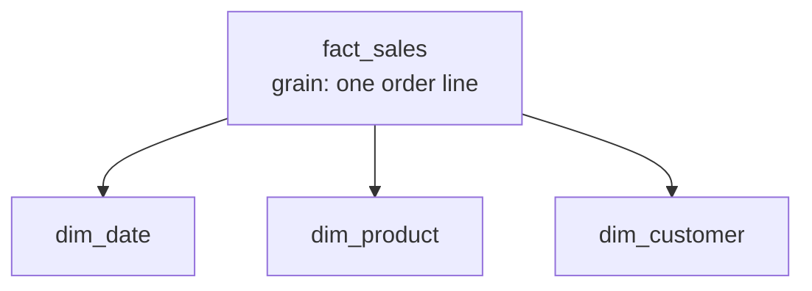

## 🎯 TL;DR

> **Dimensional modeling** (Kimball) organizes an analytical database around a business process: **facts** are the numbers you measure, **dimensions** are the context you slice them by (who, what, where, when).

Kimball's four steps, in order:

1. **Choose the business process** (for example, retail sales).
2. **Declare the grain**: exactly what one fact row represents (for example, one order line).
3. **Choose the dimensions** that describe each row (date, product, customer, store).
4. **Choose the facts** (quantity, sales amount, discount) that are true at that grain.

The result is a **star schema**: one fact table in the middle, dimension tables around it. Grain comes first; everything else follows from it.

## 🌱 Start simple (Junior)

> **💡 Analogy:** A pivot table in a spreadsheet. The numbers in the cells are the **facts**. The row and column labels (month, product, city) are the **dimensions**. Dimensions tell you how to slice; facts are what you slice.

Here is a small retail star schema. `dim_*` tables describe things, `fact_sales` records events:

```sql
CREATE TABLE dim_date (
  date_sk    int PRIMARY KEY,        -- 20260115, a readable surrogate key
  full_date  date NOT NULL,
  year       int,
  month      int,
  is_weekend boolean
);

CREATE TABLE dim_product (
  product_sk   int PRIMARY KEY,      -- surrogate key
  product_id   text NOT NULL,        -- business key from the source system
  product_name text,
  category     text,
  brand        text
);

CREATE TABLE dim_customer (
  customer_sk   int PRIMARY KEY,
  customer_id   text NOT NULL,
  customer_name text,
  city          text,
  segment       text
);

CREATE TABLE fact_sales (
  order_number    text NOT NULL,     -- degenerate dimension (no table needed)
  line_number     int  NOT NULL,
  date_sk         int REFERENCES dim_date (date_sk),
  product_sk      int REFERENCES dim_product (product_sk),
  customer_sk     int REFERENCES dim_customer (customer_sk),
  qty             int,
  sales_amount    numeric(12,2),
  discount_amount numeric(12,2),
  PRIMARY KEY (order_number, line_number)   -- the grain: one order line
);
```

Reading a business question becomes a simple join and group:

```sql
SELECT d.year, d.month, p.category, SUM(f.sales_amount) AS revenue
FROM fact_sales f
JOIN dim_date d    ON d.date_sk    = f.date_sk
JOIN dim_product p ON p.product_sk = f.product_sk
WHERE d.year = 2026
GROUP BY d.year, d.month, p.category;
```



## 🔧 How it really works (Mid)

**Facts** are measurements at the grain. Most are **additive**: you can sum them across every dimension. `qty` and `sales_amount` are additive. Other kinds exist:

- **Semi-additive:** sum across some dimensions, not others. An account balance can be summed across accounts for one day, but never across days. Use `AVG` or the last value over time.
- **Non-additive:** cannot be summed at all, such as a unit price or a percentage margin. Store the additive parts (`margin_amount`, `sales_amount`) and compute the ratio after aggregation: `SUM(margin) / SUM(sales)`.

**Dimensions** are wide, descriptive and mostly text or codes. They are usually denormalized on purpose: `dim_product` contains category and brand in one table instead of a chain of snowflake tables. Each dimension has a **surrogate key** (`product_sk`), a meaningless integer owned by the warehouse. The business key (`product_id`) stays as an attribute. See [[surrogate-key]].

Why surrogate keys:

- The source system can reuse, change or merge its IDs, and the warehouse stays stable.
- Integer joins on a compact key are cheap in the engine.
- It is the only way to keep history when a dimension attribute changes (Type 2 [[scd]] creates a new row with a new surrogate key).
- Unknown or late members can be represented by a special row (for example `product_sk = -1`, "unknown product") so that no fact row is lost in an inner join.

**Conformed dimensions** are dimensions with the same keys and the same meaning across several fact tables. If `fact_sales` and `fact_returns` both use one `dim_customer` and one `dim_date`, you can compare sales and returns by customer or by month ("drill across"). If each mart defined "customer" differently, the numbers could never be reconciled.

The **bus matrix** is the planning tool for this. Rows are business processes, columns are dimensions, and a mark shows which dimension applies to which process:

| Business process | date | product | customer | store |
|---|---|---|---|---|
| Sales | X | X | X | X |
| Returns | X | X | X | |
| Inventory snapshot | X | X | | X |

Columns that repeat across rows are the conformed dimensions you must design once.

## 🧠 Senior depth & trade-offs

- **Grain is the contract.** Mixing grains in one fact table breaks sums. A header-level `order_shipping_fee` repeated on every line item is double-counted by `SUM`. Either allocate it to lines or keep a separate header-grain fact.
- **Role-playing dimensions.** An order has an `order_date` and a `ship_date`. Model one `dim_date` and reference it twice (two foreign keys), or create views named `dim_order_date` and `dim_ship_date`. Do not copy the table.
- **Degenerate dimensions.** `order_number` lives in the fact table, with no separate table, because it carries no descriptive attributes.
- **Junk dimensions.** Low-cardinality flags (is_gift, payment_type, channel) can be combined into one small dimension instead of many tiny ones.
- **Late-arriving data.** A sale can arrive before its product exists in the dimension. Insert an inferred member, then update its attributes when the real record arrives.
- **Physical layout.** In Spark, Trino or ClickHouse, partition or cluster the fact table by date, and let small dimensions be broadcast to every executor instead of shuffled (see [[shuffle]]). Declared primary keys in many warehouses are informational only: the engine may not enforce them, so test the grain with a query.
- **Monitor the model.** Check for duplicate grain keys, fact rows whose surrogate key has no dimension row (orphans), and reconciliation of fact totals with the source system after every load.
- **When not to use it.** Dimensional models answer known business questions well. For many-to-many relations (a patient with several diagnoses) you need bridge tables, and for ad hoc, event-level exploration a wide event table or a data vault may fit better. Star and snowflake trade-offs are covered in `star-snowflake-obt`.

## 🧪 Try it

A subscription company wants to analyze monthly invoices.

1. Write the four Kimball steps for this business process.
2. List three dimensions and two facts, and classify each fact as additive, semi-additive or non-additive.
3. Write the `CREATE TABLE` for the fact table, with its primary key.

<details><summary>Show solution</summary>

1. Process: subscription invoicing. Grain: one row per invoice line per customer per billing month. Dimensions: `dim_date` (billing date), `dim_customer`, `dim_plan`. Facts: `amount` and `discount`.
2. `amount` and `discount` are additive. A possible semi-additive fact: `active_seats` (a count of seats, which you can sum across customers but not across months). A non-additive fact: `price_per_seat`.
3.
```sql
CREATE TABLE fact_invoice_line (
  invoice_number text NOT NULL,
  line_number    int  NOT NULL,
  billing_date_sk int,
  customer_sk    int,
  plan_sk        int,
  amount         numeric(12,2),
  discount       numeric(12,2),
  PRIMARY KEY (invoice_number, line_number)
);
```

</details>

## 💬 Interview corner

**Question: "Define the grain of an orders fact table."** Mid answer: "One row per order line item." Senior answer: "One row per order line item per order, as the atomic grain, so I can roll up to orders or customers later. Header attributes like shipping fee are either allocated to lines or stored in a separate header fact. I would verify the grain by checking that `(order_number, line_number)` is unique."

**Question: "Why surrogate keys instead of natural keys?"** Mid: "They are stable and smaller, and they support history." Senior: "The source can reuse or change its keys, and I can have several sources for one entity. A surrogate key decouples the warehouse from that, supports Type 2 history with a new row per version, and gives me a stable place to represent unknown members."

> **🎤 Say this in the interview:** "I start with the grain, then the dimensions, then the facts. Every fact has to be true at that grain, and every dimension has to conform across the marts that share it."

## ⚠️ Common mistakes

> **⚠️ Watch out:** Mixing two grains in one fact table, such as order lines and order headers. The totals look right for a while and then double-count.

> **⚠️ Watch out:** Summing a semi-additive measure (a balance or a headcount) across time. The result is a number that means nothing.

- Using the source system's natural key as the join key, then losing history when the source reuses an ID.
- Putting measures into dimension tables, or descriptive text into fact tables.
- Creating a separate dimension for every tiny flag, which makes the model hard to browse.
- Skipping the unknown member, so that fact rows silently disappear in inner joins.
- Defining "customer" differently in two marts, so drill-across reports cannot be reconciled.

## ✅ Check yourself (quiz)

1. Which of Kimball's four steps must come first?
   - A) Choose the dimensions
   - B) Choose the business process
   - C) Choose the facts
   - D) Build the indexes

<details><summary>Answer</summary>

**B** — the business process defines what is being measured. Then you declare the grain, the dimensions and the facts, in that order.

</details>

2. Which measure is **semi-additive**?
   - A) `qty` sold
   - B) `sales_amount`
   - C) Account balance
   - D) `discount_amount`

<details><summary>Answer</summary>

**C** — a balance can be summed across accounts for one day, but summing it across days is meaningless. Quantities and amounts are fully additive.

</details>

3. Why do dimensional models use surrogate keys instead of source business keys?
   - A) Surrogate keys are required by SQL
   - B) They decouple the warehouse from source ID changes and allow multiple row versions for history (Type 2)
   - C) Business keys cannot be stored as text
   - D) Surrogate keys remove the need for a grain

<details><summary>Answer</summary>

**B** — the warehouse owns the key, so source changes do not break history, and a new version of a customer gets a new surrogate key while the business key stays the same.

</details>

4. **(Senior)** The sales mart and the returns mart each have their own `customer` dimension, and the two disagree on customer counts. What is the fix?
   - A) Copy the sales dimension into the returns mart
   - B) Conform the dimension: one `dim_customer` with shared keys and definitions, used by both fact tables
   - C) Remove the customer dimension from the returns mart
   - D) Switch both marts to 3NF

<details><summary>Answer</summary>

**B** — conformed dimensions make drill-across possible. Copies drift apart over time, which is exactly the problem.

</details>

5. **(Senior)** An order has an `order_date` and a `ship_date`. A junior creates a second `dim_ship_date` table with the same data. Why is this a weak design, and what is the better one?

   - A) It is fine, because copies are faster to query
   - B) Use one `dim_date` referenced twice (role-playing): two foreign keys in the fact table, or views with different names; copies of the same dimension drift and complicate maintenance
   - C) Put both dates in the dimension instead of the fact
   - D) Remove the dates and use a text column

<details><summary>Answer</summary>

**B** — the date dimension describes the same calendar in both roles. One table keeps attributes such as fiscal month consistent, and the fact table gets two keys pointing to the same dimension.

</details>

## 🗂️ Flashcards

| Front | Back |
|---|---|
| Grain | The precise meaning of one fact row, declared before anything else |
| Fact table | Measurements at the grain, with foreign keys to dimensions |
| Dimension table | Wide, descriptive context for slicing facts (who, what, where, when) |
| Additive fact | Can be summed across all dimensions (for example `sales_amount`) |
| Semi-additive fact | Summable across some dimensions only (for example an account balance) |
| Surrogate key | A warehouse-owned integer key, independent of the source business key |
| Conformed dimension | The same dimension, with the same keys and meaning, shared across fact tables |
| Bus matrix | Table of business processes against dimensions, used to plan conformed dimensions |

## 🔗 Go further

- `fact-table-types`: transaction, periodic snapshot, accumulating snapshot and factless facts.
- `scd`: how dimension attributes change over time (Types 1, 2 and 3).
- `advanced-dimensions`: bridge tables, junk dimensions and other special cases.
- `star-snowflake-obt`: when to keep dimensions normalized, and when to flatten them.
- `normalization`: the normalized design that dimensional modeling deliberately relaxes.
