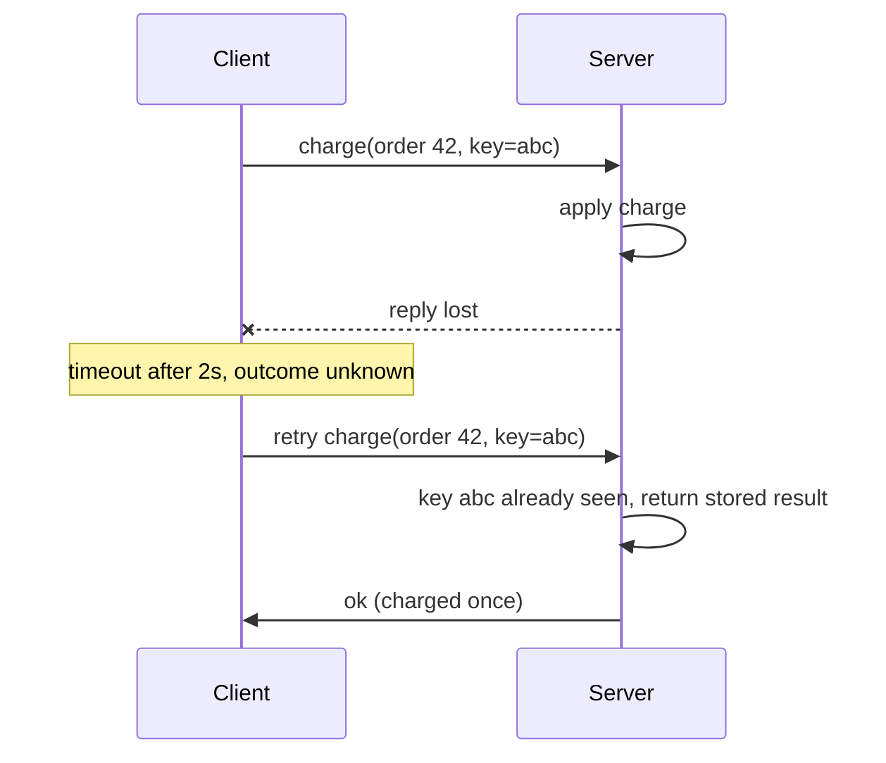

## 🎯 TL;DR

> A distributed system is several machines cooperating over a network. The hard part is not the machines. It is that **one part can fail while the rest keeps running**, and the other parts often cannot tell which thing happened.

- A network request can fail, arrive late, or succeed while the reply is lost. A timeout means "no answer yet", not "it failed".
- Clocks on different machines disagree. Do not order events by wall-clock time without care.
- A process can freeze for seconds (garbage collection, a VM stall) and still believe it is the leader.
- The core tools are timeouts, heartbeats, fencing tokens and idempotency.

## 🌱 Start simple (Junior)

> **💡 Analogy:** You text a friend "can you send the file?" and get no reply. Did the message never arrive, is the friend busy, or did they send the file and the reply got lost? Silence does not tell you which. Every distributed system lives with this problem.

On one laptop, a function call either returns or throws an error. Across machines, a call is a message that travels a network. The message can be lost, it can arrive late, or the server can process it and the answer can be lost. From the caller's side, all three look the same: **no reply before the timeout.**

A small example: a checkout service calls a payment API with a 2-second timeout. After 2 seconds it has no answer. If it retries, the customer may be charged twice. If it does nothing, the order may never be paid. The safe answer needs an idempotency key, which we cover below.

The classic list of **fallacies of distributed computing** (from Peter Deutsch and colleagues) is a list of things engineers wrongly assume: the network is reliable, latency is zero, bandwidth is infinite, the network is secure, the topology does not change, there is one administrator, transport has no cost, and the network is homogeneous. Each one is false in production, and each has caused an outage.

## 🔧 How it really works (Mid)

**1. Timeouts create ambiguity.** The sequence below is the most common source of duplicate writes.



**2. Failure detection is a guess.** A node cannot know whether another node is dead or just slow. Most systems use **heartbeats**: each node sends "I am alive" every few hundred milliseconds, and a peer is declared dead after a **timeout** without one. The timeout is a trade-off. Too short, and a healthy but busy node is declared dead (a false positive). Too long, and recovery is slow.

Kafka consumers use this model. A consumer that stops sending heartbeats within its session timeout is removed from its consumer group, and its partitions are reassigned.

**3. Pauses break your assumptions.** A process can stop for seconds because of a long garbage collection, a VM migration or a swap. When it wakes up, it does not know that time passed. It may still believe it holds a lock or a lease that has already been given to someone else.

A **fencing token** solves this. The lock service gives every lease a number that only grows. The storage keeps the highest number it has seen and rejects anything older.

```python
class FencedStore:
    def __init__(self):
        self.max_token = 0
        self.data = {}

    def write(self, token, key, value):
        if token < self.max_token:
            raise PermissionError(f"stale token {token} < {self.max_token}")
        self.max_token = token
        self.data[key] = value

store = FencedStore()
store.write(33, "owner", "A")
store.write(34, "owner", "B")          # B took over the lease
try:
    store.write(33, "owner", "A-late") # A wakes up after a long pause
except PermissionError as e:
    print("rejected:", e)
print(store.data)                      # {'owner': 'B'}
```

The check must live in the **resource** (the storage), not only in the lock service. A lock service cannot stop a paused client from writing.

**4. Clocks lie a little.** Machines sync their clocks with NTP, but the offsets between them can be milliseconds or more, and wall-clock time can even jump backwards. Use monotonic clocks to measure durations on one machine. Never use them as a global order without understanding the error.

Consider last-write-wins (LWW) by timestamp:

| Event | Real time | Clock on that machine | Stamp | Value |
|---|---|---|---|---|
| Client A writes first | 10:00:00 | 3 s fast | 10:00:03 | v1 |
| Client B writes later | 10:00:01 | accurate | 10:00:01 | v2 |

LWW keeps `v1`, even though `v2` happened later in real time. The skewed clock decided the winner.

**5. Idempotency** is the main defence. An operation is idempotent if running it twice has the same effect as running it once. You get it with a unique key stored in the same transaction as the effect. See [[idempotency]].

## 🧠 Senior depth & trade-offs

- **System models.** A *synchronous* model has bounded delays and pauses. A *partially synchronous* model has bounds that exist but are unknown, which is the realistic model for data platforms. An *asynchronous* model makes no timing assumptions at all. Consensus algorithms are designed to stay **safe** (never disagree) always, and to be **live** (make progress) only while the network behaves.
- **Failure models.** *Crash-stop*: a node halts for good. *Crash-recovery*: a node restarts and loses its memory. *Byzantine*: a node may lie. Kafka, Spark and most databases assume crash-recovery with honest nodes. Byzantine tolerance matters mainly in blockchains and multi-party systems.
- **Partial failure drives design.** Once you accept that the outcome may be unknown, you need three things: retries, idempotency, and a **reconciliation** job that compares source and target (row counts, sums, key sets) and repairs drift.
- **Spark in practice.** When an executor is lost, its tasks are retried elsewhere. A slow "zombie" attempt can still finish. Spark's commit protocol writes task output to temporary locations and promotes only the committed attempt, which is the same fencing idea applied to files. Check the committer behaviour for your version and storage.
- **What to monitor.** Heartbeat lag, rebalance counts, timeout and retry rates, clock offset on each host, and reconciliation mismatches.
- **When not to distribute.** One well-tuned PostgreSQL node often beats a cluster for a given workload. Distribution buys scale and fault tolerance, and charges you with new failure modes. Measure first.

## 🧪 Try it

1. A payment client has a 2-second timeout and retries on timeout. Write the retry wrapper so that every retry carries the same idempotency key. Explain in one sentence why generating a new key per retry breaks the guarantee.
2. Heartbeats are sent every 1 s and the timeout is 3 s. A node freezes for 4 s and then resumes. Describe what the rest of the cluster sees, and what the node does when it wakes up.
3. In the LWW table above, suppose Client A's clock is accurate (stamp 10:00:00) and Client B's clock is 5 seconds slow (stamp 09:59:56). Which value survives?

<details><summary>Show solutions</summary>

**1.**
```python
import uuid

def charge_with_retry(api, order_id, amount, attempts=3):
    key = str(uuid.uuid4())          # created ONCE, outside the loop
    for _ in range(attempts):
        try:
            return api.charge(order_id, amount, idempotency_key=key, timeout=2)
        except TimeoutError:
            continue                 # same key: the server can recognise the retry
    raise RuntimeError("outcome unknown, reconcile later")
```
A new key per retry makes the server treat each retry as a new charge, so the customer can be charged several times.

**2.** After 3 s without a heartbeat, the others declare the node dead and reassign its work. When the node wakes at 4 s, it still believes it owns that work. Without fencing, it can write stale results or duplicate output. The fix is a fencing token checked by the resource.

**3.** `v1` survives. Its stamp 10:00:00 is larger than B's stamp 09:59:56, so LWW keeps A's value even though B wrote later in real time. A slow clock makes a write lose.

</details>

## 💬 Interview corner

**Question: "Why can't we just retry failed calls?"** Mid answer: "Retries can duplicate side effects, so I'd add an idempotency key." Senior answer: "The problem is ambiguity. A timeout does not tell me whether the effect happened. So the retry must carry the same idempotency key, the key must be stored atomically with the effect, and I'd run a reconciliation job for cases where the key expired."

**Question: "How do you detect a dead node?"** Mid: "Heartbeats plus a timeout." Senior: "I cannot tell dead from slow. I pick the timeout from observed latency distributions, and I protect the shared resource with fencing tokens, so a node that was wrongly declared dead cannot corrupt state when it wakes up."

> **🎤 Say this in the interview:** "A timeout means unknown, not failed. I design every side effect to be idempotent, I use fencing tokens for leases, and I never order events by machine clocks alone."

## ⚠️ Common mistakes

> **⚠️ Watch out:** A timeout means "unknown". Treating it as "failed" leads to duplicates, and treating it as "succeeded" leads to lost work.

- Ordering events by the wall-clock time of different machines.
- Assuming a lock or lease guarantees exclusive access without a fencing check at the resource.
- Setting a very short heartbeat timeout, which creates false deaths and rebalance storms.
- Retrying non-idempotent writes, or generating a new idempotency key per attempt.
- Forgetting that messages can arrive twice and out of order.

## ✅ Check yourself (quiz)

1. A request times out after 2 seconds. What can you conclude?
   - A) The server did not process it
   - B) The server crashed
   - C) Nothing certain: it may have been lost, delayed, or processed with the reply lost
   - D) The request will never succeed

<details><summary>Answer</summary>

**C** — a timeout only tells you that no reply arrived in time. The outcome is unknown, which is why retries need idempotency.

</details>

2. Client A holds a distributed lock, freezes for 40 seconds, and its lease expires. Client B takes the lock. What protects the data?
   - A) A longer lease
   - B) A fencing token checked by the storage
   - C) Running both clients on the same machine
   - D) Tighter NTP synchronisation

<details><summary>Answer</summary>

**B** — a longer lease only makes the problem rarer. The storage must reject writes with an old token, so a paused client cannot overwrite newer data.

</details>

3. **(Senior)** Heartbeats are sent every 1 s, the timeout is 3 s, and a node pauses for 4 s. Which statement is most accurate?
   - A) The cluster sees the node as alive, because 1 s is less than 3 s
   - B) The cluster may declare the node dead and reassign its work while the node still believes it owns that work, so fencing is needed
   - C) The node crashes and loses its data
   - D) Nothing happens, because other nodes cannot see GC pauses

<details><summary>Answer</summary>

**B** — a 4 s pause exceeds the 3 s timeout, so the node is declared dead. When it wakes up, it may act on stale ownership. Fencing tokens prevent the damage.

</details>

4. Why is last-write-wins by wall-clock timestamp risky?
   - A) Timestamps are too large to store
   - B) Clock skew between machines can make an earlier write win
   - C) LWW cannot handle more than two writes
   - D) Wall-clock time always moves forward

<details><summary>Answer</summary>

**B** — a machine with a fast clock can stamp an older write with a larger timestamp, so it beats a newer write from a correct clock.

</details>

5. **(Senior)** Which failure model do Kafka, Spark and most databases assume?
   - A) Byzantine: nodes may lie
   - B) Crash-recovery: nodes may stop and restart with lost memory, but they do not lie
   - C) No failures at all; only the network is unreliable
   - D) Only the network fails, never the nodes

<details><summary>Answer</summary>

**B** — these systems tolerate crashes and restarts, and assume nodes follow the protocol. Byzantine tolerance costs much more and is rarely needed inside a data platform.

</details>

## 🗂️ Flashcards

| Front | Back |
|---|---|
| What does a timeout tell you? | Only that no reply arrived in time; the outcome is unknown |
| Why do heartbeats need a timeout? | A dead node and a slow node look the same; the timeout is a trade-off |
| What is a fencing token? | A number that only grows; the resource rejects writes with an older one |
| Why does a paused node cause trouble? | It may still believe it holds a lease that was already reassigned |
| Why is wall-clock LWW risky? | Clock skew can let an older write win |
| Which failure model do data platforms assume? | Crash-recovery with honest nodes, not Byzantine |
| What makes retries safe? | Idempotency: the same key stored atomically with the effect |

## 🔗 Go further

- **consensus** explains how nodes agree on a leader and on values, with safety and liveness under partial synchrony.
- **replication** covers how copies of data stay in step, and where stale reads come from.
- **fault-tolerance** puts retries, checkpoints and recovery together for pipelines.
- **time-and-ordering** goes deeper into clocks, event time and why ordering is hard.
- **cap-pacelc** applies these ideas to the choice between consistency and availability.
- Read the first chapters of *Designing Data-Intensive Applications* (Kleppmann) on unreliable networks and unreliable clocks. It is the primary source for this topic.
