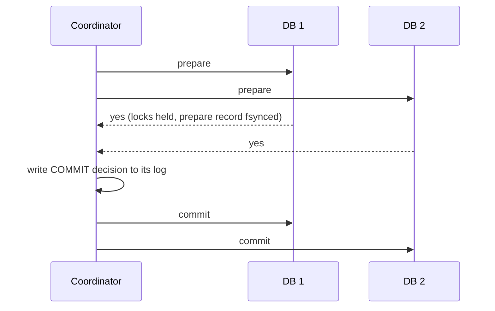

## 🎯 TL;DR

> A **distributed transaction** changes data in more than one system and must end either fully applied or fully not applied. You can pay for that with a blocking protocol (**two-phase commit**, 2PC), or design a sequence of local steps with undo actions (a **saga**). The **transactional outbox** solves the most common version of the problem: updating a database and publishing an event atomically.

- **2PC** gives atomicity across databases, but a coordinator crash can leave participants **blocked** while holding locks.
- A **saga** replaces one atomic commit with local commits plus **compensating actions**. It is eventually consistent, and the middle states are visible.
- **Dual writes** (write the database, then publish to Kafka) can silently lose or reorder events. Never do them without a safety net.
- The **outbox** writes the event in the same local transaction as the business change. A relay publishes it later, so delivery is **at least once**, and consumers must be idempotent (the **inbox** pattern).

## 🌱 Start simple (Junior)

> **💡 Analogy:** Buying a house involves a bank, a notary and the seller. Either all three sign and the deal closes, or nothing happens. A **saga** is different: you rent a van, book a hotel and buy tickets for a trip. If the flight is cancelled, you do not un-happen the van rental; you cancel the hotel and the van, and maybe pay a fee. The first is atomic; the second is a sequence with undo steps.

Imagine a transfer of 100 from account `A` (in database 1) to account `B` (in database 2). A single database would wrap both updates in one transaction. Two databases cannot do that by themselves.

```text
Step 1: debit A by 100     (database 1)
Step 2: credit B by 100    (database 2)

If the process crashes after step 1 and before step 2:
  money left A and never reached B
```

Two families of answers exist. Either all parties agree before anyone applies the change (2PC), or each step is applied locally and a reverse action exists for each step (saga). The rest of this lesson is about the trade-offs between them.

## 🔧 How it really works (Mid)

### Two-phase commit (2PC)

A **coordinator** asks each **participant** to do its part and then decides the outcome.



1. **Prepare.** Each participant makes the transaction durable and locks what it touched, then votes yes or no. A yes is a promise: the participant can no longer decide alone.
2. **Commit.** If all voted yes, the coordinator writes the decision to its own durable log and tells everyone to commit. Otherwise it tells everyone to abort.

The weak spot is the window after a yes vote and before the decision arrives. If the coordinator crashes there, a participant is **in doubt**: it cannot commit or abort without the coordinator, and it keeps its locks. Other transactions that touch those rows wait. Recovery requires the coordinator to come back, or a manual heuristic decision. This is why 2PC is called **blocking**.

Java and relational stacks expose this as **XA** transactions. Many teams avoid XA across services because of the blocking behaviour and the operational cost of in-doubt transactions.

### Saga

A saga is a sequence of local transactions `T1 ... Tn`. Each one commits on its own. For each step that can be undone, there is a compensation `Ci` that semantically reverses it: a refund for a charge, a release for a reservation.

- If `Tk` fails, run the compensations `Ck-1 ... C1` in reverse order.
- A **pivot** step is the point of no return: steps after it must be retriable, and steps before it must be compensable.
- Steps that cannot be undone (sending an email, calling a tax authority) go last.

Sagas come in two styles. In **choreography**, each service reacts to events from the previous one, with no central controller. In **orchestration**, a workflow engine (for example Temporal or a state machine) calls each step and tracks progress. Orchestration is easier to observe and debug, and choreography has fewer moving parts but a harder-to-see flow.

Sagas have **no isolation**. Between `T1` and `Tn`, other transactions can read the intermediate state. A reader can see money debited but not credited yet. Countermeasures include semantic locks (mark the record as "pending"), commutative updates (add and subtract rather than set), and reading again before acting.

### The dual-write problem

A common service does this:

```text
1. UPDATE orders SET status='PAID' WHERE id=42;   -- commit to PostgreSQL
2. producer.send('order-events', {id: 42, status: 'PAID'});   -- publish to Kafka
```

If step 2 fails after step 1 commits, the state changed and nobody was told. If the publish succeeds but the commit fails, consumers act on an order that does not exist. Retrying the whole function can publish twice. Reversing the order is no better. There is no single atomic operation across the database and Kafka.

### The transactional outbox

The fix is to make the event part of the database transaction:

```sql
BEGIN;
UPDATE orders SET status = 'PAID' WHERE id = 42;
INSERT INTO outbox (id, aggregate_type, aggregate_id, event_type, payload)
VALUES (gen_random_uuid(), 'order', '42', 'OrderPaid', '{"status":"PAID"}');
COMMIT;
```

Both rows commit together or not at all. A separate **relay** then reads new outbox rows and publishes them:

- A **polling publisher** queries `outbox` for unsent rows, publishes them, and marks them sent. Simple, but adds load and latency.
- **CDC** (change data capture, see [[cdc]]) reads the database log. **Debezium** can capture the outbox table and route each row to a topic by `aggregate_type`, using its outbox event router.

Delivery is **at least once**: the relay can publish, crash before marking, and publish again. So every consumer must be idempotent. The **inbox** pattern does this: the consumer stores the processed message id in the same local transaction as its own effect, and skips duplicates. See [[idempotency]] and [[dedup-idempotent-loads]].

## 🧠 Senior depth & trade-offs

- **Pick by invariant, not by fashion.** If two systems must never disagree on money and you control both, a database transaction, or 2PC with a highly available coordinator, may be justified. If the systems are independent services, sagas with compensations plus an outbox are the usual answer.
- **2PC cost.** Two round trips plus a durable write per participant. Locks are held across the network, so a slow participant slows every conflicting transaction. In-doubt transactions need monitoring and a clear operator procedure.
- **Flink and checkpoints.** Flink's exactly-once sinks use a two-phase commit protocol that is aligned with its checkpoints: the sink pre-commits during the checkpoint and commits when the checkpoint completes. The sink must support it (for example transactional Kafka producers or table formats). Check the connector documentation for your version.
- **Kafka transactions.** Kafka's transactional producer gives atomic writes to several partitions and exactly-once read-process-write inside Kafka (see [[kafka-exactly-once]]). It does not make an external database write atomic with Kafka. That still needs an outbox or an idempotent sink.
- **Lakehouse commits.** Iceberg and Delta commit one table atomically through a catalog or log swap. A change across several tables is not atomic unless your tool provides a multi-table commit. Design the pipeline so each table is idempotent on rerun.
- **Outbox operations.** Index the outbox by sequence, delete or archive published rows (a table that grows without cleanup slows the relay), and order events per aggregate by using the aggregate id as the Kafka key.
- **What to monitor.** Outbox lag (age of the oldest unsent row), saga instances stuck in an intermediate state, compensation failures, in-doubt XA transactions, and consumer duplicate-skip rates.
- **Failure modes to design for.** Compensations that fail, duplicate events, out-of-order events from different producers, and sagas that never finish. Give each saga a timeout and a dead-letter path ([[dead-letter-queue]]).

## 🧪 Try it

1. A payment service debits a wallet, then sends `PaymentCaptured` to Kafka. Describe two failure scenarios that cause inconsistency, and rewrite the flow with an outbox.
2. Design the saga for "book flight, book hotel, charge card". Which step is the pivot? Which compensations are needed if the charge is declined after the flight is booked?
3. Your outbox relay publishes each event at least once. A consumer receives `OrderPaid` for order 42 twice. Describe the inbox table and the check that makes the second delivery harmless.

<details><summary>Show solutions</summary>

**1.** Scenario one: the debit commits, then the process crashes before publishing, so the event is never sent. Scenario two: the publish succeeds, then the debit transaction fails, so consumers see a payment that did not happen. The outbox fix writes the debit and an `outbox` row in one local transaction. A relay publishes the row later, so the event exists if and only if the debit committed.

**2.** Order: book flight (compensation: cancel flight), book hotel (compensation: cancel hotel), charge card. The charge is the pivot, because it is the step that decides whether the trip is paid. If the charge is declined, run the compensations in reverse: cancel the hotel, then cancel the flight. Steps after the pivot, such as sending the confirmation email, must be retriable and placed last.

**3.** The consumer keeps a table `inbox(message_id primary key, processed_at)`. In one local transaction it inserts `message_id` and applies the effect (for example setting order 42 to paid). On the second delivery the insert hits the primary key, the transaction rolls back or is skipped, and the effect is not repeated. The message id must be stable across retries (set it at outbox insert time, not at publish time).

</details>

## 💬 Interview corner

**Question: "How do you update a database and publish an event without losing or duplicating it?"**

- Mid: "I would not do a dual write. I'd use a transactional outbox: insert the event into an outbox table in the same transaction as the change, then publish from the outbox with a relay or CDC. Consumers deduplicate."
- Senior: "The outbox gives at-least-once delivery per aggregate, so I'd key Kafka messages by aggregate id to keep per-entity order, and make consumers idempotent with an inbox or a unique key. I'd monitor the age of the oldest unsent outbox row, because that is the user-visible lag. I would not use 2PC between Kafka and the database; the blocking and operational cost are not worth it for this case."

**Question: "Why not 2PC across microservices?"** Locks are held across network calls, a coordinator crash leaves participants in doubt, and most modern services and message brokers do not offer XA. Sagas trade isolation for availability and independence.

> **🎤 Say this in the interview:** "I separate atomicity from coordination. Inside one database, I use a local transaction. Across services, I use an outbox to make the event atomic with the state change, and a saga with compensations for multi-step business flows. Consumers are idempotent."

## ⚠️ Common mistakes

> **⚠️ Watch out:** "Publish to Kafka first, then commit the database, so we are safe." If the commit fails, consumers already acted on a change that never happened.

> **⚠️ Watch out:** "Exactly-once in Kafka means no duplicates end to end." Kafka's guarantees stop at Kafka's boundary. External side effects still need an idempotent design.

- Treating a saga as an atomic transaction, and forgetting that intermediate states are visible.
- Writing compensations that are not idempotent, so a retry refunds twice.
- Using a random UUID for the outbox id at publish time. The id must be fixed at write time so retries deduplicate.
- Leaving the outbox table to grow forever, which slows the relay and the database.
- Forgetting that a 2PC participant in doubt holds its locks until the coordinator recovers.

## ✅ Check yourself (quiz)

1. In two-phase commit, what is the main reason a participant can block?
   - A) It must wait for the network to drain
   - B) After voting yes, it cannot decide the outcome alone and must wait for the coordinator
   - C) It has to replicate the log to three regions
   - D) The coordinator must sort the locks

<details><summary>Answer</summary>

**B** — a yes vote is a promise. The participant holds its locks until the coordinator tells it to commit or abort. If the coordinator is down, the participant is in doubt.

</details>

2. Which pattern lets you publish an event without a dual write?
   - A) Two-phase commit between the database and Kafka
   - B) A transactional outbox table written in the same local transaction as the business change
   - C) Retrying the producer until it succeeds
   - D) Disabling acknowledgements on the producer

<details><summary>Answer</summary>

**B** — the event row commits or rolls back with the state change. A relay publishes it afterwards. Retries alone do not remove the gap between two separate writes.

</details>

3. A saga charges a card at step 3 of 4 and the charge is declined. Steps 1 and 2 committed. What should happen?
   - A) Nothing; the saga is atomic
   - B) Run the compensations for step 2 and then step 1, in reverse order
   - C) Retry the charge forever
   - D) Roll back the database that holds step 1

<details><summary>Answer</summary>

**B** — a saga is undone by compensating actions in reverse order. Each completed step is reversed by its own compensation, so the business state returns to a consistent end state.

</details>

4. **(Senior)** A consumer of outbox events is idempotent by checking `processed_at` in a separate table, outside its main transaction. Why is this unsafe, and what should it do?
   - A) Separate tables cannot be queried
   - B) The check and the effect can commit independently, so a crash between them can lose or duplicate the effect; record the message id in the same transaction as the effect
   - C) Idempotency is not needed for consumers in Kafka
   - D) processed_at must be stored in Kafka, not in the database

<details><summary>Answer</summary>

**B** — idempotency needs the marker and the effect to be atomic. If they are in different transactions, a crash in between either repeats the effect or skips it. Same-transaction inbox writes close the gap.

</details>

5. **(Senior)** Why does an orchestrated saga usually give better operability than a choreographed one, and what does it cost?
   - A) It needs no compensations
   - B) One place holds the workflow state and timeouts, so stuck sagas are visible; the cost is a central component that must be highly available and a coupling of the orchestrator to every step
   - C) It removes the need for idempotency
   - D) It is always faster

<details><summary>Answer</summary>

**B** — with a central orchestrator, progress and retries live in one state store, so stuck instances are easy to find. The price is an extra component to run and operate, and the orchestrator knows about all steps.

</details>

## 🗂️ Flashcards

| Front | Back |
|---|---|
| What is 2PC? | Prepare (vote and lock) then commit or abort decided by a coordinator |
| Why is 2PC blocking? | A participant that voted yes waits for the coordinator and holds locks |
| What is a saga? | A sequence of local transactions, each undone by a compensating action on failure |
| Saga isolation | None by default; intermediate states are visible to other transactions |
| Dual-write problem | Writing a database and a broker separately can lose, duplicate or reorder events |
| Transactional outbox | Event row written in the same local transaction; a relay publishes it later |
| Delivery guarantee of an outbox relay | At least once; consumers must be idempotent |
| Inbox pattern | Record processed message ids in the same transaction as the effect |

## 🔗 Go further

- **[[consistency-models]]** explains the isolation and visibility trade-offs that sagas give up.
- **[[consensus]]** shows how a highly available coordinator is built.
- **[[delivery-semantics]]** and **[[kafka-exactly-once]]** explain what the broker does and does not guarantee.
- **[[cdc]]** and **[[dedup-idempotent-loads]]** cover the relay and the duplicate-safe load patterns.
- The **outbox-pattern** and **saga** glossary entries give short definitions for quick review.
