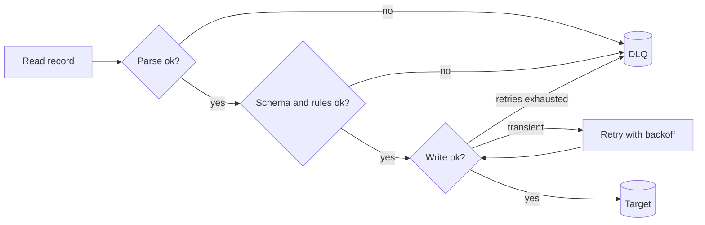

## 🎯 TL;DR

> When a record cannot be processed, you have three choices: **halt** the pipeline, **drop** the record silently, or **divert** it to a **dead letter queue (DLQ)** / quarantine table with the reason attached. The DLQ option keeps the pipeline moving and keeps the evidence.

- Classify the failure first. A **transient** error (timeout, throttling) should be retried. A **record-level** error (bad value, broken JSON) goes to the DLQ. A **systemic** error (wrong schema for the whole file, sink down) should halt the pipeline.
- A DLQ entry needs the **raw payload**, the **error reason**, the **source position** (topic, partition, offset, or file and line) and a **status** so someone can fix and replay it.
- Never drop bad records silently. A pipeline that "passes" with 5% of rows missing is worse than one that stops.
- Reprocessing a DLQ is a normal pipeline run. It must be idempotent, or the replay creates duplicates.

## 🌱 Start simple (Junior)

> **💡 Analogy:** A post office. A letter with a wrong address does not stop the whole mail truck, and it is not thrown in the river either. It goes into the "undeliverable" bin with a note saying why. Someone checks the bin each day, fixes the address if possible, and sends it again.

Imagine a pipeline that reads order events and writes them to a table. One event is `{"order_id": "o2", "amount": -5}`. A negative amount is wrong, so the pipeline has to decide what to do:

| Choice | What happens | Good when |
|---|---|---|
| Halt | The job fails; nothing after this event is loaded | The error means the code or config is broken |
| Drop | The event disappears; the job reports success | Almost never; it hides data loss |
| Divert (DLQ) | The event is stored with the reason; the job continues | Only a few records are bad and the rest are fine |

The rule of thumb: halt on problems that affect **every** record, divert problems that affect **one** record, and retry problems that might go away on their own.

## 🔧 How it really works (Mid)

A typical record path has layers, and each layer can produce a dead letter:



**The DLQ table.** Keep it generic so every pipeline can use it:

```sql
CREATE TABLE ops.dead_letters (
  dl_id       BIGINT       NOT NULL,
  pipeline    VARCHAR(100) NOT NULL,
  source_ref  VARCHAR(255),              -- e.g. topic:partition:offset, or file:line
  batch_id    VARCHAR(64),
  error_code  VARCHAR(50)  NOT NULL,     -- e.g. PARSE_ERROR, NEGATIVE_AMOUNT
  error_msg   VARCHAR(2000),
  payload     TEXT,                      -- the raw record exactly as received
  failed_at   TIMESTAMP    NOT NULL,
  status      VARCHAR(20)  NOT NULL DEFAULT 'open',  -- open / fixed / discarded
  attempts    INT          NOT NULL DEFAULT 0
);

-- Reprocessing: pick the open rows for one error class after the fix is deployed
SELECT dl_id, payload
FROM ops.dead_letters
WHERE pipeline = 'orders' AND status = 'open' AND error_code = 'NEGATIVE_AMOUNT';
```

The `payload` column stores the record as it arrived, not as your parser understood it. If the parser had a bug, the raw payload is the only way to replay it correctly.

**A worked example.** This loop keeps good records and diverts bad ones:

```python
import json
from datetime import datetime, timezone

def parse_order(raw: str) -> dict:
    rec = json.loads(raw)                 # JSONDecodeError on broken JSON
    if rec["amount"] < 0:                 # ValueError on a business-rule failure
        raise ValueError("negative amount")
    return {"order_id": rec["order_id"], "amount": rec["amount"]}  # KeyError if missing

def run(batch: list[str]):
    good, dead_letters = [], []
    for offset, raw in enumerate(batch):
        try:
            good.append(parse_order(raw))
        except (json.JSONDecodeError, KeyError, ValueError) as exc:
            dead_letters.append({
                "payload": raw,
                "error": f"{type(exc).__name__}: {exc}",
                "offset": offset,
                "failed_at": datetime.now(timezone.utc).isoformat(),
            })
    return good, dead_letters

batch = [
    '{"order_id": "o1", "amount": 120}',
    'not-json',
    '{"order_id": "o2", "amount": -5}',
    '{"amount": 7}',
]
good, dlq = run(batch)
print(len(good), "good,", len(dlq), "dead letters")  # 1 good, 3 dead letters
```

Notice what the code does **not** do: it does not retry a `ValueError`, because retrying a bad value gives the same bad value. Retries are for errors that can change between attempts, such as a network timeout. See [[retry]].

**Engines and tools.** Most stacks have a built-in version of this idea:

- **Kafka**: a DLQ is a separate topic. The consumer publishes the failed message plus headers (error, source offset) and commits the original offset. Kafka Connect has error-tolerance settings and a DLQ topic option for sink and source connectors; check the docs for your version.
- **Flink**: a side output (an `OutputTag`) collects bad records from an operator while the main stream continues.
- **Spark file readers**: CSV and JSON readers have modes. `PERMISSIVE` keeps malformed rows with nulls, and `columnNameOfCorruptRecord` stores the raw text. `DROPMALFORMED` silently drops them, which is the mode to avoid in production. `FAILFAST` halts.
- **Warehouses and loaders**: many load tools have a "max bad rows" threshold. Below it the load succeeds and the rejects are logged; above it the load fails.

**Thresholds.** A pipeline can tolerate some bad records. Set an explicit budget, for example "halt if more than 0.1% of a batch is rejected, or if rejects exceed 1,000 rows". A budget turns a silent data quality problem into an alert. Check the budget on the batch total, not per record.

## 🧠 Senior depth & trade-offs

- **Poison pills.** A message that always crashes the consumer will be retried forever if you do not divert it. Count attempts per record, and move it to the DLQ after N tries. Otherwise the whole partition stalls behind one record.
- **Ordering breaks.** If `o2` is diverted and `o2` later updates arrive and succeed, the table state is wrong when `o2` is replayed. Reprocessing must use the same merge rules (for example "latest `updated_at` wins") and never a blind insert. Decide whether a DLQ record for a key blocks newer records for that key.
- **Replay must be idempotent.** A replayed batch may partially overlap what already loaded. Use keyed upserts or a `MERGE`, not plain `INSERT`. See [[idempotency]] and [[dedup-idempotent-loads]].
- **The DLQ holds sensitive data.** Raw payloads contain PII and sometimes secrets. Apply the same access controls, masking and retention rules as the source. A DLQ with customer phone numbers in an open dashboard is a leak.
- **Binary and large payloads.** Storing a 50 MB file in a text column is a bad idea. Store a pointer (object storage path plus checksum) and the error, not the bytes.
- **Failure-mode alerts.** Alert on the **rate of growth** of the DLQ, not only its size. A sudden rise of `PARSE_ERROR` after a producer deploy is the signal you need. Track the oldest `open` row as a freshness metric.
- **When NOT to use a DLQ.** If the consumer must be strictly ordered and every record must be applied in order (for example a ledger balance), a DLQ can break correctness. Halt, fix, and resume instead, and accept the downtime.
- **Monitor.** Per-pipeline DLQ rate, open count, oldest open age, reprocess success rate, and the number of records that failed again after a fix.

## 🧪 Try it

Your `orders` pipeline receives 200,000 records a day. On a bad day, 4,000 fail with `PARSE_ERROR` because a producer changed a date format.

1. Should the pipeline halt, or divert these 4,000 records? Justify with the threshold idea above.
2. Write the reprocess plan after the producer is fixed: what you select, how you reload, and how you mark rows as `fixed`.

<details><summary>Model answer</summary>

1. It depends on the budget. 4,000 of 200,000 is 2%. If your budget is 0.1%, halt and page someone, because a broken producer may affect every new record. If the budget allows 2% and the rest of the batch is clean, divert the 4,000 with `error_code = 'PARSE_ERROR'`, alert on the rate, and keep loading. Either way the failure is visible.
2. Select `open` rows with that error code and pipeline, parse them with the fixed parser from the raw `payload`, and load them through the same idempotent `MERGE` as the main path. Update each row to `fixed` only after its load succeeds, and record `attempts`. Rows that fail again stay `open` with a new error.

</details>

## 💬 Interview corner

**Question:** "What do you do with bad records in a streaming or batch pipeline?"

> **🎤 Say this in the interview:** "I classify the failure first. Transient errors get retried with backoff. Record-level errors go to a DLQ with the raw payload, the error code and the source position, and the pipeline keeps running. Systemic errors halt the job, because they affect every record. I set an explicit reject budget so a silent problem becomes an alert, and I make replay idempotent so fixing the DLQ does not create duplicates."

A mid answer names the DLQ and the raw payload. A senior answer adds poison pills, ordering effects on replay, PII in the DLQ, and the reject budget.

## ⚠️ Common mistakes

- **Dropping bad rows silently.** The job succeeds, the totals are wrong, and nobody knows. Always count and log rejects.
- **Retrying permanent errors.** A bad value fails the same way every time. Retry only errors that can change.
- **Storing only the error, not the payload.** Without the raw record you cannot fix the parser and replay.
- **Replaying with plain INSERT.** The replay duplicates rows that already loaded.
- **One DLQ with no owner.** Entries pile up for months. Give the DLQ an owner, an SLA and a dashboard.
- **Ignoring order.** A replayed record can overwrite a newer state if the merge rule is not respected.

## ✅ Check yourself (quiz)

1. A consumer gets a message whose JSON is broken. Which action fits best?
   - A) Retry forever with exponential backoff
   - B) Divert it to the DLQ with the parse error and continue
   - C) Halt the whole pipeline
   - D) Drop it silently to keep the metrics clean

<details><summary>Answer</summary>

**B** — broken JSON is a record-level, permanent error. Retrying gives the same result, halting blocks every other record, and dropping hides the loss. Divert it with the raw payload and the error.

</details>

2. Which failure should halt the pipeline instead of going to the DLQ?
   - A) One record with a negative amount
   - B) A single timeout to the sink
   - C) The producer started sending a new schema for every record, and the sink rejects all of them
   - D) One record with an unknown currency code

<details><summary>Answer</summary>

**C** — a systemic error affects every record, so diverting each one fills the DLQ with the whole stream. Halt, fix the schema contract, and replay. A and D are record-level; B is transient and should be retried first.

</details>

3. A DLQ replay loads 800 records that were diverted two days ago. Some of their keys were updated successfully after the failure. What must the replay use?
   - A) A plain `INSERT`, because the records are new
   - B) A keyed `MERGE` or upsert that respects the update timestamp
   - C) `TRUNCATE` the target and load everything
   - D) Skip the replay; DLQ records are never reprocessed

<details><summary>Answer</summary>

**B** — the replay must be idempotent and must not overwrite a newer state. A keyed merge with a rule like "latest `updated_at` wins" handles both the duplicates and the ordering problem.

</details>

4. **(Senior)** A Kafka consumer keeps failing on the same message and the partition lag grows. What is the most likely design gap?
   - A) The consumer needs more partitions
   - B) There is no attempt counter or poison-pill path, so one record blocks the partition; divert after N attempts
   - C) Kafka does not support DLQs
   - D) The offsets should never be committed

<details><summary>Answer</summary>

**B** — one poison message blocks the partition forever when it is retried in place. Count attempts, move the message to a DLQ topic with headers, commit the original offset, and alert on the DLQ rate. More partitions do not fix a stuck record.

</details>

## 🗂️ Flashcards

| Front | Back |
|---|---|
| Three choices for a bad record | Halt the pipeline, drop it (never do this silently), or divert it to a DLQ |
| What a DLQ entry must contain | Raw payload, error code and message, source position, batch ID, timestamp, status |
| Retry or DLQ for a broken JSON record? | DLQ. A permanent record-level error fails the same way on every retry |
| Retry or halt for a timeout? | Retry with backoff first; halt only if retries are exhausted and the sink stays down |
| Poison pill | A message that always fails and blocks its partition if retried in place |
| Why keep the raw payload? | To fix the parser later and replay the exact original input |
| Why replay must be idempotent | A replayed batch can overlap rows that already loaded |
| What a reject budget does | Turns a silent quality problem into an alert when rejects pass the threshold |

## 🔗 Go further

- [[fault-tolerance]] explains retries, checkpoints and failure modes at the system level.
- [[data-quality]] covers the checks that produce the rejects in the first place.
- [[pattern-reconciliation]] shows how to prove that the target matches the source after a replay.
- [[pattern-backfill]] covers the reload strategy when a DLQ replay is large.
- Check your engine's bad-record options (Spark reader modes, Kafka Connect error tolerance, Flink side outputs) in its documentation for your version; the names and defaults change between releases.
