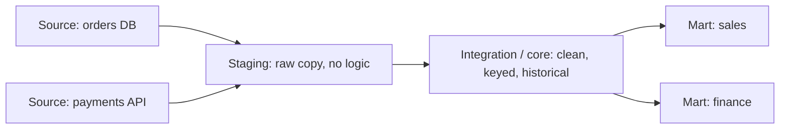

## 🎯 TL;DR

> A **data warehouse (DWH)** is a database built for **analysis**, not for running the business. It copies data from many operational systems, cleans and organizes it around business events, and serves questions like "revenue by month and region" fast.

- **OLTP** systems (your app's database) handle many small reads and writes. **Warehouses** handle few, huge reads over years of history.
- Data flows through **layers**: staging (raw copy), integration/core (clean, conformed, historical), and marts (ready for a business area).
- The usual model is **dimensional**: one **fact** table per business event at a fixed **grain**, surrounded by **dimension** tables that describe the who, what, where and when.
- The warehouse is a **product of decisions** about grain, keys, history and load patterns. Most interview points come from those decisions.

## 🌱 Start simple (Junior)

> **💡 Analogy:** Think of a shop with many cash registers. Each register is an **OLTP** system: it records one sale at a time, quickly, and must never lose a sale. The **warehouse** is the accountant's office at the end of the month. The accountant collects the receipts from all registers, sorts them into folders (by product, by store, by day), and answers questions like "which store sold the most coffee in March?" The accountant does not sell anything.

Here is one operational table and the question the business asks:

```sql
-- Operational (OLTP) table: one row per order, written by the web app
CREATE TABLE orders (
  order_id    int PRIMARY KEY,
  customer_id int,
  status      text,         -- 'new', 'paid', 'shipped', 'cancelled'
  total       numeric(10,2),
  updated_at  timestamp
);
```

The app can answer "show order 42" in a millisecond, using the primary key. But "total paid revenue per city for each month of 2025" needs to read millions of rows, join with customers, and filter by history. Running that on the app database slows checkout. That is the core reason a warehouse exists.

Three words to remember:

- **Fact:** a measurable event (an order line, a click, a payment).
- **Dimension:** the context of the event (customer, product, date, store).
- **Mart:** a small, ready-made set of tables for one team (sales, finance, marketing).

## 🔧 How it really works (Mid)

A typical warehouse has three layers. Each layer has one job, so a bug in one layer is easy to locate.



- **Staging** is a raw copy of the source, often the same columns and types, loaded in batch (or by [[cdc]]). Nothing is fixed here. Keeping the raw copy lets you reload without asking the source again.
- **Integration / core** cleans types, removes duplicates, resolves codes (`'PD'` becomes `paid`), assigns **surrogate keys** and keeps history where needed.
- **Marts** are dimensional models shaped for a team's questions. They are often views or tables rebuilt from the core.

Now a small worked example in PostgreSQL. Staging has raw order lines. We build a customer dimension and a fact table at the grain "one row per order line":

```sql
CREATE TABLE stg_order_lines (
  order_id int, customer_email text, product_code text,
  qty int, unit_price numeric(10,2), order_ts timestamp
);

-- Dimension: one row per customer, with a surrogate key
CREATE TABLE dim_customer (
  customer_key   serial PRIMARY KEY,
  customer_email text UNIQUE,
  city           text
);

-- Fact: one row per order line (this is the grain)
CREATE TABLE fact_order_line (
  order_id     int,
  customer_key int REFERENCES dim_customer(customer_key),
  date_key     int,          -- yyyymmdd, points at a date dimension
  qty          int,
  amount       numeric(12,2)
);

INSERT INTO stg_order_lines VALUES
 (1, 'ali@x.com',  'P1', 2, 10.00, '2026-03-01 10:00'),
 (1, 'ali@x.com',  'P2', 1, 25.00, '2026-03-01 10:00'),
 (2, 'sara@x.com', 'P1', 3, 10.00, '2026-03-02 09:30');

-- Load the dimension: add unseen customers only
INSERT INTO dim_customer (customer_email, city)
SELECT DISTINCT s.customer_email, 'unknown'
FROM stg_order_lines s
WHERE NOT EXISTS (
  SELECT 1 FROM dim_customer d WHERE d.customer_email = s.customer_email
);

-- Load the fact: look up the surrogate key, compute the amount
INSERT INTO fact_order_line (order_id, customer_key, date_key, qty, amount)
SELECT s.order_id,
       d.customer_key,
       CAST(to_char(s.order_ts, 'YYYYMMDD') AS int),
       s.qty,
       s.qty * s.unit_price
FROM stg_order_lines s
JOIN dim_customer d USING (customer_email);
```

Analysts now ask questions with simple joins and sums:

```sql
SELECT c.city, SUM(f.amount) AS revenue
FROM fact_order_line f
JOIN dim_customer c USING (customer_key)
GROUP BY c.city
ORDER BY revenue DESC;
```

Note the `USING (customer_email)` join in the load: the source has the natural key (email), but the fact stores the **surrogate** key. If the email changes later, the surrogate key stays the same and the history is preserved.

Two design families you should be able to name:

- **Kimball (dimensional bus):** build marts directly as star schemas that share **conformed dimensions** (the same `dim_customer` everywhere). Fast to deliver, and the default in most teams.
- **Inmon (enterprise warehouse):** build a normalized, enterprise-wide core first (third normal form), then derive marts from it. Slower to start, stronger consistency for many subject areas.

In modern stacks the layers are often called bronze/silver/gold (see [[medallion-architecture]]), and the warehouse is a cloud engine such as Snowflake, BigQuery or Redshift (see [[cloud-warehouses]]). The layers are the same idea with different names.

## 🧠 Senior depth & trade-offs

- **Grain first.** Decide what one fact row means before you add any column. "One order line" and "one order" give different row counts and different correct sums. A mixed grain is the most common cause of double-counted revenue. See [[grain]] and [[fact-table]].
- **Keys.** Use surrogate keys in the warehouse so that source key changes, re-used IDs or merges do not break history. Keep the natural key as an attribute. Unknown members (`-1` or a special row) let facts load when a dimension is late.
- **History.** Dimensions change. A customer moves cities. [[scd]] (slowly changing dimension) types decide whether you overwrite (Type 1), keep a version row (Type 2), or keep a previous-value column (Type 3). Pick per attribute, not per table.
- **Load patterns.** Batch loads must be **idempotent**: rerunning a day must not double the facts. Use partition overwrite for a day, or `MERGE` on a business key. The naive `INSERT` above doubles every fact on a rerun; it is the first bug to find in a review. See [[dedup-idempotent-loads]] and [[backfills]].
- **Late data.** A correction that arrives three days later changes an old partition. Your design needs a re-load window and a rule for which history the reports show.
- **Architecture choice.** An MPP columnar warehouse (see [[mpp-architecture]]) is fast for joins and aggregates over structured data and charges by compute and storage. A lakehouse (see [[lakehouse-table-formats]]) stores open files and supports many engines, and is often cheaper at large volume, but you own more of the table maintenance. Neither is "the modern answer" for every team.
- **Monitoring.** Track freshness (max loaded timestamp vs now), row counts per load, reconciliation against the source (sums per day), and test results for keys (no duplicates, no orphans). Silent wrong data costs more than a late dashboard.
- **When not to build one.** A small company with a few sources and one BI tool may be served by a single Postgres replica plus good models. Build layers when you have several sources, several teams and disagreements about numbers.

## 🧪 Try it

Use the three tables from the worked example (PostgreSQL 13 or later).

1. **Idempotent fact load.** Rewrite the fact insert so that running it twice gives the same row count. Hint: delete the rows for the day you are loading first, in the same transaction, then insert them again.
2. **Grain check.** Write a query that returns the number of order lines per `order_id`, and explain what happens to `SUM(amount)` if you accidentally join `fact_order_line` to a table that has one row per order.
3. **Dimension change.** Ali moves to Shiraz. Write the update that keeps the old fact rows pointing at Tehran for their original date. What would you need to add to the dimension to make that possible (hint: a validity range)?

<details><summary>Show solutions</summary>

**1.**
```sql
BEGIN;
DELETE FROM fact_order_line WHERE date_key = 20260301;
INSERT INTO fact_order_line (order_id, customer_key, date_key, qty, amount)
SELECT s.order_id, d.customer_key,
       CAST(to_char(s.order_ts, 'YYYYMMDD') AS int),
       s.qty, s.qty * s.unit_price
FROM stg_order_lines s
JOIN dim_customer d USING (customer_email)
WHERE s.order_ts::date = DATE '2026-03-01';
COMMIT;
```
Running it again replaces the same day, so the count does not grow. (In a real system you would also scope the delete by a partition or batch id.)

**2.**
```sql
SELECT order_id, COUNT(*) AS lines FROM fact_order_line GROUP BY order_id;
```
If you join to a one-row-per-order table and sum the order total, each order's total is repeated once per line. Revenue is inflated. The fix is to keep facts at one grain and join dimensions only to dimensions.

**3.** Add `valid_from` and `valid_to` columns to the customer dimension (a Type 2 row). Then the old row has `city = 'Tehran'` with `valid_to = '2026-05-31'`, and the new row has `city = 'Shiraz'`. Facts point at the surrogate key of the version that was valid on their date. This is the core idea of [[scd]] Type 2.

</details>

## 💬 Interview corner

**Question: "What is a data warehouse and how is it different from an operational database?"**

- **Junior answer:** "A warehouse stores data for reports. An operational database stores data for the app. The warehouse is optimized for reading large amounts of data."
- **Mid answer:** "It is a subject-oriented, integrated, historical store built from many sources. It has layers (staging, core, marts), uses a dimensional model with facts and dimensions, and is columnar so aggregates scan few columns. Loads are batch or micro-batch and must be idempotent."
- **Senior answer:** "I start with the business processes and the grain of each fact. Then I decide the conformed dimensions, the history policy per attribute, and the load strategy for corrections. I compare the warehouse with a lakehouse on cost, concurrency and multi-engine needs, and I define freshness and reconciliation checks before the first dashboard."

> **🎤 Say this in the interview:** "A data warehouse is an analytical store that integrates data from many operational systems, keeps history, and is organized in layers and dimensional models. I design it around the grain of each fact table and the conformed dimensions, and I make loads idempotent so reruns and corrections are safe."

## ⚠️ Common mistakes

> **⚠️ Watch out:** A warehouse is not a copy of the app database. Copying the normalized OLTP schema into the warehouse and calling it done gives slow, confusing queries. Model around business events.

- Mixing grains in one fact table (some rows per order, some per line).
- Using natural keys as the only join key, so a source re-keying breaks history.
- Non-idempotent loads: rerunning a job doubles revenue.
- Overwriting dimension history by default and then being unable to answer "what was true last year?".
- Skipping the staging layer, so a bad transform forces a re-extract from a source that no longer has the old data.
- Building marts from marts (layer skipping) until two dashboards disagree about revenue.

## ✅ Check yourself (quiz)

1. Which property matches a data warehouse better than an OLTP database?
   - A) Many small transactions per second with row-level locking
   - B) Few large analytical reads over years of history
   - C) Enforcing foreign keys on every write
   - D) Storing the latest state of each entity only

<details><summary>Answer</summary>

**B** — warehouses serve analytical reads over large history. OLTP systems optimize many small transactions and the latest state of each entity.

</details>

2. In the worked example, what is the grain of `fact_order_line`?
   - A) One customer
   - B) One order
   - C) One order line (one product in one order)
   - D) One day

<details><summary>Answer</summary>

**C** — each row is one order line. Keeping one grain per fact table is what makes sums correct.

</details>

3. Why does the fact table store `customer_key` instead of `customer_email`?
   - A) Email is too long for an index
   - B) Surrogate keys decouple facts from source keys and support history
   - C) Emails cannot be joined in SQL
   - D) The warehouse forbids text columns

<details><summary>Answer</summary>

**B** — a surrogate key stays stable when the natural key changes or is reused, and it lets a Type 2 dimension keep several versions of one customer.

</details>

4. **(Senior)** A nightly job reloads yesterday's facts. After a failure, the job is rerun and revenue doubles. What is the root cause and the right fix?
   - A) The job used too many executors; reduce parallelism
   - B) The load is not idempotent; delete-then-insert per partition, or MERGE on a business key, in one transaction
   - C) The dashboard caches; clear the cache
   - D) The fact table needs a larger grain

<details><summary>Answer</summary>

**B** — a rerun must produce the same state. Replacing the partition (or merging on a key) makes the job safe to retry, which is the basis of backfills.

</details>

5. **(Senior)** When would you prefer a lakehouse over a columnar warehouse for the core layer?
   - A) When all consumers are BI tools with one engine
   - B) When data is large, many engines must read the same tables, and you accept managing table maintenance
   - C) When you never need history
   - D) When the data is always small

<details><summary>Answer</summary>

**B** — open table formats fit multi-engine access and large volumes. The trade-off is more operational work (compaction, snapshot expiry), so the choice depends on the team, not on fashion.

</details>

## 🗂️ Flashcards

| Front | Back |
|---|---|
| OLTP vs warehouse (purpose) | OLTP runs the app with small, fast transactions; a warehouse answers analytical questions over large history |
| Fact table | Measurable events at one fixed grain (for example, one order line) |
| Dimension table | Context for facts: who, what, where, when; usually wide and descriptive |
| Grain | What one row in a fact table represents; decide it first |
| Surrogate key | Warehouse-owned integer key that decouples facts from source keys |
| Staging layer | Raw copy of sources, with no business logic, so you can reload without re-extracting |
| Conformed dimension | A dimension shared across marts with the same keys and meaning |
| Idempotent load | Running a load twice gives the same result as running it once |

## 🔗 Go further

- [[oltp-vs-olap]] explains the workload difference in more depth.
- [[dimensional-modeling]] and [[star-framework]] cover fact and dimension design step by step.
- [[etl-vs-elt]] compares where transformations run.
- [[data-lake-object-storage]] covers the lake that often feeds a warehouse.
- [[lakehouse-table-formats]] covers open table formats for the same questions on files.
- Question bank: the warehouse questions in the DWH chapter (views vs materialized views, SCD Type 2, dimension vs attribute) are good follow-ups.
