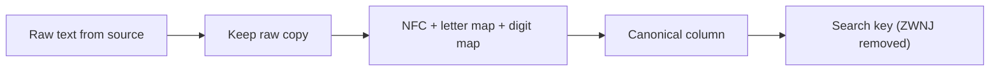

## 🎯 TL;DR

> Persian text looks simple, but it has code-point traps that break joins, counts and sorts: two different "ye" letters, two different "kaf" letters, two sets of digits, an invisible joiner (ZWNJ), and Jalali dates and Tehran time rules that do not match the Gregorian/UTC defaults most tools assume.

- Two strings that look identical can have different bytes. `"ي"` and `"ی"` look alike, but they are different characters.
- Normalize Persian text **once, at ingestion**, into a canonical form. Keep the raw value next to it.
- Store timestamps in UTC. Convert to Tehran time and Jalali dates at the edges (reports, UI), using a tested library and the IANA timezone database.
- Never hand-roll calendar math or timezone offsets. Use a library and test it against known dates.

## 🌱 Start simple (Junior)

> **💡 Analogy:** Two keys can look identical and still open different locks. A data system compares **code points** (numbers), not pictures. The eye sees one letter, the database sees two different numbers.

Look at this:

```python
>>> "ي" == "ی"
False
>>> "ك" == "ک"
False
>>> len("می‌خواهم"), len("میخواهم")   # the first one has a ZWNJ inside
(8, 7)
```

The two letters that differ are not spelling mistakes. They are different characters that were produced by different keyboards, layouts or source systems. Persian and Arabic share the same alphabet family, so both forms appear in real data:

| Character | Code point | Unicode name | Typical source |
|---|---|---|---|
| ي | U+064A | ARABIC LETTER YEH | Arabic keyboard layouts, many legacy sources |
| ی | U+06CC | ARABIC LETTER FARSI YEH | Standard Persian text |
| ك | U+0643 | ARABIC LETTER KAF | Arabic keyboard layouts |
| ک | U+06A9 | ARABIC LETTER KEHEH | Standard Persian text |
| (invisible) | U+200C | ZERO WIDTH NON-JOINER (ZWNJ) | Half-space, as in می‌خواهم |
| ٠ to ٩ | U+0660 to U+0669 | ARABIC-INDIC DIGITS | Arabic text |
| ۰ to ۹ | U+06F0 to U+06F9 | EXTENDED ARABIC-INDIC DIGITS (Persian digits) | Persian text |

If a user types `كتاب` and another user types `کتاب`, a `WHERE` clause or a `GROUP BY` treats them as two different products, two different people, or two different cities. Nothing crashes. The numbers are just wrong.

For juniors, the rule is simple: **Persian text is not clean text.** Assume it needs normalization before you count, join or deduplicate it.

## 🔧 How it really works (Mid)

### UTF-8 in one minute

Modern systems store text as UTF-8. It is a variable-length encoding:

- ASCII (`a`, `1`) takes **1 byte**.
- Most Persian letters are in the U+0600 to U+06FF range and take **2 bytes** each.
- ZWNJ (U+200C) is in the U+0800 to U+FFFF range and takes **3 bytes** (`E2 80 8C`).

So the number of characters is not the number of bytes. Functions differ by engine. For example, in ClickHouse `length` counts bytes while `lengthUTF8` counts code points. In MySQL, use `utf8mb4` for new tables; the legacy `utf8` charset is a 3-byte subset and is a common source of errors. Always check which function you call.

A debugging helper is worth keeping in your toolbox:

```python
import unicodedata

def show_codepoints(text: str) -> None:
    for ch in text:
        print(f"U+{ord(ch):04X}  {unicodedata.name(ch, '<unnamed>')}")

show_codepoints("كتاب")
# U+0643  ARABIC LETTER KAF
# U+062A  ARABIC LETTER TEH
# U+0627  ARABIC LETTER ALEF
# U+0628  ARABIC LETTER BEH
```

### Normalization is a policy, not a single function

Unicode normalization (`NFC`, `NFD`, `NFKC`, `NFKD`) handles accents and compatibility forms, but it does **not** map Arabic letters to Persian ones. This is a very common surprise:

```python
import unicodedata
unicodedata.normalize("NFKC", "ي") == "ي"   # True: NFKC leaves it unchanged
```

So you need an explicit mapping, plus a decision about each special character. The example below is a small, runnable normalizer for ingestion:

```python
import unicodedata

# Arabic letters typed on Arabic keyboards -> Persian letters used in Persian text
CHAR_MAP = str.maketrans({
    "ي": "ی",  # ي ARABIC LETTER YEH  -> ی ARABIC LETTER FARSI YEH
    "ك": "ک",  # ك ARABIC LETTER KAF  -> ک ARABIC LETTER KEHEH
    "​": None,      # zero-width space: always junk, drop it
})

# Arabic-Indic digits (U+0660..U+0669) and Persian digits (U+06F0..U+06F9) -> ASCII 0-9
DIGIT_MAP = {}
for i in range(10):
    DIGIT_MAP[0x0660 + i] = str(i)
    DIGIT_MAP[0x06F0 + i] = str(i)


def normalize_fa(text: str) -> str:
    """Canonical form for storage and joins. Keeps ZWNJ (U+200C) on purpose."""
    text = unicodedata.normalize("NFC", text)
    text = text.translate(CHAR_MAP).translate(DIGIT_MAP)
    return text.strip()


def search_key(text: str) -> str:
    """Looser key for search and dedup only: also removes ZWNJ."""
    return normalize_fa(text).replace("‌", "")


if __name__ == "__main__":
    samples = ["كتاب", "کتاب", "۱۴۰۵/۰۱/۱۵", "١٤٠٥/١/١٥", "می‌خواهم", "میخواهم"]
    for s in samples:
        print(repr(s), "->", repr(normalize_fa(s)))

    assert normalize_fa("كتاب") == normalize_fa("کتاب") == "کتاب"
    assert normalize_fa("۱۴۰۵") == normalize_fa("١٤٠٥") == "1405"
    assert normalize_fa("می‌خواهم") != normalize_fa("میخواهم")   # ZWNJ is kept
    assert search_key("می‌خواهم") == search_key("میخواهم")
    assert unicodedata.normalize("NFKC", "ي") == "ي"                  # NFKC does not fix it
    print("all checks passed")
```

Expected output of the `print` loop:

```text
'كتاب' -> 'کتاب'
'کتاب' -> 'کتاب'
'۱۴۰۵/۰۱/۱۵' -> '1405/01/15'
'١٤٠٥/١/١٥' -> '1405/1/15'
'می‌خواهم' -> 'می‌خواهم'
'میخواهم' -> 'میخواهم'
```

Notice what the normalizer does **not** do: it does not pad `1/1/1405` to `01/01/1405`, and it does not decide that `می‌خواهم` and `میخواهم` are the same word. Those are separate decisions, and they belong in your data contract.



### Sorting and collation

A database sorts strings using a **collation**. Under a binary (byte or code point) collation, `ك` (U+0643) and `ک` (U+06A9) sort in separate places, and neither follows the Persian alphabet. A locale-aware collation (for example a Persian ICU or locale setting, where your engine supports it) is closer to what users expect. Check how your engine behaves before you build a sorted report or a `DISTINCT` on names.

### Jalali (Solar Hijri) dates

Iran uses the Jalali calendar in daily life. Data pipelines usually store Gregorian dates and show Jalali dates to users. A reliable approach:

- Keep a **date dimension** with the Gregorian `date` as the key, and add Jalali `year`, `month`, `day`, `month_name_fa` and `week_of_year` as columns.
- Generate the dimension once with a tested library, and check known anchor dates. For example, 1 Farvardin 1400 is 21 March 2021.
- Store Jalali numbers as integers, not strings. Persian digits in source text must be normalized before you cast them.

### Tehran time

Tehran uses the IANA zone `Asia/Tehran`, with standard time UTC+03:30. Iran has changed its daylight-saving rules several times, most recently abandoning DST in 2022 and debating its return since. Do not hard-code offsets. Store event timestamps in UTC, convert to `Asia/Tehran` at query or presentation time, and keep the tz database (tzdata) updated on your servers.

## 🧠 Senior depth & trade-offs

- **Keep raw and canonical.** Store the raw value for audit and reprocessing, and a canonical column for joins and aggregates. If the normalizer changes, you can recompute the canonical column from raw data. Store a `normalizer_version` so you can tell which rows are stale.
- **Normalize before you hash.** A national ID or phone number typed with Persian digits gives a different hash from the same number typed with ASCII digits. Normalize first, then hash with a keyed HMAC if the value is personal data. Otherwise the same person appears as two people.
- **Deleting ZWNJ is lossy.** `می‌خواهم` and `میخواهم` are both common in real text. Removing ZWNJ in the stored value destroys information that a reader may need. Remove it only in the search key, or in a deduplication key, and say so in the data contract.
- **Search engines.** For full-text search, put the normalization into the analyzer (character filters or token filters) of the index, so that the query and the documents go through the same rules. Ad-hoc `replace()` calls in one service and not in another guarantee mismatch. Check the analyzer documentation of your engine for the Persian filters it provides.
- **Engine behaviour.** Equality, `LIKE`, `ILIKE`, regular expressions and `CAST` all depend on the engine. For example, a cast of `'۱۴۰۵'` to an integer fails in many engines, so normalize digits before the cast.
- **Data quality checks.** Add a daily check: count rows that still contain `ي`, `ك` or Arabic-Indic digits in a column that should be canonical. Alert when the count rises. Source systems often change keyboards or import tools without telling you.
- **When not to normalize.** Free-text comments, poems, or legal documents should keep the author's characters. Normalize for matching and analytics, not for the public display of user content.

## 🧪 Try it

Use PostgreSQL 13 or later, or any engine with regular expressions.

1. **Find the contamination.** Write a query that counts rows in a table `customers(id, city)` where `city` contains `ي` or `ك`.
2. **Dedup with a search key.** Given the Python list `["می‌خواهم", "میخواهم", "کتاب", "كتاب"]`, use `search_key` to count how many distinct keys there are. Explain why the answer is 2, not 4 and not 1.
3. **Digits before cast.** Write a Python function that takes `"۱۴۰۵"` and returns the integer `1405`, using only the mapping from this lesson. Test it with `"١٤٠٥"` too.

<details><summary>Show solutions</summary>

**1.**
```sql
SELECT COUNT(*) AS contaminated
FROM customers
WHERE city ~ '[يك]';
```

**2.** Both `ZWNJ` variants become `میخواهم`, and both `كتاب` and `کتاب` become `کتاب`. So the distinct keys are `میخواهم` and `کتاب`: 2.

**3.**
```python
def to_int_fa(text: str) -> int:
    return int(normalize_fa(text))

assert to_int_fa("۱۴۰۵") == 1405
assert to_int_fa("١٤٠٥") == 1405
```

</details>

## 💬 Interview corner

**Question: "Two rows look like the same person, but the join misses them. What do you check?"**
Mid answer: "I'd check for whitespace and case, then I'd compare the code points, because Persian has `ي` and `ی` and `ك` and `ک` that look identical."
Senior answer: "First I'd check the code points, then I'd check whether the canonical column exists and whether the normalizer version is the same for both rows. I'd also check whether the key is a national ID with Persian digits, because a hash of the raw value would differ. The fix is a canonical column produced at ingestion, plus a data-quality alert on non-canonical characters."

**Question: "How do you store and report dates for Iranian users?"**
Mid: "Store UTC timestamps, convert to `Asia/Tehran` for display, and use a date dimension with Jalali columns."
Senior: "The same pattern as any timezone, plus a warning: the DST rules have changed, so the conversion must come from the tz database, not a fixed offset. Jalali is a presentation and reporting dimension. Joins still use Gregorian dates."

> **🎤 Say this in the interview:** "Persian text needs canonicalization at ingestion. I keep the raw value, normalize the letters and digits with an explicit map because Unicode normalization does not handle them, and I store UTC and convert to Tehran time at the edges."

## ⚠️ Common mistakes

> **⚠️ Watch out:** `NFKC` does not turn `ي` into `ی`. You need an explicit mapping, and you need tests that prove it.

> **⚠️ Watch out:** Hard-coding `+03:30` ignores the DST history. Use `Asia/Tehran` from the tz database.

- Assuming that two strings that render the same are equal. Compare code points or normalized keys.
- Storing only the normalized value. You lose the audit trail and cannot recompute it later.
- Removing ZWNJ everywhere. It changes the meaning of text and can break search expectations.
- Hashing personal IDs before normalizing digits.
- Using `length` in bytes when you mean characters, or the reverse.
- Writing your own Jalali conversion. Leap-year rules are subtle; use a library and test anchor dates.

## ✅ Check yourself (quiz)

1. Which code point is the Persian letter "ye" (ی)?
   - A) U+064A
   - B) U+06CC
   - C) U+0643
   - D) U+200C

<details><summary>Answer</summary>

**B** — U+06CC is ARABIC LETTER FARSI YEH. U+064A is the Arabic yeh, a different character that looks almost the same.

</details>

2. Which normalization step converts `ك` (U+0643) to `ک` (U+06A9)?
   - A) `NFC`
   - B) `NFKC`
   - C) `NFKD`
   - D) None of them: you need an explicit character mapping

<details><summary>Answer</summary>

**D** — Unicode normalization handles accents and compatibility forms, but these letters are distinct characters with no such mapping. An explicit map (as in `CHAR_MAP`) is required.

</details>

3. A column `name` contains `می‌خواهم` from one source and `میخواهم` from another. The business says they are the same word for search. What is the best design?
   - A) Remove ZWNJ from the stored value during ingestion
   - B) Keep the raw and canonical values, and use a search key that removes ZWNJ on both sides
   - C) Ignore the difference and let users search for both forms
   - D) Replace ZWNJ with a regular space

<details><summary>Answer</summary>

**B** — Removing ZWNJ from the stored value loses information (A), and a space (D) changes the word. A search key derived from the canonical value keeps the data and makes matching consistent, which is what a senior would propose.

</details>

4. (Senior) A national ID is hashed for a cross-system join. Some sources send Persian digits and others send ASCII digits. What goes wrong, and what is the fix?

<details><summary>Answer</summary>

The two hashes differ, so the same person is never joined. The fix is to normalize digits before hashing, then apply a keyed HMAC so that the hash cannot be reversed by brute force over the small ID space.

</details>

5. Why should timestamps be stored in UTC and converted to `Asia/Tehran` only for display?
   - A) UTC is faster to compute on
   - B) Offsets and DST rules change over time, so the stored instant must not depend on them
   - C) Tehran time cannot be represented in SQL
   - D) Jalali dates require UTC

<details><summary>Answer</summary>

**B** — A stored UTC instant stays correct when the local rules change. Converting at read time uses the current tz rules, which is what you want for reports.

</details>

## 🗂️ Flashcards

| Front | Back |
|---|---|
| U+06CC | ARABIC LETTER FARSI YEH (ی), not the Arabic yeh (ي U+064A) |
| U+06A9 | ARABIC LETTER KEHEH (ک), not the Arabic kaf (ك U+0643) |
| U+200C | ZERO WIDTH NON-JOINER (ZWNJ), the invisible half-space |
| U+06F0 to U+06F9 | Persian (extended Arabic-Indic) digits ۰ to ۹ |
| Does NFKC fix ي → ی? | No. You need an explicit character map. |
| Where do canonical values come from? | A normalization step at ingestion, versioned, with the raw value kept |
| Why normalize before hashing an ID? | Different digit forms give different hashes, so joins fail |
| Which zone for Tehran? | IANA `Asia/Tehran`; never a fixed offset in code |

## 🔗 Go further

- Related lessons: [[data-quality]] for checks that catch non-canonical values, [[dedup-idempotent-loads]] for the deduplication that depends on a stable key, and [[data-formats]] for how text is stored in files.
- Reference: the official Unicode character charts for every code point in the table above. Check your engine's documentation for its collation names.
- Practice: take one real text column from your own project, count its non-canonical characters, and write the canonicalization rule down as a short data contract.

