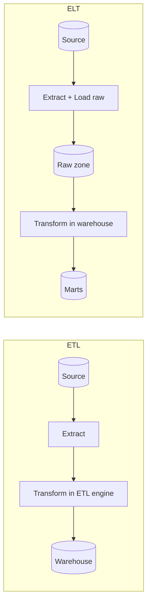

## 🎯 TL;DR

> **ETL** = Extract, **Transform**, then Load. **ELT** = Extract, Load the raw data first, then **Transform** inside the target system. The only real question is *where the transform runs and when the raw data lands*.

- ETL cleans and reshapes data **before** it reaches the warehouse. It was the default when warehouses were expensive and weak.
- ELT lands the raw data **first** and transforms it with the warehouse's own compute. It became common when storage got cheap and warehouses (MPP engines) got strong.
- Use ELT as the default for analytics. Keep ETL for cases where raw data must not land in its original form: PII that must be masked, binary or heavily nested payloads that need parsing, or data that must be cut down before storage.
- Both are patterns, not products. Most real systems are a mix: a small transform before landing, and most business logic after.

## 🌱 Start simple (Junior)

> **💡 Analogy:** A restaurant kitchen. In **ETL** the chef cooks and plates the food in the back room, then carries only the finished dish to the table. In **ELT** the delivery trucks drop off all the raw ingredients in a big storeroom, and the cooks prepare each dish from that storeroom on demand. The second design needs a big, well-organized storeroom, but you can change the recipe later without buying the ingredients again.

Three steps, the same in both patterns:

1. **Extract**: read the data from a source (an OLTP database, an API, a log file).
2. **Transform**: clean types, remove duplicates, join with reference data, compute columns.
3. **Load**: write the result into the target, usually a data warehouse or a lakehouse table.

The only difference is the order of steps 2 and 3. Here is the same goal written both ways. Assume a source table of orders where `amount` is a text column with a currency suffix.

```sql
-- Source (raw, as the app wrote it)
-- orders_raw(order_id, amount_text, status, created_at)
-- e.g. ('o1', '120000 IRR', 'paid', '2026-03-01 10:22:00')

-- ETL: the transform already ran outside the warehouse,
-- so the warehouse only receives clean typed rows.
INSERT INTO dw.fact_orders (order_id, amount_irr, status, order_date)
VALUES ('o1', 120000, 'paid', DATE '2026-03-01');

-- ELT: the raw row is loaded as it is, then transformed in the warehouse.
-- Step 1 (load): raw.orders_raw already contains the text value.
-- Step 2 (transform), run inside the warehouse:
CREATE TABLE analytics.fact_orders AS
SELECT order_id,
       CAST(REPLACE(amount_text, ' IRR', '') AS INTEGER) AS amount_irr,
       status,
       CAST(created_at AS DATE)                          AS order_date
FROM raw.orders_raw
WHERE status = 'paid';
```

The ELT version keeps `raw.orders_raw` untouched. If you later find a bug in the cast, you fix the SQL and rebuild `analytics.fact_orders` from the raw table. In the ETL version the bad rows are gone, and you can only fix them by re-extracting from the source.

## 🔧 How it really works (Mid)

**Where the compute runs.** ETL uses a separate transform engine: a Python job, an ETL tool, or a Spark cluster that sits between the source and the warehouse. ELT uses the target's own engine: the SQL of a warehouse (Snowflake, BigQuery, Redshift, ClickHouse, StarRocks) or the Spark or Trino cluster that reads your lake.



**Why ELT became the default.** Three changes made it practical:

- **Cheap object storage.** Keeping the full raw history costs little, so you can always reprocess.
- **Massively parallel warehouses.** A SQL engine that scales out can run large transforms faster than a single ETL server.
- **Versioned SQL tooling.** Transforms are SQL files in Git, tested and run in order (for example with [[dbt]]-style models). They are easier to review than hidden ETL jobs.

**What ETL still does better.**

| Concern | ETL | ELT |
|---|---|---|
| Sensitive data (PII, card numbers) | Mask before it lands | Raw PII is in the warehouse; access must be controlled |
| Binary or unstructured input (images, PDFs, protobuf) | Parse outside, load structured fields | Hard to parse inside SQL |
| Reducing volume before paid storage | Filter and aggregate early | Pay to store everything first |
| Re-processing history after a logic change | Needs re-extraction from source | Rebuild from the raw zone |
| Transform compute cost | Separate, fixed cluster | Warehouse credits per query, can grow fast |
| Team skills | Often Python or a visual tool | Mostly SQL |

**Example: masking PII before landing.** A keyed hash (HMAC) keeps the value joinable without exposing it. A plain hash of an email can be reversed by guessing common addresses, so the key matters.

```python
import hmac
import hashlib

SECRET_KEY = b"load-from-a-secret-manager"  # never hard-code in production

def mask_email(email: str) -> str:
    # Same input always gives the same token, so joins and counts still work.
    return hmac.new(SECRET_KEY, email.strip().lower().encode(), hashlib.sha256).hexdigest()

rows = [{"order_id": "o1", "email": "Ali@Example.com"}]
safe = [{"order_id": r["order_id"], "email_token": mask_email(r["email"])} for r in rows]
print(safe)  # the warehouse never sees the raw address
```

**Hybrid is normal.** A common production design is: ETL-style masking and format checks at the edge, then ELT for all business logic in the warehouse. You are not picking one pattern for the whole company.

**Latency is a separate question.** Batch ELT runs on a schedule (hourly, daily). If you need data in seconds, you use streaming, where "transform" means a stream processor (Flink, Spark Structured Streaming, Kafka Streams) before the sink. Do not confuse ETL/ELT with batch/stream: both patterns can be batch or streaming.

## 🧠 Senior depth & trade-offs

- **Cost model.** ELT moves cost from infrastructure (fixed servers) to usage (warehouse compute and storage). Run the numbers: a daily job that rescans 20 TB of raw data every night costs about 20 TB of scanned bytes per run, even when only 1% changed. Incremental models fix this, and so does partitioning raw data by event date.
- **Raw zone as a contract.** The raw zone is the contract with your future self. Keep the schema, the load timestamp and the source batch ID. Without a batch ID you cannot tell which load produced a bad row.
- **Schema drift.** ELT tolerates a new source column because the raw load keeps it, but the transform must decide what to do with it. ETL usually fails fast or drops the column. Both need a monitor (see [[data-quality]]).
- **Lakehouse blur.** On a lakehouse, the "raw zone" is a table format (Iceberg, Delta) and the transform is a Spark or Trino job. The labels still help, but the engines overlap.
- **When NOT to use ELT.** Do not land raw card numbers, health data or regulated personal data in a shared analytics schema just because it is easy. Also do not run an ELT transform that rescans petabytes every hour when the data changes slowly.
- **What to monitor.** Load lag (time from source change to raw landing), transform runtime and cost per run, row counts per stage, and failed-row counts. A silent drop in row count is the most common ELT failure.

## 🧪 Try it

Take the `orders_raw` example above and answer on paper:

1. Which of these must stay in the ETL step, and why: (a) casting the amount text, (b) masking the customer email, (c) removing test orders with `status = 'test'`?
2. A bug is found in the currency rule six months later. Describe the recovery steps for the ETL design and for the ELT design.

<details><summary>Model answer</summary>

1. (b) must happen before landing if the raw email is sensitive. (a) and (c) can happen in either place. ELT is fine for them because the raw table keeps everything, so you can recompute if the rule changes.
2. ETL: find the affected window, re-extract those rows from the source (if the source still has them), re-transform, and reload. The source may have already purged old data. ELT: fix the SQL, rebuild the affected models from the raw zone, and compare row counts before swapping the tables.

</details>

## 💬 Interview corner

**Question:** "ETL or ELT, and why?"

> **🎤 Say this in the interview:** "For analytics on a modern warehouse or lakehouse I default to ELT: land the raw data with its load metadata, then transform with versioned SQL. That keeps raw history, so a logic change is a rebuild, not a re-extraction. I switch to ETL-style processing for specific cases: PII that must be masked before storage, binary payloads that need parsing, or volume that must be reduced for cost. In practice most systems are a mix."

Mid-level answers name the trade-off (compute cost, raw history). Senior answers add the failure modes: a raw zone without batch IDs, a transform that rescans everything, and PII that leaks into a shared schema.

## ⚠️ Common mistakes

- **"ELT means no transformation before loading."** Many ELT pipelines still do light cleaning, such as type checks, masking and deduplication of the batch, before the raw load.
- **Treating the raw zone as a dump.** Without a schema, batch ID and load time, you lose traceability.
- **Choosing ETL out of habit** for analytics data that needs no masking. You then lose reprocessing ability for no benefit.
- **Ignoring warehouse cost.** ELT is cheap to build and easy to run expensively. Watch scan bytes per model.
- **Mixing up ETL/ELT and batch/streaming.** Both patterns can run on either.

## ✅ Check yourself (quiz)

1. In ELT, where does the transform run?
   - A) In a separate ETL server before loading
   - B) In the target system, after the raw data is loaded
   - C) In the source database, before extraction
   - D) Only in the BI tool

<details><summary>Answer</summary>

**B** — ELT loads raw data first and uses the target's compute (warehouse SQL, Spark or Trino over the lake) for the transform.

</details>

2. Which requirement most strongly suggests ETL-style masking before the data lands?
   - A) Daily revenue reports
   - B) Storing raw customer card numbers that analysts must never see
   - C) Joining orders to a product dimension
   - D) Building a dashboard with weekly totals

<details><summary>Answer</summary>

**B** — sensitive values must not land in a shared schema. Mask or tokenize them before the load. The other three are normal analytics work that ELT handles well.

</details>

3. A logic bug in an ELT transform is found after 9 months. What is the cleanest recovery?
   - A) Re-extract the entire history from the source
   - B) Fix the SQL and rebuild the affected models from the raw zone
   - C) Delete the warehouse and start over
   - D) Patch the rows by hand in BI

<details><summary>Answer</summary>

**B** — the raw zone keeps the history, so you rebuild from it. Option A is what ETL forces you to do, and it may be impossible if the source has purged old data.

</details>

4. **(Senior)** A team moves to ELT and the warehouse bill doubles in a month, though data volume grew only 10%. What is the most likely cause and the first fix?

   - A) The warehouse needs a larger instance type; buy more compute
   - B) Full-table rebuilds of large models on every run; switch the heavy models to incremental processing and partition the raw data by event date
   - C) ELT always costs more than ETL; switch back
   - D) The raw zone should be deleted to save storage

<details><summary>Answer</summary>

**B** — full rebuilds scan the whole history on every run, so cost grows with total size, not with new data. Incremental models that process only new partitions, plus partition pruning on the raw tables, fix the cause. Buying more compute only hides it.

</details>

## 🗂️ Flashcards

| Front | Back |
|---|---|
| ETL in one line | Extract, transform outside the target, then load clean data |
| ELT in one line | Extract, load raw into the target, then transform there |
| Main reason ELT became common | Cheap storage plus strong MPP warehouses, so keeping raw history is affordable |
| Case for ETL-style masking | PII or secrets that must never land in the shared warehouse |
| Why keep a raw zone | Reprocess after logic changes without re-extracting from the source |
| What a raw zone needs besides data | Load timestamp and source batch ID for traceability |
| Main cost risk of ELT | Full rebuilds that scan growing raw history on every run |
| Is ELT always batch? | No. Both ETL and ELT patterns can run on batch or streaming engines |

## 🔗 Go further

- Read [[dwh-fundamentals]] for the warehouse context that makes ELT practical.
- [[pattern-batch-etl]] shows a full batch ETL design with scheduling and backfills.
- [[dbt]] covers how versioned SQL models implement the "T" in ELT.
- [[data-quality]] explains the checks that should run at both the raw and the transformed layers.
- Read the documentation of your engine's MERGE, partitioning and incremental features before you choose a design; defaults differ between warehouses.
