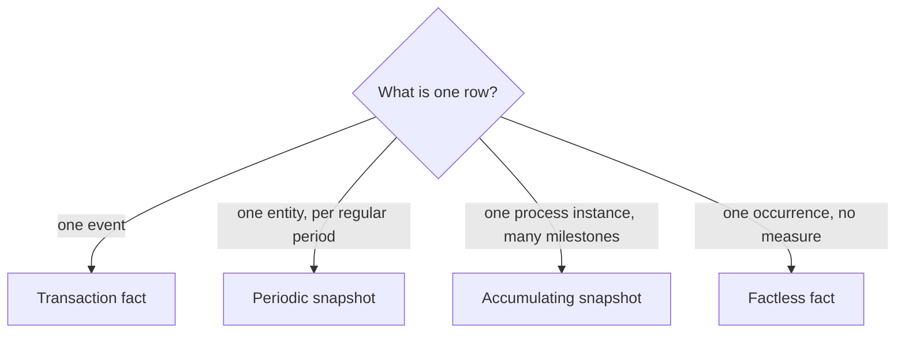

## 🎯 TL;DR

> A **fact table** has one grain, and that grain determines its type. There are four types: **transaction** (one row per event), **periodic snapshot** (one row per entity per regular period), **accumulating snapshot** (one row per process instance, updated as milestones happen) and **factless** (rows that record that something happened, with no numeric measure).

- Transaction facts answer "what happened, and when?" They are the most common and the easiest to load.
- Periodic snapshots answer "what was the state at the end of each day or month?"
- Accumulating snapshots answer "how long did each stage of a process take?"
- Factless facts answer "which combinations occurred?" (attendance, enrollment, promotion coverage).

## 🌱 Start simple (Junior)

> **💡 Analogy:** Four ways to record a school year. A **transaction** fact is a video that records every event. A **periodic snapshot** is a photo taken on the same day every month. An **accumulating snapshot** is a single project card where each milestone date gets filled in as it happens. A **factless** fact is a sign-in sheet: it has names and dates, but no amounts.

Choose the type by asking one question: **what is one row?**

```sql
-- Transaction: one row per payment
CREATE TABLE fact_payment_txn (
  txn_id      bigint PRIMARY KEY,
  date_sk     int,
  account_sk  int,
  merchant_sk int,
  amount      numeric(14,2),
  txn_ts      timestamp
);

-- Periodic snapshot: one row per account per day, even with no activity
CREATE TABLE fact_account_daily (
  date_sk           int,
  account_sk        int,
  closing_balance   numeric(14,2),
  deposits_today    numeric(14,2),
  withdrawals_today numeric(14,2),
  PRIMARY KEY (date_sk, account_sk)
);
```

A transaction fact has no row when nothing happens. A periodic snapshot has a row for every account on every day, including quiet days. That single difference explains most of the design choices below.



## 🔧 How it really works (Mid)

**1. Transaction fact.** One row per business event, at the event's own grain. The table is append-only, sparse and additive. Rows are never updated; a correction is a new row, or a reversing row.

**2. Periodic snapshot.** One row per entity per fixed period (a day, a month). It records the state at the end of the period. The closing balance is **semi-additive**: you can sum it across accounts for one day, but not across days. Deposits are additive.

```sql
-- Total money held by the bank on one day: correct (sum across accounts)
SELECT SUM(closing_balance) FROM fact_account_daily WHERE date_sk = 20260115;

-- Wrong: summing balances across days
SELECT SUM(closing_balance) FROM fact_account_daily
WHERE account_sk = 42 AND date_sk BETWEEN 20260101 AND 20260131;
```

For the second one, use `AVG` for an average balance, or the last day's value for an end-of-month balance.

**3. Accumulating snapshot.** One row per process instance (an order, a claim, a loan application). It has one date column per milestone. The row is **updated** as the process moves forward, and lag measures are filled in along the way.

```sql
CREATE TABLE fact_order_pipeline (
  order_number      text PRIMARY KEY,
  customer_sk       int,
  ordered_date_sk   int,
  shipped_date_sk   int,      -- NULL (or -1, the unknown member) until shipped
  delivered_date_sk int,      -- NULL until delivered
  order_amount      numeric(12,2),
  days_to_ship      int,      -- computed by the pipeline from the two dates
  status            text
);

-- The order ships: one update moves the row forward
UPDATE fact_order_pipeline
SET shipped_date_sk = 20260112,
    days_to_ship    = 2,
    status          = 'shipped'
WHERE order_number = 'SO-1001';
```

Orders that never ship stay with `shipped_date_sk` unknown, so "orders stuck in the warehouse for more than 5 days" is a simple query.

**4. Factless fact.** A table with only dimension keys. It has two common uses:

- **Event occurrence:** `fact_attendance(date_sk, student_sk, class_sk)`. One row means "this student attended this class that day." Counting rows is the measure.
- **Coverage:** `fact_promo_coverage(date_sk, store_sk, product_sk)`. One row means "this product was on promotion in this store that day," whether or not it sold. Coverage lets you ask "promoted but not sold."

```sql
-- Promoted products in store 7 on one day, with their sales (0 if none)
SELECT c.product_sk,
       COUNT(s.product_sk) AS units_sold_rows
FROM fact_promo_coverage c
LEFT JOIN fact_sales s
  ON  s.product_sk = c.product_sk
  AND s.date_sk    = c.date_sk
  AND s.store_sk   = c.store_sk
WHERE c.date_sk = 20260115 AND c.store_sk = 7
GROUP BY c.product_sk;
```

`COUNT(s.product_sk)` counts only matched sales. `COUNT(*)` would count 1 for every promoted product, even the ones that did not sell.

## 🧠 Senior depth & trade-offs

- **Snapshot growth.** A daily snapshot of 10 million accounts is 10 000 000 rows per day, or about 3.65 billion rows per year, even if most accounts do nothing. Partition by date, and consider a snapshot only for the entities where the business asks for state. Alternatively, derive the snapshot from transactions on demand, at the cost of query time.
- **Who builds snapshots.** A periodic snapshot is usually produced by a scheduled job from transactions plus the opening balance. The job must be idempotent (see [[idempotency]]): rerunning a day must replace that day's rows, not add them. Backfills then reconstruct the history from the same transactions.
- **Accumulating snapshots are update-heavy.** In a row store they are easy. In a lakehouse or columnar warehouse, each update rewrites a file or partition, so a table with millions of updates per day needs a deliberate design: batch the updates, merge per micro-batch, or keep an event log and project the current state.
- **Late milestones.** A shipment event can arrive after the delivery event. Decide whether the pipeline keeps the latest value per milestone or the earliest, and test that the lag measures never go negative.
- **Factless coverage is a dense cross product.** Promotions times stores times days can grow fast. Store only the combinations that are planned, and make sure the `LEFT JOIN` path is tested, because a missing join key silently turns "did not sell" into a missing row.
- **Monitor.** For transaction facts, reconcile totals with the source. For periodic snapshots, check that every entity has a row each period. For accumulating snapshots, alert on rows stuck in one stage beyond a threshold.
- **When not to use each type.** Do not use an accumulating snapshot when you need the full history of every change; keep an event fact for that. Do not use a periodic snapshot for entities that rarely change if the transaction fact plus a window function answers the question.

## 🧪 Try it

A logistics company wants three facts: every truck movement, the number of trucks parked at each depot at the end of each day, and the lifecycle of each shipment (created, picked up, delivered).

1. Assign a fact type to each of the three requirements and state the grain.
2. Which one is an accumulating snapshot, and which column would be a lag measure?
3. Which measure in the daily depot fact is semi-additive?

<details><summary>Show solution</summary>

1. Truck movements: **transaction**, grain = one movement event. Trucks parked per depot per day: **periodic snapshot**, grain = one depot per day. Shipment lifecycle: **accumulating snapshot**, grain = one shipment.
2. The shipment lifecycle is the accumulating snapshot. A lag measure is `days_pickup_to_delivery`, computed when the delivery milestone is filled in.
3. `trucks_parked` is semi-additive: you can sum it across depots for one day, but not across days.

</details>

## 💬 Interview corner

**Question: "What is an accumulating snapshot and when would you use one?"** Mid answer: "A fact table that has one row per process, with a date for each milestone, updated as the process moves forward." Senior answer adds the trade-off: "It makes stage-duration questions simple, but it is update-heavy, so in a lakehouse I would batch the updates and keep an event fact for full history."

**Question: "How do you count products that were promoted but not sold?"** Mid: "Use a factless coverage fact and a left join to sales." Senior: "Coverage gives the population, the left join gives the matches, and I count the matched key, not `*`, so unmatched rows count as zero. I would test it on a day with a known zero-sales product."

> **🎤 Say this in the interview:** "I pick the fact type from the grain: an event gives a transaction fact, a regular state gives a periodic snapshot, a process with milestones gives an accumulating snapshot, and a pure occurrence gives a factless fact."

## ⚠️ Common mistakes

> **⚠️ Watch out:** Summing a periodic-snapshot balance across days. Each day already contains the running total, so the sum counts the same money again and again.

> **⚠️ Watch out:** `COUNT(*)` on a factless coverage join. The row for the promotion always exists, so every promoted product looks sold.

- Using a transaction fact for "current state" questions and computing the state in every dashboard.
- Building periodic snapshots without rows for quiet days, so that "balance on day X" silently returns nothing.
- Updating an accumulating snapshot in place without considering the cost in columnar storage.
- Using NULL for "not yet happened" in one table and the unknown member `-1` for the same thing in another, so queries disagree about how many orders are still open.
- Forgetting the grain of a snapshot when joining it to a transaction fact, which multiplies rows.

## ✅ Check yourself (quiz)

1. A table has one row per product per store per day with the closing stock. Which fact type is it?
   - A) Transaction fact
   - B) Periodic snapshot
   - C) Accumulating snapshot
   - D) Factless fact

<details><summary>Answer</summary>

**B** — one row per entity per regular period, recording the state at the end of the period. Stock is a state, not an event.

</details>

2. Which type is updated in place as a process moves through milestones?
   - A) Transaction fact
   - B) Periodic snapshot
   - C) Accumulating snapshot
   - D) Factless fact

<details><summary>Answer</summary>

**C** — each process instance has one row whose milestone columns are filled in over time. Transaction facts are append-only.

</details>

3. A table `fact_attendance(date_sk, student_sk, class_sk)` has no numeric columns. What is it?
   - A) A dimension table
   - B) A transaction fact
   - C) A factless fact (event occurrence)
   - D) A bridge table

<details><summary>Answer</summary>

**C** — the table records that an event occurred. Each row is a combination of keys, and attendance is counted, not summed.

</details>

4. **(Senior)** Your daily account snapshot shows a balance for each account and each day, and an analyst sums the balance over January to get "total money held in January." What is wrong, and what is the correct measure?

   - A) Nothing; the sum is correct
   - B) Balances are semi-additive: summing across days counts the same money repeatedly; use the average daily balance or the month-end balance
   - C) Snapshots cannot be summed at all, so the table must be converted to a transaction fact
   - D) The fix is to add a `DISTINCT`

<details><summary>Answer</summary>

**B** — each day already contains the running total. The average or the month-end value is the meaningful measure.

</details>

5. **(Senior)** A team wants "time from order to delivery" per order, but the order table is a transaction fact of status changes. Which design gives the simplest query, and what does it cost to maintain?

   - A) Keep the transaction fact and self-join it for each stage in every dashboard
   - B) Build an accumulating snapshot with one row per order and milestone dates; it costs update work, which you batch and test
   - C) Build a periodic snapshot of orders per day
   - D) Store the lag only in the BI tool

<details><summary>Answer</summary>

**B** — an accumulating snapshot makes lag measures a simple subtraction. The cost is updates on each milestone, which the pipeline has to handle efficiently and without duplicates.

</details>

## 🗂️ Flashcards

| Front | Back |
|---|---|
| Transaction fact | One row per event; append-only; sparse (no row when nothing happens) |
| Periodic snapshot | One row per entity per regular period, including quiet periods |
| Accumulating snapshot | One row per process instance, updated as milestones occur |
| Factless fact | Only keys; records an occurrence (attendance) or coverage (promotion) |
| Semi-additive measure | Sum across some dimensions only (a balance across accounts, not across days) |
| Snapshot grain check | If quiet entities have no row, the table is a transaction fact, not a snapshot |
| Coverage counting | Count the matched key (`COUNT(s.product_sk)`), not `COUNT(*)`, after a left join |
| Lag measure | Difference between two milestone dates, computed when the later one is filled in |

## 🔗 Go further

- `dimensional-modeling`: grain, dimensions and facts, the foundation for every fact type.
- `scd`: how the dimensions joined to these facts change over time.
- `pattern-history`: keeping history when the source only holds the current state.
- `modeling-levels`: how fact types fit into conceptual, logical and physical modeling.
- `sql-window-functions`: computing running balances and lags when you do not store them.
