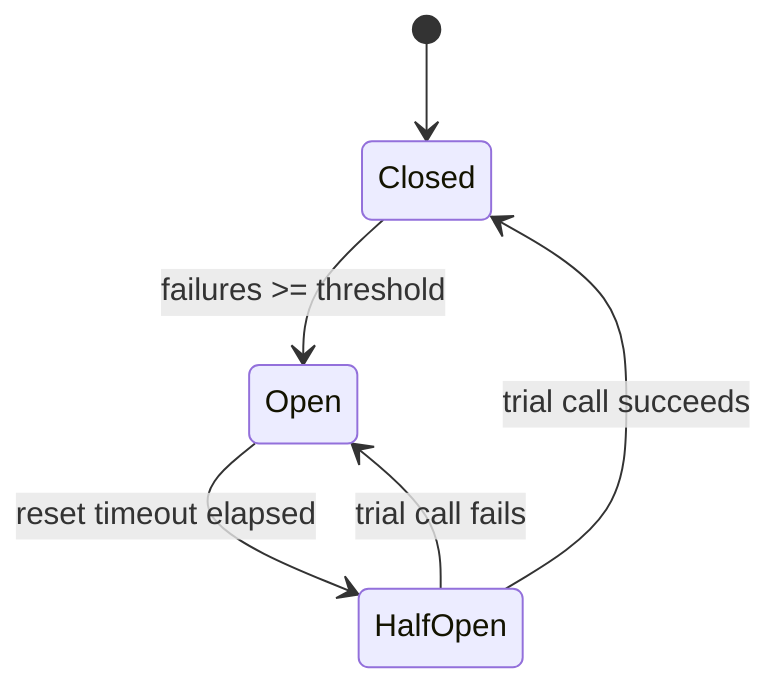
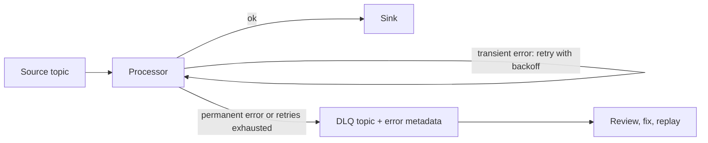

## 🎯 TL;DR

> **Fault tolerance** means the system keeps producing correct results when parts of it fail. You do not prevent failures; you assume them and design so that a failure costs a retry, a restart or a parked record, not a wrong number or a broken pipeline.

- **Retry** transient errors with exponential backoff and jitter, and only for operations that are safe to repeat.
- A **circuit breaker** stops calling a dependency that is clearly down, so you stop wasting time and load on it.
- **Checkpoints** save the progress and state of a job, so a restart resumes from a known point instead of from scratch.
- A **dead letter queue (DLQ)** holds the records that keep failing, so one bad record does not block the rest.
- **Replay** re-processes data from the durable log after a bug or outage, and it is only correct if the sink is idempotent.

## 🌱 Start simple (Junior)

> **💡 Analogy:** You send a parcel and the courier fails to deliver it. You do not panic and send ten couriers at once. You try again in an hour, then in two hours, then in four. If the address does not exist, no amount of waiting helps, so you put the parcel on a "problem" shelf and check it later.

That is the whole lesson in one picture:

- Some failures **go away** (a network blip, a busy server). Retry them.
- Some failures **do not go away** (a wrong address, a malformed record). Do not retry forever; park them.
- Some dependencies are **down for a while**. Stop calling them for a time, then test carefully whether they are back.
- If you crash in the middle of the work, you need to know **where you stopped**. Save that point regularly.

A data pipeline that handles these four cases quietly is far more valuable than one that is fast on a good day.

## 🔧 How it really works (Mid)

### Classify the failure first

Before you choose a pattern, decide what kind of failure it is:

| Kind | Examples | Action |
|---|---|---|
| Transient | timeout, 503, 429 (rate limit), connection reset | retry with backoff |
| Permanent | 400 bad request, schema mismatch, unknown field | do not retry; park in a DLQ |
| Ambiguous | timeout **after** the write may have succeeded | retry only if the operation is idempotent |
| Systemic | the database is down for 20 minutes | circuit breaker, pause, alert |

The **ambiguous** case is the one most people miss. If a request times out, you do not know whether the server processed it. Retrying a non-idempotent call (for example, "charge the card") can charge twice. Make the write idempotent first; see [[idempotency]].

### Retry with exponential backoff and jitter

Exponential backoff doubles the wait after each failure, so a struggling service gets room to recover. **Jitter** adds randomness, so thousands of clients do not all retry at the same instant.

```python
import random
import time

class TransientError(Exception):
    """Raised by the client for errors worth retrying (timeouts, 503, 429)."""

def call_with_retry(fn, max_attempts=5, base=0.2, cap=10.0):
    for attempt in range(max_attempts):
        try:
            return fn()
        except TransientError:
            if attempt == max_attempts - 1:
                raise  # give up and let the caller park or alert
            ceiling = min(cap, base * (2 ** attempt))
            time.sleep(random.uniform(0, ceiling))  # "full jitter"
```

With `base=0.2` and `cap=10`, the ceilings are 0.2, 0.4, 0.8 and 1.6 seconds. The actual sleep is random below each ceiling, so the average wait is about half the ceiling.

Rules that keep retries safe:

- Retry only errors that can succeed later. Never retry a 400.
- Cap the attempts **and** the total time. An unbounded loop is an outage generator.
- Use a **retry budget** per service: if 30% of requests are already retries, stop retrying. Otherwise retries multiply the load on a sick system.
- Keep retries **inside** the idempotent boundary: retry the whole unit of work, using the same idempotency key.

### Circuit breaker

A circuit breaker wraps calls to one dependency and has three states:



- **Closed:** calls pass through; failures are counted.
- **Open:** calls fail immediately, without touching the dependency. This protects the caller and gives the dependency time to recover.
- **Half-open:** after a reset timeout, a **single** trial call is allowed. Success closes the breaker; failure opens it again.

A minimal version in Python (the trial-call limit is simplified here; a production breaker lets only one half-open probe through at a time):

```python
import time

class CircuitBreaker:
    def __init__(self, threshold=5, reset_after=60.0):
        self.threshold = threshold
        self.reset_after = reset_after
        self.failures = 0
        self.opened_at = None

    def allow(self):
        if self.opened_at is None:
            return True                       # closed
        return time.monotonic() - self.opened_at >= self.reset_after  # half-open probe

    def record_success(self):
        self.failures = 0
        self.opened_at = None                 # close again

    def record_failure(self):
        self.failures += 1
        if self.failures >= self.threshold:
            self.opened_at = time.monotonic() # open
```

A breaker is useful when the caller would otherwise wait on timeouts for every request. Without one, 1,000 requests per second against a dead service become 1,000 timeouts per second.

### Checkpointing

A checkpoint is a consistent snapshot of a job's progress: the input offsets it has consumed and the state it has built. In Flink, checkpoints are taken with barriers that flow through the dataflow, so each operator snapshots its state at the same logical point. On failure, the job restarts from the last completed checkpoint and re-reads the source from the saved offsets.

What this gives you:

- After a crash, the job loses at most the work since the last checkpoint, not the whole day.
- Combined with a transactional or idempotent sink, the result is **exactly-once** in effect; see [[exactly-once]] and [[kafka-exactly-once]].
- Without a checkpoint, a restart means reprocessing from the beginning of the retained log, which may be impossible.

### Dead letter queue

A **DLQ** is a separate topic or table where records that cannot be processed are parked, with metadata: the original payload, the error, the attempt count and the source offset. The main pipeline continues. Someone or some job reviews the DLQ, fixes the cause (a schema change, a bug), and replays the records.



Without a DLQ, one poison record stops the partition: the job retries it forever, and everything behind it waits. With a DLQ, the rest of the partition flows, and the bad record is still kept for analysis.

### Replay

Replay means re-reading a range of input and processing it again, for example after fixing a bug or restoring a sink. It needs three things: the input is still retained (see [[kafka-retention-compaction]]), the transformation is deterministic, and the sink is idempotent (so the second run overwrites instead of duplicating). A [[backfill]] is replay applied to a historical range.

## 🧠 Senior depth & trade-offs

- **Retries multiply load.** With three layers each retrying 3 times, one failed request becomes 27 calls to the bottom layer. Retry at one layer, usually the one closest to the failure, or use budgets so the total stays bounded.
- **Timeouts are part of fault tolerance.** Without a timeout, a retry never starts because the first call never ends. Set timeouts from the dependency's latency distribution (for example p99 plus margin), and make them shorter than the caller's own deadline.
- **Exactly-once is a property of the whole path.** Checkpointing gives you recovery; idempotent writes or two-phase commit give you correctness. Ask "what does the sink do when the same record arrives twice?" before claiming exactly-once.
- **DLQ is a feature with an owner.** A DLQ nobody reads is a data-loss storage. Alert on its growth rate, put a retention on it, and define who replays and how a fix is verified.
- **Circuit breakers need good signals.** Counting only HTTP 500s misses timeouts and slow responses. Use error rate and latency together, and test the breaker in staging by injecting faults.
- **Checkpoint cost.** Frequent checkpoints with large state cost I/O and can cause backpressure (see [[backpressure]]). Tune the interval against your acceptable recovery time: recovery time is roughly the checkpoint interval plus restore time plus the replay of input since the checkpoint.
- **Failure domains.** Replicating a service across zones does not help if all replicas share one database or one bad deployment. Ask which component is the shared failure domain.
- **Chaos testing.** Kill a worker, drop a network link, delay a sink. A fault-tolerance design that was never tested is a hypothesis.

## 🧪 Try it

Work on paper or in a Python REPL. Use the `call_with_retry` function above as a reference.

1. With `base = 0.5` seconds and `cap = 8` seconds, what are the backoff ceilings for attempts 0 to 5? What is the total maximum wait before the sixth attempt gives up?
2. For each error, say whether you retry it, park it in a DLQ, or open a circuit breaker: (a) HTTP 429, (b) HTTP 400 with "unknown field `sku`", (c) 40 consecutive timeouts over 60 seconds, (d) a timeout on a `POST` that charges a card, with no idempotency key.
3. A Flink job restarts from a checkpoint taken 3 minutes ago. The input topic retains 7 days. Is recovery possible, and what must be true about the sink for the output to be correct?

<details><summary>Show solutions</summary>

**1.** Ceilings: `min(8, 0.5 × 2^n)` gives 0.5, 1, 2, 4, 8, 8 for attempts 0 to 5. There are 5 waits before the sixth attempt (after attempts 0 to 4), so the maximum total of the ceilings is 0.5 + 1 + 2 + 4 + 8 = **15.5 seconds**. With full jitter the expected sleep is about half of that.

**2.**
- (a) **Retry** with backoff: 429 is a transient rate-limit signal.
- (b) **Park in a DLQ**: a permanent schema error does not improve with time.
- (c) **Open the circuit breaker**: the dependency is clearly down; stop calling it and alert.
- (d) **Do not retry blindly.** The write is ambiguous and not idempotent. Add an idempotency key first, then retry with the same key so the card is charged at most once.

**3.** Yes, recovery is possible: the input is retained for 7 days, so the job can re-read from the checkpoint's saved offsets. The job re-processes about 3 minutes of input. For the output to be correct, the sink must be idempotent or transactional, so the re-processed records overwrite or are committed exactly once, and not duplicated.

</details>

## 💬 Interview corner

**Question: "How do you make a pipeline fault tolerant?"** Mid answer: "I'd add retries with exponential backoff, a dead letter queue for bad records, and checkpoints so the job can restart." Senior answer: "I'd classify failures first: transient errors get bounded retries with jitter and a budget, permanent errors go to a DLQ with metadata, and a circuit breaker protects the dependencies. The job checkpoints offsets and state, and the sink is idempotent, so restart and replay produce the same result. I'd verify it with fault injection and alert on DLQ growth and checkpoint duration."

**Question: "Why use jitter?"** Without jitter, clients that failed together retry together, creating synchronized spikes (a thundering herd). Randomness spreads the retries over time.

> **🎤 Say this in the interview:** "I design for failure by classifying it. Transient errors are retried with capped exponential backoff and jitter, but only for idempotent operations. Persistent failures go to a DLQ so they do not block the partition, and dependencies that are clearly down are protected by a circuit breaker. Checkpoints give recovery, and idempotent sinks make recovery correct."

## ⚠️ Common mistakes

> **⚠️ Watch out:** Retrying a non-idempotent write after a timeout. The first request may have succeeded, and the retry creates a duplicate.

> **⚠️ Watch out:** Retrying without a cap or a timeout. The job waits forever on one call and nothing else moves.

- Retrying permanent errors (400, schema mismatch). They fail every time and waste capacity.
- Retrying at every layer at once, which multiplies traffic on the failing service.
- Using a fixed retry delay with no jitter, so all clients retry in sync.
- Running a DLQ without an owner, alert or replay procedure.
- Treating checkpoints as backups. They are for recovery of a running job; the retained source and an idempotent sink are what make the result correct.
- Claiming exactly-once without checking what the sink does with duplicates.

## ✅ Check yourself (quiz)

1. Which error should **not** be retried?
   - A) HTTP 503 Service Unavailable
   - B) HTTP 429 Too Many Requests
   - C) A connection reset
   - D) HTTP 400 because the payload has an unknown field

<details><summary>Answer</summary>

**D** — 400 means the request is malformed. Retrying the same payload will fail the same way; park it in a DLQ and fix the producer or schema.

</details>

2. Why is jitter added to exponential backoff?
   - A) To make each retry slower than the previous one
   - B) To stop many clients from retrying at the same moment after a shared failure
   - C) To change the error code of the response
   - D) To avoid using timeouts

<details><summary>Answer</summary>

**B** — synchronized retries create spikes that keep the service overloaded. Random delays spread the load.

</details>

3. A circuit breaker is in the **open** state. What happens to a new call?
   - A) It is sent to the dependency anyway, with a longer timeout
   - B) It fails immediately, without touching the dependency, until the reset timeout passes
   - C) It is written to the DLQ forever
   - D) It is retried every millisecond

<details><summary>Answer</summary>

**B** — the open breaker fails fast to protect the caller and give the dependency room to recover. After the reset timeout it moves to half-open and allows a trial call.

</details>

4. **(Senior)** A Flink job uses checkpoints every 5 minutes and writes to a sink that is not idempotent. After a crash, the dashboard shows duplicated counts. What is the cause and the fix?

   - A) The checkpoint interval is too short; increase it to 1 hour
   - B) Records between the last checkpoint and the crash are re-processed and written again; use an idempotent sink (upsert by key) or a transactional sink that commits with the checkpoint
   - C) Checkpoints should be disabled to avoid duplicates
   - D) The DLQ should receive all records

<details><summary>Answer</summary>

**B** — recovery replays input after the last checkpoint, so the sink sees those records twice. Correctness requires the sink to handle duplicates, either by overwriting by key or by committing transactionally with the checkpoint. Longer intervals only enlarge the replayed window.

</details>

5. **(Senior)** Your DLQ receives 200,000 records per day, and nobody looks at it. What is the risk, and what do you put in place?

   - A) No risk; storage is cheap and DLQs are self-healing
   - B) The DLQ is data that is effectively lost; set alerts on its growth, assign an owner, classify records by error type, define a replay and verification procedure, and set a retention that matches the time needed for a fix
   - C) Delete the DLQ to save storage
   - D) Route all records into the DLQ so the main pipeline is simpler

<details><summary>Answer</summary>

**B** — a DLQ is only useful if records are reviewed and replayed. Without an owner and a replay path, parked records stay lost while the dashboards look normal. See [[dlq-bad-records]] for the operating details.

</details>

## 🗂️ Flashcards

| Front | Back |
|---|---|
| Transient vs permanent error | Transient may succeed later (timeout, 503, 429); permanent never will (400, schema mismatch) |
| Why jitter? | Randomizes retry times so clients do not retry in sync (thundering herd) |
| Retry an ambiguous timeout on a non-idempotent write? | No; make it idempotent first (idempotency key), then retry |
| Circuit breaker states | Closed (pass and count), open (fail fast), half-open (one trial call) |
| What does a checkpoint store? | Consistent snapshot of input offsets and operator state |
| Purpose of a DLQ | Park records that keep failing so the rest of the partition keeps flowing |
| What makes replay correct? | Retained input, deterministic transforms, and an idempotent sink |

## 🔗 Go further

- **distributed-fundamentals** covers the failures that these patterns respond to.
- **dlq-bad-records** describes how to operate a dead letter queue in practice.
- **delivery-semantics** and **kafka-exactly-once** explain at-least-once, at-most-once and exactly-once in detail.
- **dedup-idempotent-loads** and **pattern-exactly-once** show how to make sinks safe under retries and replay.
- **flink** and **streaming-state** show checkpointing and state recovery in a streaming engine.
- **backpressure** covers the flow-control side of resilience, which pairs with retries and breakers.
- Read your framework's documentation on retry, timeout and checkpoint defaults; they differ by client library and version.
