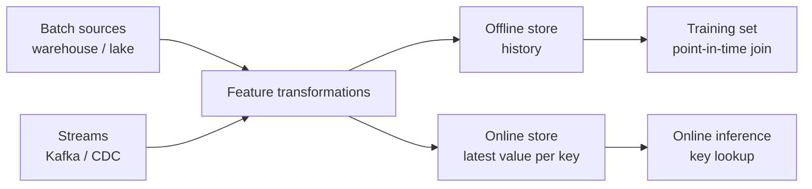

## 🎯 TL;DR

> A **feature** is a number or category that describes an entity (a user, a card, a product) at a point in time. A **feature store** computes, stores and serves these features so that training and production use the **same** definitions and the **same** values.

- The **offline store** holds history (for building training sets). The **online store** holds the latest value per entity (for low-latency predictions).
- **Point-in-time (PIT) correctness** means a training row only sees feature values that existed **before** the label time. Breaking this is data leakage, and the model looks great in training and fails in production.
- **Training-serving skew** happens when the training pipeline and the serving pipeline compute the same feature differently.

## 🌱 Start simple (Junior)

> **💡 Analogy:** A bank's credit score is a feature. To train a model that decides loans issued in March, you must use the credit score **as it was in March**, not the score you see today. Using today's score tells the model the future.

Suppose we predict whether a user churns in the next 30 days. We have two tables:

```sql
CREATE TABLE user_features (user_id int, feature_ts timestamp, orders_30d int);
INSERT INTO user_features VALUES
 (1, '2026-01-01', 2),
 (1, '2026-01-15', 5),
 (1, '2026-02-01', 1);

CREATE TABLE labels (user_id int, label_ts timestamp, churned int);
INSERT INTO labels VALUES
 (1, '2026-01-10', 0),
 (1, '2026-01-20', 1);
```

For the label at `2026-01-10`, the correct feature is `orders_30d = 2` (the value from `2026-01-01`). The value `5` from `2026-01-15` is in the future, and the value `1` from `2026-02-01` is even further. A **point-in-time join** picks the latest feature row that is not later than the label time.

Here is a PostgreSQL query that does exactly that:

```sql
SELECT l.user_id, l.label_ts, l.churned, f.orders_30d, f.feature_ts
FROM labels l
LEFT JOIN LATERAL (
  SELECT orders_30d, feature_ts
  FROM user_features f
  WHERE f.user_id = l.user_id
    AND f.feature_ts <= l.label_ts
  ORDER BY f.feature_ts DESC
  LIMIT 1
) f ON true
ORDER BY l.label_ts;
```

Result: label `2026-01-10` gets `orders_30d = 2`; label `2026-01-20` gets `orders_30d = 5`. Each row only sees the past.

## 🔧 How it really works (Mid)

A feature store has four jobs:

1. **Define** features once (name, entity, source, transformation, owner).
2. **Compute** them in batch (from the lake or warehouse) and in streaming (from Kafka or CDC).
3. **Store** history in an offline store (Parquet, a warehouse table) and the latest values in an online store (a key-value store such as Redis, DynamoDB or a wide-column database).
4. **Serve** the same features to training jobs (point-in-time joins) and to online inference (key lookup by entity id).



**Feast** is an open-source feature store. In Feast, you declare entities and feature views, and call `get_historical_features` with an entity DataFrame that has an `event_timestamp` column. Feast then performs the same point-in-time join as the SQL above. Its documentation also states that the **TTL** (time-to-live) of each feature view limits how far back it looks: an older value outside the TTL becomes null. Check the docs for your Feast version before you rely on specific API names, because the API has changed between releases.

**Materialization** is the step that copies the latest values from the offline store into the online store. It runs on a schedule (or continuously). The freshness of the online store is therefore the freshness of your materialization job, not of the source.

Two layers of time matter:

| Time | Meaning | Used for |
|---|---|---|
| Event time | When the thing happened in the world | Point-in-time joins |
| Ingestion time | When the record reached your system | Late data handling, freshness checks |

A feature computed from events that arrive late must be stamped with its **event time**, or the PIT join will leak or miss values. See [[late-arriving-data]] and [[watermark]].

## 🧠 Senior depth & trade-offs

- **Leakage is the main risk.** Common leaks: using a feature computed over a window that ends after the label time, joining on the latest snapshot of a dimension table (a slowly changing dimension without history), and aggregating over the full dataset before splitting train and test. Test your pipeline by asserting `feature_ts <= label_ts` on every training row.
- **Training-serving skew.** Keep one transformation definition for both paths. Typical skews: the training job uses a warehouse SQL function while the online path uses a Python re-implementation with different null handling or time zones. Log the features served online and compare their distribution with the offline training set. For more, see [[training-serving-skew]].
- **Online store sizing.** Estimate `entities × features × bytes per value + key overhead`. For example, 50 million users × 100 features × 8 bytes is about 40 GB before overhead, and the overhead (keys, indexes, replication) is often larger than the payload. Measure a sample.
- **Freshness vs cost.** Streaming features (for example, "clicks in the last 5 minutes") need stateful stream processing (Flink, Spark Structured Streaming) and bounded windows. Batch features (for example, "orders in 30 days") are cheaper and easier to backfill. Choose the cheapest freshness that the model really gains from.
- **Backfills.** A new feature needs history for training. Backfilling means recomputing it with PIT correctness for past labels, which is often more work than the feature itself. Plan for it before you promise a feature to a data scientist. See [[backfill]].
- **Ownership and governance.** Features outlive the projects that created them. Record owner, source tables, SLA and consumers. A feature with no owner will eventually break a model silently.
- **When not to use a feature store.** One model, one team, a few features computed in a nightly SQL job: a feature store adds operational cost without a clear gain. Start with a shared SQL table and a documented PIT query, and move to a store when several models need the same features.

## 🧪 Try it

Using the `user_features` and `labels` tables from the junior section:

1. Add a label at `2026-01-31` for user 1. Which `orders_30d` value does the PIT join return, and why?
2. Write a **wrong** query that joins on `user_id` only, taking `MAX(feature_ts)` as the feature. Show which label rows it leaks into.
3. Add a second user with no rows in `user_features` before the label time. Predict whether the `LEFT JOIN LATERAL` returns a null, and check your answer.

<details><summary>Show solutions</summary>

**1.** The latest feature row at or before `2026-01-31` is `2026-01-15`, so `orders_30d = 5`. The `2026-02-01` row is in the future and is ignored.

**2.** The query below takes the global latest feature for each user, so label `2026-01-10` gets the value from `2026-02-01`, which is leakage.
```sql
SELECT l.user_id, l.label_ts, l.churned,
       (SELECT orders_30d FROM user_features f
        WHERE f.user_id = l.user_id
        ORDER BY feature_ts DESC LIMIT 1) AS orders_30d
FROM labels l;
```

**3.** The `LEFT JOIN LATERAL` keeps the label row and returns `NULL` for the feature, because no feature row satisfies `feature_ts <= label_ts`. A downstream step must decide how to impute or drop such rows, and that decision must be made consistently in training and serving.

</details>

## 💬 Interview corner

**Question: "What is point-in-time correctness and why does it matter?"** Mid answer: "When building a training set, each row should use feature values from before the label time, so the model does not see the future." Senior answer: "It is the rule that the feature value joined to a label has `feature_ts <= label_ts`. Violations inflate offline metrics and fail in production. I enforce it with PIT joins in the offline store, a test that asserts the timestamp rule, and a check that the online values match what the offline job would have produced."

**Question: "Online vs offline store?"** Offline: full history, large scans, used for training. Online: latest value per key, low-latency lookups, used for inference. The two must be filled by the same transformation logic, or you get skew.

**Question: "How do you prevent training-serving skew?"** One feature definition, shared code or SQL for both paths, logging of served features, and a periodic comparison of online and offline distributions.

> **🎤 Say this in the interview:** "A feature store gives me one definition of each feature, a PIT-correct offline history for training, and a low-latency online copy for serving. I treat event time as the key correctness rule and test for leakage and skew explicitly."

## ⚠️ Common mistakes

> **⚠️ Watch out:** Joining the **current** dimension table to historical facts. A customer who moved city last month gets the new city in last year's training rows. Use SCD history or PIT joins.

> **⚠️ Watch out:** Computing a feature over the full dataset (for example, a normalization mean) before the train/test split. The test set has influenced the feature. Fit transforms on the training window only.

- Using ingestion time instead of event time for PIT joins, which lets late events leak or disappear.
- Treating the online store as a cache of the source. It is a materialized copy with its own freshness and failure modes.
- Building a feature store for one model with three features.
- Changing a feature's definition without a version, so old and new models read different meanings under the same name.
- Forgetting the TTL: values older than the TTL silently become null.

## ✅ Check yourself (quiz)

1. What does a point-in-time join guarantee?
   - A) Each training row uses the latest feature value in the table
   - B) Each training row uses the latest feature value at or before its label time
   - C) Each training row uses the average feature value over all time
   - D) Each training row uses the feature value from the next day

<details><summary>Answer</summary>

**B** — the PIT join selects the most recent feature row whose timestamp is not later than the label timestamp. A is leakage; C and D are not PIT semantics.

</details>

2. Which store is used for low-latency lookups during online inference?
   - A) The offline store
   - B) The online store
   - C) The raw Kafka topic
   - D) The training data lake

<details><summary>Answer</summary>

**B** — the online store holds the latest value per entity key, designed for fast point lookups. The offline store holds history and is designed for large scans.

</details>

3. A model scores 0.95 AUC offline and 0.70 in production, and the feature code is different in the batch job and in the API. What is the most likely cause?

   - A) Too few trees in the model
   - B) Training-serving skew
   - C) Too many partitions in Kafka
   - D) The online store is too large

<details><summary>Answer</summary>

**B** — the same feature is computed differently in training and serving, so the model sees different inputs in production. Fix it with one shared definition and a comparison of served and training distributions.

</details>

4. **(Senior)** You backfill a new feature for the last two years of training data. The feature is "orders in the last 90 days". What must you guarantee, and what is a common way to get it wrong?

   - A) Only that the feature is stored in Parquet
   - B) That each historical label sees the 90-day window ending at its own label time; the common mistake is computing one window ending today for all rows
   - C) That the feature has no nulls
   - D) That the online store is empty during backfill

<details><summary>Answer</summary>

**B** — the window must be anchored at each label's time, so you compute it per label (or per daily snapshot) with PIT logic. A single window ending today leaks the future into old rows.

</details>

5. **(Senior)** Why might you choose a batch feature over a streaming one, even though the streaming one is fresher?

   - A) Batch features are always more accurate
   - B) Streaming features need stateful processing and are costlier to build and backfill; if the model gains little from the extra freshness, batch is the better trade-off
   - C) Streaming features cannot be stored in an online store
   - D) Batch features do not need event time

<details><summary>Answer</summary>

**B** — freshness has an engineering cost (stateful jobs, late data, harder backfills). Choose the cheapest freshness the model actually benefits from, and measure it.

</details>

## 🗂️ Flashcards

| Front | Back |
|---|---|
| Feature | A value describing an entity at a point in time, used as model input |
| Offline store | Full feature history, used to build training sets |
| Online store | Latest value per key, used for low-latency inference |
| Point-in-time join | Join each label to the latest feature with `feature_ts <= label_ts` |
| Data leakage | Training rows that see information from after the label time |
| Training-serving skew | Same feature computed differently in training and serving |
| Materialization | Copying latest feature values from offline to online store |
| TTL on a feature view | Maximum age of a value that can be used; older values become null |

## 🔗 Go further

- **design-feature-store** works through the system design of a feature pipeline for recommendations: online/offline consistency, PIT joins and backfill.
- **pattern-late-data** covers how late events affect the event-time logic that PIT joins rely on.
- **sql-window-functions** shows the window and `LATERAL` patterns used for "latest value before time t".
- **data-quality** explains the checks (null rates, freshness, range tests) that you should run on feature tables.
- Read the Feast documentation for your version: the point-in-time semantics are stable, but the API and the store configuration change between releases.
