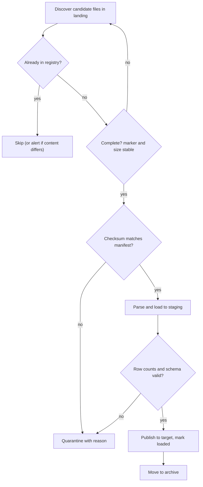

## 🎯 TL;DR

> **File-based ingestion** takes files delivered by a partner or system (over SFTP or into object storage) and loads them into the platform. The hard parts are not reading the file. They are: finding each file **exactly once**, knowing the file is **complete and intact**, and recording **what happened** to every file.

- Files land in a **landing zone**. Ingestion never reads a file that might still be written.
- A **manifest** or **done marker** says which files belong to a delivery and what their checksums are.
- A **file registry table** records every file, its checksum and its status. It is the memory that prevents reloads.
- Bad files go to **quarantine** with a reason, good files go to **archive**, and nothing is deleted silently.

## 🌱 Start simple (Junior)

> **💡 Analogy:** Think of a mailroom in an office. Parcels arrive at the front desk. The clerk logs each parcel, checks that the box is not damaged and that it is the complete order, never delivers the same parcel twice, and puts broken parcels aside with a note. The mailroom has a log book, and the log book is the source of truth.

A partner drops a file every night. A common folder layout is:

```text
/data/landing/cdr/              <- partner uploads here
/data/landing/cdr/2026-10-13/   <- one folder per delivery
    cdr_2026-10-13_0001.csv.gz
    cdr_2026-10-13_0002.csv.gz
    manifest.txt                <- expected checksums, written last
/data/processing/               <- ingestion works here
/data/archive/cdr/              <- loaded successfully
/data/quarantine/cdr/           <- failed checks, with a reason file
```

The **manifest** is the sender's promise: "these are the files, and this is what each one should hash to". It is usually written **last**, so its presence means the delivery is complete. Checking it is simple:

```bash
# manifest.txt holds one line per file: "<sha256>  <file name>"
cd /data/landing/cdr/2026-10-13 && sha256sum -c manifest.txt
```

If every line says `OK`, the files are what the sender intended to send. If one says `FAILED`, the file is corrupt or incomplete, and it should go to quarantine rather than to the warehouse.

## 🔧 How it really works (Mid)

A robust file pipeline follows the same steps for every file:



**The registry.** The registry is a table in your platform (not a file on disk). It makes "have we loaded this?" a query instead of a guess.

```sql
CREATE TABLE file_registry (
  source        text        NOT NULL,
  file_name     text        NOT NULL,
  sha256        text        NOT NULL,
  size_bytes    bigint      NOT NULL,
  row_count     bigint,
  status        text        NOT NULL
                CHECK (status IN ('discovered', 'loading', 'loaded', 'quarantined')),
  discovered_at timestamptz NOT NULL DEFAULT now(),
  loaded_at     timestamptz,
  PRIMARY KEY (source, file_name)
);

-- a second, unique constraint catches the same content sent under a new name
CREATE UNIQUE INDEX ux_file_registry_sha ON file_registry (source, sha256);
```

Two keys catch two different problems:

- **Same name, same content** (a resend or a retry): the primary key rejects it, and the pipeline skips it.
- **Different name, same content** (the partner renamed and re-sent): the checksum index catches it. Without this, you load the same data twice under two names.
- **Same name, different content** (the partner overwrote a file): this is suspicious. Do not overwrite the loaded data silently. Quarantine the new version, alert, and let a human decide. Versioned names from the sender avoid this completely.

**Completeness.** Do not trust a file just because it exists.

- **SFTP**: a writer may still be writing when you list the folder. Ask the sender to upload to a temporary name (`.part`, `.tmp`) and rename at the end, or rely on the manifest. Ingestion ignores temporary names and checks that the size is stable across two listings.
- **Object storage (S3-style)**: an object becomes visible only when the upload completes, so a half-written object is rare. A multi-file delivery still needs a marker, because "file 2 of 3 arrived" is not a state the storage can describe.

```python
import hashlib
import time
from pathlib import Path

LANDING = Path("/data/landing/cdr")

def sha256_of(path: Path) -> str:
    h = hashlib.sha256()
    with path.open("rb") as f:
        for chunk in iter(lambda: f.read(1 << 20), b""):  # 1 MiB chunks
            h.update(chunk)
    return h.hexdigest()

def is_stable(path: Path, wait_s: float = 5.0) -> bool:
    # Simple version: sleep and compare sizes. In production, compare two directory listings.
    size_before = path.stat().st_size
    time.sleep(wait_s)
    return path.stat().st_size == size_before

def discover(known_names: set[str]) -> list[Path]:
    ready = []
    for p in sorted(LANDING.glob("*.csv.gz")):
        if p.name in known_names:
            continue
        if is_stable(p):
            ready.append(p)
    return ready
```

**Corrupt and partial content.** Checksums catch transfer damage. They do not catch a file that was wrong when the sender produced it. Check these too:

- **Compression**: a truncated `gzip` stream fails with a CRC or unexpected end-of-file error. That is a whole-file failure.
- **Header and schema**: a missing column or a new column in a CSV. Fail fast, or map by name with an explicit contract.
- **Encoding**: a file in Windows-1256 loaded as UTF-8 produces garbled Persian text. A UTF-8 BOM can add an invisible character to the first column name. See [[encoding-persian-data]].
- **Record-level errors**: a few bad rows in an otherwise good file. Send them to a dead-letter location with the reason (see [[dead-letter-queue]]) and set a threshold. For example, quarantine the whole file if more than 0.1% of rows fail.

**Binary formats.** Many telecom CDRs are encoded with ASN.1 (BER or PER), not CSV. You need the compiled ASN.1 schema for the exact release that produced the file, a decoder that reads record boundaries, and a conversion to a columnar format such as Parquet. A file header and trailer often carry counts and a sequence number, which are excellent completeness checks.

**Polling or events.** Polling a folder every few minutes is simple and robust. Event notifications (for example, an object-created event sent to a queue) are faster, but they can be delivered late, more than once, or not at all. The robust design uses events for speed and a periodic **listing reconciliation** for correctness, with the registry making both idempotent.

**Load and publish.** Load into a staging table that carries the `file_name` as a lineage column. Publish to the target only after the checks pass. If the target is in the same database as the registry, update the target and the registry status in one transaction:

```sql
BEGIN;
INSERT INTO dwh.cdr_events
SELECT * FROM staging.cdr_batch
WHERE file_name = 'cdr_2026-10-13_0001.csv.gz';

UPDATE file_registry
SET status = 'loaded', row_count = 1250000, loaded_at = now()
WHERE source = 'partner_a' AND file_name = 'cdr_2026-10-13_0001.csv.gz';
COMMIT;
```

If a crash happens before the commit, nothing is half-published. The registry still says `discovered` or `loading`, and the next run retries the file.

## 🧠 Senior depth & trade-offs

- **Scale of files.** Millions of tiny files kill both listing performance and query performance (see [[small-files-problem]]). Ask the sender for larger files, or compact after landing. Conversely, a single 200 GB file cannot be parallelised unless the format is splittable, so compressed text may need chunking or a different codec.
- **Idempotency is the contract.** Retries, reruns and backfills must produce the same result. Use the registry and a deterministic publish step (overwrite a partition for that file's date, or delete-then-insert by file lineage). Never append blindly.
- **Partner trust levels.** Treat each source as untrusted until proven otherwise. Validate the manifest, enforce size limits, and scan for surprising content. Keep an SLA with the partner about delivery time and about how they correct a bad file.
- **Quarantine policy.** Whole-file quarantine is safe but can delay a day's data for a few bad records. Record-level dead-lettering keeps the data flowing but can hide a systemic problem. Choose by business impact, set a threshold, and always alert.
- **Telecom and bank realities.** CDR files in telecoms are high volume, time-sensitive for billing, and often binary. Late or duplicate files change billing totals, so reconciliation counts against the switch or mediation system matter. Persian-language fields and names need the encoding checks above.
- **Monitoring.** Track files discovered, files loaded, files in quarantine and their age, rows per file versus the previous day, and the time from delivery to publish. "No file today" is an alert, not a silent success.
- **Replay and retention.** Keep raw files for the retention period the business needs (and the law requires). Replaying from the archive is the cheapest recovery path, so make sure the archive is complete and read-only.
- **When not to use file ingestion.** If the source can give you change events or an API with incremental reads, use [[cdc]] or an API pull instead of asking a partner to produce files every night.

## 🧪 Try it

1. A delivery folder contains `cdr_0001.csv.gz`, `cdr_0002.csv.gz` and `manifest.txt`. The manifest lists three files. Describe the checks you run before anything is loaded, in order.
2. The partner resends `cdr_0002.csv.gz` with an identical checksum but a new name, `cdr_0002_v2.csv.gz`. What does the registry do, and why is the checksum index needed?
3. Write the query that lists files that have landed in the registry but have not reached `loaded` status for more than one hour.

<details><summary>Show solutions</summary>

**1.** (a) Confirm the manifest exists and is complete, since it is written last. (b) Check that every file in the manifest exists and that its size is stable. (c) Verify each checksum against the manifest. (d) Check the gzip stream is complete. (e) Only then parse and load into staging. Any failure quarantines the file with a reason.

**2.** The primary key on `(source, file_name)` does not match, because the name is new. The unique index on `(source, sha256)` catches the duplicate content and the pipeline skips or alerts. Without it, the same rows would be loaded twice under two names.

**3.**
```sql
SELECT source, file_name, status, discovered_at
FROM file_registry
WHERE status IN ('discovered', 'loading')
  AND discovered_at < now() - interval '1 hour';
```
Adjust the threshold to the delivery SLA. Alert on any rows returned, and treat `quarantined` separately because those need a human decision.

</details>

## 💬 Interview corner

**Question: "Design the ingestion of nightly files from a partner's SFTP server."**

- **Mid answer:** "Poll the SFTP folder, download files to a landing zone, check them against a manifest, parse and load into staging, then move the files to an archive. I'd keep a registry table so files are not loaded twice."
- **Senior answer:** "I'd start with the contract: the partner writes a manifest last, uses temporary names during upload, and uses versioned file names. The pipeline discovers files through a registry, validates completeness and checksums, parses with an explicit schema, and publishes in one transaction that also updates the registry. Corrupt files go to quarantine with a reason and an alert, and record-level errors go to a dead-letter location with a threshold. I'd monitor missing deliveries as strictly as bad ones, and make every step idempotent so a rerun or a backfill from the archive is safe."

**Question: "How do you avoid loading the same file twice?"** A registry keyed by the source and file name, plus a unique index on the checksum. The first stops retries; the second stops renamed resends.

> **🎤 Say this in the interview:** "I treat a file as complete only when the manifest and checksums say so. I track every file in a registry, so reruns are safe and duplicates are caught by content, not just by name. Failures are quarantined with a reason, and a missing delivery is an alert, not a silent success."

## ⚠️ Common mistakes

> **⚠️ Watch out:** Deduplicating by file name only. A renamed resend loads the same data twice.

> **⚠️ Watch out:** Reading a file from an SFTP folder while the sender is still writing it. You load a truncated file and count it as success.

- Appending to the target on every run. A retry then creates duplicates. Use a deterministic publish step.
- Overwriting a loaded file when the sender replaces it under the same name, without any alert.
- Treating "no file arrived" as success. A missing delivery is a failure to report.
- Loading CSV without an explicit schema, so a new column silently shifts every value to the right.
- Assuming UTF-8 for every partner file. Old Windows systems often export Windows-1256, and Arabic-form Persian letters (ي, ك) mix with Persian ones (ی, ک).
- Deleting source files as soon as they are loaded, with no archive to replay from.

## ✅ Check yourself (quiz)

1. Why is the manifest usually written last by the sender?
   - A) It is faster to write
   - B) Its presence signals that the delivery is complete, so ingestion does not start on a partial batch
   - C) Only the last file in a delivery can be checksummed
   - D) The partner's SFTP server requires it

<details><summary>Answer</summary>

**B** — a manifest that appears last is a completion signal. Ingestion waits for it, and it lists the checksums to verify against.

</details>

2. A file is resent with the same content and a new name. Which registry feature catches it?
   - A) The primary key on `file_name`
   - B) A unique index on the checksum (for example `sha256`) per source
   - C) The `discovered_at` timestamp
   - D) The row count

<details><summary>Answer</summary>

**B** — the name is new, so the primary key does not match. The content hash is the same, so a unique index on the checksum rejects the duplicate.

</details>

3. A partner overwrites `cdr_0007.csv.gz` with different content under the same name. What is the correct response?
   - A) Overwrite the loaded data, since the newest file is the truth
   - B) Quarantine the new version, alert, and let a person decide, keeping the loaded data intact
   - C) Load it as a new file with the same name, which the target accepts
   - D) Ignore it, since the name is already registered

<details><summary>Answer</summary>

**B** — silent overwrites destroy the audit trail and can change billing or reporting numbers. Quarantine and alert, and ask the partner for a versioned name going forward.

</details>

4. **(Senior)** A 40 GB ASN.1 file has 0.3% of records that fail to decode. The business needs the day's data by 08:00. Should you quarantine the whole file or dead-letter the bad records? What is your reasoning?
   - A) Quarantine the whole file, because any error means the file is invalid
   - B) Dead-letter the bad records with their reasons, load the rest, and alert, provided the failure rate is under an agreed threshold and the bad records are kept for replay
   - C) Ignore the errors, because 0.3% does not matter
   - D) Convert the file to CSV first, so the errors disappear

<details><summary>Answer</summary>

**B** — the threshold makes the decision explicit. A small, understood error rate should not delay the whole day, but the bad records must be stored with reasons so they can be replayed, and the alert ensures the failure is investigated. A rate above the threshold, or a sudden jump, should quarantine the file.

</details>

5. **(Senior)** Object-created events for your landing bucket are sometimes delivered twice and occasionally not at all. What design keeps the pipeline correct?
   - A) Trust the events, since they are reliable enough
   - B) Use events for low latency, but also run a periodic listing reconciliation, with the registry making each file's processing idempotent
   - C) Switch to a single nightly cron job and drop events entirely
   - D) Delete the event rule and load the files manually

<details><summary>Answer</summary>

**B** — events are the fast path and can be lost or duplicated. A periodic listing finds anything the events missed, and the registry (keyed by name and checksum) ensures duplicates are processed once. The combination is correct even when either mechanism misbehaves.

</details>

## 🗂️ Flashcards

| Front | Back |
|---|---|
| What is a landing zone? | The folder or prefix where partners deliver files, which ingestion must not read while files are still being written |
| What does a manifest provide? | The list of expected files and their checksums, usually written last as a completion signal |
| Why a file registry table? | It turns "have we loaded this file?" into a query, which makes reruns and retries safe |
| Why two uniqueness keys? | Name catches a same-name resend; the checksum catches a renamed resend with the same content |
| Same name, different content | Suspicious: quarantine, alert, and never overwrite loaded data silently |
| How to avoid partial reads on SFTP? | Upload to a temporary name and rename at the end, plus size-stability checks or a manifest |
| Quarantine vs dead-letter | Quarantine holds whole failed files; dead-letter holds individual bad records, with a threshold between them |
| Why are ASN.1 CDRs harder? | They are binary, need the exact compiled schema for the release, and need a decoder before any SQL |

## 🔗 Go further

- **batch-ingestion** covers the same discipline for database sources: watermarks, lookback and idempotent merges.
- **small-files** and **file-layout** explain how the number and layout of files affect query speed and cost.
- **data-formats** compares CSV, JSON, Avro, ORC and Parquet, which matters once the files are landed.
- **dlq-bad-records** shows how to store and replay records that fail validation.
- **encoding-persian-data** covers the encoding traps in Persian files in more depth.

