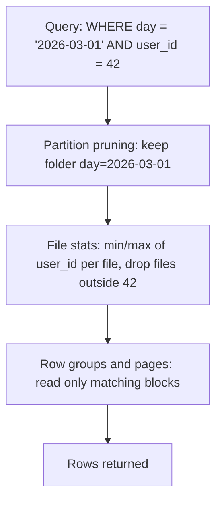

## 🎯 TL;DR

> **File layout** decides how the data is split into files and folders on storage. It controls how much the engine must read for a query. The three levers are **partitioning** (which folders exist), **file sizing** (how many files and how big), and **sorting/clustering** (what is inside each file).

- Partitioning lets the engine **skip whole folders**. Min/max statistics let it **skip whole files** and row groups. Sorting makes those statistics narrow, so more files can be skipped.
- Too many small files hurt everything: planning, listing, open/close overhead, and the cost of many small requests on object storage.
- **Compaction** rewrites small files into fewer, larger, well-sorted ones. It is the repair tool for the layout you did not design.

## 🌱 Start simple (Junior)

> **💡 Analogy:** A library. If books are shelved by subject (partition), you walk to one shelf instead of the whole building. If each shelf is sorted by author (sorting), you find a name fast. If the library has a million pamphlets in boxes of two (small files), finding anything takes forever, even with good shelves.

Say you have a year of web-visit logs, about 365 GB in total. Compare two layouts:

```text
Layout A: one folder, 365 files of 1 GB each, unsorted
  query: visits for user 42 on 2026-03-01
  -> the engine opens every file (365 GB of reads)

Layout B: folders by day, files sorted by user_id
  logs/day=2026-03-01/part-000.parquet   (about 1 GB, sorted by user_id)
  query: visits for user 42 on 2026-03-01
  -> one folder, and in it the min/max of each file tells the engine
     which files can contain user 42
```

Layout B reads a small fraction of the bytes. The same data, a different arrangement on disk.

Two rules to start with:

- Partition by something you **filter on almost always**, with a **moderate** number of values. A date is the classic example.
- Aim for files that are **hundreds of megabytes**, not kilobytes. Exact targets depend on the engine, so check its documentation.

## 🔧 How it really works (Mid)

A query engine plans in three stages, and each stage can skip data:



- **Partition pruning** works on the folder names (`day=2026-03-01`). It is cheap and exact.
- **File-level statistics** (min and max per column, stored in the Parquet footer or table metadata) let the engine skip files without opening their data. This works only if the values are clustered: if every file contains users 1 to 1,000,000, the min/max cannot exclude anything.
- **Row-group statistics** do the same inside a file. Parquet stores data in row groups, usually sized in the tens of megabytes, each with its own stats.

**Sizing.** Each file costs something: a request, metadata to read, a task to schedule. Take a concrete example. Suppose a daily job writes 2 TB across 200 countries, partitioned by `day` and `country`:

- Average per country-day: 2 TB / 200 = 10 GB.
- If the writer produces 10,000 tiny files of 200 MB each, that is 2 TB / 200 MB = 10,000 files per day, all readable. Fine.
- If the writer produces 2 million files of 1 MB each (for example, one file per Spark task per partition, after a bad shuffle), the same bytes need 2,000,000 requests. Queries slow down even though the data volume did not change.

**Partition explosion.** Partitioning by a high-cardinality column is the classic mistake. Partitioning by `day` and `user_id` with 50 million users creates 50 million folders per day, each with a tiny file. Partitioning by `day` alone (365 folders a year) is usually right.

**Compaction** is the job that merges small files in a partition into fewer target-sized files. Table formats such as Delta Lake, Iceberg and Hudi provide it as a maintenance operation; the table metadata is updated atomically, so readers see either the old or the new files, never a mix. Use a bin-packing rule (combine files until the target size is reached) and run it on the partitions that changed recently, not the whole table.

```sql
-- Iceberg-style maintenance (syntax differs per engine and version; verify in your docs)
CALL system.rewrite_data_files(
  table => 'analytics.web_logs',
  where => 'day >= DATE ''2026-03-01'''
);
```

**Sorting and clustering.** Sorting inside files makes min/max statistics narrow. For one column, sort order is enough. For queries that filter on two or three columns in any combination, **Z-ordering** (or a similar space-filling curve) interleaves the sort keys so each file covers a compact box in the multi-column space. A plain sort on `(a, b)` only helps queries that filter on `a` first. Table formats offer these as commands (`OPTIMIZE ... ZORDER BY` in Delta, sort orders and clustering in Iceberg). Check the exact syntax in the docs for your version.

**Writes.** A Spark job that writes partitioned data without a shuffle on the partition key lets every task write to every partition, so each partition gets many small files. Shuffling by the partition key before the write (`repartition` by the partition column, or the equivalent write option) gives each partition one writer and therefore fewer, larger files. See [[spark-writes]].

## 🧠 Senior depth & trade-offs

- **The trade-off triangle.** More partitions give better pruning but more files. Fewer partitions give bigger files but more data scanned per query. The right point depends on the query mix, not on a rule of thumb. Measure bytes scanned and file counts before and after each change.
- **Compaction vs streaming writes.** A streaming job that commits every minute produces many small files by design. Schedule compaction for those tables, and watch for compaction conflicting with concurrent writes. Optimistic concurrency in table formats means a rewrite can fail and retry; design the schedule so compaction and ingestion do not fight over the same partitions.
- **Time travel vs storage.** Keeping old snapshots keeps old small files on disk. Rewriting files does not free space until the old snapshots expire and the unreferenced files are removed by a vacuum-style job. A layout fix can look like it did nothing for the storage bill for days.
- **Hidden partitioning.** Iceberg can derive partitions from a column transform (for example a day from a timestamp), so queries that filter on the raw timestamp still prune. Without that, a query that filters on `event_time` but not on the `day` folder scans everything. Choose a layout that matches the filter the users write, not the one that is easy to generate.
- **Skew and file sizes.** A hot partition (one country with 60% of traffic) gets the largest files and the longest writes. Sizing by partition count alone hides this. Watch the largest file and the distribution of file sizes, not only the average.
- **OLAP engines have their own layout.** ClickHouse does not use Parquet files as its native format; its `ORDER BY` defines the sorted layout and the sparse primary index inside each part, see [[clickhouse]]. The principles (prune by partition, skip by stats, avoid many tiny parts) still apply, with different knobs.
- **Monitor.** Track file count and average and median file size per table, bytes scanned per query, the number of partitions, and the age of the oldest uncompacted file. Alert when the median file falls far below the target.
- **When not to over-engineer it.** A table of a few gigabytes with one consumer needs none of this. A single daily partition and a compaction job once a week may be enough.

## 🧪 Try it

You have a `sales` table partitioned by `(day, store_id)`, with 2,000 stores. Each day receives about 20 GB, so each store adds about 10 MB per day, and each partition holds exactly one file of about 10 MB.

1. How many files are created per day and per month, and why is this a problem for queries that filter on one month?
2. Propose a new partition key and a sort order for the common query "total revenue for store 17 in the last 7 days, by product". Justify each choice.
3. Describe a compaction job for the new layout: which partitions it touches, its target file size, and how you avoid conflicts with the ingestion job.

<details><summary>Show solutions</summary>

**1.** One file per partition means 2,000 files per day (2,000 stores times 1 file), which matches 20 GB per day in 10 MB files. A 30-day month is 30 times 2,000 = 60,000 partition folders and 60,000 files. A query on one month must list and open 60,000 small files, although the total is only about 600 GB. Most of the time goes to listing and opening files, not reading bytes.

**2.** Partition by `day` alone (about 30 folders a month, bounded in count), so each day folder holds about 20 GB that compaction can merge into roughly 100 files of 200 MB. Sort by `store_id, product_id` inside the files. The query filters on `store_id`, so sorting by it lets the min/max stats skip files for other stores, and the `day` partition prunes the 7 days. If the store filter is very common with other filters, consider Z-ordering on `store_id` and `product_id`.

**3.** Run compaction per day partition, only for days that changed in the last 24 hours. Target about 256 MB to 1 GB per file (check your table format's default). Run it in a window when ingestion is idle, or use a table format that supports concurrent rewrites and retries on conflict, and keep ingestion and compaction on different partitions when possible.

</details>

## 💬 Interview corner

**Question: "How would you choose a partition key?"** Mid answer: "The column users filter on most, usually the date, so queries skip folders."

Senior answer: "I look at the query mix first. The key must be a column that appears in most filters, has a bounded number of values, and produces files of a healthy size. I check the cardinality and the size per partition, avoid high-cardinality keys like user_id, and then decide the sort order inside the files for the secondary filters. I'd measure bytes scanned and file counts before committing."

**Question: "Your table is slow, what do you check first?"** Check the number of files and their sizes before touching the query. Many small files and skewed partitions explain most slowness in data lakes.

> **🎤 Say this in the interview:** "Layout is three decisions: what folders exist, how big the files are, and how rows are sorted inside them. I choose partitions for the most common filter with bounded cardinality, keep files in the hundreds of megabytes, and sort or cluster for the secondary filters. Compaction repairs what ingestion leaves behind."

## ⚠️ Common mistakes

> **⚠️ Watch out:** Over-partitioning. Partitioning by `day` and `user_id` or by a timestamp to the second creates millions of folders, each with a tiny file. Pruning becomes cheap, but planning and listing become the bottleneck.

- Assuming more partitions always means faster queries. They help only when the filter matches the partition column.
- Partitioning on a column that queries never filter on, which adds folders and removes nothing.
- Leaving streaming or micro-batch writes uncompacted, so each table has thousands of small files.
- Sorting by one column and expecting fast filters on a second column.
- Judging a layout by the average file size alone, while a few giant files and many tiny ones hide behind the same average.
- Running compaction on the whole table every night when only yesterday's partitions changed.

## ✅ Check yourself (quiz)

1. What does **partition pruning** do?
   - A) It deletes old partitions
   - B) It skips folders (partitions) that cannot match the filter, before opening any file
   - C) It merges small files
   - D) It sorts rows inside each file

<details><summary>Answer</summary>

**B** — pruning uses the partition values, which are encoded in the folder names or metadata, to skip whole folders. Deleting old data is retention, merging small files is compaction, and sorting is a separate layout decision.

</details>

2. A table has 2 million files of 1 MB each for 2 TB of data. What is the most direct fix?
   - A) Add more partitions by `user_id`
   - B) Compact the small files into files of a few hundred MB, and fix the writer so it does not produce them
   - C) Switch to a row-based format
   - D) Increase the number of Spark executors

<details><summary>Answer</summary>

**B** — the bytes are fine; the number of files is the problem. Compaction fixes the existing layout, and fixing the writer (a shuffle by the partition key, or a batching setting) stops the problem from returning. More partitions or more executors make it worse or do not help.

</details>

3. Why does sorting a file by `user_id` help a query that filters on `user_id = 42`, but a query on `country` does not benefit from it?

   - A) Sorting only works for numeric columns
   - B) Min/max statistics are narrow for the sorted column, so files can be skipped; for `country` the values are spread across all files, so no file can be excluded by stats
   - C) Parquet cannot store `country`
   - D) Sorting removes the need for statistics

<details><summary>Answer</summary>

**B** — after sorting by `user_id`, each file covers a narrow range of user IDs, so the engine can skip most files for `user_id = 42`. A column that is not the sort key stays spread across files, so its min/max ranges overlap and nothing is skipped.

</details>

4. **(Senior)** A streaming job commits every minute into a `day` partition. Queries on the table are slow in the morning and fast in the afternoon. What is the likely cause and what do you change?
   - A) Morning queries use a different engine
   - B) Many small files accumulated overnight; schedule compaction for the recent partitions and tune the commit interval or batch size
   - C) The table needs a larger `LIMIT`
   - D) Partition by the minute

<details><summary>Answer</summary>

**B** — a commit per minute produces many small files that build up over time, so the first queries after a quiet period see a layout that compaction never repaired. The fix is a compaction schedule for recent partitions, and a bigger batch or commit interval so fewer files are written.

</details>

5. **(Senior)** You compact a table daily, but storage costs keep growing even after the file count drops. What is the most likely explanation?
   - A) Compaction creates new copies that never expire
   - B) Old snapshots still reference the replaced small files, so they cannot be deleted until snapshots expire and a vacuum or expiry job runs
   - C) Parquet files cannot be compacted
   - D) Storage costs are unrelated to file layout

<details><summary>Answer</summary>

**B** — rewrites keep the old files reachable through earlier snapshots (for time travel). Storage is reclaimed only after snapshot expiration and removal of unreferenced files. Set a retention policy that matches the time-travel need.

</details>

## 🗂️ Flashcards

| Front | Back |
|---|---|
| Partition pruning | Skipping folders whose partition values cannot match the filter |
| File-level statistics | Min and max per column per file, used to skip files without reading them |
| Why sort the data? | Narrows min/max ranges per file so more files can be skipped |
| Z-ordering | Interleaves several sort keys so multi-column filters can skip files |
| Over-partitioning | High-cardinality partition keys creating many tiny folders and files |
| Compaction | Rewriting small files into fewer files of the target size |
| Why small files hurt | Each file adds request, metadata and scheduling overhead, even if total bytes are the same |
| Storage after compaction | Old files stay until snapshots expire and unreferenced files are removed |

## 🔗 Go further

- **[[medallion-architecture]]** shows which layers need compaction and layout care the most (usually Bronze and Silver).
- **[[small-files]]** goes deeper into the small-files problem and its causes.
- **[[compression]]** and **[[data-formats]]** explain the Parquet internals (row groups, pages, encodings) that these statistics come from.
- **[[lakehouse-table-formats]]** covers snapshots, compaction and vacuum in Iceberg, Delta and Hudi.
- **[[spark-writes]]** covers how Spark writes partitioned data and why the shuffle before the write matters.
