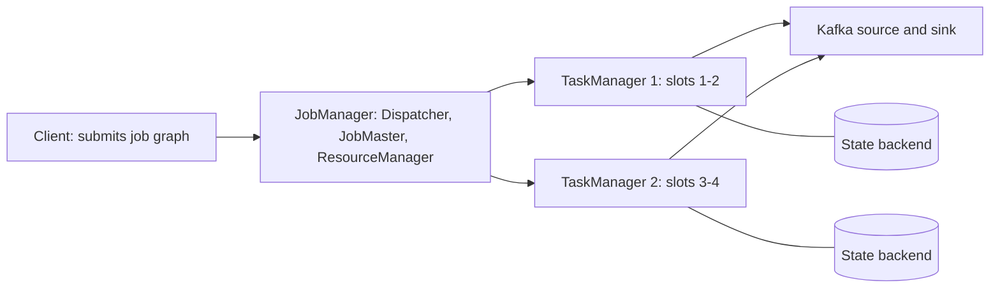

## 🎯 TL;DR

> **Apache Flink** is a stateful stream processor. It handles each record as it arrives (not in micro-batches), keeps keyed state, and uses checkpoints to recover with exactly-once **state** semantics. Exactly-once **output** needs a transactional sink as well.

- A cluster has a **JobManager** (coordination, checkpoints) and **TaskManagers** (run tasks in **slots**).
- The job is a graph of operators. Chained operators run in one thread with no network hop.
- Time is handled with **event time** and **watermarks**; windows and timers depend on them (see [[time-and-ordering]]).
- Consistency comes from **barrier-based checkpoints** plus **two-phase-commit sinks**.
- Operate it with the **Flink Kubernetes Operator** and watch **backpressure** and **checkpoint** metrics.

## 🌱 Start simple (Junior)

> **💡 Analogy:** A conveyor belt in a factory. Items (events) come one by one, each station (operator) does one step, and a supervisor (JobManager) takes a photo of the whole line at fixed times (checkpoints). If the line jams, you restart from the last photo, not from the raw materials.

A tiny job counts clicks per user in one-minute windows:

```text
clicks: (ali, 10:00:05), (ali, 10:00:40), (sara, 10:00:50), (ali, 10:01:10)
result: 10:00-10:01  ali=2, sara=1
        10:01-10:02  ali=1
```

Three ideas explain Flink:

1. **Streaming first.** Records flow through the graph continuously.
2. **Event time.** The window is decided by when the click happened, not when the job saw it. Late events are a normal fact.
3. **Recovery by snapshot.** If the job crashes, it restarts from a consistent snapshot of its state, not from the beginning of time.

## 🔧 How it really works (Mid)

### Cluster architecture



- The **JobMaster** runs one job: it schedules tasks, tracks their status and triggers checkpoints.
- A **TaskManager** is a JVM process with several **task slots**. A slot is a fixed share of memory and CPU for one parallel pipeline.
- **Slot sharing** lets one slot hold one parallel copy of each operator in a pipeline, so a slot runs a full slice of the job. This keeps network traffic between operators local when possible.

### Operators, chaining and parallelism

A job is a DAG of operators: source, map, keyBy, window, sink. Parallelism is set per operator. Flink **chains** adjacent operators with forward connections and the same parallelism into one task. A chain passes records by method call, not by serialization over the network, which is much cheaper. A `keyBy` or `rebalance` breaks the chain, because data must be shuffled.

```java
StreamExecutionEnvironment env = StreamExecutionEnvironment.getExecutionEnvironment();
env.setParallelism(4);

// clickSource: a KafkaSource<Click> defined elsewhere; CountClicks: an AggregateFunction
env.fromSource(clickSource, WatermarkStrategy
        .<Click>forBoundedOutOfOrderness(Duration.ofSeconds(10))
        .withTimestampAssigner((c, ts) -> c.eventTimeMillis()), "clicks")
    .map(c -> c.withNormalizedUser())          // chained with the source
    .keyBy(Click::userId)                      // breaks the chain: network shuffle
    .window(TumblingEventTimeWindows.of(Duration.ofMinutes(1)))
    .aggregate(new CountClicks())
    .sinkTo(kafkaSink);
```

### DataStream API and Flink SQL

- The **DataStream API** gives full control: keyed state, timers, custom process functions.
- **Flink SQL** and the **Table API** express the same logic declaratively and use the optimizer. Windows are written as table-valued functions:

```sql
SELECT window_start, window_end, user_id, COUNT(*) AS clicks
FROM TABLE(
  TUMBLE(TABLE clicks, DESCRIPTOR(ts), INTERVAL '1' MINUTE))
GROUP BY window_start, window_end, user_id;
```

Use SQL for standard aggregations and joins. Drop to the DataStream API when you need custom state or timers.

### Watermarks and windows

A **watermark** is a claim: "no events older than this timestamp should arrive any more". `forBoundedOutOfOrderness(10 s)` means the watermark is the largest event time seen minus 10 seconds. A window closes when the watermark passes its end. Events that arrive after that are **late**. You can allow a lateness period (keeping the window state longer and updating the result), or send late events to a side output. Idle sources hold the watermark back, so configure idleness for partitions that stop producing.

### Checkpoints

The JobManager periodically injects **barriers** into the sources. Barriers flow with the data. When an operator receives a barrier on all inputs (**aligned checkpoint**), it snapshots its state and forwards the barrier. Once every operator has acknowledged, the checkpoint is complete and sources can be rewound to the offsets stored in it on recovery. This is the Chandy-Lamport idea adapted for dataflow.

- **Aligned** checkpoints wait for slow channels, which hurts under [[backpressure]].
- **Unaligned** checkpoints let barriers overtake in-flight buffered records and store those records in the checkpoint. Alignment is shorter, the checkpoint is bigger.

### Exactly-once end to end

Flink's internal state is exactly-once after a restore. Output is different: a sink that writes a record before the checkpoint completes can duplicate it on replay. The fix is a **two-phase commit** sink:

1. **Pre-commit:** on each checkpoint barrier, the sink flushes its data into an open transaction and records the transaction in the checkpoint state.
2. **Commit:** when the JobManager confirms the checkpoint is complete, the sink commits the transaction.

If the job fails before the commit, the transaction is aborted or re-committed on recovery, depending on the sink. For Kafka, the sink writes inside Kafka transactions, and downstream consumers must use `read_committed` to see only committed data:

```java
KafkaSink<String> sink = KafkaSink.<String>builder()
    .setBootstrapServers("broker:9092")
    .setRecordSerializer(KafkaRecordSerializationSchema.builder()
        .setTopic("clicks-agg")
        .setValueSerializationSchema(new SimpleStringSchema())
        .build())
    .setDeliveryGuarantee(DeliveryGuarantee.EXACTLY_ONCE)
    .setTransactionalIdPrefix("clicks-agg-job")   // unique per job
    .build();
```

Set the Kafka transaction timeout longer than the checkpoint interval plus recovery time, or the broker aborts transactions before the commit happens.

### Operations: backpressure and the Kubernetes Operator

- **Backpressure** shows up when a downstream task cannot keep up: its input buffers fill and upstream tasks slow down. The Web UI and the backpressure metrics show which operator is the bottleneck. Fix the bottleneck (skew, a slow external lookup, too little parallelism), not the upstream.
- The **Flink Kubernetes Operator** manages `FlinkDeployment` resources: it deploys the cluster, submits the job, handles savepoint-based upgrades and restarts failed jobs. Use it instead of hand-rolled manifests when you run many jobs.

## 🧠 Senior depth & trade-offs

- **Flink vs Spark Structured Streaming.** Flink processes records continuously with native event-time timers and low per-record latency. Spark Structured Streaming runs micro-batches by default, with a unified API for batch and streaming and a strong SQL and ML ecosystem. Choose Flink for low-latency stateful event processing (fraud, sessionization, CDC pipelines). Choose Spark when you already run Spark for batch and latency of seconds is fine. Both can now do a lot; decide by latency, state needs and team skills, not by a benchmark you did not run yourself.
- **Parallelism and key skew.** Parallelism is capped by the number of key groups and by the busiest key. One hot key sends all its load to one subtask. Use pre-aggregation (local then global), key salting for associative aggregates, or a design that does not need the key at all.
- **Checkpoint cost.** The checkpoint interval trades recovery time for overhead. Large state with RocksDB and incremental checkpoints keeps the upload small, but compaction can still spike it. Watch the checkpoint duration, alignment time and failure count together. See [[streaming-state]] for the state side.
- **Watermark idleness and skew.** One slow partition holds the global watermark back, so windows never close and state grows. Idleness settings and per-partition watermarks are the usual answer.
- **Flink CDC.** Flink CDC reads database change logs (for example via Debezium-style log readers) directly into Flink, which avoids a separate Kafka Connect hop for some pipelines. Consider the snapshot phase, schema changes and the database's log retention before you rely on it; this is where ingestion bugs usually appear. Compare with [[cdc]].
- **Upgrades.** Changing the job graph or the state schema needs a savepoint and a compatible restore. Operator IDs (`uid()`) must be set explicitly, or the state will not map to the new job after a refactor.
- **When not to use Flink.** For simple per-record transformations with a small team and seconds of latency, a managed connector or a Kafka Streams app is simpler to run. Flink is worth its operational cost when you need exactly-once state at scale or event-time logic that is hard to express elsewhere.
- **What to monitor:** backpressure per operator, checkpoint duration and failures, watermark lag per source, records in and out per second, GC time on TaskManagers, and consumer lag on the Kafka source.

## 🧪 Try it

1. **Chaining.** In the code above, list which operators are chained together and which ones start a new task. Explain why `keyBy` must start a new task.
2. **Watermark arithmetic.** With `forBoundedOutOfOrderness(10 s)`, the largest event time seen is `10:05:30`. Which window ending at `10:05:00` can still accept events? What is the watermark value?
3. **Exactly-once check.** A Kafka sink with `EXACTLY_ONCE` and a checkpoint every 60 s. A consumer reads with `read_committed`. Explain what happens to records written after the last completed checkpoint when the job crashes.

<details><summary>Show solutions</summary>

**1.** `fromSource` and `map` are forward-connected with equal parallelism, so they form one chain. `keyBy` redistributes records by key hash across the network, so a new task starts after it. The window, aggregate and sink are forward-connected after that shuffle at the same parallelism, so they normally chain into the second task. Confirm the real grouping in the job graph of the Web UI, because the sink's own internal operators can change it.

**2.** The watermark is `10:05:30 - 10 s = 10:05:20`. The window `[10:04:00, 10:05:00)` closed when the watermark passed `10:05:00`, which already happened, so it is past the watermark. Only with allowed lateness set (for example 1 minute) would it still accept events, and the result would be updated.

**3.** Records written after the last completed checkpoint are in an open Kafka transaction that is not committed. After the crash, the job restores from the checkpoint and the open transaction is aborted (or fenced), so the `read_committed` consumer never sees those records. The restored job re-emits them in a new transaction. Consumers see each result once.

</details>

## 💬 Interview corner

**Question: "How does Flink achieve exactly-once?"** Mid: "It uses checkpoints, so after a failure it replays from the last checkpoint and results are exactly once." Senior: "Internal state is exactly-once through barrier-aligned or unaligned checkpoints that snapshot state and source offsets consistently. Output exactly-once needs a transactional sink with two-phase commit, which commits only after the checkpoint completes. For Kafka, that means transactions and `read_committed` consumers, with a transaction timeout longer than checkpoint plus recovery time. Non-transactional sinks give at-least-once unless the writes are idempotent."

**Question: "Flink vs Spark Structured Streaming?"** Mid: "Flink is true streaming and Spark is micro-batch." Senior: "Flink gives per-record processing with rich event-time timers and low latency, which suits stateful event processing. Spark gives one engine for batch and streaming and a large SQL and ML ecosystem, with latency measured in seconds for most workloads. I'd pick based on latency target, state size and whether the team already runs Spark."

> **🎤 Say this in the interview:** "Flink guarantees exactly-once state through checkpoints. For exactly-once output I need a two-phase-commit sink, and I check the transaction timeout against the checkpoint interval. My first operational metrics are backpressure per operator and checkpoint duration."

## ⚠️ Common mistakes

> **⚠️ Watch out:** Believing that exactly-once checkpoints mean exactly-once output. A sink without transactions or idempotent writes still duplicates records after a replay.

> **⚠️ Watch out:** Setting a Kafka transaction timeout shorter than checkpoint interval plus recovery time. The broker aborts the transaction and the job fails or loses the in-flight commit.

- Fixing backpressure by adding parallelism to the upstream operator when the bottleneck is downstream.
- Forgetting `uid()` on stateful operators, so a refactor cannot restore state.
- Using processing time for windows when the business question is about event time.
- Ignoring idle partitions, so the watermark never moves and windows never fire.
- Using a huge global window with no state TTL and assuming it will be cleaned up.

## ✅ Check yourself (quiz)

1. What does a TaskManager slot represent?
   - A) One Kafka partition
   - B) A fixed share of memory and CPU in a TaskManager for a pipeline slice
   - C) One checkpoint barrier
   - D) A savepoint file

<details><summary>Answer</summary>

**B** — a slot is a fixed share of a TaskManager's resources. Several parallel operator tasks of the job can share one slot through slot sharing.

</details>

2. Which operators are most likely to end up in the same task?
   - A) Two operators connected by `keyBy`
   - B) Two operators connected by a forward connection with equal parallelism
   - C) Any source and any sink
   - D) Operators in different jobs

<details><summary>Answer</summary>

**B** — forward-connected operators with the same parallelism are chained into one task and pass records by method call. `keyBy` redistributes data over the network, which breaks the chain.

</details>

3. A window closes when the watermark passes its end. What happens to an event that arrives after that, with no allowed lateness?

   - A) It is always written to the window anyway
   - B) It is treated as late and dropped, or sent to a side output if one is configured
   - C) It moves the watermark backwards
   - D) It causes the job to restart

<details><summary>Answer</summary>

**B** — with no allowed lateness, the window is already emitted and its state gone, so the event is late. Configure allowed lateness or a side output to handle it.

</details>

4. **(Senior)** A pipeline writes to a non-transactional HTTP sink with at-least-once delivery. The team says "we use Flink exactly-once, so we are safe". What is the flaw and what do you propose?

   - A) Flink does not support HTTP
   - B) Exactly-once state does not make external side effects exactly-once; the sink must be idempotent (stable keys, upserts) or use a two-phase-commit sink
   - C) The checkpoint interval must be 0
   - D) Nothing is wrong; state and output are the same thing

<details><summary>Answer</summary>

**B** — Flink restores state consistently, but a replayed record can be sent to the HTTP endpoint twice. The fix is idempotent writes keyed by a stable ID, or a sink that participates in checkpoints.

</details>

5. **(Senior)** After a refactor, a restarted job starts with empty state for one operator even though the savepoint contains it. What is the most likely cause?

   - A) The parallelism was increased
   - B) The operator's `uid()` changed or was never set, so state cannot be mapped to it
   - C) Watermarks were disabled
   - D) The job used Flink SQL

<details><summary>Answer</summary>

**B** — state is matched to operators by uid. Set uids explicitly on stateful operators so refactors keep the mapping, and check the savepoint restore report before deploying.

</details>

## 🗂️ Flashcards

| Front | Back |
|---|---|
| JobManager vs TaskManager | JobManager coordinates a job and checkpoints; TaskManagers run tasks in slots |
| What is a slot? | A fixed share of a TaskManager's memory and CPU for a pipeline slice |
| Operator chaining | Forward-connected operators with equal parallelism run in one task, without network hops |
| What breaks a chain? | Shuffles such as `keyBy`, `rebalance` or a different parallelism |
| Aligned vs unaligned checkpoint | Aligned waits for barriers on all inputs; unaligned lets barriers overtake buffered data |
| Exactly-once output needs | A transactional or idempotent sink with two-phase commit tied to checkpoints |
| Watermark with bounded out-of-orderness | Largest event time seen minus the allowed out-of-orderness |
| Why set `uid()`? | So state maps to the same operator after a job graph change |

## 🔗 Go further

- **streaming-state** explains state backends, TTL and checkpoint size in depth.
- **kafka-exactly-once** covers Kafka transactions and `read_committed` from the broker side.
- **spark-structured-streaming** is the main comparison point for the Flink vs Spark question.
- **stream-concepts** and **time-and-ordering** cover event time, windows and watermarks.
- **pattern-exactly-once** and **pattern-late-data** show these ideas as end-to-end designs.
- Check the Flink documentation for your exact version before quoting configuration defaults, especially for checkpointing and the Kubernetes Operator.
