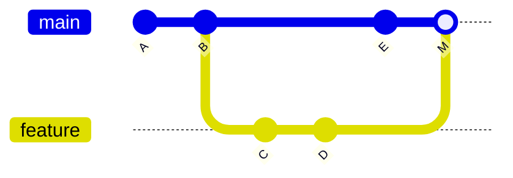

## 🎯 TL;DR

> Git records history as a graph of **commits**. A workflow is the set of rules your team uses to add to that graph safely: small branches, reviewed changes, automated checks, and a main branch that is always deployable.

- A **commit** is a snapshot plus a pointer to its parent(s). A **branch** is a movable name for one commit.
- **Merge** keeps history as it happened (a merge commit joins two lines). **Rebase** replays your commits on a new base, producing new commits with new IDs.
- **Trunk-based development**: short-lived branches merged to `main` often, behind tests and CI.
- For data teams, the same discipline applies to SQL, dbt models, DAGs and infrastructure code. A data change that is not reviewed and tested is a production incident waiting to happen.

## 🌱 Start simple (Junior)

> **💡 Analogy:** Git is a set of save points in a video game. Each commit is a save point with a note. A branch is a label that points to the latest save point in one path. You can try a risky change on a separate path and throw it away if it fails, without touching the main path.

A minimal daily loop:

```bash
git status                          # what changed?
git diff                            # show the exact changes
git add models/orders.sql           # stage one file
git commit -m "Fix duplicate orders in daily load"
git push -u origin feature/fix-orders-dup
```

Start new work from an up-to-date main branch, on its own branch:

```bash
git switch main
git pull --ff-only                  # fail if the history diverged, do not create a surprise merge
git switch -c feature/fix-orders-dup
```

> **⚠️ Watch out:** `git add .` adds everything in the folder, including generated files, credentials and large data dumps. Stage files by name, and check `git status` before committing.

Commit messages should say **why** the change exists, in the imperative mood ("Fix duplicate orders", not "fixed stuff"). Someone reading `git log` in six months should understand the intent.

## 🔧 How it really works (Mid)

### The graph

Each commit has a unique hash and points to its parent. A merge commit has two parents. A branch is just a name for a commit, and `HEAD` is the name of where you are now.



### Merge vs rebase

Both bring changes from one line into another. They differ in what happens to history.

| | `git merge main` on your branch | `git rebase main` on your branch |
|---|---|---|
| What happens | creates one merge commit with two parents | replays your commits on top of `main`, new hashes |
| History | shows the real parallel work | linear, reads like one story |
| Safe on shared branches | yes | no, it rewrites commits others may have |
| Typical use | integrate a long-lived branch, keep an audit trail | tidy a private branch before review |

Worked example. Your branch `C-D` was started from `B`. Meanwhile `main` got `E`.

```bash
git switch feature
git rebase main          # C and D are replayed on top of E, and get new hashes C' and D'
git switch main
git merge --ff-only feature   # fast-forward: main moves from E to D' with no merge commit
```

Interactive rebase cleans your own commits before review:

```bash
git rebase -i main       # editor opens: pick, reword, squash, fixup, drop
```

Rule to remember: **rebase only what you have not shared**. If others have pulled your branch, rewriting it breaks their copy. When you must update a shared branch after a rebase, use `git push --force-with-lease`, which refuses the push if someone else pushed in the meantime. Plain `--force` can silently erase their work.

### Trunk-based development

The team works on `main` (the trunk) with branches that live for hours or a few days, not weeks. Each merge runs CI. Work that is not ready is hidden behind a flag or kept out of the deployed path, so `main` is always deployable.

Compare with long-lived **GitFlow** branches (`develop`, `release/*`, `hotfix/*`). GitFlow adds merge pain because branches drift. For a data team that deploys pipelines daily, trunk-based with short branches is usually the simpler choice. The trade-off is that you need good tests and feature flags.

### Code review

A pull request (PR) or merge request shows the diff, runs CI, and asks one or more people to approve. For data work, a good review checks:

- the **grain** and join keys of any new model (a join that duplicates rows is the classic bug),
- the **schema change** and whether downstream consumers break,
- the **backfill plan** and cost (a full rebuild of a 5 TB table is not a casual change),
- tests: uniqueness, not-null, accepted values, row-count sanity checks.

### Monorepo for data

Putting SQL models, DAGs, Python jobs, infrastructure and tests in one repository makes it possible to change a table and its consumers in one atomic PR. The cost is CI that must select only the affected parts (for example, by path filters or a dependency graph) so the pipeline stays fast.

### Pre-commit hooks

A pre-commit hook runs checks before a commit is created. Git runs hooks from `.git/hooks/`, but teams usually share them through a tool such as the `pre-commit` framework, configured in a versioned file:

```bash
# one-time setup in a repository (after installing pre-commit)
pre-commit install
```

```yaml
# .pre-commit-config.yaml (illustrative)
repos:
  - repo: https://github.com/pre-commit/pre-commit-hooks
    rev: v4.6.0          # pin a version you have verified
    hooks:
      - id: check-yaml
      - id: detect-private-key
      - id: end-of-file-fixer
```

Hooks catch cheap problems (secrets, broken YAML) before CI. They should be fast, because developers will disable slow hooks.

## 🧠 Senior depth & trade-offs

- **Branch strategy is a throughput decision.** Long branches create merge conflicts and hide integration bugs. Measure the time from branch creation to merge; if it is more than a few days, the process is the bottleneck, not the people.
- **Protect `main`.** Require passing CI, at least one approval, and no force-pushes. Keep the CI run on the merge commit as well as on the PR, so a conflict-free but broken combination is caught.
- **Secrets are permanent once pushed.** Removing a file in a new commit does not remove it from history. If a key was committed, rotate it first, then clean history with a tool such as `git filter-repo` and force-update everyone's clones. Prevention (pre-commit secret scanning, `.gitignore`) is much cheaper.
- **Large binary and data files.** Git is not a data store. Do not commit datasets or model binaries; use object storage with a reference file, or Git LFS if the team truly needs versioned binaries. A repository grows forever, and clones get slow.
- **Deploy from Git, not from laptops.** The state of production should be reproducible from a commit. This is the link to [[dataops-cicd]]: the pipeline builds from a tagged commit, and rollback means deploying the previous tag.
- **Migrations and merge order.** For schema changes, deploy the backward-compatible step first (add column, write both), then migrate readers, then remove the old column. A single PR that changes a table and all consumers at once is a bigger risk than it looks, even in a monorepo.
- **When not to use what.** Do not rebase a branch that a colleague is building on. Do not use `git reset --hard` on work you have not committed; it has no undo. Do not turn every pipeline change into a multi-week GitFlow release if you deploy daily.

## 🧪 Try it

Run these in a scratch repository (`mkdir /tmp/git-lab && cd /tmp/git-lab && git init -b main`):

1. Create a file `orders.sql` with one line, commit it on `main`. Create a branch `feature/a`, change the line, commit. Go back to `main`, change a different line, commit. Now `git merge feature/a`. Describe what the history looks like.
2. Repeat step 1, but use `git switch feature/a && git rebase main` instead of merge, then `git switch main && git merge --ff-only feature/a`. Compare `git log --oneline --graph` for both runs.
3. Write the command sequence you would use to safely update a branch that you already pushed and rebased, without destroying a colleague's new commit.

<details><summary>Show solutions</summary>

**1.** After `git merge feature/a` on `main` (with a conflict-free change to a different line), Git creates a merge commit with two parents. `git log --oneline --graph` shows two lines joining at the merge commit.

**2.** The rebase replays the `feature/a` commit on top of the new `main` commit, giving it a new hash. The fast-forward merge then moves `main` forward without a merge commit, so the graph is a straight line.

**3.**
```bash
git push --force-with-lease origin feature/a
```
`--force-with-lease` refuses the push if the remote branch has a commit you have not fetched. Fetch and inspect first (`git fetch && git log origin/feature/a`), then rebase onto the new remote state if needed, not blindly onto your old copy.

</details>

## 💬 Interview corner

**Question: "Merge or rebase?"** Mid answer: "Rebase to keep history linear on my own branch before review; merge to integrate a shared branch so the history shows the real parallel work." Senior answer: "It depends on who else has the commits. I rebase private work freely and use `--force-with-lease` when I must update a pushed branch. I never rewrite `main`. I prefer short-lived branches merged with a squash or fast-forward so the history stays readable and each merge maps to one reviewed change."

**Question: "How would you bring software engineering practices to a data team?"** Senior answer: "Put SQL, DAGs and infrastructure in version control, require PRs with a checklist (grain, schema change, backfill cost), add automated tests such as uniqueness and freshness checks in CI, and deploy from tagged commits so rollback is one command. I would start with the highest-risk tables, not with a rewrite of everything."

**Question: "A bad commit was pushed to main. What now?"** Mid: "`git revert` creates a new commit that undoes it. It is safe for shared branches." Senior: "Revert first to restore service quickly, then fix forward in a PR. I do not rewrite `main` to hide the mistake, because other clones and deployments depend on it. If a secret was pushed, I rotate it before anything else."

> **🎤 Say this in the interview:** "I keep branches short, rebase only private work, and never force-push shared branches without `--force-with-lease`. For data teams I treat SQL and pipelines like code: reviewed PRs, automated data tests in CI, and deployments from tagged commits."

## ⚠️ Common mistakes

> **⚠️ Watch out:** `git push --force` to a shared branch can erase a teammate's commits. Use `--force-with-lease`, and only after you know what is on the remote.

- Committing secrets, `.env` files or data dumps, then deleting them in a later commit. The history still contains them.
- Long-lived feature branches that drift for weeks, then produce a huge conflicting merge.
- Rebasing a branch someone else has checked out.
- Using `git add .` without checking `git status`.
- Writing commit messages like "fix" or "wip" on main, which makes `git log` useless for incident review.
- Skipping review because "it is only a SQL change". A wrong join in a model can duplicate revenue for every dashboard.
- Using `git reset --hard` on uncommitted work. Commit or `git stash` first.

## ✅ Check yourself (quiz)

1. What does `git merge` create when `feature` has commits that `main` does not, and `main` also has new commits?
   - A) A new branch named `feature`
   - B) A merge commit with two parents
   - C) A rebased copy of `feature` with new hashes
   - D) Nothing; merge only moves the HEAD pointer

<details><summary>Answer</summary>

**B** — when both branches have diverged, Git creates a merge commit that has both tips as parents. Rebase (option C) produces new hashes, but merge does not.

</details>

2. You rebased a branch you already pushed. Which push command is the safest way to update the remote?
   - A) `git push`
   - B) `git push --force`
   - C) `git push --force-with-lease`
   - D) `git push --mirror`

<details><summary>Answer</summary>

**C** — `--force-with-lease` overwrites the remote only if it still matches the commit you last fetched, so you do not erase a colleague's new commit. Plain `--force` (B) has no such check. A plain push (A) is rejected after a rebase.

</details>

3. A teammate accidentally committed a database password two commits ago and the branch is pushed. Deleting the file in a new commit is enough. True or false?
   - A) True; the file is removed from the repository
   - B) False; the password remains in history and must be rotated, and history cleaned if needed
   - C) True, if the repository is private
   - D) False, only if the commit was signed

<details><summary>Answer</summary>

**B** — history keeps the old blobs, and anyone with a clone has them. Rotate the credential first, then consider rewriting history with a tool such as `git filter-repo` and coordinate with everyone who has clones.

</details>

4. **(Senior)** Your data team deploys pipelines daily, and feature branches take 3 weeks to merge with many conflicts. What is the most likely root cause, and what is a better workflow?
   - A) Too few reviewers; add more
   - B) Long-lived branches drift from `main`; move to trunk-based development with short-lived branches, CI on every merge, and feature flags or dark launches for unfinished work
   - C) Git is too slow; switch to a file share
   - D) Commits are too small; squash everything into one per week

<details><summary>Answer</summary>

**B** — long branches accumulate divergence and hide integration bugs, so the conflicts grow with time. Short branches merged often, tested by CI, and gated by flags keep `main` deployable and the diffs small.

</details>

5. **(Senior)** Why is a monorepo for SQL models, DAGs and tests useful for a data team, and what does it require?
   - A) It removes the need for code review
   - B) A single PR can change a table and its consumers atomically, but CI must select only the affected parts to stay fast
   - C) It stores data files efficiently
   - D) It makes rebase unnecessary

<details><summary>Answer</summary>

**B** — co-locating producer and consumer code lets one reviewed change update both, avoiding broken intermediate states across repositories. The cost is that CI needs path filters or a dependency graph, otherwise every change runs the whole suite.

</details>

## 🗂️ Flashcards

| Front | Back |
|---|---|
| What is a commit? | A snapshot of the tree plus pointers to its parent commit(s) |
| What is a branch? | A movable name pointing to one commit |
| Merge vs rebase (effect on history) | Merge adds a commit with two parents; rebase replays commits with new hashes |
| When is it unsafe to rebase? | When others have based work on the commits you would rewrite |
| `--force` vs `--force-with-lease` | `--force` overwrites blindly; `--force-with-lease` refuses if the remote changed since your last fetch |
| What is trunk-based development? | Short-lived branches merged to `main` often, behind CI and feature flags |
| Why is a pushed secret still a leak after deletion? | Git history keeps old blobs; rotate the secret, then clean history if needed |
| What does a pre-commit hook do? | Runs checks (secrets, YAML, formatting) before a commit is created |

## 🔗 Go further

- **dataops-cicd** explains how a tagged commit becomes a tested, deployed pipeline, and how rollback works.
- **dbt** and **airflow** are the typical data tools whose code lives in Git; their tests and DAG review follow the same workflow.
- **data-quality** describes the checks to put in CI so a bad model fails before it reaches dashboards.
- Read `git help rebase` and the "Reset, restore and revert" section of the Git documentation once; the exact behaviour of `reset`, `restore` and `revert` is what people get wrong under pressure.
