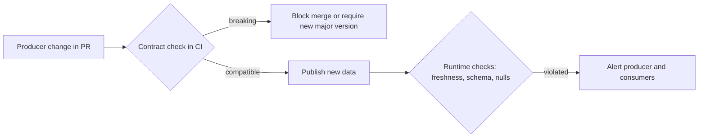

## 🎯 TL;DR

> **Data governance** decides who owns data, what rules apply to it, and how its quality and access are controlled. A **data contract** is a versioned agreement between a data **producer** and its **consumers** about schema, meaning, freshness and quality. **Data Mesh** is an organizational approach that gives domain teams ownership of their data as products, on a shared self-serve platform with federated rules.

- Governance without owners is a policy document. Ownership is the first control.
- Contracts move quality checks to the **producer side**, where a breaking change is caught before it reaches consumers.
- Data Mesh is mainly about **who owns what** and **how teams work**. It is not a technology, and it has real costs and critics.

## 🌱 Start simple (Junior)

> **💡 Analogy:** A shared kitchen in an office building. Each team cooks for the others. Governance is the house rules: who cleans the fridge, which allergens must be labelled. A contract is the menu promise: "our soup always has these ingredients, at this time, and if we change the recipe we tell you first." Data Mesh is the decision to give each floor its own kitchen, as long as they follow the same building rules.

Here is the problem contracts solve. The checkout service changes `amount` from cents to euros. Its own tests pass. The finance dashboard shows revenue 100 times too high, and nobody notices for a week. The producer did nothing wrong by its own definition, but there was no agreement that the consumer could rely on.

A contract makes the agreement explicit:

```yaml
dataset: orders
owner: checkout-team
version: 2.1.0
schema:
  - {name: order_id, type: string, nullable: false, unique: true}
  - {name: amount_cents, type: integer, nullable: false}
  - {name: currency, type: string, nullable: false, allowed: [EUR, USD, GBP]}
freshness:
  max_lag_minutes: 60
change_policy: removing, renaming or retyping a column requires a new major version
```

## 🔧 How it really works (Mid)

**Governance** covers several controls. The useful way to remember them:

| Control | Question it answers | Typical mechanism |
|---|---|---|
| Ownership | Who answers for this dataset? | Owner field in the catalog, steward role |
| Classification | Is it personal, financial, public? | Tags (PII), column-level labels |
| Access | Who may read it, and who approved? | Roles, grants, approval workflows |
| Quality | Is it fit for use? | Tests, observability, SLAs |
| Retention | How long must we keep it, and when must we delete it? | Lifecycle rules, deletion jobs |
| Lineage and change | What depends on it, and what changes? | Lineage graph, change logs |

**Data contracts** are the producer-side part of that. A contract has four parts: the **schema** (names, types, nullability, allowed values), the **semantics** (what a field means, which the description and business terms carry), the **service levels** (freshness, completeness, availability) and the **change policy** (how breaking changes are announced and versioned). Enforcement can run in three places:



A row-level check that a pipeline can run against the contract:

```python
contract = {
    "schema": [
        {"name": "order_id", "nullable": False},
        {"name": "amount_cents", "nullable": False},
        {"name": "currency", "nullable": False, "allowed": ["EUR", "USD", "GBP"]},
    ]
}

def check_row(row: dict, contract: dict) -> list[str]:
    errors = []
    for col in contract["schema"]:
        value = row.get(col["name"])
        if value is None and not col["nullable"]:
            errors.append(f"{col['name']} is null")
        if "allowed" in col and value is not None and value not in col["allowed"]:
            errors.append(f"{col['name']}={value!r} not allowed")
    return errors

print(check_row({"order_id": "a1", "amount_cents": 500, "currency": "JPY"}, contract))
# ["currency='JPY' not allowed"]
```

**Data Mesh** (a term from Zhamak Dehghani's work) rests on four principles:

1. **Domain ownership:** the team that understands the business process owns the data it produces.
2. **Data as a product:** datasets have consumers, documentation, SLAs and a product owner.
3. **Self-serve data platform:** a central platform team gives domains tools for storage, pipelines and publishing, so each domain does not build infrastructure from scratch.
4. **Federated computational governance:** global standards (naming, privacy, interoperability) are enforced by code and automation, while domains decide the details.

## 🧠 Senior depth & trade-offs

- **Contracts are an API for data.** Treat schema changes like API versioning: deprecation windows, consumer lists from lineage, and a migration plan. A breaking change without a version is a production incident waiting to happen.
- **Where the contract lives matters.** A contract in a repository that the producer owns, enforced in its CI, catches changes early. A contract that exists only in a wiki is a promise nobody checks.
- **Runtime checks are still needed.** Upstream systems change in ways CI cannot see, such as a source database column that starts receiving a new value. Keep row and freshness checks running in the pipeline, as described in [[data-observability]].
- **Governance is a trade-off between control and speed.** Central approval for every new column stops mistakes and stops teams. Automated policy checks (for PII columns, naming, retention tags) scale better than committees.
- **Data Mesh's real claim.** The bottleneck in many companies is the central data team that becomes a queue for every request. Mesh tries to move ownership to the people who know the business. The technical platform is the part that makes this possible at all.
- **Criticisms of Data Mesh.** These are worth knowing:
  - It needs a mature platform and mature domain engineering. Without them, each domain rebuilds the same pipelines badly.
  - Duplicated effort and inconsistent definitions across domains, which cross-domain analytics must reconcile.
  - Cross-domain joins and consistency are harder when ownership is split.
  - Small companies usually do not have enough domains to justify the overhead.
  - It is often adopted as a label for reorganizing teams, without changing the incentives or the platform.
- **Quality ownership moves upstream.** Contracts make producers accountable for what consumers see. This needs incentives: a team measured only on feature delivery will not maintain contracts.
- **When not to adopt it.** A small company with one data team and a few sources does better with a central team, clear ownership in the [[data-catalogs|catalog]], and a few contracts for the critical feeds. Adopt mesh-style ownership gradually, one domain at a time, where it removes a real bottleneck.

## 🧪 Try it

1. Add a field `discount_cents` (nullable, integer) to the contract and to `check_row`. Then decide: is adding this field a breaking change under the change policy above? Explain why.
2. A producer renames `amount_cents` to `amount_minor`. Describe the steps you would follow so consumers are not broken. Name the versions you would use.
3. Your company is 40 engineers across five product teams with one data team of three people, and the data team is a bottleneck. Propose a first step toward domain ownership that does not require a full Data Mesh rollout.

<details><summary>Show solutions</summary>

**1.** Adding a nullable field is usually a **backward-compatible** change: existing consumers that ignore unknown columns keep working. Under the policy above, only removing, renaming or retyping a column needs a new major version. The `check_row` function must still accept rows that do not contain the field, so the new check should not require it.

**2.** Publish a new version that contains both `amount_cents` and `amount_minor` (a minor-version change, for compatibility). Announce the deprecation with a date. Find consumers through lineage and the catalog. Migrate them. Then remove `amount_cents` in a new major version, after consumers have moved. Renaming in place without this sequence is a breaking change.

**3.** Pick one product team with a clear business domain and make it the owner of its key datasets, with a contract and an SLA, while the data team provides the shared platform and standards. Keep the rest of the organization as it is. Measure whether the data team's queue shrinks and whether consumer incidents fall. Expand only after that works.

</details>

## 💬 Interview corner

**Question: "What is a data contract, and why would you use one?"** Mid answer: "A data contract is an agreement about a dataset's schema and quality between the producer and consumers. It prevents breaking changes from reaching dashboards without warning." Senior answer: "It is an API-like agreement with four parts: schema, semantics, service levels and a change policy. I enforce the schema and nullability in the producer's CI, keep freshness and row checks at runtime, and version breaking changes. The hard part is incentives: the producer has to own the consumers' experience, so I make contract health part of the team's goals."

**Question: "What do you think of Data Mesh?"** A balanced answer is what this question tests. Mid answer: "It is a way to give domain teams ownership of their data, using a shared platform." Senior answer: "The principles are useful, especially when a central team is the bottleneck. I would not adopt it as an organization-wide rewrite. It needs a mature self-serve platform and strong domain engineering, and it adds duplicated effort and cross-domain consistency problems. I would start with one or two domains where ownership is clear and measure the result."

> **🎤 Say this in the interview:** "I see governance as ownership first, then policies and checks. A data contract makes the producer's promise explicit and enforceable. Data Mesh is a useful set of principles for ownership, but I would adopt it where a central team is the real bottleneck, not as a blanket reorganization."

## ⚠️ Common mistakes

> **⚠️ Watch out:** Treating Data Mesh as a technology to buy. It is an operating model, and the platform is only one part of it.

- Writing contracts that nobody enforces. A contract without a check is documentation.
- Changing a column type in place and calling it a "minor" change because the test suite passed.
- Making governance a committee for every change, which slows teams without reducing incidents.
- Assuming domain ownership removes the need for shared definitions. Cross-domain metrics still need agreed terms.
- Launching a mesh with no self-serve platform, so each domain rebuilds the same pipelines.
- Measuring governance by the number of policies written instead of incidents avoided and consumers served.

## ✅ Check yourself (quiz)

1. Which of these is a **data contract**?
   - A) A dashboard that shows table freshness
   - B) A versioned agreement between a producer and its consumers about schema, meaning, freshness and quality
   - C) A role-based access rule in the warehouse
   - D) A retention schedule for backups

<details><summary>Answer</summary>

**B** — a contract is the producer-consumer agreement. Dashboards, access rules and retention schedules are other governance tools.

</details>

2. Which change is **breaking** under a typical change policy?
   - A) Adding a nullable column at the end
   - B) Adding a new allowed value to an enumerated column, if consumers handle unknown values gracefully
   - C) Renaming `amount_cents` to `amount_minor` without a transition
   - D) Adding a description to a column

<details><summary>Answer</summary>

**C** — renaming removes a name consumers rely on. The other options are backward-compatible in most setups; option B depends on whether consumers tolerate new values, which is itself a contract question.

</details>

3. **(Senior)** Which Data Mesh principle addresses a central data team becoming a bottleneck?

   - A) Data as a product
   - B) Domain ownership
   - C) Federated computational governance
   - D) Self-serve data platform

<details><summary>Answer</summary>

**B** — domain ownership moves responsibility for data to the teams that understand the business process. Self-serve platforms help too, but the ownership shift is what removes the queue.

</details>

4. **(Senior)** A team argues that a contract's freshness SLA is unnecessary because CI already checks the schema. Give the strongest counterargument.

<details><summary>Answer</summary>

CI runs on code changes, but freshness failures come from runtime conditions: a late upstream source, a failed job, a slow query. A schema can be perfect while the data is three days old. Freshness needs runtime checks against the SLA, which CI cannot see.

</details>

5. **(Senior)** Name two legitimate criticisms of Data Mesh and one condition under which you would still adopt its ideas.

<details><summary>Answer</summary>

Two criticisms: it needs a mature platform and domain engineering to avoid duplicated pipelines, and cross-domain consistency gets harder when ownership is split. A condition for adopting its ideas: a central data team is a proven bottleneck and a few domains have clear business ownership and enough engineering maturity to own their data products.

</details>

## 🗂️ Flashcards

| Front | Back |
|---|---|
| What is data governance? | Decisions and controls over ownership, classification, access, quality, retention and change |
| Parts of a data contract | Schema, semantics, service levels (freshness, completeness), change policy |
| Where should a contract be enforced first? | In the producer's CI for schema changes, plus runtime checks for freshness and values |
| What is a breaking change? | A change that removes, renames or retypes something consumers rely on; it needs a new major version |
| Data Mesh's four principles | Domain ownership, data as a product, self-serve platform, federated computational governance |
| Why is ownership the first control? | Without an accountable owner, policies, quality and access have no one to enforce them |
| Main criticism of Data Mesh | It requires a mature platform and domain engineering; otherwise it duplicates work and weakens consistency |

## 🔗 Go further

- [[data-catalogs]] is where owners, classifications and contracts become visible to people.
- [[data-lineage]] shows which consumers a breaking change would reach.
- [[data-observability]] covers the runtime checks that complement contracts.
- [[medallion-architecture]] is a common layering that contracts often sit on, between producers and curated layers.
- [[dataops-cicd]] covers the CI pipeline where schema checks belong.
- [[data-security]] covers access control and masking, which governance policies rely on.
