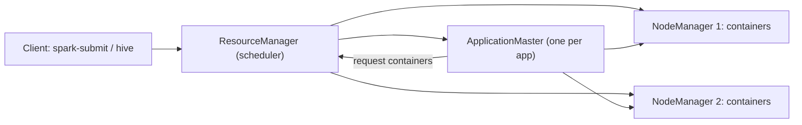

## 🎯 TL;DR

> **Hadoop** is a set of components for storing files across many machines (**HDFS**), scheduling work on them (**YARN**), and querying them with SQL (**Hive**, with **HBase** for random reads and writes). Most of the ecosystem is still running in on-prem clusters.

- **HDFS** splits files into large blocks and replicates them (3 copies by default). The **NameNode** keeps the namespace in memory; **DataNodes** store the blocks.
- **YARN** is the resource manager: the **ResourceManager** allocates containers on **NodeManagers**, and each application has its own **ApplicationMaster**.
- **Hive** turns SQL into jobs that run on YARN. Its **Metastore** (a relational database holding table and partition metadata) is the catalog that Spark, Trino and Impala also use.
- The recurring operational problem is **small files**: too many objects stress the NameNode and make every job slow.

## 🌱 Start simple (Junior)

> **💡 Analogy:** Think of a large library in a city with many buildings. HDFS is the warehouse system: each book is cut into chapters (blocks), every chapter is stored in three different buildings (replicas), and a single index card catalog says where each chapter is (the NameNode). YARN is the staff manager who assigns workers and desks to each request. Hive is a reference desk where you ask questions in SQL, and the desk sends workers to fetch the answer.

Four pieces you must be able to name:

| Component | Role | If it dies |
|---|---|---|
| **NameNode** | Keeps the file tree and block locations in memory | Without HA, the whole cluster is unavailable |
| **DataNode** | Stores block files on local disks, sends heartbeats | HDFS re-replicates its blocks elsewhere |
| **ResourceManager** | Global scheduler for CPU and memory | No new applications can start |
| **NodeManager** | Runs containers on one machine | Its containers are rescheduled |

A table in Hive is a directory of files in HDFS, plus a row in the Metastore that describes its columns, format and location:

```sql
CREATE TABLE sales (
  order_id    BIGINT,
  customer_id BIGINT,
  amount      DECIMAL(12,2)
)
PARTITIONED BY (dt STRING)
STORED AS ORC;
```

Each partition becomes a sub-directory such as `/warehouse/sales/dt=2026-10-01/`. A query with a filter on `dt` reads only those directories. This is called **partition pruning**, and it is the first optimization you should check.

## 🔧 How it really works (Mid)

### HDFS

A file is split into blocks (128 MB by default in Hadoop 2 and later; check your cluster). Each block is replicated on three DataNodes, preferably on different racks. Writes go through a **pipeline**: the client sends the block to the first DataNode, which forwards it to the second, and so on. The write is acknowledged when all replicas have it.

**NameNode metadata.** The NameNode holds the namespace (directories and files) and the mapping of blocks to DataNodes in memory. The block-to-DataNode mapping is rebuilt from DataNode block reports, but the namespace is persisted through an **edit log** and an **fsimage** (checkpoint). On startup, the NameNode replays the edit log over the last fsimage, which can take a long time on a big cluster.

**NameNode HA.** Production clusters run an **Active** and a **Standby** NameNode. Both read a shared edit log from a quorum of **JournalNodes** (QJM), and a failover controller using **ZooKeeper** promotes the standby automatically. Fencing makes sure the old active cannot keep writing. Without HA, a single NameNode is a single point of failure.

**Read path.** The client asks the NameNode for block locations, then reads each block directly from a DataNode. The NameNode is not in the data path, which is why it can scale to large throughput.

### YARN

YARN separates resource management from computation:



- The **ResourceManager** schedules containers (a slice of memory and vCores) according to queues. The **Capacity Scheduler** gives each queue a guaranteed share, and the **Fair Scheduler** balances between running apps. Banks and telcos usually define queues per team or per pipeline, so one job cannot starve the others.
- Each application has an **ApplicationMaster** that asks for containers and tracks its own tasks. For MapReduce it is the MR AM; for Spark it is the Spark driver running in the AM (cluster mode).
- If a NodeManager stops heartbeating, its containers are lost and the work is rescheduled.

### Hive

Hive has three layers that you should separate in your head:

1. **Metastore.** A service backed by a relational database (MySQL or PostgreSQL in most installations). It stores databases, tables, columns, partitions, locations and statistics. Spark SQL, Trino, Impala and many other engines read the same Metastore, so it is the de-facto catalog of a Hadoop shop.
2. **Query compiler.** HiveQL is parsed, optimized (cost-based optimizer with statistics) and compiled into a DAG of tasks.
3. **Execution engine.** MapReduce is the legacy engine. **Tez** is the usual choice for interactive and batch Hive, because it runs the DAG in one YARN application without writing between stages.

**Partitions.** A partition is a directory `col=value` in the table location. Filters on partition columns prune directories before any file is opened. A filter on a non-partition column scans everything in the selected partitions.

**Buckets.** A bucket is a hash of a column into a fixed number of files (`CLUSTERED BY (customer_id) INTO 32 BUCKETS`). Buckets help joins and sampling when both sides are bucketed on the same key with the same count. They are rigid: changing the count means rewriting the table.

**File formats.** ORC and Parquet are columnar with compression and statistics per stripe or row group. Text and JSON are row-based and expensive to scan. Store analytical tables in ORC or Parquet.

**Loading a partition** with a static partition value:

```sql
INSERT OVERWRITE TABLE sales PARTITION (dt = '2026-10-01')
SELECT order_id, customer_id, amount
FROM staging_sales
WHERE load_date = '2026-10-01';
```

`INSERT OVERWRITE` replaces only that partition, which makes daily reloads idempotent (see [[idempotency]]). Dynamic partitioning (`PARTITION (dt)` without a value) is convenient, but it can create thousands of partitions from one bad column; restrict it with limits such as `hive.exec.max.dynamic.partitions` and check the values first.

**HBase** is different: a wide-column store on HDFS with **RegionServers**, a sorted row key and fast random reads and writes. Use it for lookups by key at scale (profiles, device state), not for analytical scans.

## 🧠 Senior depth & trade-offs

- **The small-files problem.** Every file and every block is an object in NameNode memory; a common rule of thumb is about 150 bytes per object (check your version and heap sizing). Compare two layouts of the same 1 TB. As about one million 1 MB files, it is roughly 1,000,000 file objects plus 1,000,000 block objects, about 2,000,000 objects, or roughly 300 MB of NameNode heap at 150 bytes each, and a full scan starts about a million tasks. As 128 MB blocks, it is about 8,192 blocks and far fewer tasks. Causes: streaming ingestion writing one file per micro-batch, one file per partition per small load, or many reducers each writing a tiny file. Fixes: fewer, larger writes; a periodic compaction job that rewrites partitions into target-size files; Hive's small-file merge settings (for example `hive.merge.mapfiles`) where available. See [[small-files-problem]].
- **Metastore as the contract.** When the Metastore is wrong (a partition location points to a deleted directory, or stats are stale), every engine sees the wrong data. Operations on it (repair partitions, refresh stats after big loads) are real work, not housekeeping.
- **Hive on Tez vs Spark.** Tez removes per-stage disk writes inside a query. Spark-based SQL engines are common now for ETL. Pick one engine per platform and document it, because mixing engines on the same tables creates subtle format and statistics differences.
- **Migration paths.** Most Iranian banks and telcos will keep Hadoop for years. The realistic path is to keep HDFS or move storage to object storage, keep the Metastore as the catalog, adopt columnar table formats such as Iceberg or Delta on top, and move compute to Spark or Trino. Replacing the catalog and the file layout at the same time is the usual cause of failed migrations. See [[lakehouse-table-formats]] and [[design-hadoop-migration]].
- **Legacy tools.** **Sqoop** moved data between relational databases and HDFS; newer ingestion uses CDC tools or Spark JDBC reads. **Oozie** orchestrated workflows; Airflow and similar schedulers replaced it in most new platforms. Recognize both in old codebases.
- **Operating it.** Watch NameNode heap and GC pauses, the number of files and blocks, under-replicated and corrupt blocks (`hdfs fsck /`), DataNode disk usage, YARN queue utilization and pending containers, and Metastore database load.

## 🧪 Try it

You need a local Hadoop or Hive installation for the commands; the SQL reasoning works in any Hive-compatible engine.

1. For the `sales` table above, which query reads only the directories for one week: `WHERE dt = '2026-10-01'` or `WHERE customer_id = 42`? Explain why. Then write a query that also prunes on `dt` when the filter is `dt >= '2026-10-01'`.
2. A daily job writes 500 files of about 2 MB each into one partition. Estimate the number of HDFS blocks and the number of map tasks for a full scan, and propose a rewrite to reduce both. Show the arithmetic.
3. Draw the failure timeline when the active NameNode crashes during a write. Which component detects the failure, and what must happen before the standby becomes active?

<details><summary>Show solutions</summary>

**1.** `WHERE dt = '2026-10-01'` prunes to one partition directory. `customer_id` is not a partition column, so the query scans all partitions, unless the table is bucketed on `customer_id` with a matching join. For a range, use `dt >= '2026-10-01' AND dt < '2026-10-08'` for a week, so the optimizer can select the directories.

**2.** 500 files × 2 MB = 1,000 MB. Each file is one block, so 500 blocks and at least 500 map tasks (one per file, since files do not share blocks). Rewriting into a single 1,000 MB file gives about 8 blocks of 128 MB, so about 8 tasks. A compaction job that writes 1 GB files with `INSERT OVERWRITE` from the same partition fixes both numbers.

**3.** ZooKeeper's failover controller notices the active NameNode's session expired (or the health check fails). It fences the old active so it cannot write to the JournalNodes, then promotes the standby, which replays the remaining edit log. Clients retry on the failover proxy. The in-flight write may fail and be retried by the client.

</details>

## 💬 Interview corner

> **🎤 Say this in the interview:** "HDFS keeps files as replicated blocks, the NameNode keeps the namespace in memory, and YARN schedules containers across NodeManagers through queues. Hive gives SQL over those files, with the Metastore as the catalog and partitions as directories. The problem I watch most is small files, because they hurt the NameNode and every job that touches them."

**Typical questions**

- *What happens when a DataNode dies?* Its blocks drop below the replication factor, the NameNode schedules copies from the surviving replicas, and the cluster heals.
- *What is the difference between a partition and a bucket?* A partition is a directory per value and enables pruning; a bucket is a fixed hash split into files and helps joins.
- *Why is the Metastore important beyond Hive?* Spark, Trino and Impala use the same table definitions; a broken Metastore breaks them all.
- *Why do queries get slower over time on the same table?* Small-file accumulation, missing statistics, or partitions that no longer match the data layout.

**Mid-level answer:** explains each component, partition pruning, and one fix for small files.

**Senior answer:** covers NameNode HA and the fencing, queue design for multi-team clusters, a migration plan that keeps the catalog stable, and the monitoring signals listed above.

## ⚠️ Common mistakes

- **Treating HDFS as a POSIX file system.** It is append-mostly, has no in-place updates, and files are immutable once closed. Row-level updates need a table format or a rewrite of the partition.
- **Partitioning by a high-cardinality column** such as `customer_id` or a timestamp with seconds. You get millions of tiny directories and files. Partition by day or month, bucket if you need join locality.
- **Dropping a Hive table and expecting the files to be deleted** when it is `EXTERNAL`. External tables keep their data; managed tables delete it.
- **Believing the replication factor protects against everything.** Replicas protect against disk and node loss, not against a bad `DELETE`, a bad job that writes wrong data, or a corrupted Metastore.
- **Running Hive with the default MapReduce engine** for interactive work and wondering why it is slow.

## ✅ Check yourself (quiz)

1. Which component holds the mapping from file paths to block IDs, and what happens to it when the active NameNode fails without HA?

   - A) The DataNode, and it is rebuilt from the Metastore
   - B) The NameNode in memory, persisted through the edit log and fsimage; without HA, the cluster is unavailable until the NameNode restarts
   - C) The ResourceManager, and it keeps working
   - D) ZooKeeper, which stores the full data

<details><summary>Answer</summary>

**B** — the NameNode owns the namespace. Without a standby, nothing can change or read the namespace until a NameNode comes back and replays its edit log.

</details>

2. A query filters on `dt` but scans the whole table. Which is the most likely cause?

   - A) The table is in ORC format
   - B) The filter is wrapped in a function on the partition column, or `dt` is not a partition column, so the optimizer cannot prune
   - C) The replication factor is 3
   - D) The table has buckets

<details><summary>Answer</summary>

**B** — pruning needs a direct comparison on the partition column. A function such as `substr(dt, 1, 7) = '2026-10'` on the column often blocks it. Rewrite the predicate on the raw column.

</details>

3. **(Mid)** A team wants to store a `customer_id` as the partition key of a 5-year table with 50 million customers. Why is this a poor choice, and what would you use?

   - A) Customer IDs cannot be strings
   - B) It creates millions of directories and small files; partition by a time column such as day or month and bucket by `customer_id` if join locality is needed
   - C) Partitions must be numeric
   - D) Partitioning is not supported in Hive

<details><summary>Answer</summary>

**B** — each partition is a directory with files, so high cardinality multiplies the number of objects in NameNode memory and the number of tasks. Partition by time (coarse and bounded), and use buckets for the join key.

</details>

4. **(Senior)** A job writes 2,000 files per hour into a partition. The NameNode heap is at 90% and job startup takes minutes. What is the root cause and the order of fixes?

   - A) The DataNodes are too slow; add disks
   - B) The file count is the root cause; first reduce future writes (larger batches, fewer reducers, or a sink that merges), then compact the existing files, then tune NameNode heap if still needed
   - C) Increase the replication factor so reads are faster
   - D) Switch from ORC to text files

<details><summary>Answer</summary>

**B** — the problem is object count, not disk bandwidth. Stop creating small files at the source, compact what exists, and only then tune the heap. Adding replicas or changing formats does not reduce the number of objects.

</details>

5. **(Senior)** Why is a migration that moves data to object storage and also replaces the Metastore in the same release risky?

   - A) Object storage does not support Parquet
   - B) Two changes at once make failures hard to isolate: if counts or partitions differ, you cannot tell whether the data, the catalog or the engine is wrong; move one layer at a time with a validation step
   - C) Metastores cannot be backed up
   - D) Hive cannot read files that are not in HDFS

<details><summary>Answer</summary>

**B** — a staged migration (keep the catalog, move storage, then move engines and table formats) lets you compare results at each step. Changing everything at once removes that ability.

</details>

## 🗂️ Flashcards

| Front | Back |
|---|---|
| What does the NameNode store? | The namespace and block locations in memory; persisted as an edit log and fsimage |
| Default HDFS replication factor? | 3 (configurable per file or directory) |
| Why is the NameNode not a data bottleneck? | Clients read block data directly from DataNodes; the NameNode only serves metadata |
| What does the Standby NameNode need for HA? | A shared edit log via JournalNodes (QJM) and a failover controller (ZooKeeper) with fencing |
| What does the ResourceManager do? | Schedules containers on NodeManagers according to queues; each app has its own ApplicationMaster |
| What is the Hive Metastore? | A relational database holding table, partition and stats metadata; the shared catalog of the platform |
| Partition vs bucket? | Partition = directory per value (pruning); bucket = fixed hash split into files (join locality) |
| Why are small files harmful? | Each file and block is a NameNode object and a separate task; they slow both storage and compute |

## 🔗 Go further

- **mapreduce** explains the execution model under Hive on MapReduce and the reason Tez and Spark replaced it.
- **spark-architecture** shows how Spark uses the same YARN and Metastore, and **yarn-vs-k8s** compares YARN with Kubernetes as a scheduler.
- **small-files** and the glossary entry [[small-files-problem]] go deeper into compaction and layout.
- **design-hadoop-migration** walks through a full migration design, which is a common senior interview topic in Iran.
- **lakehouse-table-formats** explains how Iceberg and Delta add transactions and schema evolution on top of files like the ones in HDFS.
