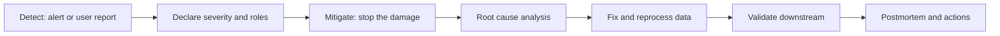

## 🎯 TL;DR

> An **incident postmortem** is a short, honest written story of a production failure: what users saw, how you stopped the damage, why it happened, and what you will change so it does not happen the same way again.

- In data work the damage is often **silent**: a wrong revenue number that nobody noticed for three weeks is a worse incident than a loud outage.
- The order of the story matters: **detect → mitigate → find the root cause → fix → prevent**. Stop the bleeding before you investigate.
- **Blameless** means you describe systems, defaults and decisions, not people. A person made a move; the system let one bad move reach production.
- Every preventive action has an **owner and a date**. "Be more careful" is not an action.

## 🌱 Start simple (Junior)

> **💡 Analogy:** A kitchen fire. First you turn off the gas and put out the fire (mitigation). Then you ask why the pan overheated and why the smoke alarm was silent (root cause and detection). Finally you change the habit or the alarm so the next pan does not burn (prevention). Nobody is fired for the fire; you learn from it.

Here is a small, realistic incident. A dashboard shows revenue about 40% lower than usual since Tuesday.

| Time (UTC) | Event |
|---|---|
| Tue 02:00 | Nightly job `build_revenue_daily` runs with a new version of the SQL |
| Tue 09:15 | A finance analyst notices the drop and posts in the team channel |
| Tue 09:30 | On-call pauses the downstream dashboards refresh |
| Tue 11:00 | Root cause found: an inner join drops orders with an unknown country code |
| Tue 14:00 | Fix merged, affected days reprocessed, numbers validated against the payments system |
| Thu 10:00 | Postmortem written and reviewed |

The bug is one word. The lesson is about everything around that word.

```sql
-- Version deployed on Tuesday (bug): inner join drops orders with unknown country codes
SELECT o.order_id, o.amount, c.country
FROM orders AS o
JOIN countries AS c ON c.code = o.country_code;

-- Fixed version: keep every order, label the unknown ones
SELECT o.order_id, o.amount, COALESCE(c.country, 'UNKNOWN') AS country
FROM orders AS o
LEFT JOIN countries AS c ON c.code = o.country_code;
```

A **postmortem template** gives you the sections every good write-up has. Use it as a fill-in form:

```text
Title:            <short, specific, dated>
Severity:         SEV-1 / SEV-2 / SEV-3
Impact:           who was affected, for how long, how much data or money
Detection:        how we found out (alert, user report, manual check) and how long it took
Timeline:         timestamped facts only, with the decision made at each step
Mitigation:       what stopped the damage (may differ from the fix)
Root cause:       the mechanism, plus the contributing factors
What went well:   what helped (fast rollback, good lineage, clear owner)
What went badly:  what slowed us down
Action items:     <action> | owner | due date | ticket
```

## 🔧 How it really works (Mid)

An incident has a predictable lifecycle. The roles matter because they stop five people from fixing the same thing in five different ways.



Typical roles in a small team:

- **Incident lead** decides what happens next and keeps one timeline.
- **Investigator** runs queries, checks lineage and proposes fixes.
- **Communicator** tells stakeholders what is affected and when the next update comes.
- **Scribe** writes timestamps. Without this role, the postmortem timeline is always wrong.

### Mitigation is not the fix

Mitigation limits the damage **right now**, even if the cause is unknown. In data systems typical mitigations are:

- pause the scheduler or the consumer that writes bad data;
- mark the affected table or dashboard as stale or hide it;
- roll back the model or the deployment to the last good version;
- stop a sink from pushing data to external systems.

The fix removes the cause, and reprocessing repairs the data that already went wrong. Both are needed. A rollback that leaves 3 days of wrong rows is only half the job.

### Root cause and contributing factors

A single "root cause" is often a comfortable simplification. Use the **five whys** to walk down the chain, then list **contributing factors** that made the bug possible or slow to notice:

- Why was revenue low? Orders were dropped in the join.
- Why were orders dropped? The country code was missing for some orders.
- Why did the join drop them? The model used an inner join by default.
- Why did no test fail? No test checked row counts against the source.
- Why did nobody notice for 13 hours? The freshness check passed, because the table was loaded on time, just with fewer rows.

Each "why" should point to a **system property** you can change (a test, a default, an alert), not to a person's attention span.

### Weak vs strong postmortem text

| Weak | Strong |
|---|---|
| "Bob changed the join and broke revenue. We will be more careful." | "A change to `build_revenue_daily` replaced a LEFT JOIN with an INNER JOIN. The CI run had no row-count check against `orders`, so the change merged." |
| "We fixed it and everything is fine now." | "Fix merged at 14:00. 6 days reprocessed. Revenue matched payments within 0.1% on each day; the check is in the dashboard." |
| "Action: improve testing." | "Add a reconciliation test: `orders` count must equal the output count per day, within a 0% tolerance. Owner: data platform. Due: next sprint. Ticket: DATA-412." |
| "Detected by users." | "Detected 13 hours after the first bad load. No alert existed for a sudden drop in row count; this is the detection gap." |

### Reprocessing without making things worse

After the fix, you must rebuild the affected period. Rebuilding is only safe when the write is **idempotent**: running it twice gives the same result. Overwrite whole partitions for the affected dates, not ad-hoc inserts.

```sql
-- Idempotent repair for one day: delete the partition, rebuild it from the fixed logic
DELETE FROM revenue_daily WHERE day = DATE '2026-10-06';

INSERT INTO revenue_daily
SELECT day, SUM(amount) AS revenue
FROM (
    SELECT o.order_id, o.amount, o.created_at::date AS day
    FROM orders AS o
    LEFT JOIN countries AS c ON c.code = o.country_code
) AS x
WHERE day = DATE '2026-10-06'
GROUP BY day;
```

Then validate: compare the rebuilt totals with an independent source (payments, the ledger), not with the same pipeline.

## 🧠 Senior depth & trade-offs

**Data incidents have their own shape.** Compared with a web outage, they are often:

- **Silent**: the pipeline is green, the numbers are wrong. Freshness and job-status checks do not catch this. You need volume, distribution and reconciliation checks (see [[data-quality]] and [[data-observability]]).
- **Delayed in detection**: a bad row for one day may be found only at month-end close.
- **Wide in blast radius**: one table feeds dashboards, ML features and finance exports. Use lineage to list every consumer before you communicate.
- **Expensive to repair**: reprocessing has compute cost, and some downstream systems already acted on the wrong numbers (refunds sent, models retrained).

**Storage and engine details that change the response:**

- **Lakehouse tables** (Iceberg, Delta): time travel or snapshot rollback can restore a table to a known-good snapshot faster than rewriting history. Check the retention of old snapshots before you rely on it. Details differ by engine and version, so verify in your version's docs.
- **Kafka**: resetting a consumer offset can replay data (duplicates) or skip data (loss). Whether replay is possible depends on topic retention; if the events already expired, the postmortem must say so.
- **Spark**: a bad job with dynamic partition overwrite may have replaced more partitions than you intended. Check which partitions were written from the job logs before you reprocess.
- **ClickHouse**: `ALTER ... UPDATE` and `DELETE` are asynchronous mutations. "The fix is applied" must mean "the mutation finished", so check the mutation status.
- **Airflow**: clearing tasks re-runs them, which is powerful and dangerous. Know whether the tasks are idempotent before you clear a range.

**Metrics to report**, so incidents can be compared over time:

- time to detect (TTD): first bad load to first alert;
- time to mitigate (TTM): first alert to damage stopped;
- exposure window: how long consumers saw wrong data;
- affected rows, tables and consumers;
- reprocessing hours and cost.

**Trade-offs you should be able to defend:**

- **Block vs warn**: a failing quality check that blocks the pipeline protects consumers but can stop everything for a noisy metric. A warning protects nothing if nobody reads it. Block on rules with clear meaning (row count dropped by 50%, a primary key duplicated), warn on the rest.
- **Freeze after incident**: pausing risky deployments for a week after a SEV-1 buys time but slows delivery. Say when you would do it and when you would not.
- **Full postmortem vs short note**: a 5-minute blip with no user impact deserves a short note. Writing a long document for every blip teaches people to ignore postmortems.

**What you would monitor after the incident:** row counts per day against the source, the freshness of each consumer table, and a reconciliation metric against the system of record.

## 🧪 Try it

**Exercise 1 — Fix a weak postmortem.** Rewrite this sentence so it follows the blameless and actionable rules: *"Dina pushed a bad migration on Friday and the warehouse was down for 4 hours. Dina needs to be more careful with migrations."*

<details><summary>Solution</summary>

Example rewrite: "A schema migration on Friday 16:10 added a NOT NULL column without a default. The migration ran in production without a staging rehearsal, and the warehouse loads failed for 4 hours (16:10–20:10). Actions: (1) require a staging migration run in CI, owner: platform, due: next sprint; (2) add a lint rule that rejects NOT NULL columns without defaults on existing tables, owner: data platform, ticket DATA-415."

The rewrite removes the name, states the mechanism and the duration, and turns the lesson into two checkable actions.

</details>

**Exercise 2 — Classify the timeline.** For each entry, say whether it is detection, mitigation, root cause or fix: (a) "16:40 the freshness alert fired"; (b) "16:50 pipeline paused"; (c) "17:20 found a join on a column that was renamed upstream"; (d) "18:00 column mapping restored and backfill started".

<details><summary>Solution</summary>

(a) detection, (b) mitigation, (c) root cause, (d) fix (with reprocessing). Note that (a) was a freshness alert, which is weak for this kind of problem: the postmortem should add a row-count alert as a detection improvement.

</details>

**Exercise 3 — Write one good action item.** Your incident: an upstream API started sending amounts in cents instead of currency units for 2 days. Write one preventive action with an owner, a due date and a measurable success condition.

<details><summary>Solution</summary>

Example: "Add a contract test on the `amount` field: values must be within the range seen over the last 90 days, and the unit is documented in the data contract. Fail the load and alert when a day's average differs from the trailing 30-day average by more than 10x. Owner: ingestion team. Due: 2 weeks. Success: the test catches a staged cents payload in CI."

The good action names the check, the threshold, the owner and how you will know it works.

</details>

## 💬 Interview corner

**Typical question:** "Tell me about a production incident you handled. What did you do?"

- **Junior answer:** "The pipeline failed, I restarted it, and it worked." This shows no detection, no impact and no prevention.
- **Mid answer:** "A load failed silently and a dashboard showed wrong totals. I found the cause in the join, rolled back, reprocessed three days, and added a row-count test."
- **Senior answer:** names impact in numbers, the detection gap, the mitigation choice under uncertainty, how consumers were told, and the org-level change (for example a standard reconciliation check for all revenue tables).

> **🎤 Say this in the interview:** "We found out 13 hours late, from a finance analyst. The first thing I did was pause the downstream refresh so no more wrong numbers spread, while we kept investigating. The root cause was an inner join that silently dropped orders with unknown country codes; our tests checked schema, not row counts. We reprocessed six days idempotently by partition and validated against payments. The lasting change was a reconciliation test on every revenue table, owned by the platform team, and our detection time for this class of error dropped from hours to minutes."

## ⚠️ Common mistakes

- **Naming a person as the root cause.** It makes people hide future incidents. Name the system property that allowed the mistake.
- **Starting with root cause before mitigation.** While you investigate for two hours, the bad data keeps flowing to consumers.
- **Actions without owners or checks.** "Improve monitoring" cannot be finished. Write what check, where, and who owns it.
- **Declaring victory after the code fix.** The code is fixed, but the bad partitions still exist. Reprocess and validate downstream.
- **Forgetting consumers.** The people who used the wrong number need a correction notice, not only a postmortem in a wiki.
- **Describing the fix but not the detection gap.** The question "why did we not notice sooner?" is often more valuable than the bug.

## ✅ Check yourself (quiz)

1. What is the correct order of the postmortem story?

   - A) Root cause → fix → detect → mitigate
   - B) Detect → mitigate → root cause → fix → prevent
   - C) Fix → detect → prevent → mitigate
   - D) Prevent → detect → fix → mitigate

<details><summary>Answer</summary>

**B** — you first notice the problem, then stop the damage, then find out why, fix the cause, and change the system so it cannot happen again. Mitigation can happen before the root cause is known.

</details>

2. A pipeline is green for three weeks, but revenue is 15% low. Which check would most likely have caught this earlier?

   - A) A job-duration alert
   - B) A freshness check on the output table
   - C) A reconciliation or row-count check against the source system
   - D) A retry policy on the scheduler

<details><summary>Answer</summary>

**C** — the job is on time and fresh, so freshness and job-status checks pass. Only a comparison of the output with the source (row counts, totals, a reconciliation) sees that data is missing.

</details>

3. Which action item is the most useful for a postmortem?

   - A) "Be more careful with joins."
   - B) "Add a row-count test that fails the load if output rows are below source rows for the same day; owner: data platform; due in two weeks."
   - C) "Document the incident in the wiki."
   - D) "Discuss in the next team meeting."

<details><summary>Answer</summary>

**B** — it is a specific system change with a measurable condition, an owner and a date. The other options are either vague or not preventive.

</details>

4. **(Senior)** You must reprocess 90 days of a table that is read by finance and ML features. Why is an idempotent partition overwrite preferred over running ad-hoc inserts, and what would you still verify?

   - A) Ad-hoc inserts are faster, so they are always preferred
   - B) Overwriting whole partitions can be re-run safely and gives the same result, while inserts can duplicate rows if the job is restarted; still verify which downstream consumers already used the wrong values and whether they need a correction
   - C) Idempotent writes remove the need for a postmortem
   - D) Finance tables cannot be reprocessed

<details><summary>Answer</summary>

**B** — re-running an overwrite gives the same result, so a restart after a failure is safe. Reprocessing repairs the table, but downstream systems that already consumed wrong values (refunds, retrained models) still need a correction.

</details>

## 🗂️ Flashcards

| Front | Back |
|---|---|
| What is the postmortem order? | Detect → mitigate → root cause → fix → prevent |
| Mitigation vs fix | Mitigation stops the damage now; the fix removes the cause; reprocessing repairs the data |
| What does "blameless" mean? | Describe systems and decisions, not individuals; ask what let the mistake reach production |
| Why are freshness checks not enough? | A late load is caught, but a complete load with missing rows is not |
| What makes an action item good? | A specific change, an owner, a due date and a measurable success condition |
| Why use partition overwrite for repairs? | It is idempotent: a restart gives the same result, no duplicates |
| What is a contributing factor? | A condition that let the bug happen or delayed its detection, not the direct cause |

## 🔗 Go further

- **behavioral-questions** covers how to tell incident stories in interviews with the STAR structure.
- **data-observability** and **data-quality** explain the checks that would have caught the silent failures in this lesson.
- **data-lineage** shows how to list downstream consumers quickly, which decides the communication plan.
- **dedup-idempotent-loads** explains why reprocessing and retries must not create duplicates.
- Read the postmortem culture guidance from SRE literature (blameless postmortems) and adapt it to your team's size; the principles matter more than a template.
