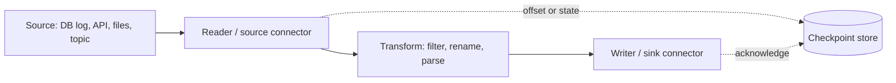

## 🎯 TL;DR

> An **ingestion tool** moves data from a source (database, API, files, logs, event stream) into a target (lake, warehouse, topic) and handles retries, offsets and schema. **Pick by source type and by who operates it**, not by which logo looks best.

- **Database changes:** log-based CDC with **Debezium** (usually on Kafka Connect).
- **Event streams:** **Kafka Connect** source and sink connectors.
- **SaaS and API sources:** managed connectors such as **Airbyte** (or a vendor's own loader).
- **On-prem mixed protocols with a visual flow:** **Apache NiFi**, common in large enterprises.
- **Unified batch and streaming transforms:** **Apache SeaTunnel**, or Spark and Flink when the logic is heavier.
- **Logs and metrics on hosts:** **Fluent Bit**, **Vector**, or **Logstash**.

## 🌱 Start simple (Junior)

> **💡 Analogy:** Think of a water supply system. Some sources are a river (a stream of events), some are wells (a database you pull from on schedule), some are rain barrels you carry by hand (files). Pipes, pumps and filters are the ingestion tools. You do not build a pump for every house; you choose the right kind of equipment for each source and for the people who must maintain it.

The question to ask first is simple:

| Source | What you want | Typical tool |
|---|---|---|
| A Postgres or MySQL table | Every insert, update and delete | Debezium (CDC) |
| A Kafka topic | Write it to a lake or warehouse | Kafka Connect sink |
| A SaaS API (CRM, payments) | Scheduled sync of many objects | Airbyte or a managed connector |
| SFTP folder plus HTTP plus a database | Route, transform and deliver with a visual flow | Apache NiFi |
| Application logs on 500 servers | Collect, filter and forward | Fluent Bit (or Vector) |
| Mixed batch and streaming, many formats | One job definition, several engines | Apache SeaTunnel |

You do not need to know every tool. You do need to know the **shape** each one has: a connector reads from a source, optionally transforms, and writes to a sink, and it must remember where it stopped.

## 🔧 How it really works (Mid)

### The common contract

Every ingestion tool implements the same loop, with different names:



Four things differ between tools, and they are what you compare in an interview:

1. **Where the state lives:** Kafka Connect keeps offsets in Kafka topics; NiFi uses repositories on each node; Airbyte keeps a sync state per stream.
2. **Delivery guarantee:** most tools give **at-least-once** by default. Exactly-once depends on the sink (for example, idempotent upserts or transactional writes). See [[exactly-once]] and [[delivery-semantics]].
3. **Operations model:** a managed SaaS, a cluster you run, or a library inside your own job.
4. **Schema handling:** does the tool pass the raw payload, convert types, or enforce a registry? See [[schema-registry]].

### Apache NiFi

NiFi is a **flow-based** tool. You build a graph in the browser from **processors** (for example `ListSFTP`, `FetchSFTP`, `ConvertRecord`, `PutS3Object`, `PublishKafka`). Each unit of data is a **FlowFile**: content (bytes) plus attributes (key-value metadata).

- **Back-pressure** is built in. Each connection between processors has a size limit; when it is full, upstream processors stop. This protects memory on a single node.
- **Provenance** records every event for each FlowFile (received, routed, sent). It is the best audit trail of any tool in this lesson, and it makes "where did this file go?" a 30-second question.
- **Guarantees:** NiFi writes FlowFile state to a durable repository, so a crash generally resumes work. Duplicate delivery to a downstream system is still possible, so the sink must be idempotent.
- **Trade-off:** the visual canvas is productive for dozens of flows, but large flows are hard to review and version. Keep flows in a registry (NiFi Registry or the equivalent in your version) and treat them as code.

### Kafka Connect

Kafka Connect is a framework that runs **source connectors** (database → Kafka) and **sink connectors** (Kafka → storage or database). In **distributed mode**, workers form a group, and the connector's tasks are spread across them.

- Configuration, offsets and status are stored in internal Kafka topics, so a restarted worker resumes where the group left off.
- **Single Message Transforms (SMTs)** do small per-record changes (rename a field, route to another topic, mask a value).
- A sink commits the Kafka offset after the write succeeds. If the write succeeds but the commit fails, the record is written again, so sinks should be idempotent.

Operating Kafka Connect (rebalances, dead connectors, DLQ settings) is covered in [[kafka-connect-ops]].

### Debezium

Debezium reads the database's **transaction log** (Postgres logical decoding, MySQL binlog, SQL Server CDC tables, and others) and emits one event per change: `before`, `after`, the operation code (`c`, `u`, `d`, `r` for snapshot read) and the source position.

- The first run takes an **initial snapshot** of the existing table, then switches to streaming the log. Position is stored (for example as an LSN in Postgres or a binlog position in MySQL), so restarts resume correctly.
- Deletes arrive as events, which is the main advantage over query-based CDC. See [[cdc]].
- The source database needs its log settings enabled (for example `wal_level = logical` in Postgres) and a replication slot that must be monitored; an unread slot makes the database keep WAL and fill the disk.

```yaml
# Debezium Postgres connector registered in Kafka Connect (simplified)
name: orders-cdc
config:
  connector.class: io.debezium.connector.postgresql.PostgresConnector
  database.hostname: pg.internal
  database.dbname: shop
  topic.prefix: shop
  table.include.list: public.orders
  plugin.name: pgoutput
  snapshot.mode: initial
```

### Airbyte

Airbyte is an **ELT** tool with a large catalogue of source and destination connectors, many of them for SaaS APIs. Each **stream** (for example `orders`) runs in one of the sync modes: **full refresh** (overwrite or append), **incremental append** (cursor-based, appends new rows), or **incremental deduped** (keeps the latest version per primary key).

- Connectors are containers. You can build your own with the Connector Development Kit (CDK), which handles pagination, rate limits and state for you.
- Airbyte loads raw data; transformation is usually done afterwards with dbt. See [[dbt]] and [[etl-vs-elt]].
- Incremental state is a cursor per stream. The same watermark and lookback concerns from [[api-ingestion]] apply.

### Apache SeaTunnel

SeaTunnel is an Apache project with one job definition (a config file) that can run on its own engine (Zeta) or on Spark or Flink. It supports batch and streaming, and it has connectors for many databases, files, queues and warehouses. It is a good fit when you want one team to define data movement across heterogeneous systems without learning every engine.

### Logs and metrics: Fluent Bit, Vector, Logstash

| Tool | Runtime | Strength | Typical use |
|---|---|---|---|
| Fluent Bit | C, very small memory | Runs everywhere, Kubernetes-friendly | Node or sidecar log forwarder |
| Vector | Rust, high throughput | Transforms with its own language (VRL), also metrics | Observability pipeline between agents and sinks |
| Logstash | JVM, heavy | Mature plugin ecosystem, part of the Elastic stack | Parsing and enrichment inside an ELK setup |

For log data, the usual architecture is: agent on each host → buffer (often Kafka) → lake or search index. The buffer gives you replay after a sink outage.

### Legacy and niche tools

- **Apache Flume** collected logs into Hadoop. It still appears in old platforms, but new designs usually use Kafka or NiFi.
- **Apache Sqoop** bulk-imported tables into Hadoop with JDBC. Most teams now use CDC or a managed connector instead.

Mention them only if the interviewer uses them; know what replaced them.

## 🧠 Senior depth & trade-offs

- **Ownership cost.** A managed connector is cheap in engineering time and expensive per row at high volume. A self-run Kafka Connect cluster has the opposite profile. Estimate both: rows per day, price per million rows, and the people needed for on-call.
- **Failure domains.** NiFi concentrates flow state on nodes you operate; Kafka Connect delegates durability to Kafka; managed tools hide the state but also hide the retry policy. Ask where state is stored and what happens on a node failure.
- **Ordering.** Parallel tasks break per-key ordering. Debezium keeps order per table partition and per key; a sink with many tasks can reorder updates to the same row. Partition by primary key and make the sink apply updates by version or by timestamp.
- **Schema change.** A new column in a source table should not break the pipeline. Check whether each tool propagates DDL (Debezium does for some databases through schema history topics; batch connectors often need a full refresh). See [[schema-evolution]].
- **Replication slots and logs.** A stopped CDC connector keeps the source's transaction log growing. Alert on replication lag and slot age before the database's disk fills.
- **Back-pressure end to end.** A fast source and a slow sink need a buffer in between. Kafka gives this for free; a direct connection between source and warehouse does not, and the source may time out instead.
- **Testing.** Test a connector with a failure in the middle of a batch: kill the worker, restart, count the rows. The result should be "all rows, possibly duplicated, and the sink handles duplicates".

## 🧪 Try it

Design the ingestion for these three sources. For each, write one sentence on the tool, one on the delivery guarantee, and one on the main risk.

1. Orders table in a MySQL database, 50 million rows, updates and deletes must reach the lakehouse within 5 minutes.
2. A payments SaaS with 40 objects, daily sync, and a team that has no Java developers.
3. Web server logs: 300 servers, about 2 TB per day, and a search team that needs them in 1 minute.

<details><summary>Show solutions</summary>

1. **Debezium** (CDC from the MySQL binlog) into Kafka, then a sink into the lakehouse. Guarantee: at-least-once from the log; the sink applies changes by primary key and version, so it is effectively exactly-once. Risk: the binlog must retain enough history and the connector must keep up.
2. **Airbyte** or a managed connector with incremental sync and dedup. Guarantee: at-least-once per sync, with state per stream. Risk: API rate limits and schema changes from the vendor; monitor the sync status and the row count.
3. **Fluent Bit** on each server, forwarding to **Kafka**, then a sink to the lake and to the search index. Guarantee: at-least-once with a buffer; duplicates must be removed downstream by event id. Risk: 2 TB per day is about 23 MB per second on average (2 × 10¹² bytes ÷ 86,400 s ≈ 23 MB/s), but peaks are higher, so size the Kafka partitions for the peak.

</details>

## 💬 Interview corner

**Question: "How would you move data from an operational Postgres database into the lake?"**

- **Mid answer:** "I'd use Debezium with Kafka Connect for CDC, write the topics to S3 with a sink connector, and then merge into an Iceberg table."
- **Senior answer:** "I'd start with a log-based CDC approach so deletes are captured, and I'd monitor the replication slot, because an unread slot fills the database's disk. The events go to Kafka, which decouples the source from the lake. The lake sink applies changes idempotently by primary key and ordered version, and I'd run a periodic reconciliation with counts and checksums. Initial load uses the snapshot, and I'd plan for schema changes with a schema registry."

**Question: "Why would a company choose NiFi over writing Spark jobs?"**

NiFi fits many heterogeneous, on-prem protocols with routing, back-pressure and audit (provenance) out of the box, and it lets operators who are not developers maintain flows. Spark fits heavy transformations and large batch volumes; many teams use both.

> **🎤 Say this in the interview:** "I choose the tool from the source type and the operations model. CDC for databases, connectors for event streams, a managed tool for SaaS, and a flow tool when the environment is mixed and the operators are not all developers. In every case I check the delivery guarantee and make the sink idempotent."

## ⚠️ Common mistakes

> **⚠️ Watch out:** Querying the source table every hour for "changes" (`WHERE updated_at > ...`) and calling it CDC. You miss deletes and you add load to the production database. Use the log instead, or accept the limits of query-based incremental loads.

> **⚠️ Watch out:** Creating a CDC connector and forgetting its replication slot. When the consumer stops, the database keeps WAL until the disk is full.

- Choosing a tool because it is popular, without the source or operations model in mind.
- Assuming "exactly-once" is a property of the tool. It is a property of the whole path, mostly of the sink.
- Parallelising a connector without partitioning by key, then getting out-of-order updates.
- Forgetting that a visual flow is still code: no version control, no review, no tests.
- Running a self-managed Kafka Connect cluster without monitoring connector status and task failures.
- Ignoring the network path: a connector in the wrong subnet fails in ways that look like database bugs.

## ✅ Check yourself (quiz)

1. You need every insert, update and delete from an operational MySQL table, with low load on the database. Which approach fits best?
   - A) A nightly `SELECT *` into a file
   - B) A query every minute with `WHERE updated_at > last_run`
   - C) Log-based CDC with Debezium
   - D) A trigger that writes to a CSV file

<details><summary>Answer</summary>

**C** — log-based CDC reads the binlog, sees deletes, and adds little load to the table. Query-based approaches miss deletes and compete with production queries.

</details>

2. What is the main reason to put Kafka between a CDC source and the lake?
   - A) Kafka makes the data encrypted
   - B) It decouples the source from the sink and buffers changes when the sink is slow or down
   - C) Kafka removes the need for primary keys
   - D) Kafka converts data to Parquet

<details><summary>Answer</summary>

**B** — the buffer lets the source keep moving and lets consumers replay after an outage. Kafka does not encrypt by itself or change formats.

</details>

3. Which tool is the best fit for a team that must collect logs from hundreds of hosts with a tiny memory footprint?
   - A) Logstash on every host
   - B) Fluent Bit or Vector on every host
   - C) Airbyte with a SaaS source
   - D) Spark Structured Streaming on every host

<details><summary>Answer</summary>

**B** — both are lightweight agents built for this job. Logstash runs on the JVM and is heavier per host; Airbyte and Spark are not designed as host agents.

</details>

4. **(Senior)** A sink connector with 8 parallel tasks writes updates from one database table to a lakehouse table. Sometimes an older version of a row overwrites a newer one. What is the root cause and fix?

   - A) The lakehouse does not support updates
   - B) Parallel tasks can deliver updates for the same key out of order; partition by primary key and apply changes by version or source timestamp in the merge
   - C) Increase the number of tasks to 16
   - D) Disable the primary key

<details><summary>Answer</summary>

**B** — the same key can travel through different tasks, so arrival order is not guaranteed. The merge must compare a version or source position and keep the newest.

</details>

5. **(Senior)** A CDC connector was stopped for three days for maintenance, and the source database's disk is almost full. What is the likely cause and what should you have monitored?

   - A) The connector is writing too many logs
   - B) The replication slot kept WAL (transaction log) that the connector had not consumed; monitor slot lag and age
   - C) The source table was too large for the snapshot
   - D) Kafka topics were deleted

<details><summary>Answer</summary>

**B** — a replication slot pins the log until its consumer confirms it. Monitor slot lag and alert long before the disk fills, and drop unused slots deliberately.

</details>

## 🗂️ Flashcards

| Front | Back |
|---|---|
| Best tool for DB row-level changes including deletes? | Debezium (log-based CDC) |
| What runs source and sink connectors in a cluster? | Kafka Connect (distributed mode) |
| NiFi's unit of data | FlowFile: content plus attributes |
| What is NiFi back-pressure? | A full connection queue stops upstream processors, protecting memory |
| Airbyte incremental deduped means | Cursor-based sync that keeps the latest row per primary key |
| Fluent Bit vs Logstash | Fluent Bit is a small C agent; Logstash is a heavier JVM pipeline |
| Why does a stopped CDC connector fill the source disk? | Its replication slot keeps the transaction log until consumed |
| Where is exactly-once really decided? | Mostly at the sink, through idempotent or transactional writes |

## 🔗 Go further

- **kafka-connect-ops** covers running Kafka Connect: rebalances, error handling and monitoring.
- **cdc** and **api-ingestion** go deeper into the two patterns behind most of these tools.
- **dlq-bad-records** explains where a connector sends records it cannot process.
- **seatunnel** and **kafka-architecture** are the next steps for multi-engine movement and for the buffer layer.
- **etl-vs-elt** explains when to transform before loading and when to load first.
