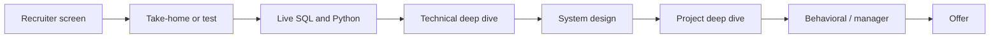

## 🎯 TL;DR

> A data engineering interview is a **loop**: several rounds, each testing a different signal. Knowing what each round is for tells you what to prepare and how to talk.

- Typical stages: recruiter screen, take-home or online test, live SQL, Python coding, technical deep dive, system design, past-project deep dive, behavioral or manager round, then offer and negotiation.
- Each round is scored against a rubric (what the interviewer must see), not against "did they guess my answer".
- Interviewers write feedback separately and a committee decides. Do not treat any round as optional: a clear weak signal in one round can sink an offer.
- The level you are interviewing for changes the bar in every round. A senior loop expects trade-offs where a mid loop expects correctness.

## 🌱 Start simple (Junior)

> **💡 Analogy:** A driving test has a written part, a parking exercise and a road drive. Passing the written part does not prove you can park. An interview loop is the same: each round checks a different skill.

Here is the typical order, in plain words:

1. **Recruiter or HR screen (20–30 min).** Are you who the CV says, what are you looking for, what is your salary range and notice period. Be short and honest.
2. **Take-home or online test.** A small task, such as cleaning a CSV and loading it into a table. It shows how you work when nobody watches.
3. **Live SQL.** You write queries while explaining your thinking. Joins, `GROUP BY`, and sometimes window functions.
4. **Python coding.** Data-handling tasks with lists, dicts, files or pandas. They check clear code and sensible complexity.
5. **Technical deep dive.** "You listed Kafka on your CV. Walk me through a problem you solved with it." They look for real depth.
6. **System design.** You design a data pipeline or warehouse on a whiteboard or shared document. See [[delivery-framework]].
7. **Project deep dive.** You explain a project you actually built: data volume, decisions, what broke.
8. **Behavioral or manager round.** Teamwork, conflict, ownership, mistakes.
9. **Offer.** Level, scope and compensation.

> **🎤 Say this in the interview:** "Before we start, could you walk me through the rounds and what each one is scored on? I want to prepare for what you are looking for."

## 🔧 How it really works (Mid)

Each round has one main **signal**. Interviewers take notes against that signal and rarely judge the whole candidate.

| Round | Main signal | Typical length | What a strong candidate does |
|---|---|---|---|
| Recruiter screen | Fit, logistics, expectations | 20–30 min | Gives a short story of the last two roles and a clear range |
| Take-home / online test | Clean work, judgement, communication | A few hours (often capped) | Ships a runnable repo with a README, assumptions and tests |
| Live SQL | Fluency and reasoning | 45–60 min | Clarifies the grain and edge cases before typing |
| Python coding | Data handling and clean code | 45–60 min | Gets a correct version first, then improves and names trade-offs |
| Technical deep dive | Depth on tools in the CV | 45–60 min | Moves from concept to failure modes and numbers |
| System design | Structured thinking | 45–60 min | Follows a fixed sequence, see [[delivery-framework]] |
| Project deep dive | Ownership and results | 45–60 min | Tells a story with metrics and decisions made by "I" |
| Behavioral / manager | Collaboration and judgement | 30–45 min | Concrete examples, honest about mistakes |



**Worked example: a take-home.** The prompt says: "Given raw order events where an order can be updated several times, produce daily revenue per country using the latest version of each order." A good solution starts with the dedup, which is the part most candidates get wrong:

```sql
-- Keep the latest version of each order, then aggregate
WITH ranked AS (
  SELECT
    order_id, order_date, country, amount, updated_at,
    ROW_NUMBER() OVER (PARTITION BY order_id ORDER BY updated_at DESC, order_id) AS rn
  FROM orders_raw
)
SELECT order_date, country, SUM(amount) AS revenue
FROM ranked
WHERE rn = 1
GROUP BY order_date, country
ORDER BY order_date, country;
```

The tiebreaker `order_id` makes the result deterministic when two versions share the same `updated_at`. Mention it in the README; reviewers notice.

**Take-home rules that work:**

- Time-box it. If the prompt says 4 hours, do not spend 12. Write down what you skipped.
- Put a README first: how to run, the assumptions you made, the trade-offs, and what you would do next.
- Test the one piece of logic that matters most (here, the dedup).
- Do not build a dashboard nobody asked for.

**Scoring.** Feedback is written per signal, and the committee compares levels. This is why the same answer can be "good" for a mid and "not enough" for a senior.

## 🧠 Senior depth & trade-offs

- **Senior loops test ambiguity.** The prompt is deliberately vague. Strong candidates restate it, list two or three assumptions, and ask which constraint matters most (latency, cost, correctness).
- **The deep dive finds the truth.** Interviewers ask "what broke in production?" and follow up three levels deep. If you cannot explain a failure mode of a tool you list, remove it from the CV or prepare it.
- **Take-home vs live.** A take-home shows polish, but it can hide shallow understanding. Expect a follow-up call that asks you to change the code live. Plan for that.
- **The "grill me on your experience" round.** In the Iranian market this round often carries heavy weight. Prepare two or three projects with numbers (rows per day, latency, cost), the architecture you actually built, the decision you would reverse today, and the incident you learned from.
- **Trade-off language.** "It depends" is only a good answer when followed by the variables it depends on and the choice you would make under each. Say it that way every time.
- **When not to over-prepare.** If you have a week, spend it on your own projects and two or three mock rounds, not on memorizing a list of 200 tools.

## 🧪 Try it

1. Take three past interviews (yours or a friend's). Map each round to a row of the table above. Which signal was weakest?
2. Use the take-home prompt in the worked example. Time-box yourself to 90 minutes, write a README with three assumptions, and list what you skipped.

<details><summary>Show solutions</summary>

**1.** There is no single answer. A common pattern: candidates prepare SQL and coding well but are weak on the project deep dive, where they cannot give numbers or explain a trade-off. Fix the weakest signal first.

**2.** A good README has: how to run the code, the dedup rule ("latest by `updated_at`, tie broken by `order_id`"), the assumption that `amount` is in one currency, and "next: handle late corrections by re-running the affected `order_date` partitions".

</details>

## 💬 Interview corner

> **🎤 Say this in the interview:** "I prepare each round by its signal. For the take-home I time-box and write a README. For the deep dive I bring projects with numbers and the failures I learned from."

**How it is asked:** "How do you prepare for a data engineering interview loop?" or "Walk me through your last interview process."

- **Junior answer:** lists topics ("SQL, Python, Spark, Kafka") and says "I study them".
- **Mid answer:** maps rounds to skills, mentions practice with timers, and asks what each round is scored on.
- **Senior answer:** explains the trade-offs they make under time pressure, shows how they choose which projects to present, and describes a past loop they learned from.

**Model answer (3–5 sentences):** "I treat each round as a different signal. For SQL and Python I practise under a timer and say my assumptions out loud. For the take-home I time-box, ship a runnable repo with a README, and list what I skipped. For the deep dive I bring two projects with real numbers and one incident I learned from. I ask the recruiter for the round structure early so I prepare for what is actually scored."

## ⚠️ Common mistakes

- **Treating the take-home as a contest.** Extra features are not extra points if they cost you time you needed for tests and the README.
- **Starting live SQL without clarifying the grain.** You may solve a different problem beautifully.
- **Saying "we" in the project deep dive.** Interviewers cannot score the team; they score your part.
- **Listing tools you cannot defend.** The deep dive will test them.
- **Unprepared salary answer.** Know your range and level before the recruiter call.
- **Ignoring logistics.** Time zone, notice period and tools (shared editor, camera, language) cause avoidable failures.

## ✅ Check yourself (quiz)

1. Which round most directly tests whether you can explain a project from your CV with real numbers?
   - A) Live SQL
   - B) Past-project deep dive
   - C) Take-home test
   - D) Recruiter screen

<details><summary>Answer</summary>

**B** — the project deep dive is where ownership, metrics and decisions are scored. SQL tests fluency, the take-home tests judgement in private, and the screen tests fit and logistics.

</details>

2. A take-home suggests about 4 hours. What is the strongest move?
   - A) Build the pipeline, a dashboard and a scheduler
   - B) Time-box, deliver a runnable core with tests and a README, and list what you skipped
   - C) Send only a notebook with no explanation
   - D) Ask for 2 more days without telling the recruiter

<details><summary>Answer</summary>

**B** — the reviewer scores clean, runnable work and clear communication. Listing what you skipped shows judgement, which is what the round measures.

</details>

3. **(Senior)** In a live SQL round, the interviewer asks for "daily active users per country" and you start typing a join immediately. What is the main risk, and what should you do first?
   - A) The interviewer cannot see the screen, so the score is zero
   - B) You may answer a different question; first clarify the grain (per user per day?), the time zone and whether duplicates exist
   - C) Live SQL does not allow `JOIN`
   - D) You must use a window function for every query

<details><summary>Answer</summary>

**B** — the risk is solving a different problem. Clarify grain, time zone and duplicates, say the assumptions out loud, then write the query. A senior candidate's clarification questions are part of the score.

</details>

4. **(Senior)** A recruiter asks for your salary expectation before any technical round. What is the best response?
   - A) Refuse to discuss numbers for the whole process
   - B) Give a range based on your market research and level, and ask what level and scope the role has
   - C) Name the highest number you have ever seen
   - D) Say you have no expectations

<details><summary>Answer</summary>

**B** — a researched range plus a question about level and scope keeps you in control of the negotiation. Refusing forever or naming an extreme number usually hurts you. See [[negotiation-iran]] for the market context.

</details>

## 🗂️ Flashcards

| Front | Back |
|---|---|
| What is the signal of the project deep dive? | Ownership, real numbers and decisions you made |
| First thing to do in a vague live SQL question? | Clarify the grain, time zone and duplicates, then state assumptions |
| Take-home: what must come first in the repo? | A README: how to run, assumptions, trade-offs, next steps |
| Why is `order_id` in the `ORDER BY` of a dedup window? | A deterministic tiebreaker when `updated_at` ties |
| Why is "we" a red flag in project stories? | The interviewer scores your contribution, not the team's |
| What should you know before the recruiter screen? | Your salary range, level and notice period |

## 🔗 Go further

- **how-to-prepare** turns this map into a weekly study plan.
- **delivery-framework** is the structure for the system design round.
- **behavioral-questions** and **star-framework** cover the behavioral and project stories.
- **questions-to-ask** gives you good questions for the end of each round.
- **negotiation-iran** covers offers and compensation in the Iranian market.
