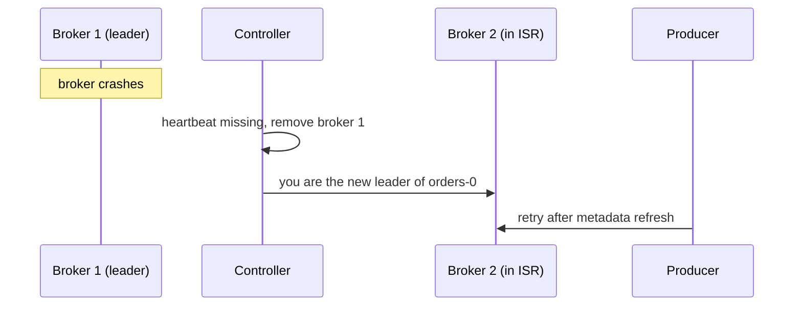

## 🎯 TL;DR

> Kafka is a cluster of **brokers** that store **topics**. Each topic is split into **partitions**, and each partition is an ordered, append-only log copied to several brokers. One replica is the **leader** for reads and writes, the others are **followers**, and the **ISR** is the set of replicas that are caught up.

- A **controller** decides who leads each partition. Modern Kafka runs this inside Kafka with **KRaft**, a Raft-based quorum, instead of ZooKeeper.
- Durability is a combination of settings: replication factor, `acks` and `min.insync.replicas` must be chosen together.
- Kafka is fast because it appends sequentially, uses the OS page cache, sends bytes with zero-copy, and works in batches.

## 🌱 Start simple (Junior)

> **💡 Analogy:** Think of a topic as a **set of numbered notebooks** (partitions). You only write at the end of a notebook, and each line has a number (its offset). To survive a fire, you keep copies in three libraries (replicas), and one librarian (the leader) takes every new write.

Create a topic `orders` with 3 partitions and replication factor 3:

```bash
kafka-topics.sh --bootstrap-server localhost:9092 \
  --create --topic orders --partitions 3 --replication-factor 3
```

Then describe it:

```bash
kafka-topics.sh --bootstrap-server localhost:9092 --describe --topic orders
```

Typical output (abbreviated; broker IDs depend on your cluster):

```text
Topic: orders  Partition: 0  Leader: 1  Replicas: 1,2,3  Isr: 1,2,3
Topic: orders  Partition: 1  Leader: 2  Replicas: 2,3,1  Isr: 2,3,1
Topic: orders  Partition: 2  Leader: 3  Replicas: 3,1,2  Isr: 3,1,2
```

Read it like this: partition 0 is written to broker 1, brokers 2 and 3 copy it, and all three are in sync. Three words to keep: **broker** (a server), **partition** (an ordered log), **offset** (a position inside it). Records in different partitions have no shared order.

## 🔧 How it really works (Mid)

**Partitions and segments.** A partition lives on disk as a directory of **segment** files. Records are appended to the active segment. When it reaches a size or age limit, Kafka rolls a new segment. Old segments are removed by retention or cleaned by compaction. Each segment has an offset index, so a consumer asking for offset 4000 does not scan the whole file.

**Offsets.** Each partition numbers its records 0, 1, 2, ... An offset is unique only inside its partition.

**Replication.** Each partition has a replication factor (RF), commonly 3 in production. The leader accepts produce requests. Followers **fetch** from the leader the way consumers do, and append the same bytes. A record becomes visible to consumers only when every in-sync replica has it; the position up to which this is true is the **high watermark**.

**ISR.** The in-sync replica set contains the leader and every follower that has caught up recently (within `replica.lag.time.max.ms`). A follower that falls behind leaves the ISR and rejoins once it catches up.

**Durability settings work together:**

- `acks=all`: the leader answers the producer only after the ISR members have the record.
- `min.insync.replicas`: the minimum ISR size needed to accept a write at all when `acks=all`.

With RF=3, `acks=all` and `min.insync.replicas=2`, one broker can fail and writes continue. If a second one fails, the ISR drops below 2 and producers get `NotEnoughReplicas`. That is the design: refuse the write rather than accept it with weak durability.

**Controller and leader failover.** One broker acts as the **controller**. It tracks live brokers and the leader of every partition. In KRaft mode, the controllers form a Raft quorum that stores this metadata in a Kafka log. When a leader broker dies:



The new leader can only come from the ISR. Writes to that partition pause briefly during the election and the metadata refresh. Unless `unclean.leader.election.enable` is true (its default is false), a replica outside the ISR never becomes leader, so acknowledged records are not lost. Turning unclean election on trades availability for possible data loss.

**Why it is fast.**

- **Sequential I/O:** appends go to the end of a file, which disks and the OS handle far better than random writes.
- **Page cache:** Kafka relies on the OS page cache rather than a large JVM heap cache, so recent data is often served from memory.
- **Zero-copy:** for consumers, file bytes go to the socket through the OS (`sendfile`) without being copied into user space.
- **Batching and compression:** producers send batches, and each batch is compressed once and stored compressed.

## 🧠 Senior depth & trade-offs

- **Choosing partitions.** Start from two measurements: the target throughput, and the throughput one partition sustains on your hardware (measure it). Partitions needed for throughput = target ÷ per-partition rate. The largest consumer group also sets a floor, since one partition is read by at most one consumer per group. Example: a target of 300 MB/s and a measured 20 MB/s per partition gives at least 15 partitions. With 12 consumers in the largest group, 15 already covers them. Choose a little more headroom, such as 18, because adding partitions later changes the key-to-partition mapping of keyed topics.
- **Partitions are not free.** Each one costs file handles, memory, replication traffic and recovery time after a restart. Very large partition counts per broker slow down leader elections. Check the sizing guidance for your version.
- **Replication multiplies cost.** RF=3 triples storage and inter-broker traffic. For data you can rebuild from a source, RF=2 can be a deliberate choice, but say why in the design.
- **Failure signals to alert on:** under-replicated partitions (ISR smaller than the replica list), offline partitions (no leader), ISR shrink events after network trouble, a broker with a full disk, and a controller quorum that lost its majority.
- **Hot leaders.** A leader carries all produce traffic and much of the consume traffic for its partitions. Uneven leader placement creates hot brokers even when partition counts look balanced. Check leader distribution after adding brokers, and rebalance leaders deliberately.
- **Multi-cluster.** Copying data between clusters or datacenters uses a separate tool (for example MirrorMaker 2), with its own lag and ordering limits.
- **When not to use Kafka.** Low volume with per-message routing, priorities or delayed jobs is usually simpler with a queue. A small team without Kafka operations experience should consider a managed service.

## 🧪 Try it

1. **Partition count.** Your target is 500 MB/s of ingest, your test shows 25 MB/s per partition, and the largest consumer group has 40 consumers. Which number satisfies both throughput and parallelism?
2. **Durability math.** RF=3, `acks=all`, `min.insync.replicas=2`. How many broker failures can happen before producers to a partition start failing? What changes if `min.insync.replicas=1`?
3. **Read the metadata.** A partition shows `Leader: 1  Replicas: 1,2,3  Isr: 1,3`. What is wrong, and what is the risk with `min.insync.replicas=2`?

<details><summary>Show answers</summary>

**1.** Throughput needs 500 ÷ 25 = 20 partitions. Forty consumers need 40 partitions for none to be idle. The minimum that covers both is 40. Choose 40 or a bit more for headroom.

**2.** One failure leaves an ISR of 2, which still satisfies the minimum, so writes continue. A second failure leaves an ISR of 1, below the minimum, so producers get errors. With `min.insync.replicas=1`, `acks=all` only means the leader alone has the record, so one broker failure can lose acknowledged data.

**3.** Broker 2 has fallen out of the ISR, because it is behind or down. The ISR size of 2 still meets the minimum of 2, so writes continue, but one more failure of broker 1 or 3 would block writes. Investigate broker 2 before it becomes an incident.

</details>

## 💬 Interview corner

**Question: "How do you choose the number of partitions?"** Mid answer: "I look at target throughput and the largest consumer group, and pick a number that covers both with headroom." Senior answer: "I measure per-partition throughput on our hardware, derive the minimum from the throughput target and the consumer parallelism, and add headroom. Changing the count later remaps keys, so for keyed data I plan it up front or create a new topic."

**Question: "What happens when a leader broker dies?"** Mid answer: "The controller elects a new leader from the ISR, and clients refresh metadata and reconnect." Senior answer: "The affected partitions are unavailable for a short window. Data is safe because the new leader comes from the ISR, which is why unclean election stays off. Afterwards I watch the leader-election rate and under-replicated partitions, and check whether the failed broker was a hot spot."

**Question: "min.insync.replicas and acks=all together."** Mid answer: "`acks=all` waits for the in-sync replicas, and the minimum ISR says how many must be present at all." Senior answer: "Together they give durability without requiring every replica. With RF=3 and minimum ISR 2, I tolerate one failure and fail fast on the second. `acks=all` alone is not enough if the ISR has shrunk to one replica."

> **🎤 Say this in the interview:** "Kafka partitions are ordered logs replicated across brokers. A leader takes writes, in-sync followers copy them, and durability comes from `acks=all` together with `min.insync.replicas`. I size partitions from throughput and from the largest consumer group."

## ⚠️ Common mistakes

> **⚠️ Watch out:** `acks=all` does not protect you if the ISR has shrunk. With one replica left in the ISR, `acks=all` waits for that single copy.

- Replication factor 1 in production: one disk failure loses the partition.
- Enabling unclean leader election to "keep it available", which can lose acknowledged records.
- Adding partitions to fix a slow consumer when the real bottleneck is processing code or one hot key.
- Assuming order across partitions. Order exists only inside one partition.
- Reading `Leader` and `Replicas` as health. Health means the ISR matches the replica list.
- Assuming the controller and metadata details are identical in every version. Check your version's docs.

## ✅ Check yourself (quiz)

1. What is the ISR?
   - A) The list of all brokers in the cluster
   - B) The replicas that are caught up with the leader
   - C) The consumers subscribed to a topic
   - D) The topics that use replication

<details><summary>Answer</summary>

**B** — the ISR is the set of replicas, including the leader, that are caught up. It decides which replicas can become leader and whether `min.insync.replicas` is met.

</details>

2. RF=3, `acks=all`, `min.insync.replicas=2`. The ISR shrinks to one broker. What does the producer see?
   - A) Writes succeed, with a warning
   - B) Writes fail with an error, so the record is not accepted with weak durability
   - C) Writes are routed to the controller
   - D) Writes succeed, and followers catch up later

<details><summary>Answer</summary>

**B** — with fewer in-sync replicas than the minimum, the broker rejects the write. Failing loudly is the point of the setting.

</details>

3. Why is Kafka's disk write path fast?
   - A) It keeps all data in the JVM heap
   - B) It appends sequentially and relies on the OS page cache and zero-copy
   - C) It calls fsync on every record
   - D) It stores records in random-access B-trees

<details><summary>Answer</summary>

**B** — sequential appends suit disks, the page cache serves recent data from memory, and zero-copy avoids extra copies on the way to consumers.

</details>

4. **(Senior)** A leader dies and `unclean.leader.election.enable` is true. A replica that was out of the ISR becomes leader. What is the risk?
   - A) The partition ends up with two leaders
   - B) Records that were acknowledged to producers but never reached that replica can be lost
   - C) Consumers must reset their offsets to zero
   - D) Followers stop replicating

<details><summary>Answer</summary>

**B** — with `acks=all`, acknowledged records sit on ISR members. An out-of-sync replica may lack some of them, so promoting it silently drops those records.

</details>

5. **(Senior)** A topic has 12 partitions and a consumer group of 12 consumers. You add 12 more consumers to the same group. What happens?
   - A) Throughput doubles
   - B) 12 of the new consumers sit idle, because a partition is read by at most one consumer per group
   - C) Kafka splits each partition across all 24 consumers
   - D) The brokers reject the new consumers

<details><summary>Answer</summary>

**B** — the group is capped at one consumer per partition, so extra consumers beyond 12 get nothing. More throughput needs more partitions.

</details>

## 🗂️ Flashcards

| Front | Back |
|---|---|
| Broker | A Kafka server that stores partition replicas and serves clients. |
| Partition | An ordered, append-only log; the unit of parallelism and ordering. |
| Offset | A record's position inside its partition. |
| Leader and follower | The replica that serves reads and writes, and the replicas that copy it. |
| ISR | The replicas caught up with the leader. |
| High watermark | The offset up to which all ISR members have a record; consumers read only below it. |
| `min.insync.replicas` | The minimum ISR size needed to accept a write when `acks=all`. |
| Unclean leader election | Lets an out-of-sync replica lead; can lose acknowledged data. |

## 🔗 Go further

- `queues-vs-logs`: why partitions and offsets exist.
- `kafka-producers`: `acks`, batching and idempotence from the client side.
- `kafka-consumers`: groups, offsets and rebalancing.
- `kafka-retention-compaction`: how segments are removed or compacted.
- `distributed-fundamentals`: replication, quorum and consensus in general.
- Glossary: [[wal]], [[consumer-lag]].

