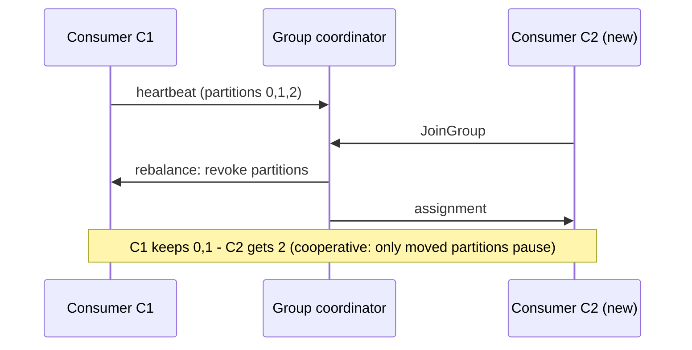

## 🎯 TL;DR

> A **consumer group** is a set of consumers that share the partitions of a topic. At any moment, each partition is read by **exactly one** consumer in the group.

- Parallelism comes from partitions: a group can never have more active readers than partitions.
- Each group stores its own **offset** (bookmark) per partition in the broker. Committing an offset means "I am done with everything before this".
- A **rebalance** moves partitions between consumers when members join, leave, crash or stall. It is the most common source of production pain.
- **Lag** (how far the group is behind the newest message) is the metric that tells you whether consumers keep up.

## 🌱 Start simple (Junior)

> **💡 Analogy:** A supermarket with 3 checkout lanes (partitions) and cashiers (consumers). Each lane has **one** cashier at a time, so customers in the same lane keep their order. If you hire a fourth cashier while there are three lanes, the fourth one stands idle. The bookmark each cashier keeps for "where I stopped" is the **offset**.

Example: topic `orders` has 3 partitions, and the group `billing` has 2 consumers.

```text
partition 0 ──► consumer C1
partition 1 ──► consumer C1
partition 2 ──► consumer C2
```

Now start a third consumer, C3. Kafka reassigns so that each consumer owns one partition. Start a fourth consumer, C4: it gets **no** partitions and does nothing except wait as a backup.

Two rules to remember:

1. Within one group, a partition is never shared by two consumers at the same time. This is what keeps per-partition order.
2. Two **different** groups each receive **all** messages. Groups are how you fan out one topic to many independent applications (billing, analytics, search).

A minimal consumer loop in Python (`confluent-kafka` client):

```python
from confluent_kafka import Consumer

c = Consumer({
    "bootstrap.servers": "localhost:9092",
    "group.id": "orders-billing",
    "enable.auto.commit": False,      # we decide when the bookmark moves
    "auto.offset.reset": "earliest",  # what to do when there is no saved offset yet
})
c.subscribe(["orders"])

while True:
    msg = c.poll(1.0)
    if msg is None or msg.error():
        continue
    process(msg.value())                       # your code; must be idempotent
    c.commit(message=msg, asynchronous=False)  # commit AFTER processing succeeded
```

## 🔧 How it really works (Mid)

**Where the state lives.** Offsets are stored in the internal topic `__consumer_offsets`, keyed by `(group, topic, partition)`. The committed offset is the **next** offset to read. A **group coordinator** (one of the brokers) tracks membership and runs the assignment.

**Liveness: two timers.**

- The consumer sends **heartbeats** from a background thread. If the coordinator hears nothing for `session.timeout.ms`, the member is removed.
- Your **poll loop** must call `poll()` again within `max.poll.interval.ms` (the default is 5 minutes in common versions; check your version). If processing a batch takes longer, the consumer is considered stuck, leaves the group, and triggers a rebalance. This is the classic bug where a slow database makes a consumer "flap" forever.

**What triggers a rebalance:** a consumer joins, leaves, crashes, exceeds `max.poll.interval.ms`, the topic gains partitions, or the subscription changes.



**Eager vs cooperative rebalancing.**

| | Eager (stop-the-world) | Cooperative (incremental) |
|---|---|---|
| What happens | Every consumer gives up **all** partitions, then gets a new set | Only partitions that must move are revoked |
| Pause for the group | Whole group stops reading | Only the moved partitions pause |
| Config | Older assignors (`RangeAssignor`, `RoundRobinAssignor`) | `CooperativeStickyAssignor` |

Cooperative rebalancing needs every member to use a compatible assignor. Check the docs for your client version.

**Static membership.** Set `group.instance.id` on each consumer. If a consumer restarts quickly (inside `session.timeout.ms`), it gets its old partitions back without a rebalance. This is useful for rolling deploys of stateful consumers.

**Offset commits.**

- `enable.auto.commit=true` commits on a timer, based on what the **last `poll()` returned**. It does not know whether your processing finished. If processing is asynchronous or the process crashes, records can be skipped (loss) or reprocessed (duplicates).
- Manual commit (`commitSync` / `commitAsync`) after processing gives **at-least-once** delivery: a crash between processing and commit causes a replay.
- Committing **before** processing gives at-most-once: a crash after the commit loses the message.

**Lag.** For each partition: `lag = log end offset − committed offset`. Sum across partitions to get the group lag. You can see it with:

```bash
kafka-consumer-groups.sh --bootstrap-server localhost:9092 \
  --describe --group orders-billing
```

The output columns are `CURRENT-OFFSET`, `LOG-END-OFFSET` and `LAG` per partition, plus which consumer owns each partition.

**Poison pills.** A record that always fails processing (malformed JSON, a schema the code does not handle) blocks its partition: the offset cannot move past it without skipping it. The usual fix is bounded retries, then a **dead-letter queue** (DLQ) topic that stores the record with metadata (topic, partition, offset, error), followed by a commit so the partition moves on.

## 🧠 Senior depth & trade-offs

**Parallelism is capped by partitions.** The maximum useful consumers in a group equals the partition count. Increasing partitions later is possible, but it changes key-to-partition mapping, which breaks per-key ordering for keys that are in flight. Size partitions for peak throughput divided by the throughput of one consumer, plus headroom for growth.

**Processing time is the real enemy.** Long batches cause `max.poll.interval.ms` violations, which cause rebalances, which cause more reprocessing, which makes batches longer. Practical levers:

- Lower `max.poll.records` so one poll returns less work.
- Keep per-record work bounded; move slow external calls behind timeouts and retries.
- If you must process in a thread pool, use `pause()` / `resume()` carefully so you do not poll more than you can finish.

**Failure modes to know by name.**

- *Rebalance storm:* group keeps rebalancing; lag grows; nothing is processed.
- *Stuck partition:* one partition's lag grows while others are fine. Usually a poison pill or a hot key.
- *Zombie consumer:* a process is paused (long GC, network partition) but still holds partitions until the timeout fires; it may then process duplicates.

**DLQ trade-off.** Sending a record to a DLQ moves it out of order. If a key's later events depend on the failed one, you must decide between blocking the partition (correct order, lag grows) and skipping (keeps flowing, data inconsistency). Business rules decide, not Kafka.

**What to monitor.** Lag **growth rate** (more useful than absolute lag), rebalance count per hour, commit failures, time from `poll()` to commit, and DLQ rate. Alert on "lag increasing for 15 minutes", not on a fixed number, because the right number depends on traffic.

**Frameworks manage their own offsets.** Flink stores source offsets in its checkpoints and uses them for recovery; committing to Kafka is mainly for monitoring. Kafka Streams and Kafka Connect use consumer groups under the hood. Know this before debugging "why does Flink's lag not match my consumer group".

**When NOT to use a shared group.** If every instance needs every message (a local cache, a notification fan-out), give each instance its own `group.id`. If you need full control and no rebalancing, use manual `assign()` for explicit partitions, and accept that you own failover.

## 🧪 Try it

1. Create a topic with 3 partitions and produce 300 messages with keys (`orders`, `key=user_id`).
2. Run one consumer in group `billing`. Run `kafka-consumer-groups.sh --describe` and note the LAG column.
3. Start a second and third consumer. Describe the group again: each consumer should own one partition.
4. Start a fourth consumer. Confirm it owns nothing.
5. Stop one consumer with `kill -9` and watch the rebalance take roughly `session.timeout.ms` to detect.

Predict first: after step 5, which consumer gets the orphaned partition, and why does it not happen instantly?

<details><summary>Your guess?</summary>

Nobody gets it instantly. The coordinator only removes a member after heartbeats stop for `session.timeout.ms`, so the partition sits unread for that window. Then the rebalance assigns it to a surviving member. Lag rises during the gap and drains afterward.

</details>

## 💬 Interview corner

**Q: How many consumers should I run?**

> **🎤 Say this in the interview:** "Up to the number of partitions; more than that just sit idle. I size the consumer count from peak throughput divided by per-consumer throughput, then choose partitions with headroom. I watch lag growth rate, not absolute lag, and I keep `max.poll.interval.ms` above my worst-case batch time so slow processing does not trigger rebalances."

**Q: What happens when a consumer dies?**

> **🎤 Say this in the interview:** "The coordinator stops getting heartbeats and removes it after `session.timeout.ms`. A rebalance reassigns its partitions. Uncommitted work is replayed, so processing must be idempotent. With static membership and cooperative rebalancing, a quick restart causes much less disruption."

## ⚠️ Common mistakes

- **"More consumers means more throughput."** Only up to the partition count. Beyond that, extra consumers do nothing.
- **Auto-commit with asynchronous processing.** The offset moves before the work is done, so a crash loses data.
- **Long processing inside `poll()` loops.** Missing `max.poll.interval.ms` causes rebalances that look like random failures.
- **Reusing one `group.id` across unrelated apps.** They split the partitions and each sees only part of the data.
- **Retrying a poison pill forever.** The partition stops; lag climbs on one partition while dashboards show the topic as "healthy".
- **Assuming "committed" means "processed exactly once".** Commits give at-least-once unless you use transactions (see the exactly-once lesson).

## ✅ Check yourself (quiz)

1. A topic has 6 partitions and the group `reports` has 8 consumers. How many consumers receive messages?
   - A) 6
   - B) 8
   - C) 1
   - D) It depends on the message keys

<details><summary>Answer</summary>

**A** — each partition goes to exactly one consumer in the group, so only 6 consumers own a partition. The other 2 stay idle until a partition is added or a consumer leaves.

</details>

2. Which setting controls how long the application may take between two `poll()` calls before the consumer is removed from the group?
   - A) `session.timeout.ms`
   - B) `heartbeat.interval.ms`
   - C) `max.poll.interval.ms`
   - D) `auto.commit.interval.ms`

<details><summary>Answer</summary>

**C** — `max.poll.interval.ms` covers the gap between polls, which is your processing time. `session.timeout.ms` is about heartbeats sent from a background thread, so a slow loop can still heartbeat and then get kicked out by the poll timeout.

</details>

3. Auto-commit is on. Your code hands each record to a background thread and returns to `poll()` immediately. What is the main risk?
   - A) Duplicate processing only
   - B) Message loss is possible
   - C) Rebalances never happen
   - D) Lag is always zero

<details><summary>Answer</summary>

**B** — auto-commit moves the offset based on the last `poll()`, not on whether the background work finished. A crash after the commit but before the thread finishes skips those records.

</details>

4. *(Senior)* Why does cooperative rebalancing reduce incidents compared with eager rebalancing?

<details><summary>Answer</summary>

Eager rebalancing revokes every partition from every member, so the whole group pauses. Cooperative rebalancing revokes only the partitions that must change owner, so unaffected consumers keep reading. The cost is more protocol rounds, and all members must support the assignor.

</details>

5. One partition's lag grows steadily while the other partitions stay near zero. What is the most likely cause, and what is the fix?

<details><summary>Answer</summary>

Most likely a poison pill (a record that always fails) or a hot key that overloads one consumer. Inspect the failing offset in the logs, bound the retries, and send the record to a DLQ with its metadata, then commit. If it is a hot key, the fix is in partitioning or salting, not in the consumer.

</details>

## 🗂️ Flashcards

| Front | Back |
|---|---|
| Consumer group rule | Each partition is read by exactly one consumer in the group at a time |
| Max useful consumers | Number of partitions; extras stay idle |
| Committed offset means | The next offset to read (everything before it is done) |
| Lag formula | Log end offset − committed offset, per partition |
| `max.poll.interval.ms` | Max time between `poll()` calls before the consumer leaves the group |
| Eager vs cooperative | Eager revokes all partitions; cooperative revokes only the ones that move |
| Static membership | `group.instance.id`: quick restarts avoid a rebalance |
| Poison pill fix | Bounded retries, then DLQ with metadata, then commit |

## 🔗 Go further

- Next: **kafka-exactly-once** explains what happens when a consumer also writes to Kafka (read-process-write inside one transaction).
- **kafka-retention-compaction** covers what happens to offsets when old data is deleted: a slow group can fall off the start of the log.
- **dlq-bad-records** goes deeper on the dead-letter pattern, retry topics and replay.
- The glossary entries [[consumer-lag]] and [[idempotency]] define the two ideas this lesson depends on.
