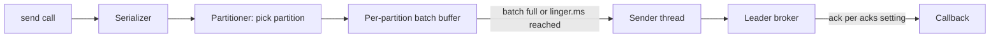

## 🎯 TL;DR

> A Kafka producer does not send each record alone. It collects records into **batches per partition**, sends each batch to the partition's leader, and waits for an **acknowledgement**. The settings `acks`, idempotence, retries and in-flight requests decide what you can lose, duplicate or reorder.

- `acks=all` plus **idempotence** gives safe retries with no duplicates within one producer session.
- `linger.ms`, `batch.size` and `compression.type` trade a little latency for much higher throughput.
- The **partitioner** picks the partition from the key. That gives per-key ordering, and it can create **hot partitions**.

## 🌱 Start simple (Junior)

> **💡 Analogy:** A post office clerk collects letters for each address in a bag. The bag leaves when it is full or when a timer ends. The sorting center's receipt says "delivered" or "failed", and the clerk must decide what to do with the failures.

A producer call looks simple:

```python
from confluent_kafka import Producer

producer = Producer({
    "bootstrap.servers": "localhost:9092",
    "acks": "all",
    "enable.idempotence": True,
    "linger.ms": 10,
    "batch.size": 65536,
    "compression.type": "zstd",
    "delivery.timeout.ms": 120000,
})

def on_delivery(err, msg):
    if err is not None:
        print("failed:", err)
    else:
        print("ok, partition", msg.partition(), "offset", msg.offset())

# Same key -> same partition -> ordered for this user
producer.produce("orders", key="user-42", value=b'{"amount": 10}', callback=on_delivery)
producer.flush()
```

Each setting maps to a concept in this lesson. `key` picks the partition, `linger.ms` and `batch.size` shape the batches, `acks` defines what "delivered" means, and the callback is where you learn about failures. Set `enable.idempotence` explicitly, so the intent is visible in the code. `produce` is asynchronous, which is why `flush()` is needed before exit.

## 🔧 How it really works (Mid)

The path of one record:



**Partitioner.** If a record has a key, the default partitioner hashes it (murmur2 in the Java client) and takes the result modulo the partition count. The same key therefore goes to the same partition while the count stays the same. Records without a key use a "sticky" strategy: they fill one partition's batch and then move on, which balances load over time. Changing the partition count changes `hash % N`, so existing keys move.

**Batching.** A partition's batch is sent when it reaches `batch.size` bytes or when `linger.ms` has passed since it was opened. With `linger.ms=0`, a batch goes out as soon as the sender is free: lowest latency, smallest batches. With `linger.ms=10`, more records join each batch: fewer requests, better compression, higher throughput, and at most 10 ms of extra waiting.

**Compression** applies per batch, and bigger batches compress better. In the common case the broker stores the batch as the producer compressed it, and consumers decompress it.

**`acks`:**

| `acks` | Producer is told "success" when | Risk |
|---|---|---|
| `0` | The record has been handed to the network | Silent loss on any failure |
| `1` | The leader has written it | Lost if the leader dies before followers copy it |
| `all` | All in-sync replicas have it (and the min ISR check passes) | Safest; higher latency |

**Retries and duplicates.** Transient errors (a leader change, a timeout, a network blip) trigger retries. The producer keeps retrying until `delivery.timeout.ms` expires, then the callback receives an error. Without idempotence, a retry after a lost acknowledgement can write the same record twice: the broker wrote it, the response was lost, and the producer sent it again.

**Idempotent producer.** With `enable.idempotence=true`, the producer gets a producer ID and attaches a sequence number per partition to each batch. The broker drops any batch whose sequence it has already stored. This removes retry duplicates within one producer session. It does not cover a restarted producer (a new session), and it does not make writes to several partitions atomic. Those need transactions, covered in `kafka-exactly-once`.

**Ordering and in-flight requests.** `max.in.flight.requests.per.connection` is how many unacknowledged requests can be open to one broker. Consider: batch 1 fails transiently, batch 2 is acknowledged, then batch 1 is retried. The partition now holds batch 2 before batch 1. There are two safe fixes: enable idempotence (the broker checks sequence numbers, so up to 5 in-flight requests keep their order), or set in-flight to 1 without idempotence, which keeps order at a large cost in throughput.

## 🧠 Senior depth & trade-offs

- **Two timeouts, one budget.** `delivery.timeout.ms` bounds the total time from `send` to final success or failure, including batching wait and retries. It must be large enough to cover `linger.ms` plus one request timeout, and the Java client rejects impossible combinations. Set it to the time you can afford to wait, then route failures to a dead-letter path or an alert.
- **Latency vs throughput.** For bulk ingest (logs, clickstream): `acks=all`, idempotence on, `linger.ms` in the 5–20 ms range, large batches, and a codec such as zstd or lz4. For latency-sensitive paths: small batches and `linger.ms=0`, accepting lower compression. Measure with your real record size; the right numbers depend on it.
- **Hot partitions from skewed keys.** A partition's load equals the traffic of the keys mapped to it. Suppose one merchant produces 40% of the traffic across 12 partitions. The partition holding that merchant gets 40% + 60% ÷ 12 = 45% of the load, against a fair share of about 8.3%. Its leader saturates and its consumer lags. Fixes: a finer key (for example `merchant_id` plus `order_id`) if the ordering requirement allows it, salting the hot key into sub-keys (which gives up per-key order for that key), or a dedicated topic for the dominant tenant. Confirm the skew with per-partition metrics first; see [[data-skew]].
- **Producer backpressure.** In the Java client, when the buffer of unsent batches (`buffer.memory`) is full, `send` blocks for up to `max.block.ms` and then throws. Watch buffer availability: a blocked producer usually means a slow broker or network. Check the docs for your client.
- **Exactly-once end to end** needs producer transactions (`transactional.id`), consumers that read only committed data, and an idempotent sink for any external system. The idempotent producer alone is not that.
- **Operate with metrics.** Watch the send error rate, retry rate, average batch size, compression ratio, request latency and buffer pressure. A falling average batch size usually means traffic is sparse or `linger.ms` is too low.
- **Schemas.** Use a schema (Avro, Protobuf or JSON Schema, with a schema registry) so a producer cannot silently break its consumers. The rules are a [[data-contract]] problem as much as a serialization one.
- **When `acks=0` is acceptable.** Best-effort metrics where some loss is fine and throughput matters more than certainty. Make it a conscious decision, not a default.

## 🧪 Try it

1. **Pick settings.** For each scenario, choose `acks`, idempotence and `linger.ms`: (a) payment events that must neither be lost nor duplicated, (b) click events at 2 million per second, where losing 1% is acceptable, (c) a fraud-alert path with a 50 ms end-to-end budget.
2. **Reordering.** Settings: idempotence off, retries on, `max.in.flight.requests.per.connection=5`. Batch A (sequence 1) fails transiently, batch B is acknowledged, then A is retried. What order do the records end up in? Which two settings prevent it?
3. **Hot key arithmetic.** One merchant produces 40% of events, spread over 12 partitions, and the other keys hash evenly. What share does the hot partition carry? What is the fair share? How many times larger is the hot share?
4. **Batch reasoning.** A producer sends 10 records per second with `linger.ms=10`. About how many records does a batch hold, and is the linger the bottleneck?

<details><summary>Show answers</summary>

**1.** (a) `acks=all`, idempotence on, and a small linger, because correctness comes first. Add an idempotent consumer or sink downstream. (b) `acks=1` or `acks=0` with large batches, a linger of 20–50 ms and compression on, since loss is tolerated and throughput is the goal. (c) `acks=all` with idempotence stays for correctness, with `linger.ms=0` or very low and small batches, so the 50 ms budget covers network and processing.

**2.** The partition ends up with B before A. Enable idempotence, which keeps order with up to 5 in-flight requests, or set in-flight to 1 without idempotence.

**3.** The hot partition carries 40% + 60% ÷ 12 = 40% + 5% = 45%. The fair share is 1 ÷ 12 ≈ 8.3%. The hot share is about 5.4 times the fair one.

**4.** At 10 records per second, one record arrives every 100 ms. A 10 ms linger expires almost always with one record, so batches hold about one record. Linger does nothing here, and the added latency is at most 10 ms. Batching matters only at higher rates.

</details>

## 💬 Interview corner

**Question: "How do you avoid duplicates when producing?"** Mid answer: "Enable the idempotent producer with `acks=all`, so retries do not write the same record twice." Senior answer: "Idempotence removes retry duplicates within one producer session, per partition. If the producer restarts, or I need atomic writes across partitions, I need transactions. Downstream I still make the consumer or sink idempotent, because a crash between write and commit replays records."

**Question: "Why can messages be reordered?"** Mid answer: "Retries combined with several in-flight requests can put a retried batch after a later one." Senior answer: "Only within a partition, and only when retries and multiple in-flight requests combine without idempotence. Idempotence with up to 5 in-flight requests keeps order. Order across partitions is never guaranteed."

**Question: "How do you handle a hot key?"** Mid answer: "Use a finer key, or spread the hot key across sub-keys." Senior answer: "First confirm the skew with per-partition metrics, then decide which ordering I can give up. Salting or a finer key trades per-key order for balance. A dedicated topic is simpler when one tenant dominates."

> **🎤 Say this in the interview:** "The producer batches per partition and waits for acknowledgements. I set `acks=all` with idempotence for correctness, tune `linger.ms` and batch size for throughput, and key records so that ordering holds where it matters. Hot keys are a design problem I would catch in per-partition metrics."

## ⚠️ Common mistakes

> **⚠️ Watch out:** `acks=1` looks safe in staging and loses data in production when the leader dies right after acknowledging. For data you cannot lose, `acks=all` with idempotence is the default choice.

- Treating a returned `send()` as "delivered". It is asynchronous; only the callback or a flush tells you the result.
- Ignoring delivery errors (no callback, no logging), which loses records silently.
- Raising `max.in.flight` without idempotence and then expecting order.
- Setting `delivery.timeout.ms` below `linger.ms` plus the request timeout.
- Adding partitions to a keyed topic and expecting a user to stay on the same partition.
- Using a random key (a new UUID per event) when you need per-user ordering. That removes ordering entirely.
- Assuming idempotence means exactly-once for the whole pipeline.

## ✅ Check yourself (quiz)

1. Which `acks` setting can lose data silently even when every broker stays healthy?
   - A) `acks=0`
   - B) `acks=1`
   - C) `acks=all`
   - D) None of them

<details><summary>Answer</summary>

**A** — with `acks=0` the producer gets no acknowledgement at all, so a network failure can drop records without anyone knowing. `acks=1` loses data only if the leader dies before replication.

</details>

2. Two records with the same key must stay in order, and retries can happen. Which configuration keeps them in order?
   - A) `linger.ms=0`
   - B) `compression.type=zstd`
   - C) Idempotence enabled with up to 5 in-flight requests, or in-flight set to 1 without idempotence
   - D) A larger `batch.size`

<details><summary>Answer</summary>

**C** — ordering under retries needs either the broker's sequence checks (idempotence) or a single in-flight request. The other options do not affect ordering.

</details>

3. A topic has 24 partitions and you add 8 more. What happens to a key that already has records?
   - A) Nothing; the key still maps to the same partition
   - B) The key may now map to a different partition, so its new records can be ordered differently from its old ones
   - C) The producer refuses to send keyed records
   - D) Old records move to the new partitions

<details><summary>Answer</summary>

**B** — the mapping is `hash % N`, so changing N moves keys. Existing records stay where they are, and new records for that key can land elsewhere.

</details>

4. **(Senior)** A producer has `delivery.timeout.ms` of 30 seconds. Brokers are slow, and some callbacks report a timeout. Which statement is most accurate?
   - A) The record was definitely not written
   - B) The record may or may not have been written; treat it as unknown and make the write idempotent or verifiable before retrying at the application level
   - C) The record was written twice
   - D) The timeout only reflects network latency

<details><summary>Answer</summary>

**B** — a timeout does not prove failure: the broker may have written the record before the response was lost. Idempotent writes or a check before retry resolve that ambiguity.

</details>

5. **(Senior)** One merchant accounts for 40% of traffic across 12 partitions, and consumers need order per order, not per merchant. What is the most direct fix?
   - A) Increase `linger.ms`
   - B) Key by `order_id` instead of `merchant_id`
   - C) Turn off compression
   - D) Set `acks=0`

<details><summary>Answer</summary>

**B** — keying by `order_id` spreads the merchant's traffic over partitions while keeping each order's records in order. The other options do not change the partition choice.

</details>

## 🗂️ Flashcards

| Front | Back |
|---|---|
| `acks=0` | Fire and forget: no acknowledgement, so loss can be silent. |
| `acks=all` | The leader answers after all in-sync replicas have the record. |
| Idempotent producer | Producer ID plus per-partition sequence numbers; the broker drops retry duplicates within a session. |
| `linger.ms` | How long a batch waits for more records before it is sent. |
| `batch.size` | Byte size at which a batch is sent immediately. |
| Partitioner | Chooses the partition; hashing the key sends the same key to the same partition. |
| `delivery.timeout.ms` | Total time budget from `send` to final success or failure, including retries. |
| Hot partition | A partition with far more traffic than its share, caused by key skew. |

## 🔗 Go further

- `kafka-architecture`: leaders, the ISR and `min.insync.replicas`, which give `acks=all` its meaning.
- `kafka-exactly-once`: transactions, read-committed consumers and end-to-end guarantees.
- `delivery-semantics`: at-most-once, at-least-once and exactly-once as a whole-pipeline view.
- `dedup-idempotent-loads`: making the sink tolerate duplicates.
- Glossary: [[data-skew]], [[idempotency]], [[data-contract]].

