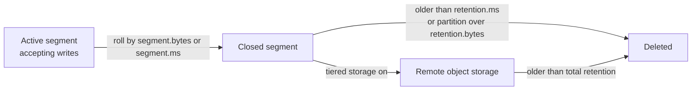

## 🎯 TL;DR

> A Kafka topic is a **log**, and a log grows forever unless you tell Kafka what to throw away. Two cleanup policies answer that question: **delete** (drop old data) and **compact** (keep the latest value per key).

- `cleanup.policy=delete` removes whole **segments** when they are older than the time limit or when the partition is larger than the size limit.
- `cleanup.policy=compact` keeps, for every key, the **most recent** record, and drops older records with the same key.
- A **tombstone** (a record with a key and a `null` value) tells compaction to remove that key entirely.
- **Tiered storage** moves older segments from broker disks to cheaper object storage while keeping the same topic and offsets.

## 🌱 Start simple (Junior)

> **💡 Analogy:** Think of a notebook where you write one line per event. With **delete**, you tear out the oldest pages once the notebook is full or the pages are older than a month. With **compact**, you keep only the last line written for each name, like a phone book where a new number replaces the old one.

Every partition is an append-only file. Kafka splits that file into **segments** (files of a fixed size or age). Cleanup never edits a record in the middle of the active segment, and it works on closed segments only.

The two policies are set per topic:

```bash
# Delete old data after 7 days (the common default)
kafka-configs.sh --bootstrap-server localhost:9092 \
  --entity-type topics --entity-name clicks \
  --alter --add-config cleanup.policy=delete,retention.ms=604800000

# Keep the latest value per key, forever
kafka-configs.sh --bootstrap-server localhost:9092 \
  --entity-type topics --entity-name user-profiles \
  --alter --add-config cleanup.policy=compact
```

A simple example for the compacted topic. We send three updates for `user-1` and one for `user-2`:

```text
offset  key       value
0       user-1    {"city": "Tehran"}
1       user-2    {"city": "Shiraz"}
2       user-1    {"city": "Isfahan"}
3       user-1    {"city": "Mashhad"}
```

After compaction, a new consumer that reads from the beginning sees `user-2 → Shiraz` and `user-1 → Mashhad`. The offsets 0 and 2 are gone, so offsets now have gaps. That is normal: consumers must not assume offsets are contiguous.

> **⚠️ Watch out:** Compaction is **not** immediate. Until a cleaner runs, a consumer can still read several old values for the same key. Never assume "compacted" means "one record per key right now".

## 🔧 How it really works (Mid)

### Delete policy

Each segment has a largest timestamp. Kafka deletes a closed segment when **either** of these is true:

- `retention.ms` is exceeded (time-based), or
- `retention.bytes` says the partition is bigger than the limit (size-based, per partition, not per topic).

Both limits are checked. If you set both, the first one that triggers wins. The **active** segment is never deleted, so a topic with a huge `segment.bytes` may keep data much longer than `retention.ms` says. Segment size and roll time (`segment.bytes`, `segment.ms`) therefore matter for how precisely retention works.

Retention does not depend on whether consumers have read the data. A slow consumer whose offset points to deleted data gets an `OffsetOutOfRangeException`, and its `auto.offset.reset` setting decides what happens next.

### Compact policy

A compacted topic keeps the **last value for each key**. The log cleaner splits the log into a **clean** part (already compacted) and a **dirty** part (new data). It runs when the dirty ratio is above `min.cleanable.dirty.ratio`, so it does not run on every write.

Important details:

| Rule | What it means |
|---|---|
| Active segment | Never compacted. The newest data always stays intact. |
| Key required | Records without a key cannot be compacted. Kafka rejects them in a compacted topic. |
| Offsets | Kept as they were. Compaction removes records, it does not renumber them. |
| Order | Surviving records keep their relative order. |
| Tombstone | A record with `value = null`. It removes the key once the tombstone itself is cleaned. |
| `delete.retention.ms` | How long tombstones stay so that consumers can see the deletion before it disappears. |

A **tombstone** is how you delete a key from a compacted topic. Downstream consumers that build a table from the topic must handle `null` values as "remove this key from my state".

```python
# Python, confluent-kafka client: delete user-1 from a compacted topic
from confluent_kafka import Producer

p = Producer({"bootstrap.servers": "localhost:9092"})
p.produce("user-profiles", key=b"user-1", value=None)  # tombstone
p.flush()
```

Both policies can be combined with `cleanup.policy=delete,compact`. Kafka keeps the latest value per key and also removes data older than `retention.ms`. This is useful for changelog topics with a time limit.

### Why compaction matters

Compacted topics are the backbone of **changelogs**. Kafka Streams state stores, Debezium CDC topics and many "current state" feeds use compaction, so a new consumer can rebuild the full current state by reading the topic from the beginning. Without compaction you would have to replay years of history. See [[cdc]] and [[log-compaction]] for the wider idea.

### Tiered storage

Tiered storage (KIP-405) keeps recent segments on local broker disks and copies older closed segments to remote object storage such as S3 or GCS. Consumers read old offsets from remote storage transparently. Two properties matter for interviews:

- `retention.ms` still describes the **total** retention (local plus remote).
- A local retention setting controls how much stays on broker disks.

Availability and exact config names depend on the Kafka version and distribution, so check the docs for your version before quoting them.

Here is the life of a record on a delete topic:



## 🧠 Senior depth & trade-offs

**Retention is a contract, not a cache.** `retention.ms` is effectively the SLA for how late a consumer may read. If your slowest consumer can be down for 3 days and retention is 2 days, you have an incident waiting to happen. Size retention as: `retention ≥ worst recovery time + replay time + margin`.

**Size math.** Estimate disk per topic:

```text
ingest rate   = 20 MB/s
retention     = 7 days = 604800 s
raw data      = 20 MB/s × 604800 s = 12,096,000 MB ≈ 12.1 TB
replication   = 3
disk needed   = 12.1 TB × 3 ≈ 36.3 TB (before compression and headroom)
```

Add headroom for segments that have not been deleted yet and for broker failures. Compression (`compression.type`) reduces the on-disk size, but check the real numbers in your cluster.

**Compaction failure modes.**

- The cleaner thread can die on a bad record or run out of memory for its key map. The dirty data then grows and disk fills. Monitor the log cleaner metrics and the size of the dirty part of the log.
- A huge number of unique keys makes the cleaner's key map large. Compaction of high-cardinality topics is expensive. Prefer a time-based delete policy for event data that does not need a "current state".
- Tombstones that are cleaned too early can let an old value "come back" for a consumer that was offline. Keep `delete.retention.ms` longer than your slowest consumer's lag.

**Ordering and keys.** Compaction preserves the order of survivors, but it does not reorder. Your partition key choice decides what "latest" means. If the same entity uses two keys (for example, a user id and an email), compaction cannot merge them.

**When NOT to use compaction.** Do not compact an event stream where every event matters (payments, clicks, audit logs). Compaction would delete valid history. Use delete retention plus a sink to a lake for history instead.

**What to monitor.**

- Consumer lag against the retention window (how close the oldest consumer offset is to the earliest available offset).
- Disk usage per broker and per topic, and the growth rate.
- Log cleaner health and the dirty ratio of compacted topics.
- Tiered storage upload errors, if you use it.

## 🧪 Try it

1. Create a topic `user-profiles` with `cleanup.policy=compact` and a small `segment.ms` (for example 10 seconds) so the cleaner runs during the exercise.
2. Produce four records: `user-1` three times with different cities, then `user-2` once.
3. Consume from the beginning and count the records. Some old values may still be there.
4. Produce a tombstone for `user-1`, wait for compaction, and consume again. `user-1` should disappear after the tombstone's retention window ends.
5. Write down what you would have to change if the topic were `cleanup.policy=delete` instead.

> **🎤 Say this in the interview:** "I pick the policy from the question I need answered. If I need history for replay or audit, I use delete with a retention long enough for my slowest consumer. If I need the current state per key, like a changelog, I use compact, and I delete keys with tombstones. I never assume compaction has already happened, because it is asynchronous."

## 💬 Interview corner

**Q: What happens when a consumer falls behind the retention window?**
- **Junior:** It loses the old data, because Kafka deleted it. It has to start from the earliest offset that still exists.
- **Mid:** Its committed offset points to a deleted segment, so the fetch fails with `OffsetOutOfRangeException`. The `auto.offset.reset` setting decides whether it jumps to earliest or latest, and that skips data silently.
- **Senior:** This is a data-loss incident for the consumer. Alert on lag against the earliest offset, size retention with a margin, and make the reset policy explicit. Recovery usually means a backfill from the source or from the lake.

**Q: How do you delete a key from a compacted topic?**
- **Mid:** Produce a tombstone, which is the same key with a `null` value. After compaction removes older values, the tombstone is removed after `delete.retention.ms`.

**Model answer (senior):** Delete keeps history for a time window, compaction keeps the latest value per key. Compaction is asynchronous and only touches closed segments, so consumers can see old values for a while. Deletes use tombstones, and retention must cover the slowest consumer. I monitor consumer lag against the earliest offset and the cleaner's health.

## ⚠️ Common mistakes

- **"Compacted means deduplicated now."** Compaction is delayed. Readers must handle duplicate keys, or read through a stateful consumer.
- **Using compaction for event streams.** Every event is a fact. Compaction erases the history you may need.
- **Sending records without keys to a compacted topic.** They cannot be compacted, and the producer will fail.
- **Forgetting that retention is per partition for `retention.bytes`.** A topic with 12 partitions can hold up to 12 times the limit.
- **Setting `retention.ms` shorter than consumer recovery time.** This is the most common cause of silent data loss.
- **Assuming offsets are contiguous after compaction.** Gaps are normal.

## ✅ Check yourself (quiz)

1. A topic has `cleanup.policy=delete` and `retention.ms` of 1 day. A segment closed 3 days ago. Why might it still exist?
   - A) Kafka never deletes closed segments
   - B) It is the active segment, or the cleaner has not run yet
   - C) Consumers must commit offsets first
   - D) Compaction is blocking deletion
   
   <details><summary>Answer</summary>

   **B** — Deletion is checked on closed segments and happens on the cleaner schedule, so a closed segment can exist briefly after its time limit. The active segment is never deleted, so a long-lived active segment can hold data past the limit.

   </details>

2. You want to remove user `42` from a compacted topic `profiles`. What do you produce?
   - A) A record with key `42` and an empty JSON object
   - B) A record with key `42` and a `null` value
   - C) A record with no key
   - D) Nothing; you must delete the topic

   <details><summary>Answer</summary>

   **B** — A tombstone is a keyed record with `null` value. Option A keeps the key alive with a value. Option C cannot be compacted at all.

   </details>

3. **Scenario:** A payments topic is compacted so the "current state" per payment is kept. Finance asks for a full audit trail. What is wrong and what would you do?
   - A) Nothing; compaction keeps all history
   - B) Compaction deletes earlier events, so use delete retention and sink the data to a lake for audit
   - C) Increase `min.cleanable.dirty.ratio`
   - D) Switch the topic to a log-compacted sink

   <details><summary>Answer</summary>

   **B** — Compaction removes older records with the same key, so the audit trail is lost. Keep the events on a delete-policy topic with enough retention, and load them into long-term storage.

   </details>

4. **Senior trade-off:** Your slowest consumer can be offline for up to 48 hours during deployments. Retention is 24 hours. What is the risk and the fix?
   - A) No risk; consumers reconnect automatically
   - B) Data is deleted before recovery, so raise retention to cover recovery and replay time with margin, and alert on lag
   - C) Lower `segment.bytes`
   - D) Enable compaction

   <details><summary>Answer</summary>

   **B** — Retention is the window in which a consumer can recover. Retention must be longer than the worst downtime plus replay time, and lag alerts give time to act.

   </details>

## 🗂️ Flashcards

| Front | Back |
|---|---|
| `cleanup.policy=delete` | Remove closed segments older than `retention.ms` or above `retention.bytes` per partition |
| `cleanup.policy=compact` | Keep the latest record per key; older same-key records are removed asynchronously |
| Tombstone | Keyed record with `null` value; removes the key after compaction |
| `delete.retention.ms` | How long tombstones remain visible before cleanup removes them |
| Active segment | Never deleted or compacted |
| Dirty ratio | Share of uncompacted data; the cleaner runs when it passes `min.cleanable.dirty.ratio` |
| Tiered storage | Older closed segments on object storage, same topic and offsets |
| Retention as SLA | Retention must cover the slowest consumer's worst recovery time |

## 🔗 Go further

- [[kafka-architecture]] — how segments and partitions are laid out on disk
- [[kafka-exactly-once]] — why duplicates matter once keys are compacted
- [[kafka-connect-ops]] — operating the pipelines that sit on top of these topics
- [[data-retention]] — retention policy beyond Kafka
- Kafka docs: "Log compaction" and the topic-level configuration reference for your version
