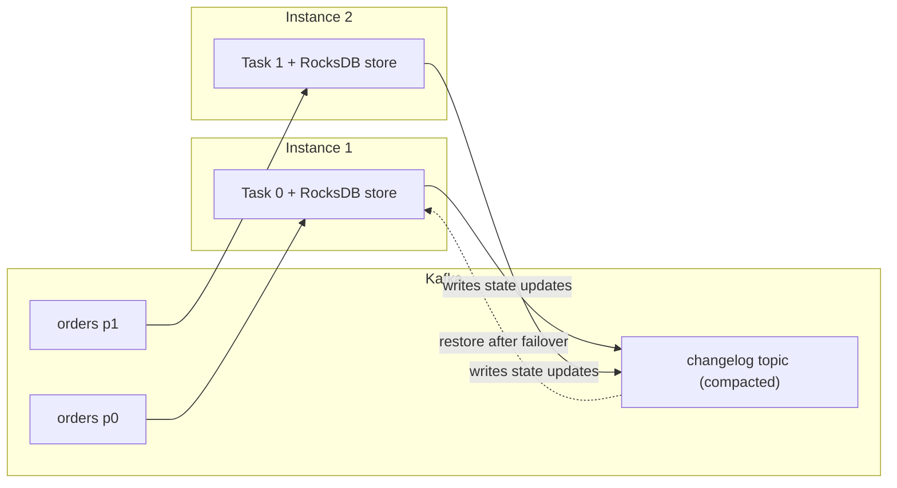

## 🎯 TL;DR

> **Kafka Streams** is a Java **library**, not a cluster. Your application reads Kafka topics, transforms them, keeps its own state, and writes results back to Kafka. Scaling means starting more copies of your app.

- `KStream` is an unbounded **stream of events**. Each record is a fact.
- `KTable` is a **changelog view**: for each key, only the latest value counts.
- Local state lives in **state stores** (RocksDB by default) and is backed up to **changelog topics** in Kafka, so it can be rebuilt after a crash.
- **ksqlDB** is SQL on top of the same engine, for teams that want queries instead of Java.

## 🌱 Start simple (Junior)

> **💡 Analogy:** Think of a Kafka Streams app as a worker at a sorting desk. The conveyor belt is the Kafka topic. The worker takes each parcel, may write a note in a personal notebook (the state store), and places the result on another belt. No separate warehouse is needed: the worker and the notebook live in the same room.

A small enrichment job in Java: each order is joined with the latest customer profile.

```java
StreamsBuilder builder = new StreamsBuilder();

KStream<String, Order> orders = builder.stream("orders");          // events
KTable<String, Customer> customers = builder.table("customers");   // latest profile per customer

orders
    .filter((customerId, order) -> order.amount() > 0)
    .join(customers, (order, customer) -> new EnrichedOrder(order, customer.tier()))
    .to("enriched-orders");

KafkaStreams streams = new KafkaStreams(builder.build(), props);
streams.start();
```

The `props` object needs at least `application.id` (the name of your app group) and `bootstrap.servers`. Notice that the topology is ordinary code: you can unit-test it with `TopologyTestDriver` without a running broker.

## 🔧 How it really works (Mid)

**Tasks.** Kafka Streams turns your topology into **tasks**. Each task owns one partition of each input topic (for co-partitioned inputs). Tasks are spread across the running instances and threads. This means:

- The maximum useful parallelism equals the number of input partitions. A 12-partition topic supports at most 12 active tasks, no matter how many instances you start.
- When an instance dies, its tasks move to another instance. The new owner rebuilds the state first.



**KStream vs KTable.** Suppose key `c1` sends three updates to the `customers` topic: `tier=silver`, then `tier=gold`, then `tier=gold, city=Tehran`. As a `KStream`, that is three events. As a `KTable`, the current value for `c1` is only the last one. A `KTable` is the stream of changes folded into "latest value per key", which is exactly what enrichment needs.

**Changelog topics.** Every state store that is updated by an aggregation or table is mirrored to a changelog topic, named after the application id and the store. The changelog is compacted (see [[log-compaction]]), so it keeps the latest value per key. On restart, the task replays the changelog into a fresh local store. Restore time is proportional to the size of the state, which is why big state makes failover slow.

**Aggregations and repartitioning.**

```java
KTable<String, Long> ordersPerCustomer = orders
    .groupByKey()
    .count();
```

If you change the key first (for example `selectKey` to `merchantId`), Kafka Streams automatically writes the records to an internal **repartition topic** so that each key lands on the right task. Those extra topics cost disk, network and latency, and they are the first thing to look at when a pipeline is slower than expected.

**Joins need co-partitioning.** A stream-table join works only if both sides have the same number of partitions and the same key partitioning. Otherwise the same key can be on different tasks and the join silently misses matches. Stream-table and stream-stream join semantics are covered in [[stream-joins]].

## 🧠 Senior depth & trade-offs

- **Exactly-once.** Kafka Streams supports exactly-once processing for the read-process-write loop through a configuration setting (`processing.guarantee`). Recent versions use the `exactly_once_v2` mode; check the docs for your version. It relies on transactions, so it is the same mechanism described in [[kafka-exactly-once]]. It does not make calls to external databases exactly-once.
- **State is the risk.** Local RocksDB state can grow to hundreds of GB. Watch disk usage per instance, restore time after a rebalance, and the number of open files. Standby replicas (a configurable number of warm copies of each store) cut failover time at the cost of disk and network.
- **Rebalancing.** Adding or removing an instance moves tasks. Without standby replicas, the new owner restores the whole store from the changelog first, and the affected partitions stall. Stateful deployments (for example Kubernetes StatefulSets with stable volumes) reduce this cost.
- **Interactive queries.** Kafka Streams can expose its local state stores over an HTTP endpoint, so you can answer "what is the current count for customer c1?" directly. Remember that each instance only holds its own partitions; you must route the request to the right instance.
- **ksqlDB.** ksqlDB runs SQL as persistent queries on Kafka Streams. It is excellent for filters, simple aggregations and joins, and for giving analysts a stream view. It is weaker for complex business logic, custom state, and operational control. Push queries stream results; pull queries read the current state of a table.
- **Versus Flink.** Kafka Streams has no separate cluster and no job manager, so it fits microservices and simple pipelines. Flink brings its own cluster, richer event-time support, large state handling and SQL. Choose by where the state and scaling should live, not by hype.
- **What to monitor.** Consumer lag on input topics, rebalance frequency, state restore duration, record cache hit rate, and processing latency. Metric names change between versions, so check the docs for yours.

## 🧪 Try it

Using the topology above, answer in writing before you check:

1. Your input topic `orders` has 6 partitions. You run 10 instances. How many instances do useful work at any moment, and why?
2. You change the key of `orders` from `customerId` to `merchantId` and then join with the `customers` table keyed by `customerId`. What is wrong, and how do you fix it?
3. A `KTable` from the `customers` topic is used for enrichment. A customer changes tier from gold to silver, then the record is deleted (a tombstone). What does the join output after the tombstone?

<details><summary>Show solutions</summary>

**1.** Six instances (or fewer) do work, and the other four sit idle. Tasks are bound to partitions; 6 partitions give at most 6 active tasks. Extra instances are standby capacity.

**2.** After `selectKey`, the records are repartitioned by `merchantId`, but the table is keyed by `customerId`. The join is not on the same key, so matches are missed. Fix it by re-keying the table to the same key you join on, or by joining on the key that actually exists in the stream.

**3.** A tombstone (a record with a null value) removes the key from the table. Subsequent joins for that customer find no row, so an inner join emits nothing for that customer until a new profile arrives. A left join emits the order with a null profile.

</details>

## 💬 Interview corner

**Question: "When would you use Kafka Streams instead of Flink?"** Mid answer: "For a simple transformation inside a microservice, with no separate cluster to run." Senior answer: "I'd pick Kafka Streams when the state is modest, the team already runs Java services, and I want scaling tied to topic partitions. I'd pick Flink when I need large state, complex event-time logic, or a shared cluster for many jobs. I'd check whether the team can operate stateful instances before committing."

> **🎤 Say this in the interview:** "Kafka Streams is a library that turns a Kafka topology into tasks, one per partition. State is local, backed by a changelog topic, so failover is a restore, not a rebuild from the source. Its limits are partition-bound parallelism and state size."

## ⚠️ Common mistakes

> **⚠️ Watch out:** Using a `KTable` for an event stream. If each record is a fact (a payment, a click), use `KStream`. A `KTable` keeps only the last value per key and silently drops history.

- Joining a stream and a table without checking that the key and partition count match.
- Changing the key and forgetting the extra repartition topic and its cost.
- Assuming exactly-once covers writes to a database. It covers Kafka-to-Kafka work.
- Ignoring restore time: a 200 GB store can make failover take many minutes.
- Changing the topology incompatibly without a reset. Use the reset tool and a new `application.id` when state layout changes.
- Thinking ksqlDB replaces the application. Complex logic usually still needs code.

## ✅ Check yourself (quiz)

1. Which abstraction should you use to enrich each order with the latest customer profile?
   - A) `KStream` on the customer topic
   - B) `KTable` on the customer topic, joined with the order stream
   - C) A global counter in a database
   - D) A repartition topic

<details><summary>Answer</summary>

**B** — a `KTable` gives the latest value per key, which is what enrichment needs. Option A keeps every profile change as an event, which is the wrong shape for "current profile".

</details>

2. An input topic has 8 partitions. What is the maximum number of tasks that can process it at once?
   - A) 1
   - B) 8
   - C) 16
   - D) Unlimited, if you add instances

<details><summary>Answer</summary>

**B** — each task owns a partition of the input. Extra instances beyond 8 do not add active tasks for this topic; they can serve as standbys.

</details>

3. What is the purpose of a changelog topic?
   - A) It stores the output of the application
   - B) It backs up local state so that a task can rebuild its store after failover
   - C) It stores the consumer offsets
   - D) It replaces the input topic

<details><summary>Answer</summary>

**B** — the changelog is a compacted copy of the state updates. On failover, the new task replays it into a local store.

</details>

4. **(Senior)** Your team wants to reduce failover time for a service with 150 GB of state. Which option trades disk and network for faster recovery, and what is the cost?

   - A) Turn off changelogs
   - B) Increase the number of input partitions to 1000
   - C) Configure standby replicas of the state stores, at the cost of extra disk and replication traffic
   - D) Use `KStream` instead of `KTable`

<details><summary>Answer</summary>

**C** — standby replicas keep warm copies of the stores on other instances, so failover does not need a full restore. Turning off changelogs (A) removes fault tolerance, and more partitions (B) do not shorten restore.

</details>

5. **(Senior)** Why does a stream-table join silently return fewer matches after a team changes a producer's partitioner?

   - A) Kafka Streams does not support joins after a producer change
   - B) The two inputs no longer have the same partitioning, so matching keys can land on different tasks
   - C) Tombstones are being generated
   - D) The offset commits are duplicated

<details><summary>Answer</summary>

**B** — joins require co-partitioned inputs (same partition count and key partitioning). If the producer partitions differently, the matching records end up in different tasks and never meet.

</details>

## 🗂️ Flashcards

| Front | Back |
|---|---|
| What is Kafka Streams? | A Java library that runs stream processing inside your application, with no separate cluster |
| KStream vs KTable | KStream = every record is an event; KTable = latest value per key |
| Where does local state go? | State stores (RocksDB by default), backed up to a compacted changelog topic |
| Max active tasks for a topic | Number of input partitions (tasks own partitions) |
| What triggers a repartition topic? | A key-changing operation such as `selectKey` followed by a grouping or join |
| What does a tombstone do in a KTable? | Removes the key from the table |
| Why are standby replicas used? | Faster failover: a warm copy of the store exists on another instance |
| ksqlDB in one line | SQL persistent queries executed on Kafka Streams |

## 🔗 Go further

- [[stream-joins]] explains windowed, table and lookup joins in depth, including late data.
- [[stream-concepts]] covers event time, windows and watermarks, which Kafka Streams also uses.
- [[streaming-state]] covers state stores, checkpoints and state TTL in general.
- [[kafka-exactly-once]] explains the transactional mechanism behind exactly-once processing.
- [[flink]] is the main alternative when state and event-time logic get large.
- Read the Kafka Streams developer guide and the ksqlDB docs for your version; the concepts above are stable, but configuration names and defaults change.
