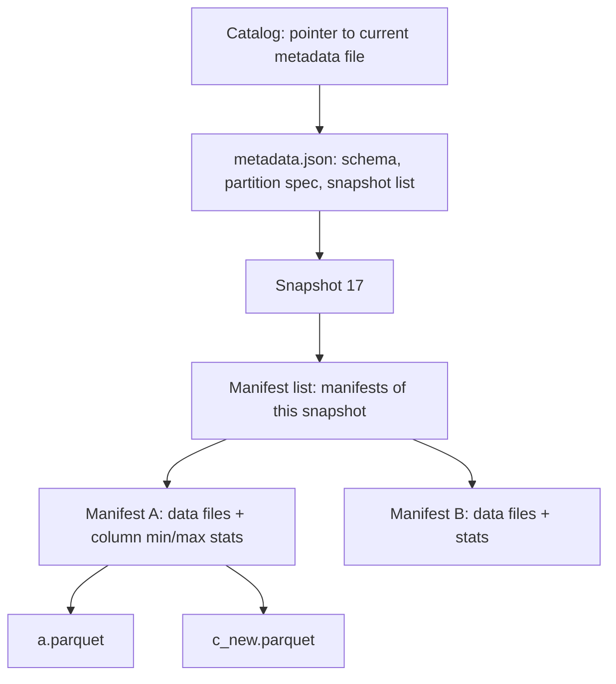
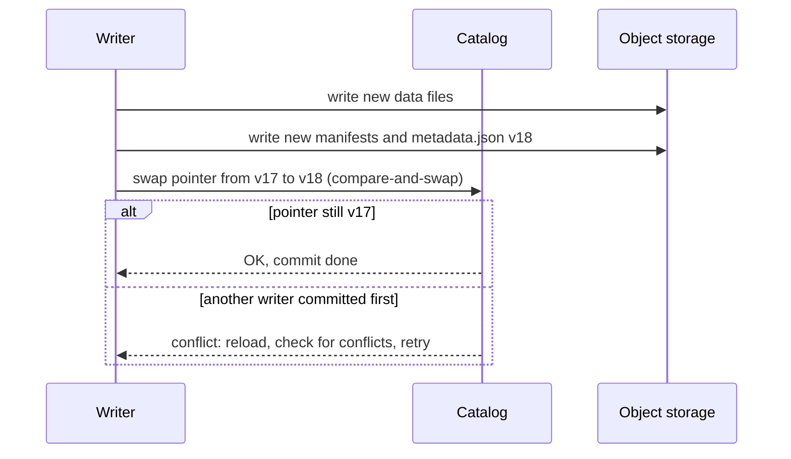

## 🎯 TL;DR

> A **table format** (Apache Iceberg, Delta Lake, Apache Hudi) is a **metadata layer over files** in object storage. It gives a folder of Parquet files the things a database table has: **atomic commits**, **snapshots** (time travel), **schema evolution**, and **row-level changes** (`MERGE`, deletes). A **lakehouse** is a lake that is queried through such tables.

- Plain Parquet folders have no atomic commit, no record of which files belong to "the table now", and no safe way to update one row.
- Table formats keep a **list of data files per snapshot**. A commit writes new metadata and then swaps one pointer. Readers see the old snapshot or the new one, never half of a write.
- Iceberg, Delta and Hudi solve the same problem with different metadata trees and different ways of handling updates. **Hudi's copy-on-write vs merge-on-read** choice is the most common interview comparison.
- Choosing a format is about the **workload** (CDC volume, engines, update patterns) and the **operations** you can staff (compaction, snapshot expiry, orphan cleanup), not about which name is popular.

## 🌱 Start simple (Junior)

> **💡 Analogy:** A shared photo album on a shelf. Each page holds photos, and anyone can add or remove photos. If two people rearrange pages at the same moment, the album gets wrecked, and nobody knows which photos were the "current" set. A **table format** is an index card on the front of the album: "Version 17 = pages 1, 2, 5, 9." A new version gets a new index card. The card swap is one quick step, so everyone sees either version 16 or version 17.

Suppose you append data to a folder of Parquet files. A reader listing the folder in the middle of your write can see some new files and miss others. There is no way to say "these 40 files form today's table" and no way to take them back if the job fails.

With a table format, the table has a **current snapshot**, and the snapshot lists its files:

```text
Snapshot 17 (current) -> files: a.parquet, b.parquet, c_new.parquet
Snapshot 16 (old)     -> files: a.parquet, b.parquet, c_old.parquet
```

- A failed job writes files but never changes the pointer, so readers never see them.
- Time travel is just "read snapshot 16".
- An update rewrites or marks a row; the old files stay until you expire the old snapshots.

## 🔧 How it really works (Mid)

### The metadata tree (Iceberg as the example)

Iceberg uses a tree of metadata files. Each layer narrows what an engine has to read:



- **Data files** are normal Parquet (or ORC, Avro) files.
- **Manifests** list data files with their row counts and column statistics. An engine can skip whole files using these stats, before opening any file. This is the main reason a table format is faster than listing a bucket.
- **Manifest list** records which manifests belong to a snapshot.
- **Catalog** (Hive Metastore, a REST catalog, Glue, Nessie and others) stores the one pointer to the current metadata file.

### How an atomic commit works



The only atomic step is the pointer swap. Everything written before it is invisible until then, so a crashed job leaves orphan files, not a half-visible table. Concurrent writers use **optimistic concurrency**: both write, one wins the swap, the other reloads and retries or fails if its changes conflict.

### Hidden partitioning and partition evolution (Iceberg)

In Hive-style tables, the partition column is part of the path (`dt=2026-03-01`), so the user must filter on `dt` exactly or the engine scans everything. Iceberg stores a **partition transform** in metadata, for example `days(event_ts)`. Users filter on `event_ts` and the engine prunes the right partitions. The layout is hidden from queries.

**Partition evolution:** you can change the spec from `days` to `hours` for new data. Old files keep the old layout, and the engine plans each file group with its own spec. You do not rewrite the table to change the partitioning.

### Row-level changes: deletes and updates

Object files are immutable, so an update or delete is done in one of two ways:

- **Copy-on-write (CoW):** rewrite each data file that contains a changed row. Reads are simple, writes amplify.
- **Merge-on-read (MoR):** write small **delete files** (or update/log files) next to the data. The reader merges them at query time, and a later **compaction** rewrites data files and applies the deletes.

Iceberg v2 uses two delete kinds. **Position deletes** name a file and row position (cheap to write, precise). **Equality deletes** name key values (`customer_id = 42`) and apply to all older rows with that key, which is good for CDC but makes reads more expensive until compaction.

### Example: CDC merge and time travel (Spark SQL with Iceberg)

```sql
-- Apply a CDC batch: op = 'I', 'U' or 'D'
MERGE INTO lake.db.customers t
USING cdc_batch s
  ON t.customer_id = s.customer_id
WHEN MATCHED AND s.op = 'D' THEN DELETE
WHEN MATCHED AND s.op = 'U' THEN
  UPDATE SET t.email = s.email, t.city = s.city, t.updated_at = s.updated_at
WHEN NOT MATCHED AND s.op <> 'D' THEN
  INSERT (customer_id, email, city, updated_at)
  VALUES (s.customer_id, s.email, s.city, s.updated_at);

-- Time travel: what did the table look like yesterday at noon?
SELECT count(*) FROM lake.db.customers
TIMESTAMP AS OF '2026-03-01 12:00:00';
```

Delta Lake and Hudi support the same `MERGE` shape in their own SQL dialects, so the logic transfers. Check the exact syntax for your engine version.

### Hudi: record keys, precombine and table types

Hudi is built around **upserts**. Each record needs a **record key** (identity), a **partition path**, and a **precombine field** (usually a version or timestamp) that picks the winner when two versions of the same key arrive in one batch. Hudi keeps a **timeline** of instants (commits, compactions, cleans) and an index that maps keys to file groups.

```python
# PySpark with Hudi: upsert into a CDC-fed table (option names as in Hudi's Spark writer)
hudi_options = {
    "hoodie.table.name": "customers",
    "hoodie.datasource.write.recordkey.field": "customer_id",
    "hoodie.datasource.write.partitionpath.field": "city",
    "hoodie.datasource.write.precombine.field": "updated_at",
    "hoodie.datasource.write.operation": "upsert",
    "hoodie.datasource.write.table.type": "MERGE_ON_READ",   # or COPY_ON_WRITE
}
(cdc_df.write.format("hudi")
       .options(**hudi_options)
       .mode("append")
       .save("s3://company-lake/hudi/customers"))
```

- **Hudi COW:** an update rewrites the file group. Reads are plain Parquet.
- **Hudi MOR:** updates go to log files next to the base Parquet file. Reads merge base + logs; **compaction** merges them into a new base file. Some engines expose a "read-optimized" view that reads only base files (fast, stale) and a "snapshot" view that merges logs (fresh, slower).

### Delta Lake in one paragraph

Delta keeps a `_delta_log/` folder of numbered JSON commits with `add` and `remove` actions, plus periodic Parquet checkpoints that summarize the log. A commit is one new JSON file created atomically in the log. Optimistic concurrency checks conflicts between writers. Delta's ecosystem is strongest with Spark and Databricks; check which engines and features your version supports before you commit to it.

## 🧠 Senior depth & trade-offs

- **Format choice by workload.** For a CDC-heavy table with many updates per day, you need either MoR (Hudi) or merge-on-read deletes (Iceberg v2), plus scheduled compaction. For a read-heavy table that changes once a day, CoW is simpler. For many engines (Trino, Spark, Flink, StarRocks) reading the same data, check which catalog and engine integrations each format supports today, since this changes quickly. Name the criterion, then the tool.
- **Compaction is the operating cost.** MoR and frequent small commits both create many small files and delete files. Schedule data-file rewrites, delete-file merges and **snapshot expiration** together. Expiring old snapshots removes time-travel history, so set a retention window that matches your audit needs.
- **Orphan files.** Failed or crashed commits leave data files no snapshot references. Run orphan-file cleanup with a safety age, so that you do not delete files a running write still needs.
- **Concurrency.** Optimistic concurrency works well when writers touch different partitions or keys. Many writers hitting the same partition, or long jobs with broad `MERGE` conditions, produce retries and wasted work. Partition by the write pattern and keep `MERGE` predicates selective.
- **Metadata scale.** Millions of files make manifests and catalogs large. Hidden partitioning, manifest pruning and fewer, larger files keep planning time bounded. Monitor planning time, not only query time.
- **Schema evolution.** Iceberg tracks columns by ID, so renames are metadata changes and do not rewrite data. Delta and Hudi have their own rules; test type widening and drops on a copy first.
- **Engine support.** The format is only useful where your engines support the features you use (row-level `MERGE`, deletes, time travel, partition evolution). Check that matrix for every engine before the design review, not after.
- **Streaming writes.** Frequent commits (for example, every minute from Flink or Spark Structured Streaming) multiply small files and snapshots. Commit at a cadence that matches compaction capacity. See [[spark-structured-streaming]].
- **When not to use a table format.** Append-only, immutable event archives with one reader engine are often fine as plain partitioned Parquet. A table format adds metadata to operate. Use it when you need the guarantees.
- **Monitoring.** Track commit success and conflict rate, snapshot count per table, small-file ratio, delete-file ratio, compaction lag, planning time, and time from source change to visible row (CDC freshness).

## 🧪 Try it

1. **Design the CDC table.** A `payments` table receives 50 million row changes per day, mostly updates to recent rows, and is read by dashboards every minute. Pick CoW or MoR (Hudi) or merge-on-read deletes (Iceberg), and write down the compaction schedule and the retention for snapshots.
2. **Trace a failed commit.** A Spark job wrote 300 files and crashed before the catalog swap. Which files do readers see? What must you run later, and why must the cleanup have an age threshold?
3. **Explain the conflict.** Two jobs run `MERGE` on the same partition at the same time and one of them fails with a commit conflict. Explain what happened, and propose one change that reduces the conflict rate.

<details><summary>Show solutions</summary>

**1.** Recent-row updates with minute-level reads favor MoR, since updates are cheap to write and reads merge a small amount of logs. Schedule compaction for the recent partitions every 15 to 60 minutes, and a daily compaction for older partitions. Keep snapshots for the audit window (for example, 7 days) and expire older ones. The exact cadence depends on the cluster's compaction capacity, so measure log size and planning time and adjust. CoW would rewrite many files on each update at 50 million changes per day.

**2.** Readers see none of the 300 files, because the pointer never moved. The old snapshot remains the current one. Later, an orphan-file cleanup removes the 300 unreferenced files. The age threshold matters because a concurrent writer may have just written files that are not yet referenced by a committed snapshot; deleting them would corrupt its commit.

**3.** Both jobs read the same base state and both try to swap the pointer or write conflicting changes to the same files. The second one detects that the table changed and that its changes overlap, so it fails. A fix is to partition the table so that the two jobs write to different partitions, or to narrow the `MERGE` condition so that each job touches disjoint keys. Serializing the two jobs is the simplest correct option.

</details>

## 💬 Interview corner

**Question: "How does Iceberg give atomic commits on S3, which has no rename?"**

- **Junior answer:** "Iceberg keeps a list of files, so readers only see the files in the list."
- **Mid answer:** "Each commit writes new manifests and a new metadata file, then the catalog swaps the pointer to the new metadata with a compare-and-swap. Readers see the old pointer or the new one. Failed commits leave orphan files that nobody references."
- **Senior answer:** "The atomic unit is the catalog pointer swap, not the file write. Writers use optimistic concurrency: on a conflicting swap they reload and retry or fail on overlapping changes. The cost is metadata growth and orphan cleanup. I make sure the catalog supports atomic swaps for my engines, and I monitor conflicts and snapshot counts."

**Question: "CoW or MoR for a CDC-heavy table?"**

- **Mid answer:** "MoR, because CoW rewrites whole files for every update. Reads are slower until compaction."
- **Senior answer:** "MoR for frequent updates and deletes, with compaction scheduled on the hot partitions. I accept read merge cost and set SLOs for freshness and query latency. CoW for read-heavy tables with few updates, where reads must stay plain Parquet."

> **🎤 Say this in the interview:** "A table format puts a metadata layer over immutable files. The commit is one pointer swap, so readers never see partial writes. For CDC-heavy tables I choose merge-on-read and schedule compaction on hot partitions, and I track conflicts, small files and snapshot counts."

## ⚠️ Common mistakes

> **⚠️ Watch out:** Thinking a table format removes the need for maintenance. Compaction, snapshot expiry and orphan cleanup are part of the design.

- Writing a CDC table with CoW and blaming the cluster when merges take hours.
- Running frequent MoR commits with no compaction, so reads merge thousands of log files.
- Expiring snapshots immediately, which removes time travel and makes failed-commit recovery impossible.
- Deleting "unreferenced" files without an age threshold, which can delete files of a running write.
- Partitioning by a column that changes per row (for example, a timestamp down to the second), which creates millions of partitions.
- Assuming every engine supports every feature (row-level deletes, partition evolution) without checking.

## ✅ Check yourself (quiz)

1. What is the one atomic step in an Iceberg commit on object storage?
   - A) Writing the first Parquet file
   - B) Swapping the catalog pointer to the new metadata file
   - C) Deleting the old data files
   - D) Writing the manifest list

<details><summary>Answer</summary>

**B** — data and metadata files are written first and stay invisible. The pointer swap makes them the current snapshot in one step.

</details>

2. Which statement about merge-on-read is correct?
   - A) It rewrites every data file on each update
   - B) Updates go to delete or log files that readers merge at query time, until compaction
   - C) It removes the need for snapshots
   - D) It only works with Parquet

<details><summary>Answer</summary>

**B** — MoR keeps writes cheap by writing small delete or log files. The read cost goes away after compaction.

</details>

3. A table is partitioned by `dt` in Hive style, and users filter on `event_ts`. What does hidden partitioning in Iceberg change?
   - A) Users must always add a `dt` filter
   - B) The partition transform lives in metadata, so filtering on `event_ts` still prunes partitions
   - C) The table cannot be partitioned
   - D) Queries skip the metadata layer

<details><summary>Answer</summary>

**B** — Iceberg stores the transform (for example `days(event_ts)`), so the engine maps the user's filter to the right partitions without a separate `dt` column in queries.

</details>

4. **(Senior)** A CDC pipeline commits every minute, and planning time for dashboards doubles each week. What is the most likely cause and the first fix?
   - A) The query engine is too slow; add more executors
   - B) Small files and snapshots accumulate; schedule compaction and snapshot expiry
   - C) Parquet is the wrong format; switch to CSV
   - D) The catalog is down; restart it

<details><summary>Answer</summary>

**B** — frequent commits create many files, delete files and snapshots, which grow metadata and planning time. Compaction and expiry keep the metadata bounded.

</details>

5. **(Senior)** Why is optimistic concurrency a good default for lakehouse writes, and when does it fail you?
   - A) It never fails
   - B) It works when writers touch different keys or partitions; heavy overlap causes retries and wasted work
   - C) It requires a global lock on every object
   - D) It is only used for reads

<details><summary>Answer</summary>

**B** — writers do not block each other; only the swap is checked. When writers overlap on the same data, the losers redo their work, so partitioning and selective predicates matter.

</details>

## 🗂️ Flashcards

| Front | Back |
|---|---|
| Table format | Metadata layer over immutable files that gives atomic commits, snapshots and schema evolution |
| Snapshot | A version of the table: the set of data files that are current at one commit |
| Atomic commit on object storage | Write new metadata files, then swap one catalog pointer (compare-and-swap) |
| Manifest | File listing data files with stats; lets engines skip files without opening them |
| Hidden partitioning | Partition transform stored in metadata (for example `days(ts)`), so queries filter on the column itself |
| CoW vs MoR | CoW rewrites files on update (fast reads); MoR writes log or delete files and merges at read (fast writes) |
| Equality vs position delete | Equality names key values; position names file and row offset |
| Compaction | Rewrite small files and merge delete or log files into clean base files |

## 🔗 Go further

- [[lakehouse]] and [[delta-lake]] (glossary) define the core terms; [[iceberg]] covers Iceberg specifically.
- [[data-lake-object-storage]] explains the storage underneath these formats.
- [[cdc]] and [[upsert]] are the usual reasons to pick a format with row-level changes.
- [[time-travel]] and [[compaction]] are the two concepts you will be asked about most.
- [[dwh-fundamentals]] compares the lakehouse with a warehouse.
- Question bank: the Iceberg chapter (partition evolution, equality vs position deletes, small files) and the Hudi chapter (COW vs MOR, record key, precombine) are good drills after this lesson.
