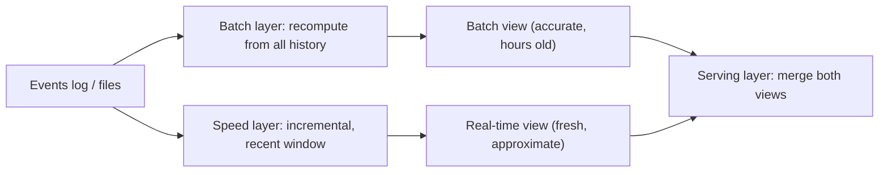
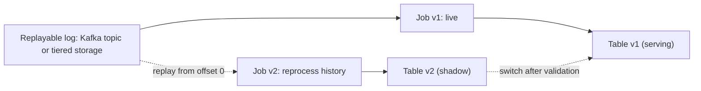

## 🎯 TL;DR

> **Lambda** computes results twice: a **batch layer** recomputes the truth from all history, and a **speed layer** gives fresh but approximate results in the meantime. **Kappa** computes results once, with a single streaming pipeline, and reprocesses history by **replaying the log**.

- Lambda is accurate and robust, but the same logic lives in two codebases that drift apart.
- Kappa has one codebase, but it needs a log with long retention and a way to run a new version over old data without disturbing the live one.
- Modern systems often blur the line: one engine (Spark or Flink) for batch and streaming, writing into a **lakehouse** table that supports time travel and compaction.
- The real question is not "which diagram is nicer" but: how far back must you reprocess, how fast, and who maintains the logic.

## 🌱 Start simple (Junior)

> **💡 Analogy:** Counting votes. Lambda is a school that counts votes twice: a quick tally on the night (speed) and an official recount next week from the ballot boxes (batch). Kappa is a school with a single counter who keeps every ballot in a box with a log, and when the rules change, they recount from the same log with the new rules.

Imagine a shop that wants "revenue per minute" on a dashboard:

```text
orders:  10:00:05 $12   10:00:40 $8   10:01:10 $20   ...
dashboard, live:          10:00  $20   10:01  $20
dashboard, next morning:  10:00  $20   10:01  $20   (corrected with late orders)
```

The live number arrives in seconds but can be wrong if orders arrive late. The corrected number arrives later but is right. Lambda and Kappa differ in how they produce both numbers.

Two words you must know:

- **Batch**: process a bounded set of data, such as yesterday's files. Accurate, but results arrive on a schedule.
- **Stream**: process events as they arrive. Fresh, but you must handle late and out-of-order events yourself (see [[event-time]]).

## 🔧 How it really works (Mid)

### Lambda architecture

Lambda (Nathan Marz) has three parts:



- The **master dataset** is immutable: raw events are only appended, never updated.
- The **batch layer** recomputes views from the master dataset, for example nightly. It is accurate and can fix any bug by re-running.
- The **speed layer** processes only recent data and covers the gap until the next batch view is ready. Its results are thrown away when the batch view catches up.
- The **serving layer** answers queries by combining the batch view (up to some cut-off) with the speed view (after it).

A concrete split for the revenue dashboard:

```sql
-- Batch (nightly, Spark SQL over the Parquet master dataset)
INSERT OVERWRITE TABLE rev_minute_batch
SELECT date_trunc('minute', order_ts) AS minute, merchant_id, SUM(amount) AS revenue
FROM orders_master
WHERE order_date = DATE '2026-10-12'
GROUP BY 1, 2;
```

The speed layer computes the same aggregate for today in a stream job and writes it to a key-value store. The serving query reads `batch` for minutes before the cut-off and `speed` after it.

The cost is visible immediately: the aggregate, the cut-off logic, the late-data policy and the merge query are all written twice. When the speed job and the batch job disagree, you must decide which one is correct, and users see numbers that jump at the cut-off.

### Kappa architecture

Kappa (Jay Kreps, 2014) removes the batch layer. The stream is the only pipeline:



- **Normal operation:** one streaming job reads the log and maintains the results.
- **Reprocessing:** when logic changes, start job v2 from the beginning (or from a chosen timestamp) on the same log. Write to a new output, let it catch up to live, compare, then switch the consumers and retire v1.

Replay from a timestamp with Kafka's CLI:

```bash
# stop the old consumer group first, then reset its offsets to a timestamp
kafka-consumer-groups.sh --bootstrap-server broker:9092 \
  --group revenue-v2 --topic orders \
  --reset-offsets --to-datetime 2026-01-01T00:00:00.000 --execute
```

Kappa works only if three things hold: the log keeps enough history, the stream engine can process that history fast enough to catch up, and the logic is deterministic enough that a replay produces the same results. Replays are not free; a year of history at 50 MB/s is about 50 × 10^6 B/s × 3.15 × 10^7 s ≈ 1.6 PB of input to reread.

### What changes with a lakehouse

Modern deployments keep the **shape** of Kappa but store results in a **lakehouse** table (Iceberg, Delta or Hudi) instead of a Kafka topic. The streaming job appends or upserts into the table, and reprocessing writes a new version or a backfill into the same table. Time travel and snapshots let you compare versions. Batch and streaming readers see the same table, so the serving problem that drove Lambda's merge logic often disappears.

For reprocessing a long history, the usual pattern is a **backfill**: run the same job code as a bounded batch over the lake data (or over the log), write into a staging table, validate, then swap. This is how one codebase serves both needs without a permanent speed layer. See [[backfill]] and [[lakehouse]].

## 🧠 Senior depth & trade-offs

**Where Lambda still wins.** Heavy batch analytics over full history (large joins across years, model training, complex deduplication across all data) are simpler in a batch engine with a clean master dataset. When the batch and speed logic really differ (for example an exact recount versus an approximate sketch), Lambda is honest about it. Lambda also degrades gracefully: if the stream breaks, the batch view still covers the past.

**Where Kappa wins.** One codebase, one set of tests and one place to fix bugs. Consistency between live and reprocessed results is easier to reason about. It fits products whose core is event-driven, where the stream is already the system of record.

**Retention is the hidden cost.** In Kappa the log is the source of truth. A 7-day Kafka retention means you cannot reprocess 8 days back, full stop. Options: longer retention (expensive on brokers), tiered storage, or sink the raw events to object storage and replay from there with a bounded job. Check [[kafka-retention-compaction]] for the mechanics.

**Ordering and late data.** Replays change the arrival order: a historical replay delivers all of October in a few minutes, so "wall-clock" windows and timeouts behave differently than in live operation. Event-time logic with watermarks must be correct for both. A job that only works when events arrive in order will produce different results in a replay.

**Side effects.** A Kappa job that calls external APIs or sends emails will repeat those side effects on replay. Keep reprocessing pure (write to tables), or gate side effects behind a flag.

**Operating two versions.** During a Kappa migration you run v1 and v2 side by side and double your compute. Plan the switch-over (dual-write, shadow comparison, cut-over date) before you start.

**Cost comparison.** Lambda costs maintenance of two pipelines plus a merge layer. Kappa costs storage for retention and more compute at reprocessing time. Estimate both for your case: engineers-months of maintenance against retained TB and replay hours.

**When not to use either pattern.** If results can be a day old and the logic is pure SQL over tables, a scheduled batch pipeline is simpler than both. Do not build a speed layer for a dashboard that is looked at once a day.

**What to monitor:** consumer lag of the live job, replay progress and ETA, the difference between shadow and live results on a sample, late-event counts, and the age of the newest value served.

## 🧪 Try it

1. **Pick the architecture.** A fraud team needs decisions in under one second and retrains models weekly on a year of history. Which parts go to a speed path, which to a batch path, and would you choose Lambda, Kappa or a hybrid? Justify in three sentences.
2. **Retention arithmetic.** An orders topic receives 2,000 events per second, each 500 bytes. Compute the size of 30 days of retention, ignoring replication. Then say what it means for a Kappa reprocessing requirement of "back to 45 days".
3. **Cut-over plan.** Write the five steps you would take to replace a Kappa job's logic without changing the dashboard numbers abruptly.

<details><summary>Show solutions</summary>

**1.** A hybrid is reasonable: the decision path is a streaming job with state (fast, event-driven), and the model training is a batch job over the lakehouse history. Both read the same event log or table, so features are defined once. Pure Kappa could train from the log, but a year of replay for every retrain is expensive; a materialized lakehouse table is cheaper. Pure Lambda would duplicate the feature logic, which is a training-serving skew risk.

**2.** 2,000 events/s × 500 B = 1,000,000 B/s = 1 MB/s. Per day: 1 MB/s × 86,400 s ≈ 86.4 GB. For 30 days: ≈ 2.6 TB before replication. A "back to 45 days" requirement is not covered by a 30-day retention; you either extend retention to 45 days (≈ 3.9 TB before replication) or sink the events to object storage for the older 15 days.

**3.** (1) Start v2 on the same log with its own consumer group and output table, reading from the same start point as v1. (2) Let v2 catch up to live and keep it running in shadow mode. (3) Compare v1 and v2 outputs on a sample of keys and totals, and explain every difference (late data, logic change). (4) Switch the dashboard's read path to v2 at a planned time, and keep v1 running for a rollback window. (5) Stop v1 and remove its output after the window closes.

</details>

## 💬 Interview corner

**Question: "Lambda or Kappa?"** Mid answer: "Kappa is simpler because there is only one pipeline, so I'd use Kappa." Senior answer: "It depends on three things: how far back we reprocess and how often, whether the batch and streaming logic really differ, and how much log retention we can afford. If the stream is the system of record and reprocessing is rare, Kappa with a lakehouse sink is my default. If we need heavy full-history batch analytics beside low-latency results, I'd use one engine for both with shared logic, and I'd avoid two separate codebases unless the logic truly differs."

**Question: "How do you fix a bug in a streaming aggregation that has been running for a month?"** Expected answer: "Deploy the fixed logic as a new version, replay the log or lakehouse data into a shadow output, compare, then switch. I check retention first, because without the history the replay is impossible."

> **🎤 Say this in the interview:** "I try to keep one codebase for the logic. Lambda's two paths drift apart over time. I choose the retention and the lakehouse sink first, because those decide whether reprocessing, which is the real operational task, is possible."

## ⚠️ Common mistakes

> **⚠️ Watch out:** Saying "Kappa means no batch at all". In practice, batch and backfill jobs are still used, often on the same code and the same tables.

> **⚠️ Watch out:** Designing Kappa with 7 days of retention and no other copy of the raw events, then discovering on the first bug that 30 days must be reprocessed.

- Keeping two implementations of the same metric and not testing that they agree.
- Replaying into the live table, so the dashboard shows half-processed numbers during the replay.
- Forgetting that replay changes arrival order and therefore window and timeout behaviour.
- Running side-effecting code (emails, API calls, charges) inside a replayed job.
- Building a speed layer for a dashboard that is read once a day.

## ✅ Check yourself (quiz)

1. In Lambda, what is the role of the speed layer?
   - A) It is the only source of truth
   - B) It gives fresh, incremental results for recent data until the batch layer catches up
   - C) It stores the master dataset
   - D) It replaces the serving layer

<details><summary>Answer</summary>

**B** — the speed layer covers the recent gap that the batch view does not yet include. Its results are superseded when the batch view is ready.

</details>

2. What does Kappa use to reprocess history?
   - A) A nightly batch job over a separate copy of the data
   - B) Replaying the log from an earlier offset or timestamp into a new job version
   - C) Re-reading the serving database
   - D) Restarting the producers

<details><summary>Answer</summary>

**B** — Kappa keeps the log as the source of truth and replays it. The new version writes to a shadow output, which is validated before the switch.

</details>

3. A team says "we have Kappa, so we never need backfills." What is the flaw?

   - A) Kappa cannot handle more than one topic
   - B) Backfills are a form of replay; the team still needs a plan for data outside retention and for reprocessing from a lake or bounded job
   - C) Backfills require Lambda
   - D) Streaming jobs cannot write to tables

<details><summary>Answer</summary>

**B** — backfilling and replaying are the same operational need. When history is outside log retention, the data must come from a lake or object storage through a bounded job.

</details>

4. **(Senior)** A Kappa replay of 60 days of events runs for 6 hours and the live job lags by 2 hours at the end. What would you check, and what is a sensible first change?

   - A) Nothing; lag is normal during replay
   - B) Check whether the replay job has the same parallelism, state backend and sink throughput as the live job; increase parallelism or fix the sink bottleneck, and consider a separate consumer group so live results are not delayed
   - C) Turn off checkpoints for the whole job
   - D) Delete the live topic

<details><summary>Answer</summary>

**B** — replay and live traffic compete for resources and sometimes for the same sink. Find the bottleneck with backpressure metrics, scale the replay job or its sink, and isolate the replay from the live path so customers do not see a delay.

</details>

5. **(Senior)** Why is replaying events in a Kappa job not always deterministic, even with the same code?

   - A) Kafka does not store timestamps
   - B) Processing-time logic, external lookups that changed since the original run, and different arrival order can change the results
   - C) Replays always use the same offsets
   - D) Flink cannot reprocess

<details><summary>Answer</summary>

**B** — results depend on time-based logic that reads the wall clock, on external reference data that has changed, and on arrival order. Use event time, versioned reference data, and deterministic keys to make replays reproducible.

</details>

## 🗂️ Flashcards

| Front | Back |
|---|---|
| Lambda in one line | Batch layer for accurate recomputation, speed layer for fresh approximate results, serving layer merges both |
| Kappa in one line | One streaming pipeline; reprocess by replaying the log into a new job version |
| Biggest Lambda cost | The same logic maintained in two codebases that can drift apart |
| Biggest Kappa requirement | Log retention long enough for the reprocessing you need, or a copy of raw events elsewhere |
| What is a master dataset? | An immutable, append-only store of raw events that can be recomputed from |
| Why validate a shadow output before switching? | To explain every difference from the live results before consumers see the new numbers |
| What role does a lakehouse play in Kappa? | Stores results as versioned tables with time travel, so batch and streaming readers share one source |
| What breaks replay determinism? | Wall-clock logic, changed reference data and different arrival order |

## 🔗 Go further

- **pattern-lambda-kappa** works through the same choice as an end-to-end system design.
- **queues-vs-logs** explains why a log with retention makes replay possible.
- **kafka-retention-compaction** covers how long data is kept and what compaction removes.
- **lakehouse-table-formats** covers time travel, snapshots and upserts that make shadow tables practical.
- **pattern-backfill** and **backfills** cover reprocessing history in batch and streaming.
- **spark-structured-streaming** and **flink** show one engine running both bounded and unbounded versions of the same logic.
