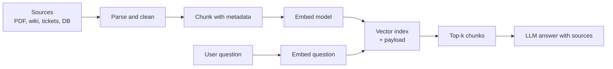

## 🎯 TL;DR

> **RAG** (retrieval-augmented generation) answers a question by first **retrieving** relevant passages from your own documents and then giving them to a language model. The data pipeline's job is to turn messy documents into **searchable, current, traceable chunks**.

- Pipeline stages: **ingest** documents, **parse and clean**, **chunk**, **embed** (turn text into vectors), **index** in a vector store, and **keep it fresh**.
- A vector database finds the nearest vectors to a query vector. Qdrant, Milvus and pgvector (a PostgreSQL extension) all do this, with different trade-offs.
- The hard data-engineering problems are **incremental updates** (re-embed only what changed), **deletes** (removed documents must disappear from the index), and **quality** (bad parsing silently ruins answers).

## 🌱 Start simple (Junior)

> **💡 Analogy:** A library with a very fast assistant. The assistant does not read every book for each question. Before opening the library, someone cut every book into index cards, wrote a short "meaning code" on each card, and filed the cards by that code. When a question arrives, the assistant finds the cards with the closest meaning and reads only those.

Here is the whole idea in four steps:

1. **Chunk**: split a long document into pieces of a few hundred words.
2. **Embed**: an embedding model turns each piece into a list of numbers (a vector), so that pieces with similar meaning get vectors that are close together.
3. **Store**: save each vector with its text and metadata (source, date, page) in a vector index.
4. **Retrieve**: embed the user's question the same way, find the nearest chunks, and pass them to the language model together with the question.

A tiny chunker in plain Python shows the first step:

```python
def chunk_words(text: str, size: int = 200, overlap: int = 40) -> list[str]:
    """Split text into word windows. Overlap keeps sentences that cross a boundary."""
    words = text.split()
    chunks = []
    step = size - overlap
    for start in range(0, len(words), step):
        window = words[start:start + size]
        if window:
            chunks.append(" ".join(window))
        if start + size >= len(words):
            break
    return chunks

doc = "word " * 450
parts = chunk_words(doc)
print(len(parts), [len(p.split()) for p in parts])
```

Output: `3 [200, 200, 130]`. The windows start at words 0, 160 and 320, so each neighbour shares 40 words.

## 🔧 How it really works (Mid)



**Ingestion and parsing.** Documents arrive as PDFs, HTML, office files, database rows and tickets. Parsing is often the weakest link: a PDF with two columns can come out with the columns interleaved, and a table can become a stream of numbers. Keep the **raw file** in object storage, store the **parsed text** separately, and record the parser version. When you change the parser, you need to re-process the affected documents.

**Chunking.** Common strategies:

- **Fixed windows** (like the Python example): simple and predictable, but they can cut sentences and tables.
- **Structural chunks**: split by headings, paragraphs or list items, then merge small pieces up to a size limit. Better for manuals and wikis.
- **Overlap**: a few percent of repeated content at the borders, so an answer that spans a boundary is still retrievable.

Each chunk should carry **metadata**: `doc_id`, `source_uri`, `section`, `page`, `updated_at`, `acl` (who may read it). Metadata is what lets you filter by permission and cite the answer.

**Embedding.** An embedding model maps text to a fixed-length vector, for example 384, 768 or 1,536 dimensions. Two rules matter for pipelines:

- The **same model and version** must embed both the documents and the queries. Changing the model means re-embedding the whole corpus, so store the model name and version with each vector.
- Embedding is the expensive stage in cost and latency. Batch the requests, cache by content hash, and do not embed unchanged chunks again.

**Vector search.** Similarity is usually cosine similarity or inner product. Exact search compares the query with every vector. **Approximate nearest neighbour (ANN)** indexes trade a little recall for much lower latency. HNSW is a graph-based index used by many systems; IVF-style indexes partition vectors into clusters.

Concrete example in PostgreSQL with pgvector (the vector size is small here for readability):

```sql
CREATE EXTENSION IF NOT EXISTS vector;

CREATE TABLE chunks (
  chunk_id     text PRIMARY KEY,         -- stable id: doc_id + chunk number
  doc_id       text NOT NULL,
  content_hash text NOT NULL,            -- changes when the text changes
  model_ver    text NOT NULL,            -- embedding model version
  source_uri   text NOT NULL,
  content      text NOT NULL,
  embedding    vector(3) NOT NULL        -- real models use 384-1536 dims
);

CREATE INDEX chunks_embedding_hnsw
  ON chunks USING hnsw (embedding vector_cosine_ops);

-- nearest 5 chunks to the query vector, by cosine distance
SELECT chunk_id, source_uri, content
FROM chunks
ORDER BY embedding <=> '[0.12, 0.90, 0.31]'
LIMIT 5;
```

With pgvector, the index is used when the query orders by the distance operator ascending and has a `LIMIT`. A query that wraps the distance in an expression and orders by it may skip the index. Check with `EXPLAIN`.

**Incremental updates.** Re-embedding the whole corpus each night is wasteful. The usual pattern is:

1. For each document, compute a content hash of the parsed text.
2. Compare with the hash stored for that `doc_id`. Unchanged documents are skipped.
3. For changed documents, delete their old chunks and insert the new ones in one transaction.
4. For removed documents, delete their chunks. This step is the one teams forget.

```sql
-- upsert one chunk (PostgreSQL 9.5+ syntax)
INSERT INTO chunks (chunk_id, doc_id, content_hash, model_ver, source_uri, content, embedding)
VALUES ('doc42#3', 'doc42', 'a1b2', 'emb-v2', 's3://docs/doc42.pdf', 'text…', '[0.1,0.2,0.3]')
ON CONFLICT (chunk_id) DO UPDATE
SET content_hash = EXCLUDED.content_hash,
    content      = EXCLUDED.content,
    embedding    = EXCLUDED.embedding,
    model_ver    = EXCLUDED.model_ver;
```

Stale chunks are the classic bug: if a document shrinks from 10 chunks to 7, the old chunks 8–10 keep answering questions. Delete by `doc_id` before re-inserting, or track chunk counts.

**Other vector stores.** Qdrant and Milvus are dedicated vector databases. They store vectors with payloads (metadata) and support filtered search, collections or partitions, and distributed deployment. Check the documentation of the version you use for filter syntax, index types and sharding options, because these change between releases.

## 🧠 Senior depth & trade-offs

- **Choosing a store.** pgvector is attractive when you already run PostgreSQL, the corpus is in the millions of chunks range, and you want transactional updates with the rest of your data. A dedicated vector database is more appropriate for very large corpora, heavy filtered search, or high query rates. Measure recall and p95 latency on your own data before deciding.
- **Filtering with ANN.** Permission filters (`acl`) and date filters are applied during or after the vector search. A post-filter can return fewer than k results when the filter is selective. Test selective filters explicitly.
- **Freshness SLA.** Define how long a source change may take to appear in answers (for example 15 minutes for tickets, 24 hours for policy documents). That SLA sets the design: CDC or event streams for near-real-time, scheduled batch for the rest. See [[cdc]] and [[kafka-architecture]].
- **Reindexing is a migration.** Changing the embedding model or chunking rules means creating a new index version, backfilling it, comparing answer quality, then switching the alias. Keep both versions until the switch is verified.
- **Evaluation.** Build a golden set of questions with expected source documents. Track retrieval recall@k after each pipeline change. Without this, a broken parser looks like a "model problem".
- **Security.** Retrieval is an access-control problem. Enforce permissions at retrieval time from the source system's ACLs, not only at the UI. Log which chunks were given to the model for audit.
- **Cost.** Embedding cost scales with changed tokens; index memory scales with vectors × dimensions × bytes per value, plus index overhead. Estimate: 5 million chunks × 768 dimensions × 4 bytes ≈ 15.4 GB of raw float32 vectors before index overhead, so quantization and dimension choices matter at scale.
- **When not to use RAG.** If the answer is a fact in a database, query the database. If the corpus is small enough to fit in the model's context window and changes rarely, passing it directly can be simpler.

## 🧪 Try it

1. A document with 10 chunks is edited and now has 7. Write the two SQL statements (delete then insert) that keep the index correct, in one transaction.
2. Your team switches from embedding model `emb-v1` to `emb-v2`, but the query path still uses `emb-v1`. Name the symptom and the check that would catch it.
3. Estimate the storage for 2 million chunks with 1,536-dimensional float32 vectors, showing the arithmetic.

<details><summary>Show solutions</summary>

**1.**
```sql
BEGIN;
DELETE FROM chunks WHERE doc_id = 'doc42';
INSERT INTO chunks (chunk_id, doc_id, content_hash, model_ver, source_uri, content, embedding)
VALUES ('doc42#1', 'doc42', 'h2', 'emb-v2', 's3://docs/doc42.pdf', '…', '[…]'),
       -- …five more rows for chunks 2 to 7
       ('doc42#7', 'doc42', 'h2', 'emb-v2', 's3://docs/doc42.pdf', '…', '[…]');
COMMIT;
```
Deleting by `doc_id` first removes the three extra chunks that no longer exist.

**2.** Mixed model versions: query vectors from `emb-v1` are compared with document vectors from `emb-v2`, which are in different spaces. Results look random or quality drops sharply. The check is a join or count of `model_ver` in the index, and a golden-set recall test after any model change.

**3.** 2,000,000 × 1,536 × 4 bytes = 12,288,000,000 bytes ≈ 12.3 GB of raw vectors (about 11.4 GiB), before index overhead, text storage and metadata.

</details>

## 💬 Interview corner

**Question: "Design a pipeline that keeps a RAG index up to date with a document store."** Mid answer: "Parse documents, chunk them, embed them, and upsert into a vector store on a schedule." Senior answer: "I'd hash each parsed document, process only changed documents, and in one transaction delete old chunks and insert new ones. I'd handle deletions explicitly, store the embedding model version with each vector, and attach ACL metadata to every chunk. The freshness SLA decides between CDC events and scheduled batch, and I'd measure retrieval recall on a golden set after each change."

**Question: "Why does retrieval quality depend on data engineering?"** Because bad parsing, bad chunk boundaries, stale chunks and missing permissions produce wrong or leaked answers even when the language model is good.

**Question: "pgvector or a dedicated vector database?"** It depends on scale, filter complexity, query rate and whether vectors need to live with transactional data. I'd prototype on realistic data and compare recall and latency.

> **🎤 Say this in the interview:** "A RAG pipeline is a data pipeline with search at the end. I focus on incremental, hash-based updates, complete deletes, model-version tracking, metadata for permissions and citations, and a golden-set evaluation so that data bugs show up as measurable recall drops."

## ⚠️ Common mistakes

> **⚠️ Watch out:** Embedding queries with a different model or version than the documents. Vectors from different models live in different spaces, and the results look plausible but wrong.

> **⚠️ Watch out:** Upserting new chunks without deleting the old ones. Documents that shrink leave stale chunks that still answer questions.

- Chunking by fixed size without checking tables, code blocks or headings.
- Skipping metadata, then being unable to cite sources or enforce permissions.
- Re-embedding the whole corpus every night when only a few documents change.
- Forgetting deletes in the source, so removed or confidential documents stay retrievable.
- Judging the pipeline only by the final answer, not by retrieval recall.

## ✅ Check yourself (quiz)

1. What does an embedding model produce?
   - A) A summary of the document
   - B) A fixed-length vector whose distances reflect semantic similarity
   - C) A SQL index
   - D) A compressed copy of the file

<details><summary>Answer</summary>

**B** — the embedding is a fixed-length vector. Nearby vectors (by cosine or inner product) correspond to similar meaning, which is what retrieval uses.

</details>

2. Which change requires re-embedding the **entire** corpus?
   - A) Adding a new document
   - B) Deleting one document
   - C) Changing the embedding model
   - D) Adding a new ACL column

<details><summary>Answer</summary>

**C** — vectors from different models are not comparable, so every document must be embedded again with the new model. Adding or deleting documents only touches those documents.

</details>

3. A document shrinks from 10 chunks to 7 and the pipeline only upserts. What goes wrong?

   - A) The index becomes read-only
   - B) Chunks 8 to 10 stay in the index and can still be retrieved
   - C) The embedding model is changed automatically
   - D) Duplicate chunks are removed

<details><summary>Answer</summary>

**B** — upsert only replaces the ids it writes. The old chunks 8 to 10 are stale. Delete by `doc_id` before inserting, in the same transaction.

</details>

4. **(Senior)** A permission filter is applied after an approximate search that returns the top 20 candidates, and most candidates belong to users who lack access. What is the risk, and what would you change?

   - A) Only slower queries
   - B) Too few or no results for authorized users; test selective filters, use filter-aware search or a larger candidate pool, and measure recall with the filter on
   - C) The embeddings become invalid
   - D) Nothing; post-filtering is always correct

<details><summary>Answer</summary>

**B** — post-filtering a small candidate set can return few or no authorized results. Use a filter-aware index or a larger candidate pool, and test recall with real permission patterns.

</details>

5. **(Senior)** Your team wants a 5-minute freshness SLA for support tickets but a nightly job for policy documents. Which design fits both?

   - A) Nightly batch for everything
   - B) Event-driven (CDC or stream) updates for tickets and scheduled batch for policies, both using the same hash-and-replace upsert logic
   - C) Real-time embedding of every query
   - D) Store raw files only and skip indexing

<details><summary>Answer</summary>

**B** — the SLA decides the trigger, while the update logic (hash, replace, delete) stays the same. One design, two schedules.

</details>

## 🗂️ Flashcards

| Front | Back |
|---|---|
| RAG | Retrieve relevant passages from your own data, then ask an LLM with them |
| Chunking | Splitting documents into retrievable pieces, often with overlap |
| Embedding | Fixed-length vector representing the meaning of a text |
| ANN index | Approximate nearest-neighbour index trading a little recall for speed |
| HNSW | Graph-based ANN index, common in pgvector and dedicated vector stores |
| Model version on vectors | Needed because vectors from different models are not comparable |
| Stale chunk | Old chunk left in the index after its document changed or was deleted |
| Golden set | Labeled questions with expected sources, used to measure retrieval recall |

## 🔗 Go further

- **file-ingestion** covers landing zones, manifests and processed-file tracking, which apply directly to document ingestion.
- **dedup-idempotent-loads** explains the replace-by-key patterns used for incremental chunk updates.
- **feature-stores** shares the idea of versioned, freshness-aware derived data.
- **data-observability** and **data-quality** cover the monitoring of freshness, null rates and parse failures for the index.
- Read the documentation of your vector store for filter syntax, index types and sharding in your version.
