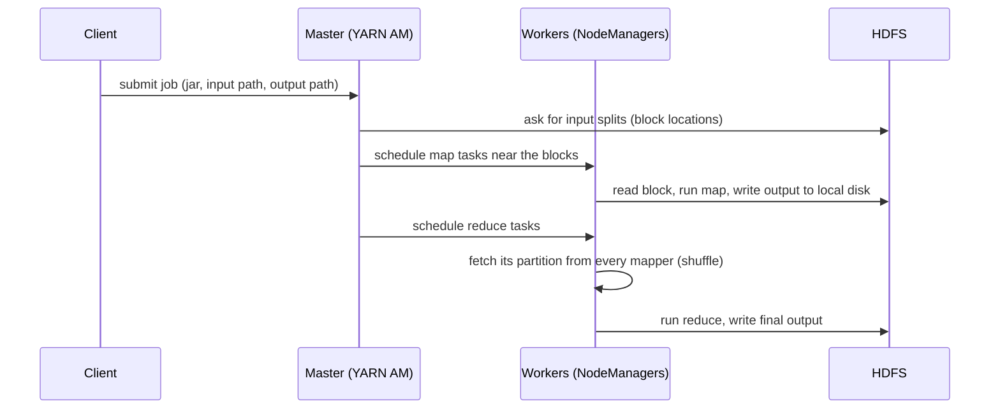

## 🎯 TL;DR

> **MapReduce** processes a huge dataset by splitting it into pieces, running a small function (**map**) on each piece in parallel, **shuffling** the outputs so that every key lands on one machine, and running an aggregation (**reduce**) per key.

- The programmer writes two functions. The framework handles splitting, scheduling, moving data, retries and failures.
- Computation is moved **to the data** (data locality), not the data to the computation.
- The model is simple and very fault tolerant, but every stage writes to disk, which makes iterative and interactive work slow.
- Almost every idea in Spark (partitions, stages, shuffles, narrow vs wide work) is a refinement of this model.

## 🌱 Start simple (Junior)

> **💡 Analogy:** Imagine counting the votes of a national election with 1,000 clerks. Each clerk counts the ballots in one box and writes "Party A: 312, Party B: 88" on a slip. Then all slips for the same party are put on one table, and one person per party adds them up. Nobody sees all the ballots, and the work is done in parallel.

The three phases map to that story:

| Phase | What happens | Election story |
|---|---|---|
| **Map** | Each input record becomes zero or more `(key, value)` pairs | Each clerk reads one box and writes slips |
| **Shuffle** | All values with the same key are sent to the same machine | Slips are sorted onto tables by party |
| **Reduce** | Values for one key are combined into a result | One person adds the slips for one party |

Here is the classic word count, runnable with plain Python (no framework needed):

```python
from collections import defaultdict

def map_fn(line):
    # emit (word, 1) for every word
    for word in line.split():
        yield word.lower(), 1

def reduce_fn(word, counts):
    # combine all counts for one word
    yield word, sum(counts)

lines = ["the cat sat", "the cat ran"]

# 1. map: run on every input split
pairs = [kv for line in lines for kv in map_fn(line)]

# 2. shuffle: group values by key (the framework does this across machines)
groups = defaultdict(list)
for key, value in pairs:
    groups[key].append(value)

# 3. reduce: one call per distinct key
for word in sorted(groups):
    for result in reduce_fn(word, groups[word]):
        print(result)
```

Output:

```text
('cat', 2)
('ran', 1)
('sat', 1)
('the', 2)
```

In SQL the same result is `SELECT word, COUNT(*) FROM words GROUP BY word`. A `GROUP BY` is exactly a shuffle followed by a reduce, which is why SQL engines and Spark can be described in MapReduce terms.

## 🔧 How it really works (Mid)

A MapReduce job on Hadoop (the open-source version of Google's 2004 paper) runs in these steps:



**Input splits and blocks.** HDFS stores files as blocks, 128 MB by default in Hadoop 2 and later (check your cluster). One map task usually reads one block. A 1 TB input with 128 MB blocks gives 1,048,576 MB / 128 MB = 8,192 map tasks, which run in parallel as far as the cluster has free slots.

**Data locality.** The master prefers to start a map task on a node that stores a replica of its block. Reading from the local disk avoids the network. If that node is busy, the task runs on the same rack, and only as a last resort on another rack.

**Partitioning.** Each map output key is assigned to a reducer by a partitioner, usually `hash(key) mod R`, where `R` is the number of reducers. Every mapper writes its output into `R` files on its local disk, one per reducer.

**The shuffle.** Each reducer fetches its files from every mapper over the network, merges them, and sorts them by key. This is the most expensive step: it moves data across the cluster and sorts it on disk.

**Combiners.** A combiner is a "mini reduce" that runs on the map side before the shuffle. For word count it turns `("the", 1), ("the", 1)` into `("the", 2)` and cuts shuffle traffic. It is only correct when the function is associative and commutative (sum, count, max are fine; average is not, unless you send `(sum, count)` pairs).

**Fault tolerance.** If a task fails, the master reruns it on another node, using the same input block. Map outputs live on local disk and are not replicated, so if a node dies, its completed map tasks are rerun too. Reduce inputs are re-fetched. Slow tasks (stragglers) can get a speculative duplicate, and the first one to finish wins.

**Chaining.** Real pipelines run several jobs in a row. Each job writes its output to HDFS, and the next job reads it back. Hive queries compiled to MapReduce, and many classic ETL flows, looked like this: a series of jobs with a disk write and read between each one.

## 🧠 Senior depth & trade-offs

- **Why Spark replaced it.** The cost of MapReduce is not the model, it is the disk round trip between jobs. An iterative algorithm (say, 20 passes of PageRank) writes 20 times to HDFS. Spark keeps intermediate data in memory and builds a DAG of the whole job, so it can pipeline narrow steps and only shuffle where it must. MapReduce is still correct; it is just slow for multi-stage and iterative work.
- **Skew is the real enemy.** Reduce work is per key. If one key has 40% of the records (a hot key such as `NULL`, a default user, or a country code of a huge market), one reducer runs for hours while the others finish in minutes. The job is only as fast as its slowest reducer. Fixes: salting the key (`key + random suffix`, then a second aggregation), a map-side combiner, or a custom partitioner. See [[data-skew]] and [[hot-key]].
- **Memory and spill.** Map output is sorted in a memory buffer and spilled to disk when full. Many small spills mean extra merge passes. Tuning buffer sizes and the number of reducers is a common operational task.
- **Small files.** One map task per file means a million tiny files create a million tasks and a huge scheduling overhead. HDFS also keeps metadata for every file in NameNode memory. See [[small-files-problem]].
- **Where MapReduce is still found.** Legacy Hive jobs on MapReduce, Sqoop imports and older Oozie workflows exist in many banks and telcos. Knowing the model helps you debug them, even if you would not write new jobs in it.
- **When not to think in MapReduce.** Low-latency queries, interactive exploration, streaming and graph iterations are poor fits for disk-based batch stages. Choose an engine whose execution model matches the workload.

## 🧪 Try it

Use the Python word-count above and extend it.

1. Add a **combiner** step: before the shuffle, sum the counts inside each mapper's output. Verify the final result is unchanged.
2. Simulate **two reducers** using `hash(key) % 2`. Print which keys each reducer receives. Note that the hash is randomized per process in Python, so use a stable function such as `sum(ord(c) for c in key) % 2` for a repeatable result.
3. Compute the **average** word length per first letter with a single MapReduce job. Explain why the naive combiner (averaging averages) gives a wrong answer and how to fix it.

<details><summary>Show solutions</summary>

**1.** Inside `map_fn`, or per mapper, aggregate `(word, count)` with a dictionary before emitting. The reduce output stays the same, but the number of pairs crossing the shuffle drops from the total word count to the number of distinct words per mapper.

**2.** Assign `reducer = sum(ord(c) for c in key) % 2`, store pairs in two lists, and reduce each list separately. Every key goes to exactly one reducer, so the union of the two outputs is the same as before.

**3.** Map each word to `(first_letter, (len(word), 1))`. The combiner and reducer add the pairs component-wise: `(sum_len, count)`. The final answer is `sum_len / count`. Averaging the averages of two mappers is wrong when they have different counts.

</details>

## 💬 Interview corner

> **🎤 Say this in the interview:** "MapReduce is three phases: map emits key-value pairs in parallel, the shuffle routes every key to one reducer, and reduce aggregates per key. The data stays where it is, and the framework moves the computation to the blocks. Its weakness is writing to disk between stages, which is why Spark replaced it for most workloads."

**Typical questions**

- *What happens between map and reduce?* Partitioning, the network transfer of map outputs, merge and sort on the reducer. Mention that this is where most time goes.
- *Why is a combiner allowed for `SUM` but not for `AVG`?* Sum is associative and commutative; a partial average loses the count.
- *Why does one slow task hold up the whole job?* Reduce is a barrier: a reducer can only finish after all its input is fetched. Skew makes one reducer the bottleneck.

**Mid-level answer:** explains the phases, mentions data locality and combiners, and gives one example of a job that is slow because of skew.

**Senior answer:** adds the cost model (disk I/O per stage, shuffle volume), the failure semantics (tasks rerun, map output not replicated), and a clear statement of when the model is the wrong choice and what replaces it.

## ⚠️ Common mistakes

- **"MapReduce is a database."** It is an execution model. It reads files and writes files; it has no indexes or transactions.
- **Assuming more reducers is always faster.** Too many reducers create many tiny output files and scheduling overhead. Too few create huge, slow reducers. Size them by data volume.
- **Using a non-associative function as a combiner.** The result changes depending on how many mappers ran. Average, median and distinct-count need special handling.
- **Ignoring skew because the average looks fine.** The job time is set by the worst key, not by the mean.
- **Thinking locality still matters in the same way.** In cloud object storage and in separated compute/storage clusters, the network is much more available, and locality matters less than it did on an HDFS cluster with co-located disks.

## ✅ Check yourself (quiz)

1. In a word-count job, which phase guarantees that all occurrences of the word `data` end up in the same reduce call?
   - A) Map
   - B) Shuffle
   - C) Combiner
   - D) Output commit

<details><summary>Answer</summary>

**B** — the shuffle partitions map output by key, so every value for one key is routed to one reducer. The combiner only reduces data earlier and does not guarantee global grouping.

</details>

2. A job has 2,000 reducers, but 1,990 finish in 2 minutes and one takes 3 hours. What is the most likely cause?

   - A) The HDFS replication factor is too high
   - B) Data skew: one key has far more values than the others
   - C) The combiner is missing
   - D) The NameNode is out of memory

<details><summary>Answer</summary>

**B** — one reducer got a disproportionate share of the keys. Adding reducers does not help, because the hot key still goes to one reducer. Salting or pre-aggregating the hot key is the fix.

</details>

3. **(Mid)** Why is a combiner valid for `SUM` but not for `AVG` computed as `sum(values) / count(values)` on each mapper?

   - A) `AVG` cannot be computed in a distributed system
   - B) Partial averages lose the count, so averaging them again gives the wrong result; sums and counts combine correctly
   - C) Combiners only work with integers
   - D) `SUM` is sorted, `AVG` is not

<details><summary>Answer</summary>

**B** — the average of two partial averages is not the overall average unless the counts are equal. Emit `(sum, count)` pairs, which combine associatively, and divide once in the reducer.

</details>

4. **(Senior)** An iterative machine-learning job takes 40 minutes in MapReduce, mostly in HDFS writes between iterations. Which change addresses the root cause, and what new risk does it add?

   - A) Increase the block size to 1 GB
   - B) Keep intermediate data in memory across iterations (as Spark does); the risk is memory pressure and recomputation or spill when partitions are lost
   - C) Replace HDFS with a local disk on one node
   - D) Remove the combiner

<details><summary>Answer</summary>

**B** — the root cause is the disk round trip per iteration. Keeping data in memory and planning the whole DAG removes it, but the working set must fit in executor memory, and lost partitions must be recomputed from lineage or read from checkpoints.

</details>

5. **(Senior)** Why does MapReduce re-execute a failed map task instead of replicating its output to another node?

   - A) Replication would break data locality
   - B) Map output is intermediate and cheap to recompute from the replicated input block; replicating it on every map task would add a large, unnecessary write cost
   - C) HDFS does not allow replication of local files
   - D) Map tasks cannot fail

<details><summary>Answer</summary>

**B** — the input is already replicated in HDFS, so re-running a map task is cheap. Writing every intermediate result three times would cost far more than the rare re-run. Spark follows the same logic with lineage.

</details>

## 🗂️ Flashcards

| Front | Back |
|---|---|
| What are the three MapReduce phases? | Map (emit key-value pairs), shuffle (route and group by key), reduce (aggregate per key) |
| What is data locality? | Scheduling a task on the node (or rack) that already stores its input block |
| What does a combiner do? | A map-side partial reduce that shrinks shuffle traffic; must be associative and commutative |
| Why can `AVG` not be a combiner directly? | Averages of partial averages are wrong; carry `(sum, count)` instead |
| Why is one slow reducer a problem? | Reduce is a barrier; the job waits for the slowest key group (skew) |
| Why is MapReduce slow for iterative jobs? | Each job writes its output to HDFS and the next job reads it back |
| How is a partition chosen? | `hash(key) mod R` by default, where R is the number of reducers |

## 🔗 Go further

- **hadoop-ecosystem** shows where HDFS, YARN and Hive fit around this model.
- **spark-architecture** and **spark-shuffle** explain how Spark keeps the same ideas (partitions, shuffles, stages) with in-memory data and a DAG.
- **spark-joins-skew** applies the skew lessons of this page to joins.
- Read the original 2004 Google paper "MapReduce: Simplified Data Processing on Large Clusters" once; the vocabulary of distributed batch processing comes from it.
- Glossary: [[shuffle]], [[partition]], [[data-skew]].
