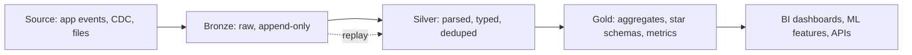

## 🎯 TL;DR

> **Medallion architecture** organizes a lakehouse into three layers of increasing quality: **Bronze** (raw data, as it arrived), **Silver** (cleaned, typed, deduplicated and conformed), and **Gold** (business-ready tables for dashboards, metrics and ML).

- Each layer has a **contract**: what it guarantees, who reads it, and how often it is rebuilt.
- Bronze keeps everything, so you can always replay history. Silver is where trust starts. Gold is shaped for the questions the business asks.
- It is a naming and responsibility convention, not a product. It works on object storage with Delta, Iceberg or Hudi tables, and the same idea maps onto classic staging, ODS and marts in a warehouse.

## 🌱 Start simple (Junior)

> **💡 Analogy:** A restaurant kitchen. The delivery crate of raw vegetables is **Bronze**: you keep it exactly as it came, so you can check it later if a dish goes wrong. The washed, peeled and portioned ingredients are **Silver**: clean, consistent, ready to use. The finished plate on the menu is **Gold**: what the customer actually orders.

Imagine an online shop. Orders arrive as JSON events from an application. A pipeline does three things:

1. **Bronze:** store each event exactly as received, plus metadata (when it arrived, from which file).
2. **Silver:** parse the JSON, cast `amount` to a number, drop test orders, and keep one row per `order_id` (the latest version).
3. **Gold:** compute `daily revenue per city`, which is what the finance dashboard shows.

Here is a tiny version of Bronze:

```sql
-- Bronze: raw, append-only, nothing is thrown away
CREATE TABLE bronze_orders (
  _ingested_at TIMESTAMP,
  _source_file TEXT,
  payload      TEXT            -- the raw JSON string, untouched
);
```

Why keep the raw payload? Because one day someone will ask "what did we receive on 3 March?" and you need an honest answer. Silver and Gold can always be rebuilt from Bronze, but Bronze cannot be rebuilt from Gold.

## 🔧 How it really works (Mid)

The pipeline between layers is usually incremental: each run reads only the new Bronze data, transforms it, and merges it into Silver. Gold is then recomputed from Silver, either fully (small tables) or by partition (large ones).



**Silver** is where the real work happens. Typical steps are parsing and type casting, deleting invalid rows, and deduplication. Deduplication is usually a window function, the same pattern as [[sql-window-functions]]:

```sql
-- Silver: keep the latest version of each order
CREATE TABLE silver_orders AS
SELECT order_id, customer_id, city, CAST(amount AS DECIMAL(12,2)) AS amount,
       updated_at
FROM (
  SELECT
    CAST(JSON_VALUE(payload, '$.order_id') AS BIGINT) AS order_id,
    JSON_VALUE(payload, '$.customer_id')              AS customer_id,
    JSON_VALUE(payload, '$.city')                     AS city,
    JSON_VALUE(payload, '$.amount')                   AS amount,
    CAST(JSON_VALUE(payload, '$.updated_at') AS TIMESTAMP) AS updated_at,
    ROW_NUMBER() OVER (
      PARTITION BY JSON_VALUE(payload, '$.order_id')
      ORDER BY CAST(JSON_VALUE(payload, '$.updated_at') AS TIMESTAMP) DESC,
               _ingested_at DESC
    ) AS rn
  FROM bronze_orders
  WHERE JSON_VALUE(payload, '$.is_test') IS NULL   -- drop test traffic
) t
WHERE rn = 1;
```

`JSON_VALUE` and the exact JSON syntax differ by engine (Spark, BigQuery, Snowflake and PostgreSQL all spell it differently), so treat the query as the shape of the logic, not a copy-paste script. The logic is what matters: parse, filter, keep the latest version.

**Gold** is shaped for consumers. It often looks like a star schema ([[star-schema]]) or a set of pre-aggregated metrics:

```sql
-- Gold: what the dashboard reads
CREATE TABLE gold_daily_revenue AS
SELECT CAST(updated_at AS DATE) AS day, city,
       COUNT(*) AS orders, SUM(amount) AS revenue
FROM silver_orders
GROUP BY CAST(updated_at AS DATE), city;
```

A useful rule: **Bronze is append-only, Silver is idempotent to rebuild, Gold is what you are willing to be paged about.** If a Gold number is wrong, the fix path is Silver, then Gold again, never a manual edit of the Gold table.

## 🧠 Senior depth & trade-offs

- **Contracts per layer.** Bronze promises "every byte we received, with lineage metadata", and never fails on a new field. Silver promises types, uniqueness on a stated key, and documented null rules. Gold promises a metric definition with an owner. Without these written down, layers blur into one messy lake.
- **Schema drift.** Bronze should store the raw payload, or a permissive struct, so an upstream field addition does not break ingestion. Silver decides what to do with new fields: ignore, add a column, or alert. This is the boundary where [[schema-evolution]] is handled.
- **Replay and reprocessing.** The main reason for Bronze is replay: after a bug in a Silver rule, you fix the code and rebuild from raw. That only works if Bronze retention covers the replay window and the Silver job is deterministic. Pair it with [[idempotency]] and [[deduplication]], otherwise a replay doubles revenue.
- **Storage and cost.** You store the data up to three times (raw, cleaned, aggregated). For large event volumes, Bronze dominates the bill. Use lifecycle rules, compression and retention per layer, and keep PII handling at Bronze in mind, because raw data often holds personal fields that must be masked or deleted ([[data-masking]] / [[tombstone]] style deletes).
- **Engine behaviour.** On a table format such as Delta Lake, Iceberg or Hudi, `MERGE` into Silver gives you ACID commits and [[time-travel]], which is what makes the layers safe to rebuild. On plain files without a table format, deduplication and late updates are much harder. The layering works on either, but the guarantees are only as strong as the storage format underneath.
- **Late and out-of-order data.** A Silver table keyed by event date must handle events that arrive days late. Decide whether Gold is recomputed for the affected days or whether late rows are dropped after a cut-off, and document the choice ([[late-arriving-data]]).
- **Compared with classic warehousing.** A traditional warehouse usually has staging, an operational data store and then dimensional marts. Medallion maps roughly to staging (Bronze), cleaned integration layer (Silver) and marts (Gold). The main difference is that Bronze keeps raw history cheaply on object storage instead of being thrown away after loading.
- **When not to use it.** One source, one small team and a few dashboards: three layers are overhead. A single cleaned layer plus marts, as in a well-run [[dwh-fundamentals|warehouse]], is enough. Add layers when you have replay needs, many consumers or many sources.

## 🧪 Try it

Design the layers for this case: a ride-hailing app sends `trip_started`, `trip_completed` and `trip_cancelled` events. Drivers can update a trip's status several times.

1. **Bronze.** Which columns would you store besides the raw payload? Name at least two metadata columns and explain why each one helps during a replay.
2. **Silver.** What is the unique key for a trip? Write the rule that keeps one row per trip, and say what happens when `trip_completed` arrives before `trip_started` (out of order).
3. **Gold.** Define `daily completed trips per city` and one ambiguity: on which day does a trip that starts on Monday and completes on Tuesday count?

<details><summary>Show solutions</summary>

**1.** Useful metadata: `_ingested_at` (when the platform received it, needed to reproduce what was known at a given time), `_source_file` or `_offset` (lineage back to the source, needed to debug a bad batch). With these you can rebuild exactly the batch that caused a problem.

**2.** The key is `trip_id`. Keep the event with the latest status rank (completed > started > cancelled is not always right, so rank by the event timestamp and a status sequence number from the producer). Out-of-order events are normal: the merge rule must not depend on arrival order, only on the event timestamp or a version column. Otherwise an older `trip_started` can overwrite a newer `trip_completed`.

**3.** `completed trips per city per day`, counted on the completion date, is a reasonable default. The ambiguity is the business definition: counting by start date or completion date gives different numbers. Write the decision in the metric definition (the Gold contract) so every dashboard agrees.

</details>

## 💬 Interview corner

**Question: "What is medallion architecture and why use it?"** Mid answer: "Bronze holds raw data, Silver is cleaned and deduplicated, Gold is aggregated for business use. Each layer has a clear job, which makes debugging easier."

Senior answer: "It is a set of layer contracts on top of a lakehouse. Bronze gives replay and lineage, Silver is the single place where cleaning and deduplication rules live, Gold holds metric definitions with owners. I'd make Silver rebuildable from Bronze and idempotent, and I'd keep Gold recomputable, so a wrong number is fixed by code, not by hand. I'd skip the extra layers if the scope is small."

**Question: "How is this different from a warehouse with staging tables?"** The concepts overlap. The practical difference is cheap, immutable raw history on object storage, and table formats that give ACID merges on every layer.

> **🎤 Say this in the interview:** "I think of medallion as layer contracts. Bronze is raw and replayable, Silver is where I enforce types, keys and dedup with idempotent merges, and Gold holds the business metrics with an owner. The layers make a fix a code change and a rebuild, not a manual patch."

## ⚠️ Common mistakes

> **⚠️ Watch out:** Treating Bronze as a copy of the source "in a nicer format". If you filter or drop fields in Bronze, you lose the ability to replay after a bug. Keep the raw form, and push filtering to Silver.

- Writing business logic into Gold that should be in Silver, so two Gold tables disagree about "revenue".
- Editing Gold tables by hand to fix a number. The next run overwrites the fix, and Silver stays wrong.
- Deduplicating without a deterministic tiebreaker. Two rows with the same `updated_at` produce different results on each run.
- Making Silver merges depend on arrival order instead of event time or a version column.
- Keeping Bronze forever with no retention or PII policy, then discovering personal data in an analytics bucket.
- Building three layers for a dataset with one consumer and no replay needs.

## ✅ Check yourself (quiz)

1. Which layer should be **append-only and as close to the source as possible**?
   - A) Gold
   - B) Silver
   - C) Bronze
   - D) All three equally

<details><summary>Answer</summary>

**C** — Bronze keeps the raw records as they arrived, which is what makes replay and lineage possible. Silver and Gold are derived from it.

</details>

2. A bug in the Silver cleaning rule has been live for two weeks. What is the cleanest fix?
   - A) Edit the Gold numbers directly with an `UPDATE`
   - B) Fix the Silver rule and rebuild Silver from Bronze for the affected days, then recompute Gold
   - C) Delete Bronze and start the source over
   - D) Add a dashboard note explaining the error

<details><summary>Answer</summary>

**B** — the layers are derived in one direction. Fixing the rule and rebuilding Silver and Gold from Bronze keeps all tables consistent. A manual edit is overwritten by the next run, and deleting Bronze destroys the replay source.

</details>

3. **(Senior)** Silver merges events by `order_id` and keeps the row with the latest `updated_at`. Two events for the same order have identical `updated_at` values. Why is this a problem, and what do you change?
   - A) Nothing; the engine picks consistently
   - B) The result can differ between runs, so add a deterministic tiebreaker such as a producer sequence number or the ingestion offset
   - C) The job must switch to `RANK` instead of `ROW_NUMBER`
   - D) `updated_at` must be removed from the key

<details><summary>Answer</summary>

**B** — `ROW_NUMBER` among ties is arbitrary, so a replay can pick a different row and Silver changes between runs. A unique tiebreaker (a sequence number from the producer, or the offset) makes the rebuild deterministic.

</details>

4. **(Senior)** An upstream team adds a new field `coupon_code` to the order payload, and the nightly ingestion job starts failing. Which layer should absorb this change, and why?
   - A) Gold, because it is the business layer
   - B) Bronze should keep the raw payload so ingestion does not fail; Silver then decides whether and how to expose `coupon_code`
   - C) Nothing; the job must be stopped until the schema is frozen
   - D) Silver must reject all events with new fields

<details><summary>Answer</summary>

**B** — Bronze stores the data permissively, so ingestion keeps working. Silver is where the typed schema is applied and where a new column is added deliberately. Gold changes only after Silver does.

</details>

5. Which statement about medallion architecture is **true**?
   - A) It is a specific product that you install
   - B) It requires exactly three layers and no more
   - C) It is a convention of layer contracts that can run on object storage or a warehouse
   - D) It replaces the need for deduplication

<details><summary>Answer</summary>

**C** — medallion is a convention about responsibilities and contracts. It is not a product, the number of layers is a choice, and deduplication is still needed (in Silver).

</details>

## 🗂️ Flashcards

| Front | Back |
|---|---|
| Bronze layer | Raw, append-only data as received, plus lineage metadata; the replay source |
| Silver layer | Parsed, typed, deduplicated and validated data on stated keys |
| Gold layer | Business-ready aggregates, star schemas and metrics with owners |
| Why keep Bronze raw? | Replay after bugs and lineage; Gold cannot rebuild Bronze |
| Fix a wrong Gold number | Fix the rule in Silver, rebuild from Bronze, recompute Gold; never hand-edit |
| Deduplication in Silver needs | A deterministic key and tiebreaker, not only a timestamp |
| Medallion vs classic warehouse | Similar roles (staging, integration, marts); Bronze keeps cheap raw history |
| When to skip the layers | One source, one consumer, no replay need |

## 🔗 Go further

- **[[dwh-fundamentals|Data warehouse fundamentals]]** explains staging, integration and marts, the classic version of the same idea.
- **[[lakehouse-table-formats]]** covers the ACID table layer that makes Silver merges and replays safe.
- **[[file-layout]]** shows how the physical files behind each layer should be sized and partitioned.
- **[[pattern-late-data]]** and **[[dedup-idempotent-loads]]** are the two design problems you meet first when building Silver.
- **[[dimensional-modeling]]** is the usual way to design Gold tables.
