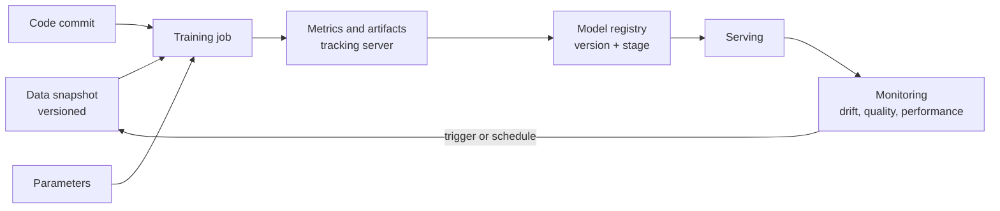

## 🎯 TL;DR

> **MLOps** is the set of practices that keeps machine-learning models working after the first training run. For a data engineer, the core question is: **which exact data produced this model, and is the data still behaving the way the model expects?**

- **Reproducibility** needs versioned data, versioned code and recorded parameters for every training run.
- **Experiment tracking** (for example MLflow) records runs, parameters, metrics, artifacts and model versions.
- **Drift** means the input data or the relationship between inputs and labels changes over time. Monitor it, and retrain on a schedule or on a trigger.
- **Data quality checks** run before training and before serving, not only in the warehouse.

## 🌱 Start simple (Junior)

> **💡 Analogy:** A recipe card says "bake for 40 minutes". If you do not write down which flour and which oven you used, nobody can make the same cake next month. MLOps is the lab notebook for models: data, settings, code, and results, written down.

Imagine you train a spam classifier on Monday with 100,000 emails. On Friday, the team re-runs the job and gets a different model, and nobody knows why. The likely reasons are:

- the email table was **updated** in between (new rows, fixed labels),
- the code changed,
- a parameter was changed by hand,
- the random seed was not set.

The fix is simple to say and harder to do: **record the inputs and settings of every run**, so you can rebuild the same model or explain the difference.

```text
run_id: 2026-10-01-spam-v7
training_data: emails_snapshot_2026_09_30   (immutable snapshot)
code_commit: 4f2a9c1
params: learning_rate=0.05, max_depth=6, seed=42
metrics: auc=0.91, precision_at_0.5=0.88
model_output: s3://models/spam/v7/
```

## 🔧 How it really works (Mid)

An ML training run has three kinds of inputs: **code**, **parameters**, and **data**. A reproducible pipeline captures all three.



**Data versioning.** A table that is overwritten every night cannot explain last month's model. Options are:

- **Immutable snapshots**: write each training set to a path or partition named by date or hash (for example `dt=2026-09-30/`), and never modify it.
- **Table formats with time travel**: Delta Lake, Apache Iceberg and Hudi keep table versions, so a training job can read `VERSION AS OF` a given snapshot. Check the docs for the exact syntax in your engine.
- **Content hashes** of the dataset, stored with the run, so you can detect if the "same" dataset changed.

**MLflow** is an open-source tool for experiment tracking and model management. Its main concepts are:

| Concept | What it stores |
|---|---|
| Run | One training execution, with start and end time and status |
| Parameters | Hyperparameters and configuration values |
| Metrics | Values over time (for example loss per epoch) |
| Artifacts | Files such as the model, plots and feature lists |
| Model registry | Named model versions, with stages or aliases for promotion |

Recent MLflow versions can also record the dataset used as an input to a run. Check the docs for your version. The principle is the same in any tracker: **the run must point to the data version, not just the table name**, because the table name always points to today's data.

**Drift** is a change in the data over time. Three kinds matter:

- **Data drift (covariate shift)**: the distribution of input features changes (for example, average email length grows after a product change).
- **Label drift**: the distribution of the target changes (fraud rate goes from 0.1% to 0.4%).
- **Concept drift**: the relationship between inputs and the target changes (users behave differently after a policy change), even if the inputs look the same.

Monitoring usually compares the current window with a reference window (the training data) using a statistic such as the population stability index (PSI), the Kolmogorov–Smirnov test, or simple summary checks (null rate, mean, min, max). The threshold is a business decision, not a universal constant.

**Retraining pipelines** run on one of two triggers: a **schedule** (weekly, daily), or an **event** (drift above threshold, performance drop from delayed labels). The pipeline is usually an orchestrated DAG: pull snapshot, validate, build features, train, evaluate against the current model, register if better, deploy with a rollback path. See [[dag]] and [[data-quality]].

## 🧠 Senior depth & trade-offs

- **Label delay.** For fraud or churn, the true label may arrive days or months later. You can monitor input drift immediately, but performance drift only after labels arrive. Design the pipeline around this delay, and do not treat a missing label as a zero.
- **Training data is a product.** Treat the training snapshot like a published dataset: schema contract, owner, quality checks, retention. Breaking changes upstream silently change the model. See [[data-contract]].
- **Reproducibility vs cost.** Storing a full snapshot per run is expensive for large tables. Store snapshots for models in production and for the baseline; for experiments, store the query, the table version and a hash.
- **Offline evaluation is not enough.** Compare the candidate model with the current one on a fixed evaluation set and on recent data. Check slices (region, device, customer segment), not only the global metric.
- **Monitoring cost.** Computing drift statistics over billions of rows every hour is a real load. Sample, aggregate per partition, and compute statistics in the warehouse or lake job that already scans the data.
- **Shadow and canary.** Serve the new model in shadow mode (it scores but does not act) or to a small traffic share before full rollout. This needs the same feature logic as production; see [[training-serving-skew]].
- **When not to build the full stack.** A model retrained once a quarter by one analyst does not need a registry and drift service. A version-controlled notebook, a snapshot path and a written metric report may be enough. Add tooling when the number of models or the cost of a wrong model grows.

## 🧪 Try it

1. A nightly job overwrites `customers_features` every night. A model trained in May cannot be reproduced in September. List three changes you would make to the pipeline, in order of impact.
2. A feature `avg_order_value` had mean 52 during training and mean 81 this week. Name the drift type you would suspect first, and two checks to confirm it before retraining.
3. Write the minimal metadata (as a YAML or JSON block) that a run record should contain so that another engineer can rebuild the model.

<details><summary>Show solutions</summary>

**1.** (a) Write each training set to an immutable, dated snapshot instead of overwriting; (b) store the snapshot path or table version and the code commit in the run record; (c) keep the transformation code under version control and pin the dependency versions. Snapshots matter most, because without them the input itself is gone.

**2.** First suspect **data drift** (covariate shift), possibly caused by a pricing or currency change upstream. Checks: compare the full distribution (not only the mean) with a reference window; check for a unit or currency change, a new data source, or a bug in the join that duplicates high-value orders.

**3.** A minimal record: `run_id`, `data_version` (snapshot path or table version plus hash), `code_commit`, `params`, `seed`, `environment` (library versions), `metrics` on a named evaluation set, and `model_artifact` location.

</details>

## 💬 Interview corner

**Question: "How do you make ML training reproducible?"** Mid answer: "Version the code, pin the parameters and seed, and save the training snapshot." Senior answer: "I make the run record point to an immutable data version (snapshot or table version with a hash), the code commit and the environment. I also test the pipeline by rebuilding a recent model from its record and checking that the metrics match within a tolerance."

**Question: "How do you detect drift in production?"** Mid: "I compare the distribution of the input features with the training data and alert on large changes." Senior: "I monitor inputs, predictions and, when labels arrive, performance, each against a reference window. I separate data drift from concept drift, because they call for different actions: data drift may need a data fix, concept drift needs retraining. I account for label delay and choose thresholds per feature with the business."

**Question: "When would you retrain?"** On a schedule when data changes gradually and labels arrive quickly; on an event when drift or a performance drop crosses a threshold; and never silently — every retrain goes through validation against the current model.

> **🎤 Say this in the interview:** "For MLOps I focus on data: every model must be traceable to an immutable data version and a code commit. I monitor input drift immediately and performance drift when labels arrive, and I retrain through a pipeline with validation and rollback, not by hand."

## ⚠️ Common mistakes

> **⚠️ Watch out:** Logging the table name instead of the data version. The table name always means "the current contents", so the run cannot be reproduced.

> **⚠️ Watch out:** Treating a drift alert as an automatic reason to retrain. First check whether the data pipeline broke (a null column, a new category, a unit change). Retraining on broken data produces a broken model that looks freshly trained.

- Overwriting training data instead of versioning it.
- Setting no random seed and comparing two runs as if they were comparable.
- Monitoring only the mean of each feature, which hides shape changes.
- Forgetting label delay and reporting "no drift in performance" when labels have not arrived yet.
- Deploying a retrained model without comparing it with the current one on the same evaluation set.

## ✅ Check yourself (quiz)

1. Which item is the **most** important to record in an ML run for reproducibility?
   - A) The name of the team that trained the model
   - B) The immutable data version used for training
   - C) The number of CPU cores on the training machine
   - D) The color of the dashboard

<details><summary>Answer</summary>

**B** — the table name points to changing data. An immutable data version (snapshot or table version with hash) is what makes the run reproducible. Hardware and team details help, but they do not rebuild the model.

</details>

2. Which kind of drift is a change in the **relationship** between inputs and the target, even when the inputs look the same?
   - A) Data drift
   - B) Concept drift
   - C) Schema drift
   - D) Clock drift

<details><summary>Answer</summary>

**B** — concept drift is a change in P(target | inputs). Data drift is a change in P(inputs). Schema drift concerns column structure.

</details>

3. Your fraud model's labels arrive 30 days late. What is the right monitoring approach?

   - A) Wait 30 days, then check performance only
   - B) Monitor input and prediction drift immediately, and track performance when labels arrive, with the delay built into the pipeline
   - C) Treat missing labels as legitimate zeros
   - D) Disable monitoring until labels are complete

<details><summary>Answer</summary>

**B** — input and prediction distributions are available right away, so drift can be detected early. Performance is measured on the labels that have arrived. Treating missing labels as zeros would make the model look better than it is.

</details>

4. **(Senior)** A drift alert fires after an upstream release. What should happen before any retraining?

   - A) Retrain immediately on the newest data
   - B) Check whether the data pipeline changed (nulls, new categories, unit or currency changes) and fix or quarantine the data first, then evaluate whether retraining is needed
   - C) Remove the drift monitor
   - D) Increase the learning rate

<details><summary>Answer</summary>

**B** — a drift alert can be a data bug, and retraining on broken data produces a model that looks fresh but is wrong. Diagnose the data first, then decide.

</details>

5. **(Senior)** Why is a candidate model compared with the current production model on the same evaluation set, and on recent data?

   - A) To make the new model look better
   - B) To ensure a fair comparison and to detect regressions in important slices, not only the global metric
   - C) Because the registry requires it for storage
   - D) To avoid computing metrics

<details><summary>Answer</summary>

**B** — a fair comparison needs the same data for both models. Slice checks catch regressions hidden by a good average, such as worse performance for one region or device.

</details>

## 🗂️ Flashcards

| Front | Back |
|---|---|
| Reproducibility inputs | Immutable data version, code commit, parameters, seed, environment |
| Run (MLflow concept) | One training execution with its params, metrics and artifacts |
| Model registry | Named, versioned models with promotion stages or aliases |
| Data drift | Change in the distribution of input features |
| Concept drift | Change in the relationship between inputs and the target |
| Label delay | Gap between prediction and the arrival of its true label |
| PSI | Population stability index, a common score for distribution shift |
| Shadow deployment | New model scores traffic but does not act on it |

## 🔗 Go further

- **feature-stores** covers the feature side of the same problem: point-in-time correctness and training-serving skew.
- **data-lineage** explains how to trace a model back to the data and code that produced it.
- **data-observability** and **data-quality** provide the checks that should run before a model is trained or served.
- **dataops-cicd** covers how to automate the pipeline and its tests.
- Read the documentation of your tracking tool and table format for the exact reproducibility features in your version.
