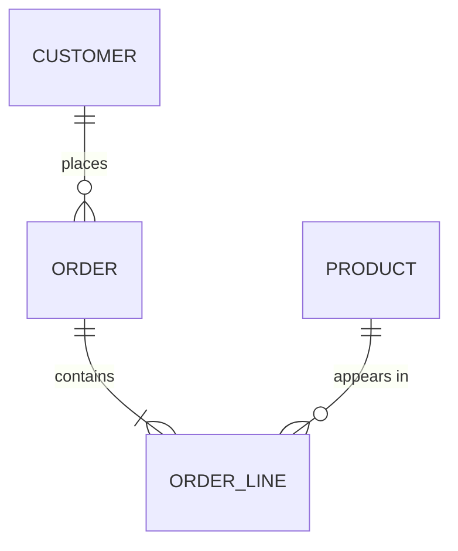

## 🎯 TL;DR

> Data modeling happens at **three levels**. The **conceptual** model says *what* the business talks about, the **logical** model says *how those things relate* (keys, attributes, cardinality), and the **physical** model says *how one specific engine stores them* (tables, types, indexes, partitions, sort keys).

- The same business model produces **different physical models** on Postgres, ClickHouse and Cassandra.
- Going from conceptual to logical is about meaning and integrity. Going from logical to physical is about the engine and the queries.
- Interviewers want you to name the level you are working at, and to say which decisions belong to the engine and which do not.

## 🌱 Start simple (Junior)

> **💡 Analogy:** Think of building a house. The **conceptual** model is the sketch "a kitchen, two bedrooms, a garage, and they are connected." The **logical** model is the architect's plan with room sizes, doors and load-bearing walls. The **physical** model is the construction spec: which bricks, which concrete mix, which screws, on this plot of land.

Let us take a small online shop. At the conceptual level we only name the things and how they connect:

- A **Customer** places **Orders**.
- An **Order** contains one or more **Products** (through order lines).



Read the diagram like this: `||--o{` means "one to many". One customer places zero or more orders. One order contains one or more order lines. No column types, no keys yet. That is the conceptual level.

> **⚠️ Watch out:** A conceptual model is not "the first draft of the tables". If you start typing `INT` and `VARCHAR(50)` before the business agrees on what an *order* is, you will rebuild the schema later.

Now the same shop at the **logical** level. We add attributes, primary keys, foreign keys and cardinality, but we still do not pick an engine:

| Entity | Primary key | Important attributes | Relationship |
|---|---|---|---|
| Customer | customer_id | name, email, country, signup date | places Orders (1 : N) |
| Order | order_id | order time, status, currency | belongs to one Customer (N : 1) |
| OrderLine | (order_id, line_no) | product_id, quantity, unit price | belongs to one Order (N : 1) |
| Product | product_id | name, category, list price | appears in OrderLines (1 : N) |

The logical model answers questions like "can an order exist without a customer?" (no, so `customer_id` is required) and "can a product be in many orders?" (yes, so we need the OrderLine table between them, not a column on Order).

At the **physical** level we pick Postgres for the orders service. Now we decide types, constraints and indexes:

```sql
-- Postgres: OLTP, row store, enforced foreign keys
CREATE TABLE customers (
  customer_id bigint PRIMARY KEY,
  email       text NOT NULL UNIQUE,
  country     char(2) NOT NULL
);

CREATE TABLE orders (
  order_id    bigint PRIMARY KEY,
  customer_id bigint NOT NULL REFERENCES customers (customer_id),
  order_ts    timestamptz NOT NULL,
  status      text NOT NULL,
  currency    char(3) NOT NULL
);

CREATE INDEX orders_customer_ts_idx ON orders (customer_id, order_ts);
```

The same business fact, "a customer's orders in time order", now has a physical answer: a B-tree index on `(customer_id, order_ts)`.

## 🔧 How it really works (Mid)

The three levels are a **decision funnel**. Each level removes options:

| Level | Question it answers | Decisions made | Who cares most |
|---|---|---|---|
| Conceptual | What are the business things and their links? | Entities, business rules, vocabulary | Business, product, analysts |
| Logical | How is each thing identified and related? | Keys, attributes, cardinality, normal form, slowly changing history | Data architects, modelers |
| Physical | How does this engine store and find it? | Types, partitions, sort/cluster keys, indexes, denormalization, file layout | Data engineers, DBAs |

### What changes between engines

The logical model is the same. The physical model is not:

- **Postgres (row store, OLTP):** foreign keys are enforced, normalized tables are fine, B-tree indexes make point lookups fast. Joins are cheap at small scale.
- **ClickHouse (columnar, OLAP):** foreign keys are not enforced. You choose an `ORDER BY` key that is the main physical sort (and sparse index). You usually denormalize or use dictionaries for dimensions, because joins and updates are expensive compared with scans.

```sql
-- ClickHouse: analytics copy of the same facts
CREATE TABLE order_lines_analytics (
  order_id    UInt64,
  customer_id UInt64,
  order_ts    DateTime,
  product_id  UInt64,
  quantity    UInt32,
  amount      Decimal(12, 2)
)
ENGINE = MergeTree
PARTITION BY toYYYYMM(order_ts)
ORDER BY (customer_id, order_ts);
```

- **Cassandra (wide-column, query-first):** you do not model entities first. You model the **queries**, and each table is shaped by one query. The partition key decides where the data lives. The same customer orders might appear in two tables: one partitioned by customer, another by day.

```sql
-- Cassandra (CQL): one table per query
CREATE TABLE orders_by_customer (
  customer_id uuid,
  order_ts    timestamp,
  order_id    uuid,
  amount      decimal,
  PRIMARY KEY ((customer_id), order_ts, order_id)
) WITH CLUSTERING ORDER BY (order_ts DESC, order_id ASC);
```

> **🎤 Say this in the interview:** "I model the business concepts logically first, then I derive the physical model for the engine. On Postgres I normalize and index; on ClickHouse I pick the sort key and denormalize for scans; on Cassandra I design one table per query."

### ERDs in practice

An Entity-Relationship Diagram (ERD) is the usual picture for the logical level. Use crow's-foot notation: `||` means exactly one, `o{` means zero or many, `|{` means one or many. Keep ERDs at the logical level in reviews, and show physical details (types, indexes) in separate DDL. Mixing them makes diagrams unreadable.

## 🧠 Senior depth & trade-offs

- **Where the levels leak:** a logical "many-to-many" becomes a bridge table in the logical model, but a physical decision (denormalize into one wide table for speed) may reintroduce duplication. Record the reason, so the next engineer knows it is intentional.
- **Keys:** logical keys are business identifiers (email, order number). Physical keys are often surrogate keys (`bigint` or hash) because business keys change. Keep both and decide which one joins facts to dimensions.
- **History:** a logical model that ignores time will produce a physical model that overwrites data. Decide early whether you need history (SCD, see the scd topic) because it changes the physical design much more than it changes the diagram.
- **Engine-driven choices:** partitioning on ClickHouse, clustering keys on BigQuery and Snowflake, and partition keys in Cassandra are physical. Putting them in a logical ERD hides the trade-offs.
- **Monitor after the fact:** physical models drift. Track query latency, scanned bytes, partition sizes and skew, and revisit the physical model when the query mix changes.
- **When NOT to over-model:** for a small service with three tables and one query pattern, a conceptual and logical diagram on a whiteboard is enough. Full three-level documentation pays off when many teams share the data.

## 🧪 Try it

Start with the online shop above. Do the following on paper or in a scratch file.

1. Add a `Shipment` entity. A shipment belongs to exactly one order, but an order can have several shipments (partial deliveries). Draw the conceptual relation and the logical cardinality.
2. Write the Postgres DDL for `shipments` with a foreign key to `orders`.
3. Write the ClickHouse `ORDER BY` for a dashboard that shows "shipments per warehouse per day". Justify your choice in one sentence.

<details><summary>Your guess?</summary>

1. Conceptually: `ORDER ||--o{ SHIPMENT : "is delivered in"`. Logically, `shipment_id` is the key and `order_id` is a required foreign key. Cardinality is one order to zero or many shipments.
2. `CREATE TABLE shipments (shipment_id bigint PRIMARY KEY, order_id bigint NOT NULL REFERENCES orders (order_id), warehouse_id bigint NOT NULL, shipped_ts timestamptz NOT NULL);`
3. A reasonable answer is `ORDER BY (warehouse_id, toDate(shipped_ts))` or the equivalent with a `DateTime` column, because the dashboard filters and groups by warehouse and day, so those columns should be the leading part of the sort key.

</details>

## 💬 Interview corner

**Question: "What is the difference between a conceptual, logical and physical model?"** Mid answer: "Conceptual is entities and relationships, logical adds keys and attributes, physical is the tables for a specific engine." Senior answer: "The same logical model can yield different physical designs. I'd show the decisions at each level, so a reviewer can see which choices are business rules and which are engine trade-offs, and I'd keep the logical model reusable when we change engines."

**Question: "Why would the physical model of the same data differ between Postgres and ClickHouse?"** Mid: "Postgres is a row store with enforced keys and indexes for point lookups; ClickHouse is columnar and scans big ranges, so the sort key and denormalization matter more." Senior: "I'd name the query patterns first. On ClickHouse I'd pick the `ORDER BY` for the dominant filters, avoid heavy joins in the hot path, and accept that constraints are not enforced, so I'd add data quality checks instead."

> **🎤 Say this in the interview:** "I model the business concepts first, then derive the physical model for the engine and the queries. I keep the logical model engine-neutral, so the reasoning survives a change of engine."

## ⚠️ Common mistakes

> **⚠️ Watch out:** Treating the conceptual diagram as the first version of the tables. Types and keys come later, after the business agrees on the meaning of each entity.

> **⚠️ Watch out:** Copying a Postgres schema to ClickHouse or Cassandra unchanged. Foreign keys, indexes and normalization all behave differently there.

- Putting engine details (partitions, replication factor) in the logical ERD.
- Modeling many-to-many as a list column instead of a bridge table.
- Skipping the cardinality on relationships, which leaves "optional or required?" unanswered.
- Designing physical tables before listing the queries they must serve.

## ✅ Check yourself (quiz)

1. Which level decides the data types, indexes and partitions of a table?
   - A) Conceptual
   - B) Logical
   - C) Physical
   - D) Business

<details><summary>Answer</summary>

**C** — the physical model is engine-specific. Types, indexes, partitions and sort keys belong there.

</details>

2. In a logical model, a product can appear in many orders and an order can contain many products. What do you add?
   - A) A list column of product IDs on `orders`
   - B) A bridge (line item) table between `orders` and `products`
   - C) A foreign key from `products` to `customers`
   - D) Nothing; a many-to-many relation needs no table

<details><summary>Answer</summary>

**B** — a many-to-many relation is resolved with a table that holds one row per pair (here, order lines). A list column breaks normal form and makes joins and constraints hard.

</details>

3. You move the same facts from Postgres to ClickHouse for dashboards. Which change is most typical?
   - A) Add more foreign keys
   - B) Choose an `ORDER BY` sort key and denormalize dimensions used by the dashboard
   - C) Remove all indexes and add a unique constraint on every column
   - D) Convert the model back to conceptual

<details><summary>Answer</summary>

**B** — columnar analytic engines rely on the sort key and scans; joins and enforced constraints are costly, so you usually denormalize the attributes the queries need.

</details>

4. **(Senior)** A team puts `partition_key`, `clustering_key` and `replication_factor` on the logical ERD. What is the risk?

   - A) None, the ERD is the single source of truth
   - B) The diagram mixes engine decisions into the business model, so the logical model cannot be reused on another engine and the trade-offs are hidden
   - C) ERDs cannot contain numbers
   - D) Replication factor must be in the conceptual model

<details><summary>Answer</summary>

**B** — keep the logical model engine-neutral. Put engine choices in the physical DDL, where reviewers can see the trade-off next to the query that motivated it.

</details>

5. **(Senior)** Why is a Cassandra physical model often built from the query list instead of from the entity diagram?

   - A) Cassandra cannot store entities
   - B) Cassandra has no joins and its lookups are efficient only by partition key, so each query needs a table whose partition key matches it
   - C) Cassandra needs the conceptual model to be in SQL
   - D) Entities are not allowed in wide-column stores

<details><summary>Answer</summary>

**B** — with no cross-partition joins and efficient access by partition key, the table design follows the queries. The entity model still gives you the vocabulary, but the physical tables are per access pattern.

</details>

## 🗂️ Flashcards

| Front | Back |
|---|---|
| Conceptual model | Business entities and how they connect; no keys, no types |
| Logical model | Keys, attributes, cardinality and normal form, engine-neutral |
| Physical model | Engine-specific types, indexes, partitions, sort keys |
| Many-to-many in a logical model | Resolve with a bridge (association) table |
| Cardinality `||--o{` | One to zero-or-many |
| What drives a ClickHouse table design? | The `ORDER BY` sort key and the scans the dashboards need |
| What drives a Cassandra table design? | The query; one table per access pattern and partition key |

## 🔗 Go further

- **normalization** explains the rules behind a clean logical model, and why you may denormalize at the physical level.
- **dimensional-modeling** is the logical-to-physical path for analytics (facts, dimensions, grain).
- **physical-modeling-olap** goes deeper into sort keys, partitions and file layout for columnar engines.
- **nosql-modeling** covers query-first design for Cassandra, HBase and Redis.
- **modeling-methodologies** compares Inmon, Kimball and Data Vault, which differ mainly in how they arrange the three levels for a whole warehouse.
