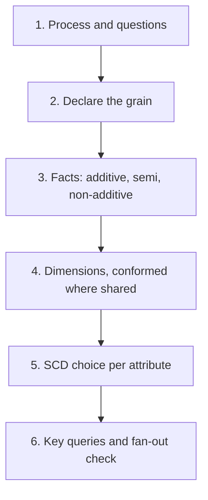

## 🎯 TL;DR

> A modeling interview is a **conversation with a method**, not a drawing contest. For every business process, say the **grain** first, then the **facts** that are measured at that grain, the **dimensions** that describe them, the **SCD** rule for each dimension attribute, and the **queries** the model must answer.

- Grain first: one sentence that says what one row means. Everything else follows from it.
- Facts are additive, semi-additive (balances) or non-additive (ratios). Store the base measure and compute ratios in queries.
- Keep one grain per fact table. A table that mixes grains is the root of most double-counting.
- Choose an SCD type per attribute, based on the questions people ask about the past.

## 🌱 Start simple (Junior)

> **💡 Analogy:** A receipt from a coffee shop. Each line says "1 × latte, 45,000 IRR". The grain of the sales table is **one receipt line**. If you store the total of the receipt instead, you can no longer answer "how many lattes did we sell?".

```sql
CREATE TABLE fact_sale_line (
  receipt_id   text NOT NULL,
  line_no      int  NOT NULL,
  item_key     int  NOT NULL,   -- dim_item
  date_key     int  NOT NULL,   -- dim_date, e.g. 20260315
  quantity     int  NOT NULL,
  line_amount  numeric(10,2) NOT NULL,
  PRIMARY KEY (receipt_id, line_no)
);

-- Lattes sold per day: possible only because the grain is one line
SELECT date_key, SUM(quantity) AS lattes
FROM fact_sale_line
WHERE item_key = 7
GROUP BY date_key;
```

The same steps work for every real domain. The problems below are where you practise them.

## 🔧 How it really works (Mid)

Use the same six steps for every problem. Say them out loud in the interview, because the interviewer is checking the method.



- **Process and questions.** What event happens, and what would the business ask every week? Write 3 questions. They will drive your facts.
- **Grain.** One row = one trip, one order line, one CDR, one impression, one payroll line per component. Write it as a sentence.
- **Facts.** Numeric measures at that grain. `fare_amount` is additive. `on_hand_qty` is semi-additive: you can sum it across warehouses but not across days. `ctr` is non-additive: store clicks and impressions, and divide in the query.
- **Dimensions.** Who, what, where and when. Use surrogate keys, and add an "unknown" member (key `-1`) for missing values such as a courier who is not assigned yet.
- **SCD.** For each attribute, ask: "Do we need the value as it was at the event?" If yes, use Type 2 (a new row with `valid_from` and `valid_to`). If no, overwrite it (Type 1). Prices belong on the fact, not in the dimension.
- **Key queries and fan-out.** Run your two most important queries in your head. If a query joins two facts at different grains, aggregate each fact to a common grain first, or the sums will be inflated.

Example: a driver changes vehicle type on 15 March. A trip on 10 March must still show the old vehicle. With Type 2 on `dim_driver`, the trip's `driver_key` points to the old version and the answer is right without any extra logic.

## 🧠 Senior depth & trade-offs

- **Fan-out is the silent killer.** Joining `fact_order_line` to `fact_return_line` multiplies order amounts for each return. The fix is a CTE per fact, grouped to product and date, then joined.
- **Conformed dimensions across domains.** `dim_date`, `dim_zone` and `dim_customer` should mean the same thing in every fact table, so that revenue and refunds, or trips and payouts, can be compared. Agree the definitions before you write DDL.
- **Storing the key that was valid at event time.** Telco rating and payroll both need this. Rating writes `tariff_key` on each usage row, so a later price change never rewrites history. Payroll uses the employee version valid at period end, and states the rule explicitly.
- **Restatements and late data.** A corrected CDR, a late refund or a retro salary change should be a **new row** (a correction or adjustment flag, with a `run_id`), not an update to a closed period. Updates destroy the audit trail and make old reports impossible to reproduce. See [[late-arriving-data]].
- **Many-to-many relationships.** A listing in two categories, or an employee in two departments, needs a bridge table with weights, or a single primary-category rule. Pick one and document it.
- **Scale numbers.** A telco with 100M subscribers and 20 usage events per subscriber per day writes 100M × 20 = 2 × 10⁹ rows per day. Partition by event date, keep the raw grain for 30 days, and roll up to hourly per subscriber for dashboards.
- **Sensitive data.** Phone numbers, national IDs (in Iran, the national code), account numbers and salaries should be masked or tokenised in the model, with restricted access. Say this in the interview; it is a senior signal.
- **Engines.** Columnar stores (ClickHouse, StarRocks, Snowflake, BigQuery) favour wide denormalised facts; the star is still right for the logic. Check the physical design for your engine, see [[star-schema]].

## 🧪 Try it

Each problem below is a short brief. Try to write the grain, facts, dimensions, SCD choices, DDL and two queries before you open the solution. The DDL is a sketch in PostgreSQL style; adapt types for your engine.

**1. Ride-hailing (trips, drivers, pricing, surge).** Model completed trips, driver earnings and the surge multiplier that applies by zone and time.

<details><summary>Show the model</summary>

- **Grain:** one row per completed trip. Surge is a separate snapshot: one row per zone per minute.
- **Facts:** `distance_km`, `duration_s`, `fare_amount`, `surge_multiplier`, `driver_payout` (additive); surge demand and supply in the snapshot.
- **Dimensions:** `dim_rider`, `dim_driver`, `dim_zone` (role-played as pickup and drop-off), `dim_vehicle_type`, `dim_date`.
- **SCD:** `dim_driver` is Type 2 for vehicle and home city, so historic payouts stay correct. `dim_rider` is Type 1. Zones are Type 2 only if boundaries are redrawn.

```sql
CREATE TABLE fact_trip (
  trip_key          bigint PRIMARY KEY,
  trip_id           text NOT NULL,      -- degenerate dimension
  rider_key         bigint NOT NULL,
  driver_key        bigint NOT NULL,    -- version valid at trip time
  pickup_zone_key   int NOT NULL,
  dropoff_zone_key  int NOT NULL,
  date_key          int NOT NULL,
  completed_at      timestamptz NOT NULL,
  distance_km       numeric(8,2),
  duration_s        int,
  fare_amount       numeric(12,2),
  surge_multiplier  numeric(4,2),
  driver_payout     numeric(12,2)
);

-- Average surge and fare per pickup zone per day
SELECT z.zone_name, d.full_date, AVG(f.surge_multiplier) AS avg_surge, AVG(f.fare_amount) AS avg_fare
FROM fact_trip f
JOIN dim_zone z ON z.zone_key = f.pickup_zone_key
JOIN dim_date d ON d.date_key = f.date_key
GROUP BY z.zone_name, d.full_date;

-- Driver payout by vehicle type, as it was at trip time
SELECT dr.vehicle_type, SUM(f.driver_payout) AS payout
FROM fact_trip f
JOIN dim_driver dr ON dr.driver_key = f.driver_key
WHERE f.date_key BETWEEN 20260101 AND 20260131
GROUP BY dr.vehicle_type;
```

</details>

**2. E-commerce (orders, items, inventory, returns).** Model order revenue, refunds and stock levels per warehouse.

<details><summary>Show the model</summary>

- **Grain:** order line (sales); returned line (returns); warehouse × product × day (inventory snapshot).
- **Facts:** `quantity`, `net_amount` (additive); `refund_amount` (additive); `on_hand_qty` (semi-additive).
- **Dimensions:** `dim_customer`, `dim_product`, `dim_warehouse`, `dim_promotion` (with an unknown member), `dim_date`. The order ID is a degenerate dimension.
- **SCD:** `dim_product` Type 2 on category if reports must use the category at sale time. `dim_customer` Type 2 on segment. The unit price lives on the fact.

```sql
CREATE TABLE fact_order_line (
  order_line_key bigint PRIMARY KEY,
  order_id       text NOT NULL,
  line_no        smallint NOT NULL,
  customer_key   bigint NOT NULL,
  product_key    bigint NOT NULL,
  promotion_key  int NOT NULL DEFAULT -1,
  date_key       int NOT NULL,
  quantity       int NOT NULL,
  unit_price     numeric(12,2) NOT NULL,
  net_amount     numeric(12,2) NOT NULL,
  UNIQUE (order_id, line_no)
);
CREATE TABLE fact_return_line (
  return_line_key bigint PRIMARY KEY,
  order_line_key  bigint NOT NULL REFERENCES fact_order_line,
  return_date_key int NOT NULL,
  returned_qty    int NOT NULL,
  refund_amount   numeric(12,2) NOT NULL
);
CREATE TABLE fact_inventory_daily (
  date_key int, warehouse_key int, product_key bigint,
  on_hand_qty int NOT NULL,
  PRIMARY KEY (date_key, warehouse_key, product_key)
);

-- Net revenue per category for September 2026 (aggregate each fact first to avoid fan-out)
WITH sales AS (
  SELECT product_key, SUM(net_amount) AS sold
  FROM fact_order_line WHERE date_key BETWEEN 20260901 AND 20260930
  GROUP BY product_key
), refunds AS (
  SELECT ol.product_key, SUM(r.refund_amount) AS refunded
  FROM fact_return_line r
  JOIN fact_order_line ol ON ol.order_line_key = r.order_line_key
  WHERE r.return_date_key BETWEEN 20260901 AND 20260930
  GROUP BY ol.product_key
)
SELECT p.category, SUM(s.sold) - SUM(COALESCE(r.refunded, 0)) AS net_revenue
FROM sales s
LEFT JOIN refunds r ON r.product_key = s.product_key
JOIN dim_product p ON p.product_key = s.product_key
GROUP BY p.category;

-- Products out of stock in one warehouse on a given day
SELECT warehouse_key, product_key
FROM fact_inventory_daily
WHERE date_key = 20260930 AND on_hand_qty = 0;
```

</details>

**3. Telco CDR & billing (calls, SMS, data sessions, subscribers, tariffs).** Model usage records, the rate applied to each one, and the monthly invoice.

<details><summary>Show the model</summary>

- **Grain:** one row per rated usage record (call, SMS or data session). Invoice: one row per subscriber, billing cycle and charge type.
- **Facts:** `duration_s`, `bytes_total` (additive); `rated_amount` (additive).
- **Dimensions:** `dim_subscriber`, `dim_tariff`, `dim_cell_site`, `dim_event_type`, `dim_date`, `dim_time`.
- **SCD:** `dim_subscriber` Type 2 on plan and status. `dim_tariff` holds effective-dated rate versions. The rating step stores the `tariff_key` valid at event time, so price changes never rewrite history.

```sql
CREATE TABLE fact_usage (
  usage_key      bigint PRIMARY KEY,
  source_cdr_id  text NOT NULL UNIQUE,     -- makes replays idempotent
  subscriber_key bigint NOT NULL,
  tariff_key     int NOT NULL,
  cell_key       int NOT NULL,
  event_type_key smallint NOT NULL,
  started_at     timestamptz NOT NULL,
  duration_s     int,
  bytes_total    bigint,
  rated_amount   numeric(12,4) NOT NULL
);
CREATE TABLE fact_invoice_line (
  subscriber_key bigint NOT NULL,
  cycle_start    date NOT NULL,
  charge_type    text NOT NULL,
  amount         numeric(12,2) NOT NULL,
  PRIMARY KEY (subscriber_key, cycle_start, charge_type)
);

-- Data volume (GB) per plan per day
SELECT s.plan_name, date_trunc('day', f.started_at) AS day,
       SUM(f.bytes_total) / 1000000000.0 AS gb
FROM fact_usage f
JOIN dim_subscriber s ON s.subscriber_key = f.subscriber_key
JOIN dim_event_type e ON e.event_type_key = f.event_type_key
WHERE e.event_type_name = 'data_session'
GROUP BY 1, 2;

-- Rated revenue per tariff per month
SELECT t.tariff_name, date_trunc('month', f.started_at) AS month, SUM(f.rated_amount) AS revenue
FROM fact_usage f
JOIN dim_tariff t ON t.tariff_key = f.tariff_key
GROUP BY 1, 2;
```

</details>

**4. Banking transactions & account balances.** Model ledger postings, balances at any date and the monthly statement.

<details><summary>Show the model</summary>

- **Grain:** one row per ledger leg (a transfer creates two legs). Balance: one row per account per day.
- **Facts:** `amount` signed from the account's view (positive = money in), `amount_base` in the base currency (additive); `closing_balance` (semi-additive: never sum across days).
- **Dimensions:** `dim_account`, `dim_customer`, `dim_txn_type`, `dim_branch`, `dim_currency`, `dim_date`. Add Persian-calendar attributes (Jalali month, fiscal period) to `dim_date`, but keep Gregorian keys.
- **SCD:** `dim_account` Type 2 on status, product type and overdraft limit. `dim_customer` Type 2 on KYC tier and risk segment.

```sql
CREATE TABLE fact_ledger_entry (
  entry_key       bigint PRIMARY KEY,
  txn_id          text NOT NULL,           -- groups the legs of one transaction
  account_key     bigint NOT NULL,
  txn_type_key    smallint NOT NULL,
  currency_key    smallint NOT NULL,
  posted_date_key int NOT NULL,
  posted_at       timestamptz NOT NULL,
  amount          numeric(18,2) NOT NULL,
  amount_base     numeric(18,2) NOT NULL
);
CREATE TABLE fact_balance_daily (
  date_key        int NOT NULL,
  account_key     bigint NOT NULL,
  closing_balance numeric(18,2) NOT NULL,
  PRIMARY KEY (date_key, account_key)
);

-- Month-end balance per account, September 2026 (PostgreSQL DISTINCT ON)
SELECT DISTINCT ON (account_key) account_key, date_key, closing_balance
FROM fact_balance_daily
WHERE date_key BETWEEN 20260901 AND 20260930
ORDER BY account_key, date_key DESC;

-- Net flow per transaction type per day
SELECT posted_date_key, txn_type_key, SUM(amount) AS net_flow
FROM fact_ledger_entry
GROUP BY posted_date_key, txn_type_key;
```

</details>

**5. Food delivery marketplace (three-sided).** Model orders that involve a customer, a restaurant and a courier, with timing and money for each side.

<details><summary>Show the model</summary>

- **Grain:** one row per order. The row is an **accumulating snapshot**: timestamps are filled in as the order moves through its states.
- **Facts:** `subtotal`, `delivery_fee`, `tip`, `commission_amount`, `courier_payout` (additive); durations come from timestamp differences.
- **Dimensions:** `dim_customer`, `dim_restaurant`, `dim_courier`, `dim_zone`, `dim_date`, `dim_time`. An unassigned courier uses the unknown member.
- **SCD:** `dim_restaurant` Type 2 on commission plan and cuisine (contracts change). `dim_courier` Type 2 on vehicle type.
- **Note:** GMV is defined once, on the order grain. Each side's money is a column, so nothing is counted twice.

```sql
CREATE TABLE fact_order_lifecycle (
  order_key         bigint PRIMARY KEY,
  order_id          text NOT NULL UNIQUE,
  customer_key      bigint NOT NULL,
  restaurant_key    bigint NOT NULL,      -- version valid at order time
  courier_key       bigint NOT NULL DEFAULT -1,
  zone_key          int NOT NULL,
  placed_at         timestamptz NOT NULL,
  accepted_at       timestamptz,
  picked_up_at      timestamptz,
  delivered_at      timestamptz,
  subtotal          numeric(12,2) NOT NULL,
  delivery_fee      numeric(10,2) NOT NULL DEFAULT 0,
  commission_amount numeric(12,2) NOT NULL DEFAULT 0,
  courier_payout    numeric(12,2) NOT NULL DEFAULT 0,
  tip               numeric(10,2) NOT NULL DEFAULT 0
);

-- Median delivery minutes per city per day (PostgreSQL ordered-set aggregate)
SELECT z.city, date_trunc('day', f.placed_at) AS day,
       percentile_cont(0.5) WITHIN GROUP (ORDER BY EXTRACT(EPOCH FROM (f.delivered_at - f.placed_at)) / 60) AS median_minutes
FROM fact_order_lifecycle f
JOIN dim_zone z ON z.zone_key = f.zone_key
WHERE f.delivered_at IS NOT NULL
GROUP BY 1, 2;

-- Commission revenue by restaurant commission plan
SELECT r.commission_plan, SUM(f.commission_amount) AS commission
FROM fact_order_lifecycle f
JOIN dim_restaurant r ON r.restaurant_key = f.restaurant_key
GROUP BY r.commission_plan;
```

</details>

**6. Ads (impressions, clicks, conversions, attribution).** Model impressions, clicks and conversions, and credit conversions to channels under more than one attribution model.

<details><summary>Show the model</summary>

- **Grain:** impression (served ad), click, conversion, and attribution row (one conversion × one impression × one model).
- **Facts:** impressions (count), `cost_micros`, `conversion_value`, `weight` (non-additive, but weights per conversion sum to 1).
- **Dimensions:** `dim_campaign`, `dim_ad_group`, `dim_creative`, `dim_placement`, `dim_device`, `dim_date`. Advertiser is Type 2 on account manager.
- **Note:** Do not store raw user IDs in dimensions; use a salted hash and a retention policy.

```sql
CREATE TABLE fact_impression (
  impression_id text PRIMARY KEY,
  campaign_key  int NOT NULL,
  creative_key  int NOT NULL,
  placement_key int NOT NULL,
  date_key      int NOT NULL,
  served_at     timestamptz NOT NULL,
  cost_micros   bigint NOT NULL
);
CREATE TABLE fact_click (
  click_id      text PRIMARY KEY,
  impression_id text NOT NULL REFERENCES fact_impression,
  clicked_at    timestamptz NOT NULL
);
CREATE TABLE fact_conversion (
  conversion_id    text PRIMARY KEY,
  converted_at     timestamptz NOT NULL,
  conversion_value numeric(12,2) NOT NULL
);
CREATE TABLE fact_attribution (
  conversion_id text NOT NULL REFERENCES fact_conversion,
  impression_id text NOT NULL REFERENCES fact_impression,
  model         text NOT NULL,           -- e.g. 'linear', 'last_click'
  weight        numeric(5,4) NOT NULL,
  PRIMARY KEY (conversion_id, impression_id, model)
);

-- CTR per campaign per day (aggregate each side before joining)
WITH imp AS (
  SELECT campaign_key, date_key, COUNT(*) AS impressions
  FROM fact_impression GROUP BY campaign_key, date_key
), clk AS (
  SELECT i.campaign_key, i.date_key, COUNT(*) AS clicks
  FROM fact_click c JOIN fact_impression i ON i.impression_id = c.impression_id
  GROUP BY i.campaign_key, i.date_key
)
SELECT imp.campaign_key, imp.date_key,
       COALESCE(clk.clicks, 0)::numeric / imp.impressions AS ctr
FROM imp LEFT JOIN clk USING (campaign_key, date_key);

-- Conversion value credited per channel under the linear model
SELECT c.channel, SUM(a.weight * cv.conversion_value) AS credited_value
FROM fact_attribution a
JOIN fact_conversion cv ON cv.conversion_id = a.conversion_id
JOIN fact_impression i ON i.impression_id = a.impression_id
JOIN dim_campaign c ON c.campaign_key = i.campaign_key
WHERE a.model = 'linear'
GROUP BY c.channel;
```

</details>

**7. Subscription / SaaS (MRR, churn).** Model monthly recurring revenue per account, the movements between months, and logo churn.

<details><summary>Show the model</summary>

- **Grain:** monthly MRR snapshot (account × month) and an MRR movement event (account × month × movement type).
- **Facts:** `mrr` (semi-additive: summed across accounts, but for a single month only), `mrr_delta` (additive).
- **Dimensions:** `dim_account` (Type 2 on segment, region and account owner), `dim_plan`, `dim_date` (month grain).
- **Definitions to state:** churn is MRR going from positive to zero. A downgrade is contraction, not churn. Store MRR in contract currency and in a constant-currency column.

```sql
CREATE TABLE fact_mrr_monthly (
  month_start date NOT NULL,
  account_key bigint NOT NULL,
  mrr         numeric(12,2) NOT NULL,
  PRIMARY KEY (month_start, account_key)
);
CREATE TABLE fact_mrr_movement (
  movement_id    bigint PRIMARY KEY,
  account_key    bigint NOT NULL,
  movement_month date NOT NULL,
  movement_type  text NOT NULL CHECK (movement_type IN ('new','expansion','contraction','churn','reactivation')),
  mrr_delta      numeric(12,2) NOT NULL
);

-- MRR bridge for October 2026
SELECT movement_type, SUM(mrr_delta) AS mrr_change
FROM fact_mrr_movement
WHERE movement_month = DATE '2026-10-01'
GROUP BY movement_type;

-- Logo churn rate: accounts paying in September and not paying in October
WITH prev AS (
  SELECT account_key FROM fact_mrr_monthly
  WHERE month_start = DATE '2026-09-01' AND mrr > 0
)
SELECT COUNT(*) FILTER (WHERE c.mrr IS NULL OR c.mrr = 0)::numeric / COUNT(*) AS logo_churn_rate
FROM prev p
LEFT JOIN fact_mrr_monthly c
  ON c.account_key = p.account_key AND c.month_start = DATE '2026-10-01';
```

</details>

**8. Music/video streaming (plays, sessions).** Model plays, listening time and sessions for a streaming service.

<details><summary>Show the model</summary>

- **Grain:** one row per play (a playback that started). Sessions are derived, not stored as a dimension.
- **Facts:** `listened_seconds`, `completed` (0/1) and a play count of 1 (all additive).
- **Dimensions:** `dim_user`, `dim_content` (track, episode or video), `dim_artist`, `dim_device`, `dim_date`.
- **SCD:** `dim_user` Type 2 on plan tier and country (licensing and reporting depend on them). `dim_content` Type 2 on licensed territories if rights windows matter.
- **Dedup:** the client sends a `play_id`; the pipeline merges heartbeats into one row per play, and reruns must not create duplicates.

```sql
CREATE TABLE fact_play (
  play_id          uuid PRIMARY KEY,
  user_key         bigint NOT NULL,     -- version valid at play time
  content_key      bigint NOT NULL,
  device_key       int NOT NULL,
  date_key         int NOT NULL,
  started_at       timestamptz NOT NULL,
  listened_seconds int NOT NULL,
  completed        boolean NOT NULL
);

-- Listening minutes per country and plan tier per day
SELECT u.country, u.plan_tier, d.full_date, SUM(p.listened_seconds) / 60.0 AS listen_minutes
FROM fact_play p
JOIN dim_user u ON u.user_key = p.user_key
JOIN dim_date d ON d.date_key = p.date_key
GROUP BY 1, 2, 3;

-- Completion rate per content item, ignoring items with very few plays
SELECT content_key, COUNT(*) AS plays, AVG(completed::int) AS completion_rate
FROM fact_play
GROUP BY content_key
HAVING COUNT(*) >= 1000;
```

</details>

**9. Classifieds marketplace (listings, contacts).** Model listings from publication to sale or expiry, and the contacts buyers make with sellers.

<details><summary>Show the model</summary>

- **Grain:** listing (one row per listing, an accumulating snapshot of its lifecycle); contact (one row per buyer-to-seller contact).
- **Facts:** `asking_price` (additive across listings, stored on the listing and not in a dimension), `days_on_market` (derived), contact count (from the contact grain).
- **Dimensions:** `dim_category` (flattened levels; one primary category per listing), `dim_location`, `dim_seller`, `dim_channel`, `dim_date`.
- **SCD:** `dim_seller` Type 2 on seller tier and business or private status. Price history, if asked for, goes in a separate price-change fact.
- **Privacy:** phone numbers and chat contents do not belong in this model.

```sql
CREATE TABLE fact_listing (
  listing_key      bigint PRIMARY KEY,
  listing_id       text NOT NULL UNIQUE,
  seller_key       bigint NOT NULL,
  category_key     int NOT NULL,
  location_key     int NOT NULL,
  published_at     timestamptz NOT NULL,
  first_contact_at timestamptz,
  closed_at        timestamptz,           -- sold or expired
  status           text NOT NULL,
  asking_price     numeric(14,0) NOT NULL -- rial (IRR), no decimals
);
CREATE TABLE fact_contact (
  contact_id   text PRIMARY KEY,
  listing_key  bigint NOT NULL REFERENCES fact_listing,
  buyer_key    bigint NOT NULL,
  seller_key   bigint NOT NULL,
  contacted_at timestamptz NOT NULL,
  channel      text NOT NULL
);

-- Listings published and listings with at least one contact, per category per month
SELECT c.category_name, date_trunc('month', l.published_at) AS month,
       COUNT(*) AS listings,
       COUNT(*) FILTER (WHERE l.first_contact_at IS NOT NULL) AS contacted_listings
FROM fact_listing l
JOIN dim_category c ON c.category_key = l.category_key
GROUP BY 1, 2;

-- Median days on market for sold listings per category
SELECT c.category_name,
       percentile_cont(0.5) WITHIN GROUP (ORDER BY EXTRACT(EPOCH FROM (l.closed_at - l.published_at)) / 86400) AS median_days
FROM fact_listing l
JOIN dim_category c ON c.category_key = l.category_key
WHERE l.status = 'sold'
GROUP BY c.category_name;
```

</details>

**10. HR / payroll with historical changes.** Model employees whose department, grade and status change over time, and the payroll paid each period, including retroactive corrections.

<details><summary>Show the model</summary>

- **Grain:** payroll line (employee × pay period × pay component). Employment history: one row per employee version.
- **Facts:** `amount` per component (base, overtime, bonus, tax, insurance) (additive); headcount is a count over versions active on a date.
- **Dimensions:** `dim_employee` (Type 2: department, grade, manager, status), `dim_pay_component`, `dim_date` (pay-period end). Departments can be a separate `dim_department` if the org chart changes often.
- **SCD:** Type 2 on everything that affects pay or reporting. Salary is a fact, not a dimension attribute.
- **Retro pay:** a correction for a closed period is a new line with `is_adjustment = true` and the `run_id` of the correction. Closed lines are never updated; this keeps payroll audits reproducible.
- **Sensitive:** names and salaries are restricted; reports expose aggregates or masked IDs.

```sql
CREATE TABLE dim_employee (
  employee_key      bigint PRIMARY KEY,   -- one per version
  employee_id       text NOT NULL,        -- natural key from the HR system
  full_name         text NOT NULL,        -- restricted PII
  department_id     text NOT NULL,
  job_grade         text NOT NULL,
  employment_status text NOT NULL,
  valid_from        date NOT NULL,
  valid_to          date NOT NULL DEFAULT DATE '9999-12-31',  -- exclusive
  is_current        boolean NOT NULL,
  UNIQUE (employee_id, valid_from)
);
CREATE TABLE fact_payroll_line (
  payroll_line_key bigint PRIMARY KEY,
  employee_key     bigint NOT NULL,       -- version valid at period end
  period_end       date NOT NULL,
  component        text NOT NULL,
  amount           numeric(14,2) NOT NULL,
  is_adjustment    boolean NOT NULL DEFAULT false,
  run_id           text NOT NULL
);

-- Active headcount per department on 30 June 2026
SELECT department_id, COUNT(*) AS headcount
FROM dim_employee
WHERE DATE '2026-06-30' >= valid_from AND DATE '2026-06-30' < valid_to
  AND employment_status = 'active'
GROUP BY department_id;

-- Gross payroll cost per department per period
SELECT e.department_id, p.period_end, SUM(p.amount) AS gross_cost
FROM fact_payroll_line p
JOIN dim_employee e ON e.employee_key = p.employee_key
WHERE p.component IN ('base', 'overtime', 'bonus')
GROUP BY e.department_id, p.period_end;
```

</details>

## 💬 Interview corner

**Question: "Design the data model for a food delivery platform."** Mid answer: "I'd make an orders fact with customer, restaurant, courier and date dimensions, and I'd keep the timestamps for the delivery times."

Senior answer: "I'd start with the grain: one row per order, as an accumulating snapshot, because the timestamps change as the order moves. Restaurants and couriers are Type 2 where contracts or vehicles change, and the fact stores the key valid at order time. I'd define GMV once, on the order grain, and keep each side's money in its own column so the three sides cannot double-count. I'd check the fan-out for the courier and restaurant joins, and I'd say what changes if we need per-state history: a separate event fact."

**Question: "A finance team and the product team report different revenue numbers. What do you do?"** Start from the grain and the join: one team probably joined the fact to a dimension or a second fact that multiplies rows. Then check the definition of "revenue" (gross, net of refunds, recognised date or order date), agree one definition as a metric, and document it in the semantic layer.

> **🎤 Say this in the interview:** "I start with the grain, then list the facts, dimensions and SCD choices, and I check the two key queries for fan-out. When two numbers disagree, I trace the grain and the join first, because most disagreements are double counting or a different date."

## ⚠️ Common mistakes

> **⚠️ Watch out:** Mixing grains in one fact table. A table with some rows per order and some rows per line will double-count as soon as someone sums it.

- Choosing dimensions before the grain. You end up with attributes that do not match the event.
- Storing the price in the product dimension. Then old orders show today's price.
- Using Type 1 for an attribute that reports need historically (segment, plan, department) and then wondering why last year changed.
- Summing semi-additive measures (balances) across time.
- Updating closed periods (payroll, invoices) instead of adding adjustment rows.
- Joining two facts directly and summing one of them. Aggregate each fact to a common grain first.
- Leaving out the unknown member, so inner joins silently drop rows with a missing courier or promotion.
- Putting personal data (phone numbers, national codes) in dimensions that everyone can read.

## ✅ Check yourself (quiz)

1. A fact table has one row per order and one row per order line. What is the problem?
   - A) Nothing; both are valid
   - B) The grain is mixed, so any sum over the table counts order amounts more than once
   - C) Dimensions cannot join to order lines
   - D) Surrogate keys are not allowed in a fact table

<details><summary>Answer</summary>

**B** — a mixed grain means some rows carry order-level amounts and others line-level amounts. Summing the table double-counts. Keep one grain per fact table.

</details>

2. Which measure is **semi-additive**?
   - A) `fare_amount`
   - B) `quantity`
   - C) `closing_balance` of an account
   - D) `refund_amount`

<details><summary>Answer</summary>

**C** — you can sum balances across accounts on one day, but summing the same account across days is meaningless. The others are additive across all dimensions.

</details>

3. In the e-commerce model, revenue per category is inflated after you join orders to returns. What is the right fix?

   - A) Use `DISTINCT` on the revenue column
   - B) Aggregate each fact to product (and date) first, then join the two results
   - C) Remove the returns fact entirely
   - D) Divide the revenue by the number of returns

<details><summary>Answer</summary>

**B** — joining at the line level multiplies each order amount by the number of returns on that line. Aggregating each fact to a common grain before the join removes the fan-out.

</details>

4. **(Senior)** A customer's plan changes from Basic to Premium in March. You need last year's churn by plan. Why does Type 2 on `dim_account` solve it, and why is Type 1 wrong?

   - A) Type 1 cannot store strings
   - B) Type 1 overwrites Basic with Premium, so last year's accounts appear as Premium; Type 2 keeps the version valid at each month
   - C) Type 2 deletes the old account
   - D) Type 1 is only for facts

<details><summary>Answer</summary>

**B** — with Type 1, the history of the plan is lost, and churn by plan for past periods moves when the account upgrades. Type 2 keeps one version per period, so the join returns the plan that applied then.

</details>

5. **(Senior)** A payroll run finds that last quarter's salaries were under-paid. Why insert adjustment lines instead of updating the closed period?

   - A) Updates are not allowed on fact tables in any engine
   - B) Adjustment rows keep an audit trail, so previously reported periods can be reproduced and the correction is visible with its own run ID
   - C) Adjustment rows make the table smaller
   - D) The closed period cannot be read after an update

<details><summary>Answer</summary>

**B** — the original figures were reported, and auditors and finance need to see both the original and the correction. Updating the closed line would silently change reports that were already published.

</details>

## 🗂️ Flashcards

| Front | Back |
|---|---|
| What is the grain? | The meaning of one row, written as one sentence; declare it before anything else |
| Semi-additive measure | Can be summed across some dimensions but not time (e.g. balances) |
| Why store clicks and impressions, not CTR? | Ratios are non-additive; compute them after aggregating the base measures |
| Fan-out | A join that multiplies rows and inflates sums; fix by aggregating each fact first |
| When is a dimension Type 2? | When reports need the attribute as it was at the event time |
| Unknown member | A dimension row (key -1) for missing values so inner joins do not drop facts |
| Accumulating snapshot | One row per process instance, updated as its milestones are reached |
| Why store the key valid at event time? | So later changes (price, plan, department) do not rewrite history |

## 🔗 Go further

- **dimensional-modeling** covers the star-schema method these problems use.
- **fact-table-types** explains transaction, periodic and accumulating snapshots in depth.
- **advanced-dimensions** covers bridges, role-playing dimensions and many-to-many relationships.
- **pattern-history** and **pattern-reconciliation** cover history tables and matching data between systems (telco CDR against billing, bank against switch).
- **star-snowflake-obt** and **physical-modeling-olap** explain how these models look on a columnar engine.
- Practise by picking one domain, writing the grain sentence, and then checking your two queries against a small sample data set.
