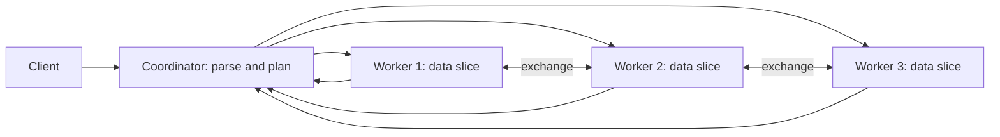

## 🎯 TL;DR

> An **MPP** (massively parallel processing) query engine splits one query across many machines. Each machine owns its own CPU, memory and disk (**shared-nothing**), and a **coordinator** plans the query, sends pieces to **workers**, and gathers the result.

- The speed comes from parallel scans, but the real cost is **moving data between nodes** during joins and aggregations.
- The **distribution key** decides where each row lives. A good key makes joins local; a bad key makes one node do all the work.
- Modern variants separate storage from compute, and add **runtime filters** and **resource groups** to keep big queries from starving small ones.

## 🌱 Start simple (Junior)

> **💡 Analogy:** Counting the votes of a big election. One clerk counts 10 million ballots alone: slow. Instead, 20 clerks each take a box of ballots, count their box, and a supervisor adds up the 20 totals. Each clerk has their own table, pen and box; nobody shares a desk. That is shared-nothing.

Suppose you want the total sales per product from 1 billion rows. A single machine reads all of them. An MPP engine with 4 workers does this:

```text
1. Coordinator receives: SELECT product, SUM(amount) FROM sales GROUP BY product
2. Each worker reads only its own slice of sales and computes partial sums
3. Workers send partial results (one row per product, not per sale) to the coordinator
4. Coordinator adds the partial sums and returns the final result
```

Two ideas to remember: **the work is split by data**, and **only small partial results travel**. When a query needs rows from different workers to meet (for example, a join on a key that is not where the data lives), the rows themselves must travel, and that is where MPP systems spend most of their time.

## 🔧 How it really works (Mid)

**Architecture.** A client sends SQL to the coordinator (also called frontend, leader or master, depending on the engine). The coordinator parses, optimizes and cuts the plan into **fragments**. Each fragment runs on many workers in parallel. Between fragments, data flows over the network through **exchange** operators (Greenplum calls them **motions**; Trino and StarRocks have exchanges and shuffles).



**Shared-nothing vs shared-disk.** In a **shared-disk** system (classic Oracle RAC style), every node reads the same disk array, so the disk becomes a bottleneck and needs a lock manager. In **shared-nothing**, each node owns a slice of data on its own disks; nodes only talk over the network. Shared-nothing scales almost linearly for scans, but adding nodes means moving data.

**Distribution.** Each table has a distribution policy:

| Policy | Where rows go | Use it for |
|---|---|---|
| Hash on key | `hash(key) mod workers` | Large fact tables, joined on that key |
| Random | Round-robin or random | Staging tables with no good key |
| Replicated | A full copy on every worker | Small dimensions (country, currency) |

Greenplum syntax, for example: `DISTRIBUTED BY (customer_id)` or `DISTRIBUTED REPLICATED`.

**Worked example: a join with numbers.** Table `orders` has 100 million rows, `customers` has 1 million rows, and there are 8 workers. The query joins them on `customer_id`.

- **Redistribute** both tables on `customer_id`: each worker sends the rows it does not own. About 7/8 of 100 million rows move, which is roughly **87.5 million rows over the network**, plus the customers.
- **Broadcast** the small table: every worker gets a full copy of 1 million customer rows. That is 8 × 1 million = **8 million rows moved**, and the big `orders` table never moves.

The optimizer chooses broadcast when the small side fits in memory on each worker, and redistribute when both sides are big. A **colocated** join is the best case: if both tables use the same distribution key, matching rows are already on the same worker and nothing moves.

**Pipeline execution.** Modern MPP engines process data in batches (vectorized) and stream them between operators, instead of finishing one stage before starting the next. Only **blocking** operators (building a hash table, a full sort) force the pipeline to wait for all input.

**Runtime filters.** When a hash join builds its hash table from a small dimension, the engine can send a compact summary of the join keys (a Bloom filter or a min–max range) to the scan of the big table. If a dimension filter keeps only 2 of 1,000 regions, the fact scan skips most blocks before reading them. Runtime filters are typically generated after the build side runs, so they help most when the join is selective.

**Queues and resource groups.** Several users share one cluster. Without limits, one heavy query takes all the memory and every other query fails or waits. Resource groups or queues cap concurrency, memory per query, and priority. Greenplum uses resource groups and queues, StarRocks and Trino have their own resource group settings.

## 🧠 Senior depth & trade-offs

- **Skew is the first failure mode.** A distribution key with 3 distinct values (for example `country`) spreads 16 segments into 3 busy ones and 13 idle ones. Check row counts per node (in Greenplum, `SELECT gp_segment_id, count(*) FROM t GROUP BY 1`) and the slowest-node time, not only the average.
- **Data movement is the cost model.** Count the bytes that cross the network in each Motion or exchange node, and read `EXPLAIN` before you tune anything else. A plan with one Redistribute Motion on a 2 TB table is a design problem, not a configuration problem.
- **Scaling out is not free.** Adding workers means redistributing existing data (Greenplum's expansion moves rows to the new segments). Storage-compute separation avoids this: data lives on object storage, and compute nodes are stateless and can be added or removed. The price is network reads and cache misses on the first query.
- **Failure handling.** Many MPP engines abort and restart the whole query when a worker fails, because the fragments depend on each other. Greenplum keeps mirror segments so that a failed primary fails over to its mirror, but a query running at that moment can still fail. Check the fault-tolerance features of your engine (for example, Trino's fault-tolerant execution) before promising "no interruption".
- **Concurrency vs latency.** One MPP query uses the whole cluster. Ten at once run at roughly a tenth of the speed each, plus overhead. Queues protect the dashboard that must answer in two seconds from the nightly report.
- **Engine differences you should know.** Greenplum is a coordinator plus segments, each segment a PostgreSQL instance. StarRocks has frontend (FE) and backend (BE) nodes, and a shared-data mode with separate compute nodes. ClickHouse has no central planner: the node that receives the query fans out to shards, and a distributed table maps across shards and replicas. Trino is a coordinator plus workers with no storage of its own; it reads through connectors.
- **When not to use MPP.** Many small point lookups per second, single-row updates with strict latency, or data small enough for one node. An MPP cluster's fixed overhead and data movement make it the wrong tool there; an OLTP database or a single-node analytical engine is simpler.

## 🧪 Try it

Use Greenplum. The `DISTRIBUTED BY` clause is Greenplum-specific, so plain PostgreSQL will reject it. Create two tables and read the plan.

```sql
CREATE TABLE orders (order_id bigint, customer_id bigint, amount numeric)
  DISTRIBUTED BY (customer_id);

CREATE TABLE customers (customer_id bigint, name text)
  DISTRIBUTED BY (customer_id);

EXPLAIN SELECT o.order_id, c.name
FROM orders o JOIN customers c USING (customer_id);
```

1. **Colocated join.** Look at the plan above. The join should not need a Redistribute or Broadcast Motion; the only motion should be the final Gather Motion that returns rows to the coordinator. Explain why.
2. **Change the key.** Recreate `orders` with `DISTRIBUTED BY (order_id)` and run the same `EXPLAIN`. Which motion appears, and on which side?
3. **Skew check.** Load 1 million rows into a table distributed by a column with 3 distinct values. Explain what you would see in per-segment row counts and why the query time follows the largest segment.

<details><summary>Show solutions</summary>

**1.** Both tables hash on `customer_id` with the same type, so a row from `orders` and its matching row in `customers` are on the same segment. The join runs locally on each segment. Only the final result is sent to the coordinator.

**2.** `orders` is no longer distributed by the join key, so its rows must be redistributed by `customer_id`. The plan shows a Redistribute Motion on the `orders` side (the `customers` side stays as it is, or is also moved, depending on the optimizer's choice). The shuffle now costs network traffic proportional to the size of `orders`.

**3.** The 3 distinct values hash to at most 3 segments, so most segments are empty and up to 3 hold everything. The query waits for the slowest segment, so the elapsed time follows the largest one, not the average. Fix the distribution key so it has many distinct values and no single value dominates.

</details>

## 💬 Interview corner

**Question: "How does an MPP database execute a join?"** Mid answer: "The coordinator plans the query, the workers scan their local data in parallel, and for the join they either broadcast the small table or redistribute both sides by the join key."

Senior answer: "It depends on the distribution. If both tables are distributed by the join key, the join is colocated and nothing moves. If one side is small, I broadcast it, and the cost is its size times the number of workers. Otherwise I redistribute both sides, and the cost is the bytes that cross the network. I check `EXPLAIN` to see which motion or exchange the optimizer picked, and I fix skew before I touch any configuration."

**Question: "Why is MPP fast for analytics but bad for OLTP?"** MPP parallelizes a scan over large data, which is what analytics needs. OLTP needs many small transactions with low latency, and each one pays coordination and data-movement overhead.

> **🎤 Say this in the interview:** "MPP is shared-nothing: each node owns a slice of data and works in parallel, and a coordinator stitches the results. Performance is decided by data movement, so the distribution key is the most important design choice. I'd colocate big tables on the join key, broadcast small dimensions, and watch skew per node."

## ⚠️ Common mistakes

> **⚠️ Watch out:** Distributing a fact table by a column with few values (status, country, a boolean). The cluster looks idle and one node is busy.

> **⚠️ Watch out:** Assuming "more workers means faster". Adding nodes to a query that is dominated by one Redistribute Motion mostly adds coordination overhead.

- Choosing the distribution key by primary key without asking how the tables are joined.
- Replicating a large table to every worker to avoid one shuffle, then running out of memory.
- Ignoring the plan and tuning memory settings when the real problem is a Motion that moves 2 TB.
- Treating a shared-nothing cluster as one big disk. Each node has its own capacity and its own failure.
- Running a nightly report and a dashboard in the same queue with no limits.
- Expecting an MPP engine to behave like an OLTP database for single-row updates.

## ✅ Check yourself (quiz)

1. What does "shared-nothing" mean in an MPP engine?
   - A) All nodes read from one shared disk array
   - B) Each node owns its CPU, memory and disk for its slice of data, and nodes communicate over the network
   - C) Nodes do not run queries, only the coordinator does
   - D) No data is stored on disk

<details><summary>Answer</summary>

**B** — each node owns a slice of the data and its own resources. Nodes exchange data over the network, which is why data movement dominates the cost of joins.

</details>

2. A query joins a 500 GB fact table with a 2 MB dimension table on 16 workers. Which strategy is most likely?
   - A) Redistribute both tables by the join key
   - B) Broadcast the dimension table to every worker
   - C) Send the fact table to the coordinator and join there
   - D) Replicate the fact table to every worker

<details><summary>Answer</summary>

**B** — 2 MB times 16 workers is 32 MB moved, which is tiny. Moving 500 GB, or copying it to every worker, would be far worse. Broadcast is the cheapest choice when the small side is really small.

</details>

3. What is a runtime filter for?
   - A) Removing duplicate rows before a join
   - B) Sending a summary of join keys from the build side to the probe-side scan, so non-matching rows are skipped early
   - C) Limiting the number of concurrent queries
   - D) Compressing the network traffic

<details><summary>Answer</summary>

**B** — when a small dimension filters the join, the engine ships its keys (as a Bloom filter or min–max range) to the big table's scan, which skips most data before reading it.

</details>

4. **(Senior)** The distribution key of a 5 TB fact table has only 4 distinct values, and the cluster has 32 workers. What happens and what should you change?

   - A) Nothing; more workers always balance the load
   - B) At most 4 workers hold all the data and the others sit idle, so the query runs at the speed of the busiest worker; choose a high-cardinality key that matches the main join
   - C) The table cannot be distributed at all
   - D) The fix is to replicate the table

<details><summary>Answer</summary>

**B** — rows hash to at most 4 workers, so the rest hold nothing. The elapsed time follows the busiest worker. A high-cardinality key that matches the main join gives both even spread and colocated joins.

</details>

5. **(Senior)** Why is storage-compute separation a trade-off and not a free upgrade?

   - A) Object storage cannot store SQL tables
   - B) Compute scales and restarts independently, but reads come over the network and the first query on a cold cache pays that latency
   - C) It requires one node per table
   - D) It removes the need for statistics

<details><summary>Answer</summary>

**B** — separating storage lets you scale and replace compute nodes freely, but every cold read goes over the network to object storage. Caches fix most of this for repeated queries, but the first run is slower.

</details>

## 🗂️ Flashcards

| Front | Back |
|---|---|
| Shared-nothing | Each node owns CPU, memory and disk for its data slice; nodes talk only over the network |
| Shared-disk | Nodes read one shared disk array; the disk and its locking become the bottleneck |
| Coordinator vs worker | Coordinator plans and gathers; workers scan and compute their local slice |
| Broadcast join | Copy the small table to every worker; cost is its size times the number of workers |
| Redistribute (shuffle) join | Re-hash both sides by the join key; cost is the bytes crossing the network |
| Colocated join | Both tables distributed by the same key; the join runs locally, nothing moves |
| Runtime filter | Join-key summary sent from the build side to the probe-side scan to skip rows early |
| Distribution skew | A key with few values puts most rows on few nodes; the query runs at the slowest node's speed |

## 🔗 Go further

- **[[columnar-storage]]** explains why the scans each worker does are cheap, and why column order matters.
- **[[sql-joins]]** covers the join types that MPP engines parallelize.
- **[[partitioning-sharding]]** is the general theory behind distribution keys; read it with this lesson.
- **[[spark-shuffle]]** shows the same data-movement idea in Spark, where the shuffle is the expensive step.
- **[[starrocks-doris]]**, **[[clickhouse]]** and **[[trino]]** apply these ideas to specific engines.
- **[[physical-modeling-olap]]** covers how to choose sort keys, distribution keys and partitions for an MPP table.
