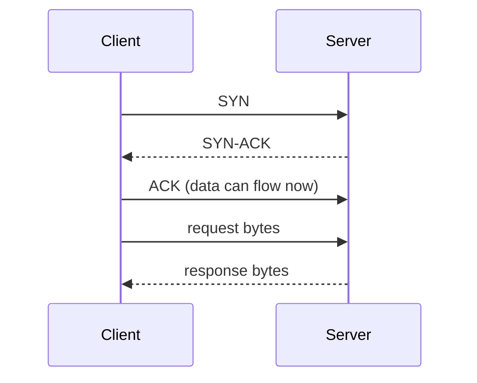

## 🎯 TL;DR

> Every data system is a set of machines talking over a network. Most design decisions are really decisions about **how many round trips** a request needs, **how reliable** the channel is, and **where** the machines are.

- **TCP** is reliable and ordered; **UDP** is fast and unordered. Pick by what your application can tolerate losing.
- **HTTP/HTTPS** is request/response on top of TCP (or QUIC). **TLS** adds encryption and costs extra round trips at connection setup.
- **DNS** turns names into IPs. Caching it (and its TTL) decides how fast failover is.
- **Latency** (time for one trip) and **bandwidth** (how much per second) are different limits. Long-distance TCP is often limited by latency, not by the link speed.
- **Connection reuse** (keep-alive, pooling) removes the setup cost from every request.

## 🌱 Start simple (Junior)

> **💡 Analogy:** Sending a letter versus a phone call. A letter (UDP) is quick to send, but it may get lost and arrive out of order. A phone call (TCP) first needs a "hello, can you hear me?" exchange, then both sides confirm every sentence. Calling takes longer to start, but you know what was heard.

Every program that talks over the network uses an **IP address** (which machine) and a **port** (which program on that machine). Port 443 is usually HTTPS, port 5432 is PostgreSQL, port 9092 is Kafka's default broker port.

You can see this from the shell:

```bash
dig +short example.com          # DNS: name -> IP address
nc -vz example.com 443          # is TCP port 443 open?
curl -sI https://example.com    # HTTP headers over TLS
```

The simplest network program in Python: open a TCP connection and send a request.

```python
import socket

with socket.create_connection(("example.com", 80), timeout=5) as s:
    s.sendall(b"GET / HTTP/1.1\r\nHost: example.com\r\nConnection: close\r\n\r\n")
    reply = s.recv(200)
    print(reply.split(b"\r\n")[0])   # e.g. b'HTTP/1.1 200 OK'
```

`create_connection` does the TCP handshake for you. Everything after that is bytes in, bytes out.

## 🔧 How it really works (Mid)

### The layers you need

| Layer (OSI) | What it does | Examples |
|---|---|---|
| 7 Application | the protocol your program speaks | HTTP, gRPC, Kafka protocol, SQL |
| 6 Presentation / 5 Session | encoding and encryption, session handling | TLS (often placed between 4 and 7) |
| 4 Transport | ports, reliability, ordering | TCP, UDP |
| 3 Network | addresses and routing | IP |
| 1–2 Link | frames on one physical network | Ethernet, Wi-Fi |

You do not need every layer memorized. In design interviews, think in three: **IP** finds the machine, **port + TCP/UDP** finds the program and the delivery rules, **application protocol** defines the messages.

### TCP: reliable, ordered, connection-based

A TCP connection starts with a **three-way handshake**:



That is one round trip (RTT) before any data. TCP numbers every byte, retransmits lost segments, and slows down when the network is congested. The price: setup costs a round trip, and head-of-line blocking can delay later data behind a lost packet.

### UDP: fast, no guarantees

UDP sends datagrams with no handshake, no retransmit and no ordering. It is used for DNS queries, video, metrics shipped as fire-and-forget (StatsD), and as the base of QUIC (HTTP/3). If your application needs a guarantee, you build it yourself on top, which is exactly what QUIC does.

### HTTP, TLS and what they cost

HTTP is a request/response protocol. With **HTTP/1.1** one connection carries one request at a time (pipelining is rarely used). **HTTP/2** multiplexes many streams on one TCP connection. **HTTP/3** runs over QUIC on UDP and avoids TCP head-of-line blocking.

HTTPS adds TLS. A TLS 1.3 handshake takes one extra round trip after TCP is up, so a fresh HTTPS request costs about **2 RTTs** before the first byte of the request is sent (TCP 1 RTT + TLS 1 RTT). Session resumption can reduce that for repeat connections.

Worked example, with a 50 ms round trip:

```text
fresh HTTPS request:   TCP 50 ms + TLS 50 ms + request/response 50 ms = 150 ms
same request on a reused connection:   request/response 50 ms = 50 ms
```

Multiply the difference by a million requests per hour and the reason for keep-alive is clear.

### Keep-alive and connection pooling

HTTP keep-alive keeps the TCP and TLS connection open after a response. A **connection pool** keeps a set of open connections to a server and hands them out to requests. Database drivers, HTTP clients and Kafka clients all do this.

```python
import http.client, time

HOST = "example.com"

def one_fresh_request() -> float:
    t = time.perf_counter()
    c = http.client.HTTPSConnection(HOST, timeout=5)   # new TCP + TLS every time
    c.request("GET", "/")
    c.getresponse().read()
    c.close()
    return time.perf_counter() - t

def reused_requests(n: int = 5) -> list[float]:
    c = http.client.HTTPSConnection(HOST, timeout=5)   # one connection, many requests
    times = []
    for _ in range(n):
        t = time.perf_counter()
        c.request("GET", "/")
        c.getresponse().read()
        times.append(time.perf_counter() - t)
    c.close()
    return times

if __name__ == "__main__":
    print("fresh:", round(one_fresh_request(), 3), "s")
    print("reused:", [round(x, 3) for x in reused_requests()])
```

Run it and compare: the first reused request is slower than the rest, and the fresh ones include setup. The exact numbers depend on your network.

### DNS

DNS maps names to IPs through a hierarchy: the resolver asks root, then the top-level domain, then the authoritative server for the name. Answers are cached for the **TTL** (time to live) set by the owner. A low TTL means fast failover after an IP change but more DNS queries. Clients may cache longer than the TTL, which is why a failover can take minutes.

```bash
dig kafka.internal A +noall +answer     # IP records and their TTL (the number in the second column)
```

### L4 vs L7 load balancing

- **L4** (transport) balances TCP or UDP connections by IP and port. It is fast and simple, and does not look inside the request.
- **L7** (application) reads HTTP: host, path, headers, cookies. It can route `/api` to one service and `/static` to another, do TLS termination, and retry idempotent requests.

L4 is enough for a database cluster behind a virtual IP. L7 is what you want for an HTTP API with several services.

### gRPC and WebSocket

**gRPC** runs on HTTP/2, uses Protocol Buffers for compact typed messages and supports streaming in both directions. It is common for service-to-service calls.

**WebSocket** starts as an HTTP request with an `Upgrade` header, then becomes a long-lived two-way channel. It suits push updates to browsers. It is not a good fit for bulk data transfer between backends.

### Bandwidth vs latency

Bandwidth is how many bits per second the link carries. Latency is how long one bit takes to arrive. They limit different things. For a single TCP stream, throughput is roughly `window / RTT`, because the sender can have only one window of unacknowledged data in flight.

Example: a classic 64 KB TCP window and a 100 ms RTT give about `65536 B / 0.1 s ≈ 655 KB/s` (about 5 Mbit/s) for one stream, even on a 1 Gbit/s link. Window scaling, several parallel streams or larger batches are the fixes.

## 🧠 Senior depth & trade-offs

- **Cross-datacenter replication is a latency budget.** Synchronous replication across regions with a 100 ms RTT and two sequential round trips per commit adds about 200 ms to every write. Asynchronous replication removes that cost and adds a replication lag you must monitor. This is the practical side of [[cap-theorem]] and PACELC.
- **Cost of TLS and connection churn.** Creating a TLS connection costs CPU as well as RTTs. A service that opens a new connection per request under load can run out of ephemeral ports (`TIME_WAIT` sockets) and spend CPU on handshakes. Pool connections and watch the count of `TIME_WAIT` and open sockets (`ss -s`).
- **Pools need limits.** A pool without a maximum size hides a slow downstream, and a pool sized too small queues requests. Set a maximum, a checkout timeout and a connection lifetime shorter than any load balancer's idle timeout, or you will meet "connection reset" errors that only happen at night.
- **Timeouts are a design decision.** Every hop needs a connect timeout, a read timeout and a total deadline. Without them a stuck dependency stalls the whole chain. Retries multiply load: three retries at each of three layers means up to 27 attempts for one user request.
- **Head-of-line blocking.** HTTP/2 fixes it at the HTTP level but still uses one TCP connection, so one lost packet blocks all streams. HTTP/3 avoids this. Know the difference when a question mentions mobile networks with packet loss.
- **Observability.** Track connection setup time, RTT (`ping`, or application histograms), retransmissions (`ss -ti`, `netstat -s`) and DNS resolution time. Many "the database is slow" incidents are DNS or connection-setup problems.
- **When not to use what.** Do not use UDP for data you cannot lose without an application-level recovery plan. Do not put a WebSocket in front of a batch job. Do not use L7 balancing for raw database traffic that needs TCP-level connection handling.

## 🧪 Try it

1. Use `dig` to find the IP and TTL of a public hostname. Run it twice within the TTL and explain what changes (or does not).
2. Modify the Python `socket` example to print the time taken by `create_connection`. Run it 5 times. Why is the first call usually the slowest?
3. **Design check:** a service in Tehran calls a database in Frankfurt with a 70 ms RTT. Each request needs 3 round trips to the database. What is the minimum added latency per request, and what would you change?

<details><summary>Show solutions</summary>

**1.** `dig +noall +answer example.com A` shows the TTL in seconds in the second column. A second query within the TTL returns the cached answer, and the TTL counts down. Your resolver's cache, not the authoritative server, answers it.

**2.** The first call includes the DNS lookup done inside `create_connection` and the TCP handshake. Later calls to the same host can reuse a resolver cache, but a new TCP connection still costs one RTT. Keeping the socket open would remove that cost; each new `create_connection` pays it again.

**3.** Minimum added latency is `3 × 70 ms = 210 ms` per request, before any server work. Options: batch the queries into one round trip, move the read path closer (a replica in the region, or a cache), or make the calls concurrent where they are independent. The point is to reduce round trips, not to tune the server first.

</details>

## 💬 Interview corner

**Question: "Why does a single request sometimes take much longer than the server's processing time?"** Mid answer: "Network round trips: DNS, TCP handshake, TLS handshake, then the request. Connection reuse removes most of the setup." Senior answer: "I would break the latency into DNS, connect, TLS, time to first byte and transfer, and find which one dominates. If it is setup, I would add pooling or keep-alive and check the TTL and the load balancer's idle timeout. If it is the first byte, the server or a dependency is slow."

**Question: "L4 or L7 load balancer?"** Mid: "L7 if I need routing by path or headers; L4 for raw TCP and speed." Senior: "L4 if I need the lowest overhead for a TCP service like a database proxy and TLS passthrough. L7 for HTTP APIs that need path routing, retries and per-route metrics. I would mention that L7 terminates connections, so it adds a hop and a bottleneck that needs scaling."

**Question: "Why is my cross-region link slow even with a 10 Gbit connection?"** Senior: "Throughput of one TCP stream is about window divided by RTT. At 100 ms RTT, the window limits the stream long before the link does. I would use multiple parallel connections, enable window scaling, or batch the transfer."

> **🎤 Say this in the interview:** "I count round trips first. TCP plus TLS costs about two RTTs before a request, so I pool and reuse connections. For cross-region traffic I budget latency per hop, set timeouts on every call, and choose asynchronous replication when the latency budget cannot afford synchronous commits."

## ⚠️ Common mistakes

> **⚠️ Watch out:** Confusing bandwidth with latency. A faster link does not make one round trip shorter. A 1 Gbit/s link with 300 ms RTT still answers each request in at least 300 ms.

- Opening a new connection for every query or request, then blaming the database.
- Setting DNS TTL to a very high value and expecting a quick failover.
- Forgetting timeouts, so one dependency stalls all threads.
- Retrying at every layer, which multiplies load during an outage.
- Assuming UDP is "faster TCP" and using it for data that must not be lost.
- Using `ping` alone to judge application latency; TLS and the server's own time are not included.

## ✅ Check yourself (quiz)

1. What does a TCP three-way handshake cost before the first request byte can be sent?
   - A) No cost; the request is sent with the SYN
   - B) One round trip (RTT)
   - C) Two round trips
   - D) It depends only on bandwidth

<details><summary>Answer</summary>

**B** — the client sends SYN, the server replies SYN-ACK, and the client's ACK can carry the first data. That is one RTT before the request is useful. The next request on the same connection needs no handshake.

</details>

2. A TLS 1.3 handshake is added to a new HTTPS connection. Roughly how much extra latency does it add on a 60 ms RTT path?
   - A) 0 ms, TLS is asynchronous
   - B) About 60 ms (one RTT)
   - C) About 240 ms
   - D) About 6 ms

<details><summary>Answer</summary>

**B** — TLS 1.3 takes one round trip for a full handshake, so about 60 ms on top of TCP's 60 ms. Resumption can reduce this further. Option C would apply to an older, multi-round-trip handshake.

</details>

3. Which choice best matches "the query needs every row of a stream in order, and retransmission is acceptable"?
   - A) UDP with no retries
   - B) TCP
   - C) ICMP
   - D) Raw IP packets

<details><summary>Answer</summary>

**B** — TCP provides ordered, reliable delivery. UDP would require building retransmission and ordering yourself. ICMP is for control messages such as ping, and raw IP gives no reliability.

</details>

4. **(Senior)** A service in Tehran calls a database in Frankfurt with a 70 ms RTT, and the code opens a new connection for each of 3 sequential queries per request. What is the main latency fix, and what is its risk?
   - A) Use UDP for the queries
   - B) Pool and reuse connections, and reduce the number of sequential round trips (batch or parallelize); the risk is pool exhaustion or stale connections if limits and lifetimes are not set
   - C) Increase the DNS TTL to 86400
   - D) Remove TLS to save the handshake

<details><summary>Answer</summary>

**B** — a pool removes the connect and TLS cost per query, and batching reduces the RTT count. The risk is exhausting the pool or using connections that a firewall or load balancer has already closed; set a maximum size, a checkout timeout and a lifetime. Removing TLS (D) is a security mistake, and a high TTL (C) does not change latency.

</details>

5. **(Senior)** Why can a single TCP stream on a long, high-bandwidth link stay far below the link speed?
   - A) Because TCP is limited to 10 Mbit/s
   - B) Because a single stream can have only about one receive window in flight per RTT, so throughput is roughly window / RTT
   - C) Because UDP is faster on all links
   - D) Because DNS caches the wrong IP

<details><summary>Answer</summary>

**B** — the sender can have at most one window of unacknowledged data outstanding, so the rate is limited by window / RTT. Window scaling, several parallel streams or batching raise the effective rate.

</details>

## 🗂️ Flashcards

| Front | Back |
|---|---|
| TCP vs UDP | TCP: reliable, ordered, connection-based; UDP: no handshake, no retransmit, no ordering |
| Cost of a new HTTPS request | About 2 RTTs before the request is sent (TCP + TLS 1.3) |
| What is keep-alive for? | Reusing an open TCP/TLS connection for many requests, removing setup cost |
| What does DNS TTL control? | How long resolvers cache an answer; it sets how fast a change propagates |
| L4 vs L7 load balancer | L4 balances TCP/UDP by IP and port; L7 routes by HTTP content |
| HTTP/2 vs HTTP/3 | HTTP/2 multiplexes on one TCP connection; HTTP/3 runs on QUIC over UDP |
| Bandwidth vs latency | Bandwidth: bits per second; latency: time for one trip. Long RTT limits single-stream throughput |
| What is WebSocket for? | Long-lived two-way channel started by an HTTP upgrade, good for pushing updates |

## 🔗 Go further

- **distributed-fundamentals** builds on latency and failures: what a network partition does to the guarantees of a distributed system.
- **kafka-architecture** shows how producers and consumers use connections and pooling against brokers.
- **linux-shell** covers `ss`, `dig`, `nc` and `curl` for checking the network from a server.
- [[cap-theorem]] explains the consistency trade-off behind cross-region replication.
- Read the RFC summaries for TCP (RFC 9293) and TLS 1.3 (RFC 8446) when you need exact details; the diagrams above are simplified.
