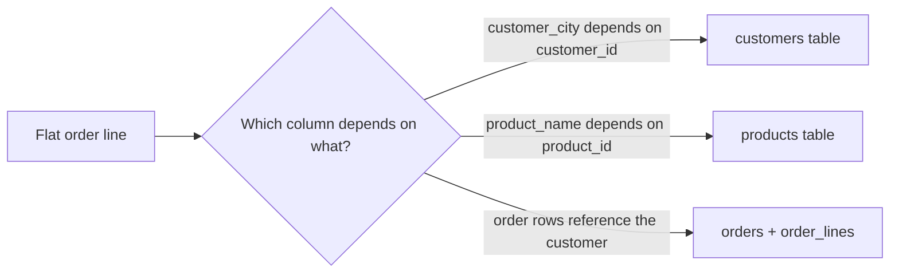

## 🎯 TL;DR

> **Normalization** stores each fact **once**, in the table that owns it. That prevents update, insert and delete anomalies. **Denormalization** repeats data on purpose so that reads need fewer joins.

- OLTP systems (orders, payments) are usually normalized to 3NF or BCNF, because they change constantly and must stay consistent.
- Analytical systems (warehouses, lakehouses) denormalize into star schemas, because they scan huge volumes and rarely update single rows.
- The normal forms are a checklist of **dependencies**: 1NF (atomic values), 2NF (no partial dependency), 3NF (no transitive dependency), BCNF (every determinant is a key).

## 🌱 Start simple (Junior)

> **💡 Analogy:** Imagine a chat app that copies your friend's full name, phone number and city into every single message. When the friend moves to another city, you must edit thousands of messages. A normal app stores the friend once, in a contact list, and each message points to that contact. Change the contact once and every message shows the new city.

That is normalization: **one fact, one place**.

Here is a flat table that breaks this rule. Each row is one order line:

```sql
CREATE TABLE order_lines_flat (
  order_id      int,
  line_no       int,
  customer_id   int,
  customer_name text,
  customer_city text,
  product_id    int,
  product_name  text,
  qty           int,
  PRIMARY KEY (order_id, line_no)
);

INSERT INTO order_lines_flat VALUES
 (1, 1, 10, 'Ali',  'Tehran', 100, 'Keyboard', 1),
 (1, 2, 10, 'Ali',  'Tehran', 101, 'Mouse',    2),
 (2, 1, 10, 'Ali',  'Tehran', 100, 'Keyboard', 1),
 (3, 1, 11, 'Sara', 'Shiraz', 101, 'Mouse',    1);
```

"Ali from Tehran" is written three times. This causes three kinds of trouble, called **anomalies**:

| Anomaly | What goes wrong here |
|---|---|
| Update | Ali moves to Isfahan. You must update every row for Ali, and one missed row leaves two cities for the same customer. |
| Insert | You want to register a new product (a monitor) before anyone orders it. You cannot, because products exist only inside order lines. |
| Delete | The last order that contains `Mouse` is cancelled. The product's name and id disappear with it. |

## 🔧 How it really works (Mid)

Normalization is driven by **functional dependencies**. We write `A → B` ("A determines B") when one value of A always gives the same value of B. In the flat table, `customer_id → customer_name` and `product_id → product_name`.

Each normal form forbids one kind of dependency problem:

- **1NF:** every column holds one atomic value. No lists such as `'Keyboard, Mouse'` in one cell, and no repeated columns `item1, item2, item3`.
- **2NF:** 1NF, and no **partial dependency**. A non-key column depends on only part of a composite key. If the key were `(order_id, product_id)`, then `product_name` would depend only on `product_id` and must move out.
- **3NF:** 2NF, and no **transitive dependency**. `order_id → customer_id → customer_city`: a non-key column depends on another non-key column. Move the customer attributes to a `customers` table.
- **BCNF:** a stricter 3NF. Every determinant (every left-hand side of a dependency) must be a candidate key. It matters when a table has several overlapping candidate keys. For most OLTP work, 3NF is enough.

The decomposition of the example:

```sql
CREATE TABLE customers (
  customer_id   int PRIMARY KEY,
  customer_name text NOT NULL,
  customer_city text NOT NULL
);

CREATE TABLE products (
  product_id   int PRIMARY KEY,
  product_name text NOT NULL
);

CREATE TABLE orders (
  order_id    int PRIMARY KEY,
  customer_id int NOT NULL REFERENCES customers (customer_id)
);

CREATE TABLE order_lines (
  order_id   int REFERENCES orders (order_id),
  line_no    int,
  product_id int REFERENCES products (product_id),
  qty        int NOT NULL,
  unit_price numeric(10,2) NOT NULL,  -- price at the time of sale
  PRIMARY KEY (order_id, line_no)
);
```

Notice `unit_price` in `order_lines`. Many designs also keep a current price in `products`, but the price charged last month is a **historical fact**. It cannot be recomputed from today's price, so it is stored with the sale. Normalization removes redundant copies of the *same* fact; it never removes history.



Keep the join count in mind. A normalized query for "revenue by city" needs three joins: `order_lines`, `orders` and `customers`. That is cheap in OLTP with indexes, and it is one reason analysts ask for flatter tables.

## 🧠 Senior depth & trade-offs

- **Why analytics denormalizes.** A warehouse answers questions like "revenue by city by month" across billions of rows. Joins between large tables need shuffles in distributed engines such as Spark or Trino (see [[shuffle]]). A star schema (one fact table and a few wide dimensions) keeps most queries to one large scan with small joins. Columnar formats make wide tables cheap to scan, because only the queried columns are read.
- **The price you pay.** Duplicated data must be kept in sync. The ETL or ELT pipeline has to update the copies when the source changes, and history patterns such as [[scd]] define what "current" means. A denormalized table that nobody maintains becomes silently wrong.
- **Storage is rarely the real cost.** Object storage is cheap. The real costs are write amplification (rewriting many rows when one dimension attribute changes) and correctness.
- **Lakehouse tables.** Table formats such as Iceberg and Delta support `MERGE`, but rewriting many data files to change one customer's city is expensive. Decide the dimension's update frequency together with its grain.
- **When not to denormalize.** Keep the system of record normalized, especially for many-to-many relations (a product in several categories) and for wide data that changes often. Denormalize at the consumption layer, not in the system that receives the writes.
- **Measure, do not guess.** Look at the query plan. If joins dominate and the data fits, a flatter table or a pre-joined mart is often right. If the table receives writes, normalize first.

## 🧪 Try it

Given this table with key `(order_id, product_id)`:

| order_id | product_id | product_name | product_category | qty |
|---|---|---|---|---|
| 1 | 100 | Keyboard | Peripherals | 1 |
| 1 | 101 | Mouse | Peripherals | 2 |
| 2 | 100 | Keyboard | Peripherals | 1 |

1. Name the functional dependencies you see.
2. Which normal form is violated, and by which columns?
3. Write a decomposition that fixes it.

<details><summary>Show solution</summary>

1. `product_id → product_name`, `product_id → product_category`, and `(order_id, product_id) → qty`.
2. 2NF is violated: `product_name` and `product_category` depend only on `product_id`, which is part of the composite key. Once that partial dependency is removed, the remaining columns have no transitive dependency, so 3NF holds.
3. A `products(product_id, product_name, product_category)` table and an `order_items(order_id, product_id, qty)` table.

</details>

## 💬 Interview corner

**Question: "Explain 1NF, 2NF and 3NF."** Mid answer: "1NF means atomic values, 2NF removes partial dependencies on a composite key, and 3NF removes dependencies between non-key columns." Senior answer adds the reason: "Each step removes one class of update anomaly. I normalize OLTP sources to 3NF, and I accept some duplication in the warehouse because the workload is read-heavy and append-heavy."

**Question: "Why would you denormalize a data warehouse?"** Mid: "To reduce joins for analytics." Senior: "To cut join cost and keep queries simple for BI tools, at the cost of duplicated data that the pipeline must keep consistent. I would also state the grain, the update frequency of each dimension, and how history is kept."

> **🎤 Say this in the interview:** "I normalize where data is written, to protect consistency, and denormalize where data is read, to make analysis cheap. The decision depends on who writes and who reads."

## ⚠️ Common mistakes

> **⚠️ Watch out:** Normalization does not mean "as many tables as possible." Over-splitting adds joins without saving any anomaly. Stop when every fact is stored once and every column depends on the key.

> **⚠️ Watch out:** Denormalizing an OLTP database because "joins are slow" usually creates update anomalies, which show up later as wrong numbers.

- Confusing 3NF with BCNF. They differ only when a table has several overlapping candidate keys.
- Removing historical values (such as the price at sale time) because they look like duplicates of the current price.
- Copying dimension attributes into a fact table and forgetting that they change over time.
- Assuming denormalized tables are always faster. Wide tables with heavy updates can be slower.

## ✅ Check yourself (quiz)

1. A customer changes address. You must update 40 000 rows, and you miss one. Which anomaly is this?
   - A) Insert anomaly
   - B) Update anomaly
   - C) Delete anomaly
   - D) Referential anomaly

<details><summary>Answer</summary>

**B** — the same fact is stored in many rows, so one change must be applied everywhere. A missed row leaves conflicting values.

</details>

2. In a table with key `(order_id, product_id)`, the column `product_name` depends only on `product_id`. Which normal form is violated?
   - A) 1NF
   - B) 2NF
   - C) 3NF
   - D) BCNF only

<details><summary>Answer</summary>

**B** — this is a partial dependency: a non-key column depends on part of a composite key. Moving `product_name` to a `products` table fixes it.

</details>

3. Which of these is a **transitive** dependency?
   - A) `order_id → customer_id`
   - B) `order_id → customer_id → customer_city`
   - C) `(order_id, line_no) → qty`
   - D) `product_id → product_name`

<details><summary>Answer</summary>

**B** — `customer_city` depends on `customer_id`, which depends on `order_id`. A non-key column depends on another non-key column. Options A, C and D are direct dependencies on a key.

</details>

4. **(Senior)** Your OLTP `order_lines` table stores `unit_price`, and `products` also has a `price`. A teammate says the copy in `order_lines` violates normalization and must go. What do you answer?
   - A) They are right; keep one price in one table
   - B) Keep it: `order_lines.unit_price` is a historical fact, the price at the moment of sale. `products.price` changes over time and cannot recreate past revenue
   - C) Remove `products.price`, because that is the duplicate
   - D) Store the price in the `customers` table

<details><summary>Answer</summary>

**B** — normalization removes redundant copies of the same, current fact. A price charged at a point in time is a different fact. Removing it would make historical revenue wrong after the next price change.

</details>

5. **(Senior)** Why is a star schema usually faster for BI dashboards than a 3NF schema on the same engine, and what does it cost?
   - A) It uses less storage on every engine
   - B) It needs fewer joins per query on large tables; the cost is duplicated data that the pipeline must keep consistent
   - C) It removes the need for indexes and statistics
   - D) It makes writes faster

<details><summary>Answer</summary>

**B** — the fact table joins directly to a few dimensions instead of a chain of normalized tables. The trade-off is duplication, plus ETL logic that keeps the copies correct.

</details>

## 🗂️ Flashcards

| Front | Back |
|---|---|
| Normalization | Storing each fact once, split into tables by dependency, to prevent anomalies |
| Update anomaly | The same fact sits in many rows; a change reaches some rows but not all |
| 2NF | 1NF plus no partial dependency on part of a composite key |
| 3NF | 2NF plus no transitive dependency (non-key depends on non-key) |
| BCNF | Every determinant is a candidate key |
| Denormalization | Repeating data on purpose to reduce joins for reads |
| Functional dependency | `A → B`: one value of A always determines one value of B |
| Why OLTP normalizes | Writes must stay consistent, so each fact changes in exactly one place |

## 🔗 Go further

- `dimensional-modeling`: how denormalized star schemas are designed on purpose.
- `oltp-vs-olap`: why the two workloads need different shapes.
- `physical-modeling-olap`: partitioning, sorting and clustering in analytical engines.
- `star-snowflake-obt`: trade-offs between star, snowflake and one-big-table designs.
