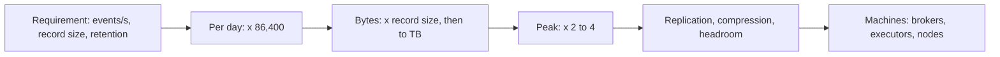

## 🎯 TL;DR

> **Back-of-envelope estimation** turns a product requirement into **orders of magnitude** (powers of ten) in a few minutes. You do not need exact numbers; you need enough accuracy to pick the right design and the right number of machines.

- A day has **86,400 seconds, which is about 10⁵**. Use it to convert "events per second" into "events per day" and back.
- Memory is roughly **1,000× faster** than an SSD random read, and an SSD random read is roughly **100× faster** than an HDD seek. Latency gaps decide designs.
- Per-component throughput (a Kafka broker, a Spark core, a ClickHouse node) and compression ratios turn bytes into machine counts.
- Always state your assumptions, multiply by **peak** and **replication**, and sanity-check the result.

## 🌱 Start simple (Junior)

> **💡 Analogy:** Before you buy groceries for a month, you do quick mental math: "5 people, 3 meals a day, 30 days, so about 450 meals." You do not count every grain of rice. Estimation works the same way: round the inputs to the nearest power of ten and keep the arithmetic simple.

**Order of magnitude** means "how many zeros". 9,000 and 12,000 are both "about 10⁴". That is precise enough to choose between "one server" and "a cluster of 50".

Three kinds of numbers cover most interview estimates:

1. **Time.** One day is 86,400 s ≈ 10⁵ s. One year is 365 × 86,400 = 31,536,000 s ≈ 3 × 10⁷ s.
2. **Size.** KB = 10³ bytes, MB = 10⁶, GB = 10⁹, TB = 10¹², PB = 10¹⁵. Use decimal units for estimates.
3. **Speed.** How long things take and how fast they move. The table below is the reference.

Latency reference (rules of thumb, order of magnitude only; real numbers vary by hardware and generation):

| Operation | Rule of thumb |
|---|---|
| Main memory reference | ~100 ns |
| SSD random read (4 KB) | ~100 µs |
| HDD seek | ~10 ms |
| Read 1 MB sequentially from SSD | ~1 ms (≈ 1 GB/s) |
| Network round trip inside one datacenter | ~0.5 ms |
| Send 1 MB over a 1 Gbps link | ~8 ms (1 Gbps ≈ 125 MB/s) |

To feel the gaps, pretend one nanosecond is one second. Then a memory reference takes about **2 minutes**, an SSD random read about **a day**, and an HDD seek about **4 months**. This is why random disk access is the thing to avoid.

## 🔧 How it really works (Mid)

Good estimates follow the same path every time:

**Unit conversion (the most common mistake).** Network speed is in **bits**: 1 Gbps ≈ 125 MB/s, so 10 Gbps ≈ 1.25 GB/s. Disk and storage are in **bytes**. Always convert before comparing.

**Daily volume from a rate.** 1 TB/day is 10¹² bytes / 86,400 s ≈ 1.16 × 10⁷ B/s, so **about 12 MB/s on average**. Try it the other way: 1,000 events/s × 86,400 s ≈ 8.6 × 10⁷ events/day, so about **10⁸ events a day**.

Planning throughputs (rules of thumb to replace with your own benchmark):

| Component | Planning number | What it depends on |
|---|---|---|
| Kafka broker | ~100 MB/s sustained writes | acks, replication factor, disks, message size |
| Kafka partition | ~10 MB/s | one partition is ordered and read by one consumer in a group |
| Spark core | ~30 MB/s for read + parse + write | file format, codec, transformations, shuffles |
| ClickHouse node | hundreds of MB/s to a few GB/s scanned | core count, compression, query shape |
| Record size | JSON event ~0.5–1 KB; telco CDR ~300 B | field count, text vs binary |
| Compressed columnar storage | ~5× smaller than raw CSV | cardinality; repetitive columns compress much better |

A **planning** number is a starting point. The skill is to show the assumption, then say "I would measure this with a load test."

## 🧠 Senior depth & trade-offs

- **Peak, not average.** Traffic is uneven. Use a peak-to-average factor of 2–4 for daily cycles and bursts. Capacity planned on the average fails at lunchtime.
- **Replication multiplies writes.** A Kafka topic with replication factor 3 is written three times across the cluster (leader plus two followers). Object storage hides this from you, but HDFS-style storage charges you 3× in disk.
- **Headroom.** Plan for 50–70% utilisation of the planning number so that one failed broker or node does not push the rest into saturation. Kafka partition counts also cap consumer parallelism: a consumer group cannot use more active consumers than partitions.
- **Spark parallelism.** Input splits and shuffle partitions set the number of tasks. Even a huge cluster is idle if the data arrives as one large, unsplittable file (see the [[data-formats]] lesson).
- **Small files multiply cost.** Ten million 100 KB files need ten million metadata operations and task launches even though the total is only about 1 TB. Compaction matters more than raw bandwidth here, see [[small-files]].
- **Cloud limits.** Object stores have request-rate limits per prefix as well as bandwidth limits. Check your provider's current documentation; do not assume a number from memory.
- **When NOT to estimate this carefully.** If the answer changes the design (one broker vs ten, Parquet vs a row store, batch vs streaming), a 2× error does not matter. Do not spend time on three significant digits.

**Sanity check.** Your estimate should land within a factor of about 3 of a known system. If your arithmetic says a 1 MB/s workload needs 200 Kafka brokers, the arithmetic is wrong.

## 🧪 Try it

**Exercise 1.** A service emits 2,000 events/s, each 500 bytes. How much data per day, and per 30 days?

Show solution

Events per day: 2,000 × 86,400 = 1.728 × 10⁸. Bytes per day: 1.728 × 10⁸ × 500 = 8.64 × 10¹⁰ B = **86.4 GB/day**. Thirty days: 86.4 GB × 30 ≈ 2,600 GB ≈ **2.6 TB**.

**Exercise 2.** A cluster ingests 500 MB/s and every write is replicated 3 times. What is the cluster-wide write rate, and how many brokers at ~100 MB/s each?

Show solution

500 × 3 = **1,500 MB/s** of disk writes across the cluster. At ~100 MB/s per broker: 1,500 / 100 = 15 brokers. With 60% utilisation as the target: 1,500 / 0.6 = 2,500 MB/s of capacity, so 2,500 / 100 = **25 brokers**. The gap between 15 and 25 is the headroom decision you should explain out loud.

**Exercise 3 (the full practice).** You receive **3 TB/day of call detail records (CDRs)**. Estimate: Kafka partitions, Kafka brokers, one-year Parquet storage, and Spark executors to process one day within one hour. Assume an average record of 300 bytes, a 3× peak-to-average factor, Parquet at 5× compression, replication 3 on HDFS-style storage, 10 MB/s per Kafka partition, 100 MB/s per broker, 5 cores per executor at 30 MB/s per core.

Show solution

**Rates.** Average: 3 × 10¹² / 86,400 ≈ 3.5 × 10⁷ B/s ≈ **35 MB/s**. (Shortcut: 3 × 10¹² / 10⁵ = 30 MB/s, about 15% low, fine for planning.) Peak: 35 × 3 ≈ **104 MB/s**. Records: 3 × 10¹² / 300 = 10¹⁰ per day, which is 10¹⁰ / 86,400 ≈ **116,000 records/s average**, about 350,000/s at peak.

**Partitions.** 104 / 10 = 10.4, round up to 11, then pick **12** (divides evenly across 6 brokers and leaves room for consumers).

**Brokers.** Each byte is written three times: 104 × 3 ≈ 312 MB/s replicated writes at peak. At 100 MB/s per broker that is 3.1, so 4 brokers minimum. At 60% utilisation: 312 / 0.6 = 520 MB/s capacity, which is 5.2 → **6 brokers**.

**One-year storage.** Raw: 3 TB × 365 = 1,095 TB ≈ 1.1 PB. Parquet at 5×: 1,095 / 5 ≈ **219 TB**. With HDFS-style replication 3: 219 × 3 ≈ **657 TB**. On object storage, the provider's durability replaces that factor, so plan for about 219 TB plus the provider's billing model.

**Spark executors.** To finish one day in one hour: 3 × 10¹² / 3,600 ≈ 8.3 × 10⁸ B/s ≈ 833 MB/s. One executor does 5 × 30 = 150 MB/s, so 833 / 150 ≈ 5.6 → **6 executors**. With 2× headroom for skew and retries: **12 executors**.

## 💬 Interview corner

**Question: "How many Kafka partitions would you use for this stream?"**

- **Mid answer:** "I'd divide the peak throughput by the throughput one partition can handle, and round up. Then I'd pick a number that divides evenly across the brokers."
- **Senior answer:** "I'd start with peak MB/s and records/s, not the average. I'd size partitions from measured per-partition throughput, then check consumer parallelism and the number of brokers the replicas need. Partitions are hard to reduce later, so I'd err slightly high and say so."

> **🎤 Say this in the interview:** "I'll state the assumptions first, then do the arithmetic in powers of ten. A day is about 10⁵ seconds, so I convert the average rate, multiply by a peak factor of about 3, and multiply writes by the replication factor. I check the answer against the planning throughput per broker and partition, and I say which numbers I would measure before buying hardware."

## ⚠️ Common mistakes

> **⚠️ Watch out:** Gbps and GB/s differ by 8×. A "10 Gbps link" carries about 1.25 GB/s, not 10 GB/s.

- Using the average and forgetting the peak. Capacity planned on the average fails at the busiest hour.
- Forgetting replication: 500 MB/s of ingest is 1,500 MB/s of disk writes with RF = 3.
- Mixing up bits and bytes, or MB and MiB. The 2.4% difference between 1000 and 1024 is small; the factor of 8 is not.
- Treating 86,400 as 100,000 without saying so. The error is about 15%, which is fine for estimates but should be stated.
- Presenting a planning number as a benchmark. Say "rule of thumb, I would measure".
- Ignoring retention: one day of data is not one year of storage.

## ✅ Check yourself (quiz)

1. Roughly how many seconds are in one day?
   - A) 10³
   - B) 10⁴
   - C) 10⁵
   - D) 10⁶

Answer

**C** — 86,400 seconds is about 10⁵. Using 10⁴ would be off by about 9×; using 10⁶ by about 12×.

2. Roughly how much faster is a main memory reference than an SSD random read?
   - A) 10×
   - B) 100×
   - C) 1,000×
   - D) 1,000,000×

Answer

**C** — about 100 ns versus about 100 µs, which is 1,000×. Keep the orders of magnitude in mind rather than the exact values.

3. A service writes an average of 1 TB per day. Which average write rate is closest?
   - A) 1 MB/s
   - B) 12 MB/s
   - C) 120 MB/s
   - D) 1.2 GB/s

Answer

**B** — 10¹² / 86,400 ≈ 1.16 × 10⁷ B/s, about 12 MB/s. Option C would be a 10× mistake, which is why the division should be written out.

4. **(Senior)** Your estimate says 4 Kafka brokers are enough for 104 MB/s of peak ingest with RF = 3. What is the most important correction before you buy hardware?
   - A) Switch from decimal to binary units (1000 → 1024)
   - B) Add replication (× 3) and a utilisation target, so the brokers are not saturated during a failure or spike
   - C) Compute the answer to four significant digits
   - D) Remove compression from the estimate, because it cannot be trusted

Answer

**B** — 104 MB/s of ingest means about 312 MB/s of replicated writes. At 60% utilisation that is about 520 MB/s of capacity, so 4 brokers are not enough. Option A changes the answer by about 2–5%, which is not the risk.

5. Which of these is a planning mistake rather than a unit mistake?
   - A) Writing "GB/s" when you meant "Gbps"
   - B) Assuming one day of data is one year of storage
   - C) Using 1000 instead of 1024
   - D) Writing 86,400 as 10⁵

Answer

**B** — ignoring retention (the number of days you keep data) makes the storage estimate wrong by a factor of 365. The other options are unit or rounding issues.

## 🗂️ Flashcards

| Front | Back |
|---|---|
| Seconds in a day (for estimates) | 86,400 ≈ 10⁵ |
| Seconds in a year | 31,536,000 ≈ 3 × 10⁷ |
| 1 Gbps in bytes | ≈ 125 MB/s (10 Gbps ≈ 1.25 GB/s) |
| Average rate of 1 TB/day | ≈ 12 MB/s |
| Memory vs SSD random read | About 1,000× faster |
| SSD random read vs HDD seek | About 100× faster |
| Why use peak, not average | Load is uneven; plan for the busiest period (×2–4) |
| Replication factor 3 on 500 MB/s ingest | 1,500 MB/s of writes cluster-wide |

## 🔗 Go further

- **data-estimation** and **capacity-planning** apply these numbers to a full system design answer.
- **kafka-architecture** explains why partitions and replicas drive the broker count.
- **spark-architecture** explains executors, cores and tasks, which the executor estimate depends on.
- **compression** and **columnar-storage** explain where the compression ratio comes from.
- **clickhouse** shows the scan rates behind the ClickHouse planning number.
- Benchmark your own stack once (a `kafka-producer-perf-test`, a Spark job on a sample of your data). Replace the planning numbers in your notes with measured ones.
