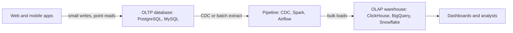

## 🎯 TL;DR

> **OLTP** (online transaction processing) serves many small, concurrent reads and writes that touch a few rows by key. **OLAP** (online analytical processing) answers questions that scan and aggregate millions or billions of rows. Different access patterns push engines, storage layouts and schemas in opposite directions, which is why analytics usually lives in a separate warehouse.

- OLTP: "place order 8812", "change this user's email". Few rows, low latency, many users at once.
- OLAP: "revenue per region per month for three years". Many rows, few columns, throughput over latency.
- **HTAP** (hybrid transactional/analytical processing) tries to serve both from one system. It trades simplicity for compromises.

## 🌱 Start simple (Junior)

> **💡 Analogy:** A bank teller vs an economist. The teller serves one customer at a time: find one account, change one balance, print one receipt. The economist reads every transaction of last year and asks "what was the average withdrawal per city?" The teller needs a fast drawer; the economist needs a fast way to read the whole ledger.

An online shop has two kinds of queries. The first is OLTP, and the second is OLAP (PostgreSQL syntax):

```sql
-- OLTP: one customer places an order (a few rows, by key)
BEGIN;
INSERT INTO orders (order_id, customer_id, total_cents, created_at)
VALUES (8812, 42, 1990, now());
UPDATE inventory SET stock = stock - 1 WHERE product_id = 77;
COMMIT;

-- OLAP: finance asks for a yearly report (millions of rows, few columns)
SELECT date_trunc('month', o.created_at) AS month,
       c.region,
       SUM(o.total_cents) / 100.0 AS revenue
FROM orders o
JOIN customers c USING (customer_id)
WHERE o.created_at >= DATE '2024-01-01'
GROUP BY 1, 2
ORDER BY 1, 2;
```

| Aspect | OLTP | OLAP |
|---|---|---|
| Typical query | `WHERE id = ?` | `GROUP BY` over a date range |
| Rows per query | one to hundreds | millions to billions |
| Columns per query | most of the row | a few of many |
| Writes | frequent, small, concurrent | bulk loads, append-heavy, rare updates |
| Latency target | milliseconds | seconds to minutes |
| Users | thousands of application users | dozens of analysts and dashboards |
| Data | current state | history, often years |

**Why separate them?** A ten-minute aggregation on the order database can slow down checkout. Analysts also need history and data from several systems, which the application database does not hold.

## 🔧 How it really works (Mid)

The access pattern drives the physical design.

**OLTP storage** is row-oriented. A row is stored together, so fetching one order is one page read. A B-tree index gives point lookups. Writes go through a [[wal|write-ahead log]] and the engine uses [[mvcc]] so readers do not block writers.

**OLAP storage** is column-oriented and compressed. Only the needed columns are read, and they compress well because values in one column look alike. Details are in [[columnar-storage]]. Indexes matter less; min/max statistics per block and partition pruning skip most of the data.

**Schema.** OLTP favors normalized schemas ([[normalization]]) so that each fact is stored once. OLAP favors a [[star-schema]]: a central [[fact-table]] of events, surrounded by [[dimension-table]]s, so most queries join only a few tables. See [[dimensional-modeling]].



**Numbers that show the difference.** Assume a table with 100 million rows, 40 columns and an average row size of 200 bytes. A full scan for `SUM(amount)` in a row store reads 100,000,000 × 200 B = 20 GB. In a column store, `amount` and `created_at` are 16 bytes per row together, so the scan reads 100,000,000 × 16 B = 1.6 GB before compression. At an assumed 4:1 compression that is about 400 MB. The exact ratio depends on the data, but the order of magnitude is the point.

**HTAP.** Some systems keep one copy in a row store for transactions and a columnar replica for analytics inside the same cluster. TiDB, for example, pairs its row store with a columnar replica (TiFlash). The pipeline disappears, but the two workloads now share hardware and the columnar copy lags behind the row store.

## 🧠 Senior depth & trade-offs

- **Long transactions on the primary.** In PostgreSQL, an open snapshot prevents vacuum from removing old row versions. A 20-minute report on the primary can bloat tables and slow down writes, even if it reads nothing that changes. Move analytics off the primary.
- **Moving the data.** Batch extraction (`WHERE updated_at > last_watermark`) is simple, but it misses hard deletes and rows that commit late. Log-based [[cdc]] reads the WAL or binlog, captures deletes, but needs a replication slot. An unused slot makes the source keep WAL and can fill the disk. Monitor it.
- **Engine families.** Warehouses such as Snowflake and BigQuery separate storage and compute. ClickHouse is very fast for scans but weak at point updates. Spark or Trino over Parquet on object storage is the [[lakehouse]] option. Choose by workload, not by brand.
- **Freshness costs money.** OLAP stores prefer appends and periodic merges. Real-time analytics needs micro-batches, deduplication and a clear rule for late data. Every step toward "seconds" adds operational work.
- **When not to split.** For a few tens of GB with simple reports, a PostgreSQL read replica or a materialized view may be enough. A separate analytical store adds a pipeline, a second source of truth and a freshness lag. Measure before you build it.
- **What to monitor:** pipeline lag, replica lag, p95 latency of OLTP queries, the age of the oldest open transaction, and WAL or slot retention on the source.

## 🧪 Try it

Use PostgreSQL 13 or later. DuckDB also works for the OLAP part.

```sql
CREATE TABLE orders (
  order_id    bigint PRIMARY KEY,
  region      text NOT NULL,
  total_cents int NOT NULL,
  created_at  timestamp NOT NULL
);

INSERT INTO orders
SELECT g,
       (ARRAY['north','south','east','west'])[1 + (g % 4)],
       (g % 5000),
       timestamp '2024-01-01' + (g % 365) * interval '1 day'
FROM generate_series(1, 1000000) AS g;

ANALYZE orders;
```

1. Predict which is faster: `SELECT * FROM orders WHERE order_id = 500000;` or `SELECT region, SUM(total_cents) FROM orders GROUP BY region;`. Then run both with `EXPLAIN (ANALYZE, BUFFERS)` and compare the plan nodes.
2. Drop the primary key index in a copy of the table and run the point lookup again. Explain the change.
3. In one sentence, explain why the checkout insert should not wait for the monthly report.

<details><summary>Show what to look for</summary>

The point lookup uses an index scan and touches a handful of pages. The aggregation uses a sequential scan of the whole table and a hash aggregate. Without the index, the point lookup also becomes a full scan, which is exactly why OLTP needs indexes and OLAP needs scans. For question 3, a long analytical query competes for CPU, I/O and snapshots with the checkout transaction.

</details>

## 💬 Interview corner

**Q: What is the difference between OLTP and OLAP?**

> **🎤 Say this in the interview:** OLTP handles many small transactions by key, with low latency and normalized, current data. OLAP handles scans and aggregations over large historical data, usually with denormalized schemas and columnar storage. We separate them so analytics does not slow down checkout, and so the data can be shaped for analysis.

- **Junior answer:** names both and gives one example of each.
- **Mid answer:** adds access pattern, row vs column storage, 3NF vs star schema, and a CDC or ETL pipeline between them.
- **Senior answer:** also covers freshness vs cost, failure modes (long snapshots on the primary, replica lag, slot retention), when read replicas or HTAP are enough, and how they would measure the result.

**Follow-up: "Is HTAP a replacement for a warehouse?"** Usually no. It removes a pipeline for operational analytics on recent data, but large multi-source history still favors a warehouse or lakehouse.

## ⚠️ Common mistakes

- Running heavy reports on the production primary "because it's only a SELECT". It competes for CPU, I/O, locks and old snapshots.
- Expecting a columnar warehouse to be fast at single-row updates or at `SELECT *` on a wide table. Columnar engines are built for scans of a few columns.
- Copying the OLTP schema into the warehouse unchanged. Joins across many 3NF tables are costly and confusing for analysts.
- Polling `updated_at` for the pipeline and forgetting hard deletes and late commits. Use [[cdc]] or explicit soft deletes.
- Treating HTAP as free. The contention moves into one cluster.

## ✅ Check yourself (quiz)

1. Which query is most typical of OLTP?
   - A) `SELECT region, SUM(amount) FROM sales GROUP BY region`
   - B) `SELECT * FROM orders WHERE order_id = 8812`
   - C) Scan five years of events to compute a daily average
   - D) Export the full table to CSV

<details><summary>Answer</summary>

**B** — a point lookup by key that returns a few rows with low latency. The other options scan many rows and are OLAP work.

</details>

2. A table has 40 columns. A dashboard sums only `amount`. Which layout reads the least data, and why?
   - A) Row store, because rows are stored contiguously
   - B) Column store, because it reads only the `amount` column
   - C) Both read the same, because the query touches the whole table
   - D) Row store with a B-tree on `amount`, because an index always wins for aggregates

<details><summary>Answer</summary>

**B** — a column store reads only the column files it needs. A B-tree index on `amount` still has to scan every index entry for a full-table sum, so it is not a clear win.

</details>

3. Why do OLAP schemas often use a star schema instead of 3NF?
   - A) Star schemas use less disk
   - B) Queries need fewer joins, and the names are easier for business users
   - C) Star schemas enforce foreign keys more strictly
   - D) 3NF cannot be stored in columnar engines

<details><summary>Answer</summary>

**B** — fewer joins make queries simpler and faster to write and run, and dimension names map to business terms. Disk use is not the main reason.

</details>

4. **(Senior)** An analyst runs a 20-minute query on the production PostgreSQL primary, and checkout latency spikes. What is the most likely mechanism, and what is the best fix?
   - A) The long query holds an old snapshot and competes for resources; move analytics off the primary, for example to a warehouse fed by CDC
   - B) PostgreSQL does not support `GROUP BY` on large tables
   - C) The fix is to add more `UNIQUE` constraints
   - D) Checkout reads from the warehouse, so the query blocks it

<details><summary>Answer</summary>

**A** — the open snapshot blocks cleanup of old row versions and the query consumes resources that checkout needs. The right fix is to separate the workloads, not to tune the checkout query.

</details>

5. **(Senior)** What is the central trade-off of choosing HTAP over a separate warehouse?
   - A) HTAP gives unlimited storage
   - B) HTAP removes the pipeline and most freshness lag, but the workloads share hardware, so isolation must be engineered
   - C) HTAP makes writes faster than a dedicated OLTP database
   - D) HTAP removes the need for schemas

<details><summary>Answer</summary>

**B** — one system means fewer moving parts and fresher data, but resource contention and isolation become your problem. Storage and write speed are not the point.

</details>

## 🗂️ Flashcards

| Front | Back |
|---|---|
| OLTP typical query | Point lookup or small write by key, few rows, low latency |
| OLAP typical query | Scan and aggregate over many rows and few columns |
| Why OLTP favors 3NF | Each fact is stored once, so updates do not create anomalies |
| Why OLAP favors a star schema | Fewer joins, and business-friendly fact and dimension tables |
| Why analytics leaves the primary | Long queries hold snapshots and compete for CPU and I/O |
| Batch extract vs CDC | Batch misses hard deletes and late commits; CDC reads the log and captures them |
| HTAP trade-off | Fresh data and one system, but shared resources and harder isolation |

## 🔗 Go further

- [[columnar-storage]] explains why the column layout makes OLAP scans fast.
- [[replication]] explains how replicas and CDC move data between systems.
- [[dwh-fundamentals]] and [[dimensional-modeling]] cover the warehouse side.
- [[realtime-olap]] covers sub-second analytics on fresh data.
- [[cap-pacelc]] explains the latency and consistency trade-off behind HTAP designs.
