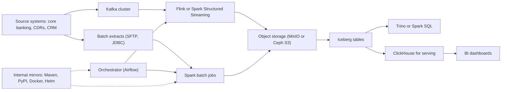

## 🎯 TL;DR

> Designing a data platform **on your own hardware, without public cloud** is a different exercise from the cloud reference architectures most interview material shows. You size from hardware and power, you plan for **offline and restricted dependencies** (package mirrors, container registries, model weights, certificates, time), and you accept that **recovery is a physical process** (spare disks, rack time, a second site).

- No "just add a node": capacity is bought in lead time, so forecasts and headroom matter more.
- Every external download (Maven, PyPI, npm, Docker images, Helm charts, OS packages, dataset sources) needs an **internal mirror or proxy** you control.
- Storage cost dominates. Choose replication, erasure coding, compression and retention with a price per terabyte in mind.
- Name the constraints explicitly in a system design: they show realism, and they change the architecture (for example, Kafka over object storage vs local disks, or a single warehouse instead of many micro-services).
- Do not invent facts about specific organizations. Describe patterns, and state your assumptions.

## 🌱 Start simple (Junior)

> **💡 Analogy:** Cooking for a family at home versus running a restaurant that gets supplies from a single market. In the cloud you can order more ingredients in minutes. On-premises, you plan the menu for the week, keep a pantry with reserve stock, and know which items you cannot buy quickly. The kitchen works even when the delivery van is late.

Three things change compared with a cloud design:

| Question | Cloud default | On-premises default |
|---|---|---|
| How do I get more capacity? | Scale in minutes | Order hardware, wait weeks, install, burn in |
| Where do packages and images come from? | Public registries | Internal mirror you operate |
| What fails and how do I recover? | Managed services, multi-zone | Disks, power, network, and staff on site |

For a junior engineer, the most useful habit is to ask: **what does this system need to download to work, and what happens if that download is blocked?** A Spark job that pulls its dependencies from Maven Central at start-up will fail on a network where that address is unreachable. The fix is a mirror, not a retry loop.

## 🔧 How it really works (Mid)

### A realistic on-premises stack

A common shape for an analytics platform in a bank or telco data centre:

Components are chosen for what runs on bare metal or a private Kubernetes cluster, with open-source licences and no dependency on a managed public service. Any product you pick must be installable offline.

### Sizing from first principles

Sizing starts with a daily volume, then multiplies out. Example for a telecom call-detail-record (CDR) feed:

- Raw volume: 200 GB per day.
- Compression in a columnar format: assume 4:1, so about 50 GB per day stored per copy.
- Replication or erasure coding: suppose 3 replicas, so 150 GB per day physical.
- Retention: 365 days, so 150 GB × 365 = 54.75 TB physical for one year.
- Headroom: keep 30% free for compaction, rebuilds and growth, so the usable target is 54.75 / 0.7 ≈ 78 TB.

Now the node count. Suppose each server carries 12 disks of 8 TB each, which is 96 TB raw. Filesystem and format overhead take about 10%, so about 86 TB usable per server. 78 TB fits on one server by capacity, but you cannot run three replicas on one machine, and a single failure would remove all copies. Three replicas need at least **three failure domains** (three servers, ideally in three racks or power feeds).

So the design is three to four servers, each with enough disk for a third of the replica set plus headroom for rebuilds. The capacity answer is not the final answer: the failure answer decides the count.

> **⚠️ Watch out:** Sizing only by data volume ignores replication, headroom, and failure domains. The result is a cluster that fits on paper and cannot survive one server failure.

### Compute sizing

Compute follows throughput and concurrency, not only volume. For a Spark batch job, estimate:

- Input per run: 200 GB compressed, about 800 GB uncompressed (4:1 back).
- A target run time of 30 minutes, so 800 GB / 1,800 s ≈ 0.44 GB/s of processing.
- If one executor core processes about 20 MB/s of real work (measure yours), you need about 0.44 × 1024 / 20 ≈ 23 cores at full speed. Add shuffle, skew and overhead, and plan around 40 cores.

Measure these numbers in a pilot before buying hardware. The 20 MB/s figure is an assumption to replace with a benchmark.

### Mirrors, registries and offline dependencies

Anything a build or a job downloads at run time is a dependency. List them:

| Dependency | Typical source | On-premises answer |
|---|---|---|
| Java libraries | Maven Central | Artifact repository proxy (Nexus, Artifactory) |
| Python packages | PyPI | Proxy or local index with mirrored wheels |
| Container images | Docker Hub, vendor registries | Harbor or another private registry with pull-through cache |
| Helm charts | Public chart repositories | Chart repository inside the platform |
| OS packages | Distribution mirrors | Local mirror of the needed repositories |
| Time | Public NTP pools | Internal NTP servers synced to a reliable source |
| Certificates | Public CAs | Internal CA; distribute its root to every host and image |
| Models and datasets | Public hubs | Copy weights and data into object storage with checksums |

Two practical rules:

1. **Pin and mirror, do not "latest".** A mirror that drifts is still an uncontrolled dependency. Snapshot the versions you use, and record the checksums.
2. **Test the offline build.** Run the full build in a network namespace or a segment with no internet access once a month. The first time you find a missing dependency should not be during an incident.

Access to some foreign public services can be restricted or unreliable in Iran. Plan for that as an operational constraint, and check what your own organization's policy allows; do not assume any particular outcome.

### Domestic providers and the hybrid question

Some organizations use domestic cloud or hosting providers for parts of the platform, for example object storage, backups or a managed database in an Iranian data centre. The engineering questions do not change: which APIs are compatible with the tools you use (S3 compatibility matters for Iceberg and Spark), what is the SLA, where are the backups, and what is the exit path. Ask for the documented compatibility matrix rather than relying on marketing claims.

### Physical operations

- **Power and cooling** set the maximum density per rack. Ask facilities for the figure before you choose 2U servers with 24 disks.
- **Spares**: keep spare disks and at least one spare server or node capacity. Replacement lead time is the real recovery time.
- **Monitoring** must work when the platform does: run it on a separate, small stack or on hardware that does not depend on the data cluster.
- **Backups** need a second medium or a second site. Tape, a second data centre, or an offline copy protect against a site failure and against ransomware.

## 🧠 Senior depth & trade-offs

- **Local disks vs shared storage for Kafka and ClickHouse.** On-premises you can have local NVMe with replication across servers, which gives high throughput per dollar and no network storage tier. The cost is that node replacement is a rebuild, and rebuild traffic competes with production. Model the rebuild time: 40 TB at 1 GB/s of effective rebuild bandwidth is about 11 hours, which is the window in which a second failure is most dangerous.
- **Erasure coding vs replication.** Erasure coding (for example, 4+2 in Ceph or MinIO) stores less than 3× overhead, but needs more nodes and gives slower writes and rebuilds. Replication is simpler and faster at small scale. Choose by node count: with fewer than about six nodes, replication is usually the sane default.
- **Single-cluster simplicity vs many services.** A small team cannot run ten distributed systems well. A design with one object store, one warehouse-style engine, one streaming platform and one orchestrator is easier to operate than a design that copies cloud reference architectures component by component.
- **Upgrades are slower.** There is no managed service doing the rolling upgrade. Plan maintenance windows, test the upgrade on a staging copy, and keep the previous version's installers available offline.
- **Security and data residency.** Customer data may need to stay in the country and within specific networks. Decide early which data can be processed by which tools, and document the trust boundaries. See [[data-security]].
- **Cost model.** Compare total cost of ownership over three to five years: hardware, power, cooling, rack space, support contracts, staff time and the cost of a missed capacity forecast. Cloud is not automatically cheaper or more expensive; the comparison depends on utilization and on the cost of the people who run the system.
- **Hiring and skills.** Running Kubernetes, Kafka and a lakehouse on bare metal needs people who can debug the storage and the network. Factor that into the design, and into the decision to use fewer, simpler components.

> **🎤 Say this in the interview:** "I start from the constraints: no public cloud, a fixed hardware budget and lead times for every server. I size from data volume, replication and failure domains, then add headroom. Every download goes through an internal mirror, and I rehearse offline builds and restores, because recovery on-premises is a physical process."

## 🧪 Try it

1. Size a platform for 500 GB per day of raw events, 5:1 compression, 3 replicas, 2 years of retention and 30% headroom. Show each step, then choose a server configuration (for example, 12 × 16 TB disks per server, 90% usable) and state the minimum number of servers, including the failure-domain constraint.
2. List every external download in a Spark + Airflow project you know (or a sample one). For each, name the mirror you would run and how you would check it in a monthly offline test.
3. Write a two-paragraph design note for a fraud-detection platform on-premises. State your assumptions explicitly (volumes, latency target, number of sites) and say which requirement drives your storage choice.

Show solutions

**1.** Raw per copy per year: 500 GB × 365 × 2 years = 365,000 GB = 365 TB raw per copy. With 5:1 compression: 73 TB per copy. With 3 replicas: 219 TB. With 30% headroom, divide by 0.7: about 313 TB. Usable per server: 12 × 16 TB = 192 TB raw × 0.9 = 172.8 TB. Capacity alone needs two servers, but three replicas need three failure domains, so the minimum is **three servers**, and each holds about 104 TB of the 313 TB (one third). Four servers give room for a rebuild after one loss.

**2.** Examples: Maven artifacts (proxy in Nexus or Artifactory), PyPI packages (local index), Docker base images (private registry with pull-through cache), Helm charts (internal repository), Ubuntu or Debian packages (local mirror), dataset downloads (copied to object storage with checksums). Monthly offline test: run the full build and the job on a network segment with no internet and confirm nothing fails.

**3.** A good note states: 20 million transactions per day, p99 scoring below 200 ms, two data centres in one country, a shared-nothing replica in the second site, and feature history for 90 days. Storage choice driven by the 200 ms latency target: low-latency serving on local NVMe with a separate analytical store. Specific numbers are assumptions; the reasoning is what is being tested.

## 💬 Interview corner

**Question: "Design a data platform for a bank that cannot use public cloud."**

- **Mid answer:** "I'd use open-source components on Kubernetes: Kafka for ingestion, Spark and Iceberg on object storage, and ClickHouse for serving. I'd run an internal Maven, PyPI and Docker mirror."
- **Senior answer:** "First I'd confirm the constraints: volume, retention, latency, residency and the hardware budget with lead times. I'd size from data volume with replication and headroom, and make sure there are at least three failure domains. Every dependency goes through a mirror, and I'd schedule offline build tests. I'd keep the number of components small because the team has to operate them without a managed service, and I'd plan backups to a second site, including a restore drill."

> **🎤 Say this in the interview:** "I design for the constraints I actually have. On-premises, capacity is bought with lead time, dependencies come from mirrors I operate, and recovery depends on spares and rebuild time. I count failure domains before I count terabytes."

## ⚠️ Common mistakes

> **⚠️ Watch out:** Copying a cloud reference architecture and assuming "more managed services" is the answer. On-premises you must operate every one of them.

- Sizing from raw data volume and ignoring replication, headroom and failure domains.
- Running three replicas on two servers.
- Depending on `latest` tags or a public registry at build time.
- Discovering that a build needs internet access during an outage.
- Forgetting the rebuild time after a disk failure, which is when a second failure is most likely.
- Keeping backups in the same rack or the same power feed as the data.
- Stating specific facts about an organization, vendor or regulation without verification.

## ✅ Check yourself (quiz)

1. Why is "add more nodes" a weaker answer on-premises than in the cloud?
   - A) Nodes cannot be added to a cluster
   - B) Hardware needs lead time, installation and burn-in, so capacity planning must be done in advance
   - C) Cloud nodes are cheaper by definition
   - D) On-premises clusters cannot scale at all

Answer

**B** — the cost of adding capacity is a delivery and installation delay, not a single API call. Forecasts and headroom become design requirements.

2. A three-replica Kafka cluster is placed on two physical servers. What is the problem?
   - A) Kafka needs four replicas
   - B) Three replicas need three failure domains; with two servers, one failure removes two copies at once
   - C) Replication requires object storage
   - D) Nothing; replicas can share a server

Answer

**B** — a replica is only useful if it survives failures that others do not. Two servers means a single server failure can take two replicas, leaving one copy.

3. A Spark job works in the lab and fails in production with "cannot resolve dependency" during start-up. What is the most likely root cause?
   - A) Spark does not support dependencies
   - B) The job downloads from a public repository that is not reachable; the fix is an internal mirror and pinned versions
   - C) The Spark version is too new
   - D) The cluster has too much memory

Answer

**B** — a run-time download is an external dependency. Mirror it, pin it, and test the offline build.

4. **(Senior)** You must choose between 3× replication and erasure coding (for example 4+2) for a five-node object store. What drives the decision?

   - A) The colour of the racks
   - B) Node count and rebuild behaviour: erasure coding saves capacity but needs enough nodes and gives slower writes and rebuilds; with few nodes, replication is usually simpler and faster
   - C) Erasure coding is always cheaper, so always use it
   - D) Replication cannot be used with object storage

Answer

**B** — the trade-off is capacity overhead against write speed, rebuild complexity and minimum node count. Five nodes with 4+2 is tight, so the answer depends on the failure tolerance you need and the rebuild time you can accept.

5. **(Senior)** A disk fails in a 40 TB node and the rebuild needs about 11 hours. Why does that window matter, and what do you change?

   - A) It does not matter; disks rarely fail
   - B) During the rebuild the system has reduced redundancy, so a second failure is most dangerous; you reduce that risk with more failure tolerance, faster rebuild bandwidth, spares on hand and monitoring of rebuild progress
   - C) It only matters for backups
   - D) The rebuild is instant on bare metal

Answer

**B** — redundancy is reduced until the rebuild completes. Design for that window: spares, bandwidth reserved for rebuilds, and tolerance above the minimum.

## 🗂️ Flashcards

| Front | Back |
|---|---|
| Biggest difference from cloud design | Capacity is bought with lead time, and every dependency must be available offline |
| Why size by failure domains | Replicas only help if they do not share a failure; count servers and racks, not only terabytes |
| Sizing formula basics | Daily bytes × compression × copies × retention, then divide by target utilization (for example 0.7) |
| What a mirror is for | A controlled internal copy of packages and images so builds and jobs work without public access |
| Pin and mirror | Use exact versions with checksums, not `latest`, so the offline copy is reproducible |
| Rebuild window | Time with reduced redundancy after a failure; the most dangerous period for a second failure |
| Replication vs erasure coding | Replication: simpler and faster at small scale; erasure coding: less overhead, needs more nodes |
| Why backups need a second site or medium | Protects against site failure, fire, power events and ransomware that reaches the primary system |

## 🔗 Go further

- **[[capacity-planning]]** covers the general method behind the sizing in this lesson.
- **[[kubernetes-for-data]]** explains running stateful systems on a private cluster and the storage trade-offs.
- **[[dataops-cicd]]** shows the pipelines that depend on internal mirrors and offline builds.
- **[[data-security]]** covers access control and encryption for data that must stay on your network.
- **[[iran-de-market]]** and **[[negotiation-iran]]** discuss the market and interview context for data roles in Iran.
- **[[hadoop-ecosystem]]** explains the on-premises Hadoop stack that many organizations still run alongside newer tools.
- For any product you consider, read its offline installation guide and its storage sizing guide for your version before committing to hardware.

