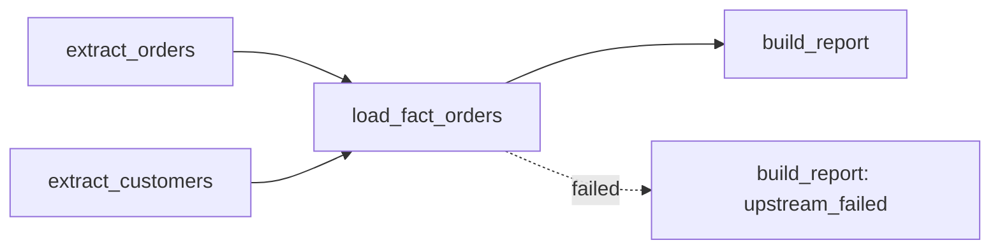

## 🎯 TL;DR

> An **orchestrator** runs the steps of a data pipeline in the right order, at the right time, and tells you when something goes wrong. It coordinates the work; the heavy data processing happens elsewhere (Spark, SQL warehouse, a script).

- A pipeline is modelled as a [[dag]] (directed acyclic graph): tasks are nodes, dependencies are arrows, and there are no cycles.
- A **scheduler** decides *when* a run starts. An **executor** (or a set of workers) decides *where* each task runs.
- Production orchestration adds **retries**, **sensors** (wait for something external), **SLAs** (a deadline), **alerts**, and **backfills** (re-run past periods).
- Tasks must be safe to run more than once, because retries and backfills will run them again.

## 🌱 Start simple (Junior)

> **💡 Analogy:** A restaurant kitchen during dinner service. The head chef does not cook every dish. They say "the sauce must be ready before plating", "start the fish at 19:00", and if the oven breaks they reroute the orders and tell the manager. The chef is the orchestrator; the cooks do the work.

Imagine a daily pipeline:

1. Extract yesterday's orders from an API.
2. Extract the customer table from a database.
3. Join them and load `fact_orders` into the warehouse.
4. Build a sales report.

Steps 1 and 2 are independent, so they can run at the same time. Step 3 must wait for both. Step 4 must wait for step 3. That "must wait for" relation is a **dependency**, and a set of tasks with dependencies is a **DAG**.

The simplest way to run this is a cron line:

```bash
# Runs every day at 02:00. It does not know whether the extract failed,
# it does not retry, it does not alert, and it cannot wait for late data.
0 2 * * * /opt/jobs/extract_orders.sh && /opt/jobs/load_fact.sh
```

Cron is a good **scheduler**. It is a weak **orchestrator**: it only knows the clock, not the state of the work. The rest of this lesson is about what you need on top of the clock.

## 🔧 How it really works (Mid)

**DAG.** Directed means each edge points one way (A → B means "B runs after A"). Acyclic means there is no loop, because a loop would mean a task waits for itself and nothing could start. Most orchestrators check for cycles when they parse the pipeline definition.

**Run and task instance.** A *DAG run* is one execution of the whole pipeline for one period. A *task instance* is one task inside one DAG run. If a daily DAG has a run for 2026-10-01, that run has four task instances, each with its own state.

**Data period, not wall-clock time.** A daily run that processes October 1 is usually triggered *after* the period closes (on October 2 at 02:00). The orchestrator calls this the logical date or data interval. The processing code should use this period, not the current time. This is what makes re-runs and backfills correct.

**States.** Most tools track states such as queued, running, success, failed, up-for-retry, skipped, and upstream-failed. "Upstream-failed" means a task was not attempted because one of its parents failed.



**Trigger rules.** A task normally runs only when all its parents succeeded. Other rules exist (run when one parent failed, run when all parents are done even if some failed). Use them for cleanup or alerting tasks, not as a shortcut around broken data.

**Retries.** A retry policy has a count, a delay, and often exponential backoff (wait 1 minute, then 2, then 4). Retries fix transient problems such as a network timeout. They do not fix a bad query, and they are only safe if the task is idempotent (see [[idempotency]]).

**Sensors.** A sensor is a task that waits until a condition is true, for example a file exists or a partition is present in a table. A classic sensor occupies a worker slot while it polls, so 50 waiting sensors can block the work that would make them succeed. Many tools offer a deferrable or async mode that releases the slot while waiting.

**SLA and alerts.** An SLA (service-level agreement, here: a deadline) says "this report must be ready by 06:00". It is different from a failure. A task can succeed at 07:00 and still have missed the SLA, so you alert on both lateness and failure. See [[sla-slo]].

A worked timeline: a daily pipeline starts at 02:00, its SLA is 06:00, and the load task has 3 retries with a 5-minute backoff. If the first attempt fails at 02:20 and the retries take 5, 10 and 20 minutes plus the runtime of each attempt, the last retry can still finish before 06:00. If the source is down for two hours, the final attempt fails, the SLA alert fires at 06:00, and a human decides whether to wait or to backfill.

Here is a tool-neutral example of how dependencies become an execution order. Python's standard library `graphlib` does the sorting:

```python
from graphlib import TopologicalSorter

# node -> set of tasks it depends on (its parents)
pipeline = {
    "extract_orders": set(),
    "extract_customers": set(),
    "load_fact_orders": {"extract_orders", "extract_customers"},
    "build_report": {"load_fact_orders"},
}

order = list(TopologicalSorter(pipeline).static_order())
print(order)
# One valid output: ['extract_orders', 'extract_customers', 'load_fact_orders', 'build_report']
# The two extracts may swap, because they are independent.
```

`static_order()` raises `CycleError` if the dependencies form a loop. That is the same check an orchestrator runs before it accepts your DAG.

## 🧠 Senior depth & trade-offs

- **Separate the roles.** The scheduler (or timer) starts runs. The DAG parser reads definitions. The executor and workers run tasks. The metadata database stores state. When the platform is slow, find which role is the bottleneck: scheduling latency, parser time on too many or too heavy DAG files, or database contention on task state.
- **Do not move data through the orchestrator.** It stores task metadata, not tables. Pass references (a path, a table name, a partition value) between tasks. Pushing large payloads through the orchestrator's database fills it and slows every query against it.
- **Retries mean at-least-once.** A task that writes and then crashes before it reports success will run again. Design writes as upserts, overwrites of a partition, or deterministic file names. See [[dedup-idempotent-loads]] and [[exactly-once]].
- **Backfills are a design requirement.** If the task reads the wall clock, you cannot reproduce last month. If it reads the data interval, you can run any period with the same code. See [[backfill]].
- **Cross-pipeline dependencies are fragile.** "Job B runs at 03:00, job A usually finishes by 02:50" is a race waiting to happen. Prefer data-driven triggers (a dataset or asset is updated) or a sensor with a timeout, and make the dependency explicit.
- **Control concurrency deliberately.** Limit active runs per pipeline, use pools or queues for shared resources (a database connection limit, a rate-limited API), and set priorities so an urgent report is not stuck behind a backfill.
- **Monitor the orchestrator as well as the data.** Watch queue time, task duration trends, scheduler lag, and the gap between expected and actual start. Data freshness and quality checks belong in the pipeline too; see [[data-observability]] and [[data-quality]].
- **When not to use an orchestrator.** A single job on one machine, with no dependencies and no alerting need, does not need a platform. Continuous event processing (Kafka consumers, Flink jobs) is not DAG scheduling; a DAG runs to completion, a stream never does. See [[orchestrator-alternatives]].

## 🧪 Try it

1. **Find the parallelism.** For this pipeline, list the tasks that can run at the same time and the critical path (the longest chain).
   - `ingest_clicks`, `ingest_orders`
   - `dedup_clicks` depends on `ingest_clicks`
   - `join_sessions` depends on `dedup_clicks` and `ingest_orders`
   - `publish_dashboard` depends on `join_sessions`

   Then run the `graphlib` snippet above with these tasks and check your answer.

2. **Retry arithmetic.** A task has `retries=3` and exponential backoff that starts at 60 seconds and doubles. Assume each attempt fails immediately. How many attempts run in total, and how much time passes between the first failure and the final failure?

3. **Find the bug.** A sensor waits for `s3://bucket/orders/{now}.parquet`, where `{now}` is the current time when the sensor starts. Why does this fail, and what should it use instead?

<details><summary>Show solutions</summary>

**1.** `ingest_clicks` and `ingest_orders` run in parallel. `dedup_clicks` starts after `ingest_clicks`. `join_sessions` waits for both `dedup_clicks` and `ingest_orders`. The critical path is `ingest_clicks → dedup_clicks → join_sessions → publish_dashboard`, which has four tasks.

**2.** There are 4 attempts in total: 1 initial plus 3 retries. The waits between attempts are 60 s, 120 s and 240 s, so 420 s (7 minutes) pass between the first failure and the final failure.

**3.** The file name depends on when the sensor runs, not on which business day it is meant to process. A re-run or backfill for last Tuesday would look for today's file. Use the data interval (logical date) to build the path, so the same code finds the right file for any period.

</details>

## 💬 Interview corner

**"What is the difference between a scheduler and an orchestrator?"**
- **Mid answer:** "A scheduler starts jobs at a time. An orchestrator also runs them in dependency order, retries them, and shows their status."
- **Senior answer:** "Scheduling is one function. An orchestrator also owns the state of every task instance, handles dependencies, backfills, concurrency limits, retries and alerts, and gives you the lineage of what ran for which period. Cron is a scheduler. Airflow, Dagster and Prefect are orchestrators, and the line blurs as the tools grow."

**"A pipeline failed at 03:00 and the dashboard is wrong at 08:00. What do you do?"**
Find the first failed task, check whether it is upstream of the dashboard, fix the cause, and re-run only the failed task and its downstream tasks for the affected period. Confirm that the re-run is idempotent, then tell stakeholders the new ready time. A senior candidate also mentions the post-incident review: why the alert came late, or why the SLA was not set.

**"How do you design retries?"** Retry transient errors (timeouts, throttling) with backoff and a cap. Do not retry validation failures (bad schema, failed quality check); fail fast and alert. Make sure the task is idempotent before you add retries.

> **🎤 Say this in the interview:** "An orchestrator manages the state of every task run: dependencies, retries, the data period each run is for, and alerts when we miss a deadline. Because retries and backfills re-run tasks, I design each task to be safe to repeat."

## ⚠️ Common mistakes

> **⚠️ Watch out:** Using the current time as the business date. A re-run next week then processes the wrong data, silently. Always use the data interval.

> **⚠️ Watch out:** Passing a DataFrame or a large list between tasks through the orchestrator's metadata. Pass a reference (path or table name) instead.

- Adding retries to a task that appends rows without deduplication, which creates duplicates.
- Treating a DAG as a stream: a DAG should finish; a continuous job belongs in a streaming system.
- Sensors that hold a worker slot for hours; use a timeout and a deferrable mode.
- Retrying forever. Every retry policy needs a cap and an alert.
- Alerting on every failure with no SLA context, so the team learns to ignore alerts.
- Relying on timing ("job A usually finishes first") instead of an explicit dependency.

## ✅ Check yourself (quiz)

1. Why must a DAG be acyclic?
   - A) So that tasks can run in parallel
   - B) Because a cycle means some task would wait for itself, so no valid order exists
   - C) Because the scheduler only supports one parent per task
   - D) To make backfills faster

<details><summary>Answer</summary>

**B** — a topological order exists only for acyclic graphs. A cycle means a deadlock: every task in the loop waits for another one in the loop, so nothing can start.

</details>

2. A cron job runs at 02:00 and loads a table. Which capability is **missing** compared with an orchestrator?
   - A) A time trigger
   - B) Running a shell command
   - C) Knowing the state of earlier tasks, retries and dependencies
   - D) Writing to a database

<details><summary>Answer</summary>

**C** — cron knows only the clock. It does not track task state, cannot wait on dependencies, and does not retry or alert.

</details>

3. A load task retried after a timeout and now the table has duplicate rows. What is the most likely root cause?
   - A) The scheduler started the task twice at the same time
   - B) The task is not idempotent: the first attempt wrote data before it reported failure
   - C) The SLA was too short
   - D) The DAG had too many tasks

<details><summary>Answer</summary>

**B** — a retry is a second execution, so any write that is not repeatable creates duplicates. Fix it with an upsert, a partition overwrite, or deterministic file names.

</details>

4. **(Senior)** A backfill for six months of data uses the wall clock for its date filter. What goes wrong, and what is the fix?
   - A) Nothing; backfills always use the current date
   - B) Every period processes today's data, so history is never produced correctly; parameterize the code by the data interval
   - C) The orchestrator refuses to run backfills with a date filter
   - D) The fix is to increase the retry count

<details><summary>Answer</summary>

**B** — the same code must produce the same output for the same period. Passing the data interval (start and end of the period) into the query makes each backfill run process its own slice.

</details>

5. **(Senior)** You must choose between a sensor that polls a file every minute and a trigger on a dataset update. Which trade-off matters most at scale?
   - A) Polling is always more accurate
   - B) Polling holds worker capacity and multiplies load on the storage system; event-driven triggers wake work only when the data changes, but depend on reliable events
   - C) Triggers cannot be used with SLAs
   - D) Sensors cannot fail

<details><summary>Answer</summary>

**B** — many long-running sensors consume slots and send many metadata calls. Event-driven triggers are cheaper, but you must trust the producer to emit the event, so add a fallback check for missed events.

</details>

## 🗂️ Flashcards

| Front | Back |
|---|---|
| DAG | Directed acyclic graph: tasks are nodes, dependencies are one-way edges, no cycles |
| Scheduler vs orchestrator | Scheduler starts runs on time; orchestrator also manages dependencies, state, retries, backfills and alerts |
| Logical date / data interval | The period of data a run processes, not the wall-clock time the run starts |
| Retry with backoff | Re-run a failed task after growing delays; safe only if the task is idempotent |
| Sensor | A task that waits for a condition (file, partition, event); watch its slot usage |
| SLA vs failure | An SLA is a deadline; a task can succeed and still miss its SLA |
| Upstream failed | A task was not attempted because a parent task failed |
| Backfill | Re-running past periods with the same code, using each period's data interval |

## 🔗 Go further

- [[airflow]] shows these ideas in a widely used orchestrator, including the Airflow 3 architecture.
- [[dbt]] covers the transform layer that often runs as one step inside an orchestrated pipeline.
- [[backfills]] and [[dedup-idempotent-loads]] cover the two design rules that make retries and re-runs safe.
- [[pipeline-monitoring]] explains what to alert on, and [[orchestrator-alternatives]] compares tools with different scheduling models.
- Read the concepts pages of your chosen orchestrator once. Names differ between tools (task instance, asset, dataset, op), but the ideas above carry over.
