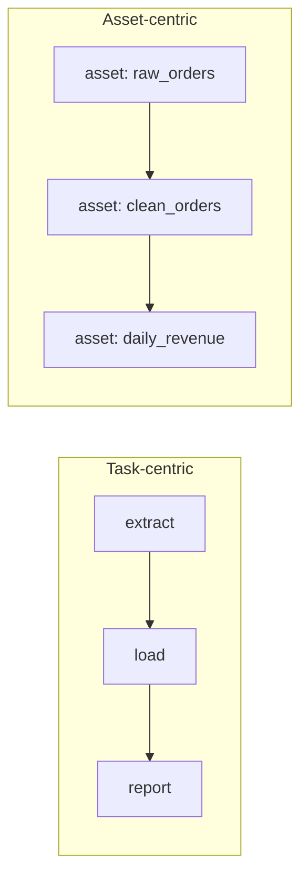

## 🎯 TL;DR

> An **orchestrator** decides **when** each pipeline step runs, in **what order**, and **what happens** when a step fails. Airflow is the default most interviewers know. The alternatives differ mainly in their **unit of work**: a **task** (Airflow, Prefect, Argo) or a **data asset** (Dagster).

- **Dagster** is asset-centric: you declare the tables or files that should exist, and Dagster runs the code that produces them.
- **Prefect** is Python-first: plain functions become flows and tasks with retries and state tracking.
- **Argo Workflows** is Kubernetes-native: every step is a container, and a workflow is a Kubernetes resource.
- **DolphinScheduler** is an Apache project with a visual workflow designer and many built-in task types.

## 🌱 Start simple (Junior)

> **💡 Analogy:** A restaurant kitchen. Airflow is a head chef with a checklist ("chop, fry, plate, serve"). Dagster is a chef who starts from the menu ("tomorrow's soup must exist, and it needs stock, which needs bones"). Both get dinner on the table. They just think about the work differently.

An orchestrator does four jobs: it **schedules** runs, respects **dependencies** between steps, **retries** failures, and shows you **what happened** in a UI. Take a small pipeline: fetch orders, drop bad rows, then compute daily revenue. Here it is written two ways.

```python
# Dagster: you declare data objects; parameter names define the dependencies
from dagster import asset

@asset
def raw_orders():
    return fetch_orders()          # your extraction code

@asset
def clean_orders(raw_orders):      # depends on raw_orders
    return [o for o in raw_orders if o["amount"] > 0]
```

```python
# Prefect: plain Python functions; calling the flow runs it
from prefect import flow, task

@task(retries=2, retry_delay_seconds=30)
def fetch_orders() -> list[dict]:
    return [{"id": 1, "amount": 10}, {"id": 2, "amount": -1}]

@task
def clean_orders(rows: list[dict]) -> list[dict]:
    return [r for r in rows if r["amount"] > 0]

@flow
def orders_pipeline():
    clean_orders(fetch_orders())

if __name__ == "__main__":
    orders_pipeline()
```

Both programs describe the same work. The difference is what the tool **knows about**: in Dagster it knows about `raw_orders` and `clean_orders` as data; in Prefect it knows about the function calls and their results.

## 🔧 How it really works (Mid)

The two main models:



- **Task-centric (Airflow, Prefect, Argo).** The graph is made of *actions*. The scheduler knows that task B runs after task A succeeds. Passing data is your problem. Airflow's XCom is meant for small metadata, not tables: pass a path to object storage instead.
- **Asset-centric (Dagster).** The graph is made of *data objects*. Each asset has a materialization history, so Dagster can tell you which assets are stale because an upstream asset changed. An **I/O manager** decides how an asset is saved and loaded (for example, Parquet on S3), so the asset code can stay focused on the transform.

**Prefect** (version 3 API) runs flows and tasks as ordinary Python. Retries are set on the decorator. A `retries` on `@flow` reruns the whole flow, while a `retries` on `@task` reruns only the failed task. Scheduling is done with deployments.

**Argo Workflows** runs each step as a pod, so every step can request its own CPU, memory or GPU. A workflow is a Kubernetes custom resource (YAML). It fits teams that already run everything on Kubernetes, including model training steps.

**DolphinScheduler** has a web UI where you draw workflows, a master service that schedules them, and workers that run the tasks. It supports many task types out of the box, which helps mixed-technology teams that want fewer custom operators.

| Tool | Unit of work | Definition style | Retry granularity | Best fit |
|---|---|---|---|---|
| Airflow | Task | Python DAG file | Task | Broad ecosystem, mixed non-data work |
| Dagster | Asset | Python decorators | Asset / run | Dataset-centric lakehouse pipelines |
| Prefect | Task and flow | Python functions | Task or flow | Python-heavy teams, dynamic runs |
| Argo Workflows | Container step | YAML on Kubernetes | Step | K8s-native and GPU/batch jobs |
| DolphinScheduler | Task | Visual designer | Task | Visual authoring, multi-technology shops |

## 🧠 Senior depth & trade-offs

- **Asset model.** Lineage, freshness and partial re-runs come almost for free. The cost is discipline: one asset per meaningful dataset. If you turn every function into an asset, the UI becomes noise.
- **Task model.** Better for work that produces no dataset: sending alerts, calling a vendor API, triggering a model deployment. Asset tools are awkward there.
- **Backfills.** Asset tools make "materialize these partitions" a first-class action. Task-based DAGs need parameters for the date range and a careful design. See [[backfill]] and the [[backfills]] lesson.
- **Retries need idempotency.** A retry on a non-[[idempotency|idempotent]] task duplicates data. No orchestrator fixes that for you.
- **Operational cost.** Argo and DolphinScheduler mean you run the infrastructure. Managed offerings reduce that work but add vendor dependency. Check each vendor's current hosting options rather than assuming.
- **Migration is the real cost.** Airflow has the largest operator ecosystem and the most hiring signal. Moving 400 DAGs is a project, not a config change. The usual safe path: run both systems in parallel, move one pipeline at a time, and reconcile outputs.
- **Monitoring is tool-agnostic.** Watch scheduler lag, queued tasks, failed runs and [[sla-slo|SLA]] misses, whichever engine you choose.
- **When not to switch.** If the pain is bad data, missing tests or unclear ownership, a new orchestrator will not fix it. Fix those first.

## 🧪 Try it

1. In the Prefect pipeline above, make `fetch_orders` fail on its first two calls (use a counter) and keep `retries=2`. **Predict:** how many attempts run, and does the flow succeed?
2. Add a third Dagster asset `daily_revenue(clean_orders)` that sums the amounts. **Predict:** the materialization order of the three assets.
3. A pipeline posts a Slack message and then loads a table. **Predict:** which model fits it worse, and why?

<details><summary>Show solutions</summary>

**1.** Three attempts in total: the first call fails, the first retry fails, the second retry succeeds. The flow succeeds, because the task eventually returns. Retries apply to the task, not the whole flow.

**2.** `raw_orders`, then `clean_orders`, then `daily_revenue`. Dagster follows the dependency graph inferred from the parameter names.

**3.** The asset-centric model fits worse. A Slack message produces no dataset, so there is no asset to materialize. A task graph describes it naturally.

</details>

## 💬 Interview corner

**Question: "Why would you pick Dagster over Airflow?"** Mid answer: "Dagster models data assets, so lineage, freshness and testing are built in. Airflow models tasks, so I would have to add those myself." Senior answer: "I would frame it as a unit-of-work question. If most of our pipelines produce tables that many teams consume, an asset model fits. If we run many non-data jobs, Airflow may still be right. I would not switch for the tool's novelty; I would migrate one pipeline first and measure."

**Question: "Argo Workflows or Airflow on Kubernetes?"** Senior answer: "Argo gives per-step containers with their own resources, which suits GPU and batch steps. Airflow gives a richer data-scheduling model and a bigger operator ecosystem. If the team already operates Kubernetes and the steps are heavy containers, Argo is attractive. Otherwise, Airflow with KubernetesPodOperator gets close."

> **🎤 Say this in the interview:** "The orchestrator choice is really a choice of unit of work: tasks or data assets. I pick by what the pipelines produce, what the team already runs, and what migration costs. Retries are only safe when the steps are idempotent."

## ⚠️ Common mistakes

> **⚠️ Watch out:** Choosing a tool by popularity instead of by unit of work, team skills and migration cost.

- Turning every function into an asset, which hides the real datasets in a sea of nodes.
- Passing large DataFrames or tables between tasks through orchestrator metadata (XCom, task results). Store the data in object storage and pass its path.
- Assuming `retries` makes a non-idempotent step safe.
- Forgetting that a Prefect `retries` on the flow reruns every task, not only the failed one.
- Migrating everything at once without running both systems and reconciling outputs.

## ✅ Check yourself (quiz)

1. Which tool treats a data object, not a function call, as its main unit?
   - A) Argo Workflows
   - B) Dagster
   - C) DolphinScheduler
   - D) Cron

<details><summary>Answer</summary>

**B** — Dagster is asset-centric: assets are declared with `@asset`, and dependencies come from their parameters.

</details>

2. A Prefect flow has `@flow(retries=2)` and one task fails once. What reruns?
   - A) Only the failed task
   - B) The whole flow, including tasks that already succeeded
   - C) Nothing; flow retries apply only to deployments
   - D) Only the next scheduled run

<details><summary>Answer</summary>

**B** — a flow retry reruns the whole flow. To retry only one step, put `retries` on the `@task`.

</details>

3. **(Senior)** A team has 400 Airflow DAGs, five engineers, and two problems: late-arriving data and no tests. Should they migrate orchestrators?

   - A) Yes, a new orchestrator fixes late data
   - B) No, not for this reason alone; first add data contracts, tests and SLAs, and consider an asset-centric tool only for new dataset-centric pipelines
   - C) Yes, because Airflow cannot run tests
   - D) No, because Dagster does not support Python

<details><summary>Answer</summary>

**B** — late data and missing tests are data-quality and process problems. A new orchestrator carries a large migration cost and does not solve them. Adopting a new tool for new pipelines is a lower-risk option.

</details>

4. **(Senior)** Why do GPU training steps often suit Argo Workflows?

   - A) Argo runs without containers
   - B) Each step is a container with its own resource requests, scheduled by Kubernetes
   - C) Argo can only run Python
   - D) Argo stores models for you

<details><summary>Answer</summary>

**B** — the step runs as a pod, so it can request GPUs and memory independently of the orchestrator process.

</details>

5. What lets an asset-centric tool answer "which datasets are stale?"

<details><summary>Answer</summary>

It records materializations of each asset and knows the dependency graph. When an upstream asset is newer than a downstream one, the downstream asset is stale.

</details>

## 🗂️ Flashcards

| Front | Back |
|---|---|
| Task-centric vs asset-centric | Task-centric graphs are actions; asset-centric graphs are data objects with a materialization history |
| How does Dagster infer dependencies? | From the names of the asset function's parameters |
| Prefect `@flow` retries vs `@task` retries | Flow retries rerun the whole flow; task retries rerun only the failed task |
| What is an I/O manager (Dagster)? | The component that saves and loads an asset's data, keeping the asset code focused on the transform |
| Argo Workflows' unit of execution | A container step (a pod) inside a Kubernetes workflow resource |
| Why not pass tables through XCom? | XCom is for small metadata; pass a storage path instead |
| Biggest real cost of switching orchestrators | Migrating definitions, retraining people and reconciling outputs, not the tool licence |

## 🔗 Go further

- [[airflow]] is the baseline: read it first to see what the alternatives change.
- [[orchestration-concepts]] covers DAGs, schedules and sensors, the vocabulary used in this lesson.
- [[backfills]] and [[pattern-backfill]] show why asset-based re-materialization is attractive.
- [[kubernetes-for-data]] explains the runtime behind Argo and other Kubernetes-based systems.
- [[dataops-cicd]] covers testing and deploying orchestrator code.
- [[data-lineage]] explains what asset graphs give you for free.
