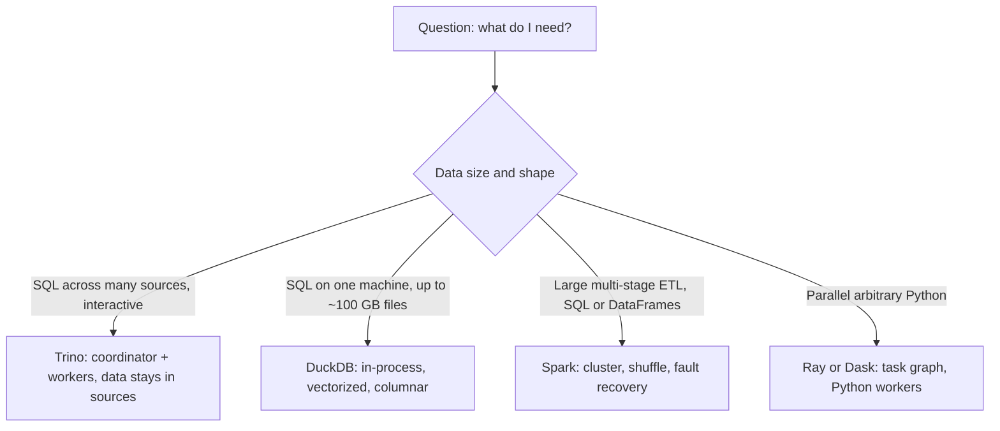

## 🎯 TL;DR

> Spark is a general-purpose engine for big, multi-stage data processing. It is not the best tool for every job. Three other families cover most of the gap: **query engines** (Trino/Presto) that answer SQL across many systems, **single-machine engines** (DuckDB) that are fast on medium data, and **distributed Python runtimes** (Ray, Dask) for Python code that does not fit Spark's model.

- **Trino / Presto**: interactive SQL over many sources (lake files, databases, Kafka topics through connectors). Data stays where it is.
- **DuckDB**: an in-process analytical database. No cluster, no server. Great for files up to tens or low hundreds of GB on one good machine.
- **Ray / Dask**: distributed Python. Good for parallel Python functions, model training preprocessing, and workloads that are awkward to express as SQL or DataFrame transformations.
- The choice depends on **data size, latency, the shape of the work (SQL or arbitrary Python), and who runs it**. Pick the smallest tool that meets the requirement.

## 🌱 Start simple (Junior)

> **💡 Analogy:** Think of a hospital. Spark is the surgery department: heavy, powerful, built for big, long procedures. Trino is the reception desk that can quickly look up a patient's records across many separate clinics. DuckDB is a well-equipped clinic room that handles most cases on its own, with no need to call the hospital. Ray and Dask are teams of specialists that spread a Python-written task across several rooms.

You do not need a cluster for every data problem. Ask these questions first:

1. **How big is the data?** A few GB fits in memory on a laptop. A few TB across hundreds of files needs a distributed engine.
2. **How fast must the answer be?** Interactive (seconds) suggests a query engine. A nightly job can take an hour.
3. **What shape is the work?** SQL over tables points to SQL engines. Arbitrary Python per row or per partition points to Ray or Dask.
4. **Where does the data live?** One database, many databases plus a data lake, or files on a shared disk?

A small example. You have a Parquet file of 3 GB of sales records and you want the total per store. With DuckDB:

```sql
-- run in the DuckDB CLI or from Python
SELECT store_id, SUM(amount) AS total
FROM read_parquet('sales/2026-*.parquet')
GROUP BY store_id
ORDER BY total DESC
LIMIT 10;
```

No cluster, no `spark-submit`, no job configuration. The same question in Spark needs a session, a cluster, and a submission. That is not wrong for 10 TB, but for 3 GB it is overhead you do not need.

## 🔧 How it really works (Mid)

The engines differ in **where the work runs** and **what they assume about the data**.



**Trino (and Presto).** Trino is a distributed SQL query engine (its origin is Presto). A coordinator parses and plans the query. Workers read data through **connectors**, which map external systems to SQL tables: Hive/Iceberg/Delta tables in object storage, PostgreSQL, MySQL, Kafka, and many more. The engine works in memory and streams data between stages; it does not keep its own storage.

```sql
-- one query across a lake table and an operational database
SELECT o.order_date, c.segment, SUM(o.amount) AS revenue
FROM lake.sales.orders AS o            -- Iceberg table on object storage
JOIN postgres.crm.customers AS c       -- live PostgreSQL table
  ON c.customer_id = o.customer_id
WHERE o.order_date >= DATE '2026-01-01'
GROUP BY o.order_date, c.segment;
```

Connector pushdown matters. Filters and projections on the lake table are pushed to the file reader (for Parquet, that means reading only some columns and skipping row groups using statistics). Whether a predicate is pushed to the source depends on the connector, so check `EXPLAIN` before assuming it is.

Historically, Trino had no fault tolerance: a worker failure killed the whole query, which made it unsuitable for long ETL. Newer releases offer a fault-tolerant execution mode that retries work, at some cost in speed and configuration. Verify the current state of this feature in the docs for your version before promising it.

**DuckDB.** DuckDB is an embedded analytical database. It is a library linked into your process (Python, R, the CLI), not a server. Its design is:

- **columnar storage and vectorized execution**, so scans and aggregations process batches of values at a time,
- a **parallel** query engine that uses all the cores of one machine,
- the ability to read **Parquet, CSV and JSON directly** from files, local or object storage, without an import step,
- **spilling** to disk when the working set is bigger than memory (performance drops, but queries can finish).

DuckDB is an excellent answer for "the data is too big for pandas but a cluster is overkill", and for local development that mirrors production SQL. Its limit is that one machine has finite memory, disk and I/O bandwidth. When the data grows past what one node can scan within your time budget, the answer changes.

**Ray and Dask.** Both run Python code in parallel across workers.

- **Dask** extends the APIs of pandas, NumPy and scikit-learn. You write familiar DataFrame code and Dask builds a task graph that runs across workers. It fits teams with heavy pandas code that needs to scale out.
- **Ray** is a general distributed runtime built on tasks and actors. Ray Data is its batch layer, and Ray is common for distributed training, hyperparameter search, and running Python models over large data (batch inference). You control parallelism explicitly with decorators, which gives flexibility and more responsibility.

Both push the cost of distribution into your code: serialization of Python objects, memory per worker, and the failure behaviour of Python tasks. Spark's SQL optimizer does not apply to arbitrary Python functions.

**Where Spark fits.** Spark's strengths are large shuffles, a mature SQL optimizer (Catalyst, see the Spark lessons), fault recovery through lineage and recomputation, and a long track record in ETL on big data. Its weaknesses are a heavy startup cost for small jobs, JVM memory tuning, and a programming model that is awkward for arbitrary Python per row.

## 🧠 Senior depth & trade-offs

**Choose by the constraint that binds.** For each workload, one or two constraints usually decide:

| Constraint | Usually points to |
|---|---|
| Interactive ad hoc SQL over many sources | Trino (or a warehouse, see [[cloud-warehouses]]) |
| Single-node analytics, files up to ~100 GB, fast local iteration | DuckDB |
| Multi-hour ETL with large shuffles and retries | Spark |
| Parallel Python (feature engineering, model inference, simulation) | Ray or Dask |
| Sub-second dashboards on fresh event data | An OLAP store such as [[clickhouse]] (not a batch engine) |

**Failure model decides the job type.** A query engine that restarts the whole query on failure is fine for a 30-second dashboard query and terrible for a 6-hour job. Before you choose Trino for a nightly transformation, find out whether its fault-tolerant mode is enabled and tested on your version, and whether the job's intermediate data fits its memory limits. Spark's stage-level recomputation is the reason it is still the default for long jobs.

**Data locality and I/O.** Trino and DuckDB read from object storage over the network. Their performance is bounded by read bandwidth and by how much the file layout lets you skip. The table format matters more than the engine: partitioning, sorted files, and statistics ([[parquet]], [[iceberg]]) decide how much is read. A bad layout with small files is slow in every engine (see [[small-files-problem]]).

**Concurrency and isolation.** Trino is designed for many concurrent users, with resource groups to share capacity. DuckDB is single-process: it suits one user or one job at a time, and concurrent writes need care. Ray and Dask schedule on shared clusters, so noisy neighbours are a real issue; plan resource requests per job.

**Operational cost.** A single DuckDB process has almost no operational cost. Trino and Spark need a cluster, upgrades, and monitoring. Ray needs a cluster and good observability for distributed Python errors. Count the platform work, not only the compute price. In on-premises environments in Iran, where a managed warehouse is often not an option, that operational cost is usually the deciding factor.

**Governance.** Trino's connector model centralizes access to many sources, which is useful for a federated access policy. But a single query can join a lake table with a production database, so put guardrails on the database connector (read replicas, query limits) before you open it to analysts.

**What to monitor.** For Trino: query queue time, failed queries by reason, and the share of time spent reading vs exchanging data between workers. For DuckDB jobs: peak memory and whether spilling occurs. For Ray and Dask: object store pressure, task retries, and worker out-of-memory events.

**When NOT to use these engines.** Do not use Trino as your ingestion or transformation system for critical pipelines unless you have verified its fault tolerance for your workload. Do not use DuckDB as a shared multi-writer database for a team. Do not pick Ray for simple SQL aggregations that a SQL engine does better and faster.

## 🧪 Try it

You need Python with `duckdb` and `pyarrow` installed (`pip install duckdb pyarrow`). Generate test data first:

```python
# make_data.py
import duckdb
con = duckdb.connect()
con.sql("""
COPY (
  SELECT
    (i % 500)                              AS store_id,
    (random() * 100)::DECIMAL(10,2)        AS amount,
    DATE '2026-01-01' + (i % 90)::INTEGER  AS sale_date
  FROM range(5000000) AS t(i)
) TO 'sales.parquet' (FORMAT PARQUET);
""")
print(con.sql("SELECT COUNT(*) FROM 'sales.parquet'").fetchone())
```

1. Write a DuckDB query that returns the top 5 stores by revenue for January 2026. Then run the same logic in pandas (`pd.read_parquet`) and compare the timings.
2. Explain in one paragraph when you would move this job from DuckDB to Spark. Name the threshold you would use and why.
3. Write a Dask or Ray version of "average amount per store" and compare the lines of code with the SQL version. What do you lose in optimizer help?

<details><summary>Show solutions</summary>

**1.**
```sql
SELECT store_id, ROUND(SUM(amount), 2) AS revenue
FROM 'sales.parquet'
WHERE sale_date BETWEEN DATE '2026-01-01' AND DATE '2026-01-31'
GROUP BY store_id
ORDER BY revenue DESC
LIMIT 5;
```
DuckDB reads only the needed columns and can skip row groups by statistics on `sale_date`. pandas loads the file more fully unless you pass `columns=`, so DuckDB is usually faster and uses less memory. Measure on your own machine rather than trusting a general claim.

**2.** Move to Spark when the data no longer fits comfortably in one machine's memory and disk while the job still runs in your time budget, when the job must survive node failures for hours, or when the data lives in a cluster-managed lake and must be processed in parallel by many nodes. A sensible rule: if a single well-equipped node can scan the input within the SLA with headroom, stay on one node. The exact threshold depends on your hardware, so benchmark it.

**3.** A Dask version looks like `ddf.groupby("store_id")["amount"].mean().compute()`, and a Ray version needs explicit grouping logic or Ray Data operations. The SQL version is shorter and the optimizer can push filters and choose the aggregation strategy. With Dask or Ray you control more of the execution, and you also take on more of the planning work yourself.

</details>

## 💬 Interview corner

**Question: "When would you not use Spark?"** Mid answer: "For small data, where the startup cost of a cluster outweighs the work. Then I'd use DuckDB or pandas on one machine, and for interactive SQL across sources, Trino." Senior answer: "I start from the constraint: data size, latency, failure tolerance, and the shape of the work. If the data fits one node within the SLA, DuckDB is cheaper to run and easier to debug. If the user needs interactive SQL over a lake and an operational database, Trino fits, provided I don't need long-running fault-tolerant ETL from it. If the work is arbitrary Python at scale, I'd look at Ray or Dask. Spark stays the choice for big, multi-stage ETL with large shuffles and recovery needs."

**Question: "Trino or Spark for a data lake?"** Mid: "Trino for queries, Spark for transformations." Senior: "That split is a good default, but the real question is failure tolerance and the length of the job. Trino is strong for interactive and federated queries and for serving analysts. Spark is the safer choice for long transformation jobs that must recover from node loss. Both read the same table format, so the choice does not lock the data into one engine."

> **🎤 Say this in the interview:** "Spark is the heavy default, but I pick the smallest tool that meets the requirement. DuckDB for single-node analytics, Trino for interactive federated SQL, Spark for large resilient ETL, and Ray or Dask when the work is Python that SQL cannot express well. I check the failure model and the operational cost before I decide."

## ⚠️ Common mistakes

> **⚠️ Watch out:** Running a nightly multi-hour transformation on an interactive query engine without checking its fault-tolerance mode. A single worker failure can restart everything.

> **⚠️ Watch out:** Using a single-node engine for data that grows past one machine, then discovering the problem in production. Put the expected growth in the design, not only today's size.

- Assuming the query engine stores your data. Trino and DuckDB read from sources; the durable copy is elsewhere, so plan backups and table formats accordingly.
- Comparing engines on one small benchmark. Results change with file layout, memory, and cache. Measure with your data.
- Opening a production database to analysts through Trino without read replicas or query limits.
- Writing Python per row in Spark, Dask, or Ray when a built-in SQL function does the job faster.
- Forgetting that DuckDB, like any engine, benefits from good layout: sorted data, columns the query needs, and Parquet files of reasonable size.

## ✅ Check yourself (quiz)

1. Which engine runs in your process, with no server or cluster, and is well suited to medium analytical files on one machine?
   - A) Trino
   - B) Spark
   - C) DuckDB
   - D) Kafka Streams

<details><summary>Answer</summary>

**C** — DuckDB is an embedded, columnar, vectorized analytical database. Trino and Spark are distributed engines that need a cluster, and Kafka Streams is a stream-processing library for Kafka, not a batch query engine.

</details>

2. Why is a Trino join between a lake table and a PostgreSQL table useful?
   - A) It copies both tables into one format automatically
   - B) It answers one SQL query across two systems without first moving the data into a common store
   - C) It guarantees exactly-once writes to both systems
   - D) It removes the need for any table format

<details><summary>Answer</summary>

**B** — connectors let one query read several sources in place. Option A is not what happens (data is not copied into one format), option C is a write guarantee Trino does not provide for this kind of query, and option D is wrong because the lake table still needs a format.

</details>

3. A nightly job runs for 5 hours and must survive node failures. Which property matters most when choosing between a query engine and Spark?

   - A) The number of SQL functions available
   - B) The failure model: whether a failed worker restarts only the lost work or the whole query
   - C) The colour of the dashboard
   - D) Whether the data is in CSV or JSON

<details><summary>Answer</summary>

**B** — long jobs need recovery of lost work, not a full restart. Spark's stage-level recomputation fits this. A query engine must be checked for fault-tolerant execution before you trust it with such a job.

</details>

4. **(Senior)** A team wants analysts to query production PostgreSQL through Trino alongside the data lake. What guardrails do you put in place first, and why?

   - A) None; Trino handles load on its own
   - B) Read replicas or a non-production copy for the connector, query limits or resource groups, and a clear policy on which tables are exposed, because one federated query can put heavy load on the source
   - C) Convert PostgreSQL to CSV before querying
   - D) Disable filter pushdown so Trino reads everything

<details><summary>Answer</summary>

**B** — a federated query runs against the source system's resources, so an unbounded analytical query can slow production. Replicas, limits, and table-level exposure control that risk. Option D makes things worse, since it forces more data to be read.

</details>

5. **(Senior)** You have a Python feature-engineering step that calls a custom model per record across 500 million records. Spark UDFs are slow for this, and the team considers Ray or Dask. What do you check before choosing one?

   - A) Whether the team likes the logo
   - B) The batching and serialization costs, per-worker memory for the model, how failures and retries behave for Python tasks, and whether the work can be expressed as vectorized batches (for example Pandas UDFs or batch inference) rather than per-record calls
   - C) Whether the output is in a pie chart
   - D) Whether the engine supports SQL

<details><summary>Answer</summary>

**B** — the performance of distributed Python depends on how many calls cross process boundaries, how much the model costs in memory per worker, and what happens on retries. Batching often matters more than the framework choice. Option D is not the deciding factor, since the work is arbitrary Python.

</details>

## 🗂️ Flashcards

| Front | Back |
|---|---|
| What is Trino based on? | Presto; a distributed SQL query engine with coordinator and workers |
| How does Trino reach data? | Through connectors that map external systems to SQL tables; data stays in place |
| What is DuckDB? | An embedded, in-process, columnar analytical database for one machine |
| When do you not need a cluster? | When the data fits one machine's memory and disk and the job meets the SLA |
| Ray vs Dask | Ray: general distributed tasks and actors; Dask: scaled-out pandas and NumPy-style APIs |
| Key risk of federated queries | Heavy load on the source system; use replicas and limits |
| The first question for choosing an engine | What is the failure model and the shape of the work (SQL or Python), and how big is the data? |
| Why keep Spark for big ETL | Large shuffles, lineage-based recovery, mature SQL optimizer |

## 🔗 Go further

- **trino** covers the Trino architecture, connectors, and operational details in depth.
- **spark-architecture** explains what Spark does that these engines do not, starting from drivers and executors.
- **pyspark-api** and **python-dataframes** show where Python DataFrame code fits, and where it becomes a scaling problem.
- **python-large-files** covers working with files bigger than memory on a single machine.
- **lakehouse-table-formats** explains why the table format, not the engine, often decides performance.
- **tech-selection** gives a framework for choosing between tools with a checklist.
- Read the official docs of each engine for your version, especially for fault tolerance, memory settings, and connector pushdown. These features change quickly.
