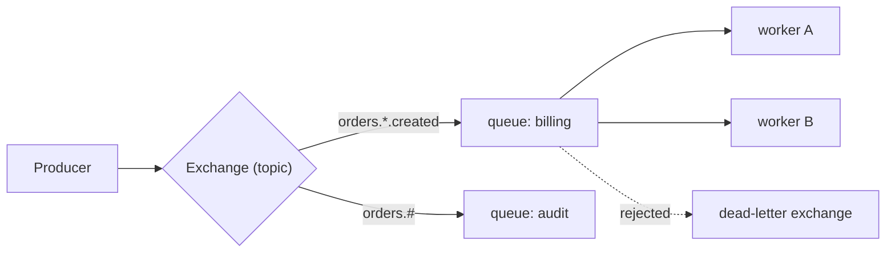

## 🎯 TL;DR

> Kafka is a **distributed log**: messages are kept for a retention period, many consumers read at their own pace, and they can replay. Other systems optimise for different jobs: **RabbitMQ** for routing and per-message work queues, **Pulsar** for multi-tenant, geo-replicated storage-and-messaging, **Redpanda** for the Kafka API with a simpler operational footprint, **NATS** for lightweight, low-latency subject-based messaging.

- Pick by **the job**, not by the brand: work distribution, event log, request/reply, or edge messaging.
- Ask four questions: do I need **replay**, **per-message acknowledgement**, **routing rules**, and **how many operational components** can the team run?
- A cloud-managed service (SQS, Pub/Sub, Kinesis, Event Hubs) is often the right answer when you do not want to run brokers at all.

## 🌱 Start simple (Junior)

> **💡 Analogy:** Kafka is a **newspaper archive**: copies stay on the shelf for days, and every reader can open any edition at any time. A **RabbitMQ queue** is a **to-do list**: each task is handed to one worker, and once it is marked done, it is gone. Both are useful; they answer different questions.

A tiny RabbitMQ worker in Python. It takes one email job at a time and acknowledges it only after the work succeeds:

```python
import pika

def send_email(body):
    print("sending:", body.decode())   # placeholder for real work

conn = pika.BlockingConnection(pika.ConnectionParameters("localhost"))
ch = conn.channel()
ch.queue_declare(queue="emails", durable=True)
ch.basic_qos(prefetch_count=10)        # at most 10 unacknowledged messages per worker

def handle(ch, method, props, body):
    try:
        send_email(body)
        ch.basic_ack(method.delivery_tag)
    except Exception:
        ch.basic_nack(method.delivery_tag, requeue=False)

ch.basic_consume(queue="emails", on_message_callback=handle)
ch.start_consuming()
```

If the worker crashes before `basic_ack`, RabbitMQ redelivers the message to another worker. That is the at-least-once guarantee, and it is the core reason queues exist.

## 🔧 How it really works (Mid)

**RabbitMQ.** Producers publish to an **exchange**. The exchange routes each message to one or more **queues** using bindings: `direct` (exact routing key), `topic` (wildcard patterns such as `orders.*.created`), `fanout` (copy to all bound queues), or `headers`. Consumers read from queues. A message is removed after it is acknowledged. Useful features:

- **Acknowledgements and prefetch** (`basic_ack`, `basic_qos`) control in-flight work per consumer.
- **Dead-letter exchanges** receive messages that were rejected, expired or exceeded a delivery limit.
- **Per-message TTL and priority queues** for delayed or urgent work.
- **Quorum queues** replicate a queue with Raft. Classic mirrored queues are deprecated in current versions; check the docs for yours.
- **Streams** (an append-only log with offsets, added in 3.9) give replay for some workloads, but the model and tooling are different from classic queues.



**Pulsar.** Brokers are stateless and serve topics. Data is stored in **BookKeeper** ledgers across bookies, so compute and storage scale separately. Topics are partitioned, and each **subscription** has a mode: `exclusive`, `failover`, `shared` (queue-like, many consumers share messages), or `key_shared` (messages with the same key go to the same consumer). Pulsar has namespaces for multi-tenancy, geo-replication, and tiered storage to object storage for old data.

**Redpanda.** A single C++ binary that speaks the Kafka wire protocol and uses Raft instead of ZooKeeper. Existing Kafka clients usually work unchanged. It is attractive when you want Kafka semantics with fewer moving parts. Compatibility is not 100%: check the feature matrix for the APIs and tools you use, and check licensing for the features you need.

**NATS.** Messages go to **subjects** (`orders.created`), and subscribers can use wildcards (`orders.*` for one token, `orders.>` for all below). Core NATS is fire-and-forget (at-most-once) and very fast, with request/reply built in. **JetStream** adds persistence, consumers with acknowledgements (at-least-once), and a deduplication window keyed by a message id header.

```bash
# Terminal 1: subscribe to all order events
nats sub 'orders.>'

# Terminal 2: publish one event
nats pub orders.created '{"id": 1, "amount": 500}'
```

**Managed services.** Amazon SQS is a queue (standard or FIFO), Amazon SNS fans out notifications, Kinesis Data Streams is a sharded log, Google Pub/Sub has topics and subscriptions, and Azure Event Hubs is a Kafka-compatible log. Each trades control for operational simplicity.

## 🧠 Senior depth & trade-offs

- **Delivery semantics come from the design.** Queues with acknowledgements give at-least-once delivery, so consumers must be idempotent (see [[delivery-semantics]]). Kafka's exactly-once features work inside Kafka ([[kafka-exactly-once]]); they do not extend to a queue's external side effects.
- **Ordering.** RabbitMQ preserves order per queue for one consumer, but redelivery after a nack or a crash reorders messages. Pulsar's `failover` subscription keeps order per partition with one active consumer; `key_shared` keeps order per key. Kafka orders within a partition. Decide what ordering the business needs before you pick.
- **Throughput and retention.** Kafka and Pulsar are built for high-throughput logs with long retention. RabbitMQ classic queues are optimised for many small messages with routing and acks; they are not a long-term archive. NATS core keeps nothing; JetStream retention is configured per stream.
- **Replay and multiple consumers.** If several services need the same events at their own pace, a log (Kafka, Pulsar, Redpanda, JetStream streams) is the natural model. If each job should be processed once by one worker, a queue fits better. Using a queue for fan-out to many independent consumers means copying messages and multiplying storage.
- **Operations.** Count the components: Kafka with KRaft is brokers and controllers; Pulsar is brokers, bookies and a metadata store; RabbitMQ is nodes plus quorum queue replication; NATS is small. The cheapest system to run is the one your team already knows well.
- **Interview framing.** Say what you would not choose and why. "I'd use RabbitMQ for background email jobs because each job is handled once, I need per-message acks and a dead-letter queue, and volume is moderate. I'd not use it as the source of truth for analytics because it deletes messages on ack."

**Decision guide**

| Need | Good fit |
|---|---|
| Replay, many consumer groups, high throughput, data platform | Kafka (or Redpanda with the same API) |
| Task queue, routing rules, delayed or priority jobs | RabbitMQ, SQS |
| Multi-tenancy, geo-replication, tiered storage at scale | Pulsar |
| Kafka API with less operational overhead, single binary | Redpanda (verify compatibility) |
| Lightweight messaging, request/reply, edge or IoT | NATS (JetStream for persistence) |
| No brokers to run at all | SQS, Pub/Sub, Kinesis, Event Hubs |

## 🧪 Try it

1. A payments team needs every transaction event to be available for replay for 30 days, to be read by fraud, billing and analytics consumers independently. Which system family fits and why?
2. A background job queue must retry failed image resizes up to 3 times and then park them for inspection. Which RabbitMQ features make this work?
3. A team wants Kafka clients to keep working but dislikes running ZooKeeper and the JVM. What would you evaluate, and what would you verify before migrating?

<details><summary>Show solutions</summary>

**1.** A log: Kafka (or Pulsar, Redpanda, or JetStream streams). Each consumer group reads at its own pace, the data is retained for 30 days, and replay is native. A RabbitMQ classic queue would delete messages on ack, so the three teams would need separate queues and copies.

**2.** A combination of manual acknowledgements, requeue-or-reject logic (`basic_nack` with `requeue=False` after a delivery count check), and a dead-letter exchange that routes rejected messages to a parking queue. Quorum queues provide the delivery-limit and dead-lettering features in current versions; check the docs for your version.

**3.** Evaluate Redpanda, and possibly a managed Kafka service. Verify the client API versions you use, the Kafka ecosystem tools (Connect, Schema Registry, Streams or Flink connectors), transactions and exactly-once behaviour if you use them, the licence for enterprise features, and how you will migrate offsets and topics without downtime.

</details>

## 💬 Interview corner

**Question: "Why would you use RabbitMQ when we already have Kafka?"** Mid answer: "RabbitMQ is a traditional broker with routing, per-message acks and a dead-letter queue; it's good for task queues." Senior answer: "If the workload is a set of independent jobs, each handled once, with complex routing and retries, RabbitMQ's model fits and it avoids building retry and parking logic on top of a log. I'd keep Kafka for the event stream that many systems replay. I'd make sure the team understands the ordering and redelivery behaviour of each, because that's where the bugs come from."

**Question: "Pulsar or Kafka?"** Mid: "Both are logs with partitions; Pulsar separates compute from storage and has built-in multi-tenancy." Senior: "I'd pick Pulsar for many tenants on one platform, geo-replication and tiered storage at scale, and accept that it means running bookies and a metadata store. I'd pick Kafka for the largest ecosystem of connectors and stream processors."

> **🎤 Say this in the interview:** "I choose by the job: a log for replay and fan-out, a queue for work distribution, a lightweight subject bus for request/reply and edge. Then I check the operational cost and the delivery and ordering semantics that the team has to live with."

## ⚠️ Common mistakes

> **⚠️ Watch out:** Treating RabbitMQ as a long-term event store. Messages are removed after acknowledgement, so replay is not the default model.

> **⚠️ Watch out:** Assuming "Kafka-compatible" means every feature and tool is compatible. Check APIs, transactions and connectors.

- Choosing a system by popularity without writing down the delivery and ordering requirements.
- Using a queue for fan-out to many independent consumers, which multiplies copies.
- Forgetting that redelivery after a crash breaks ordering in a queue.
- Assuming NATS core persists messages. It does not; use JetStream if you need persistence.
- Skipping a dead-letter path, so poison messages block or loop forever.
- Running a self-managed broker when a managed service would meet the requirement.

## ✅ Check yourself (quiz)

1. Which system is designed so that a message is removed after one worker acknowledges it?
   - A) Kafka topic with a long retention
   - B) RabbitMQ classic queue
   - C) Pulsar topic with an `exclusive` subscription
   - D) An archive in object storage

<details><summary>Answer</summary>

**B** — a RabbitMQ queue deletes a message after it is acknowledged, which suits per-job work distribution. Kafka and Pulsar keep messages for their retention period, regardless of consumers.

</details>

2. Which RabbitMQ exchange type routes by wildcard patterns like `orders.*.created`?
   - A) `direct`
   - B) `fanout`
   - C) `topic`
   - D) `headers`

<details><summary>Answer</summary>

**C** — the `topic` exchange matches routing keys against patterns with `*` (one word) and `#` (zero or more words).

</details>

3. What does NATS core do when a subscriber is offline at publish time?
   - A) It stores the message until the subscriber returns
   - B) It delivers the message to a dead-letter queue
   - C) It drops the message, because core NATS is fire-and-forget
   - D) It retries for 24 hours

<details><summary>Answer</summary>

**C** — core NATS does not persist messages; delivery is at-most-once. If you need persistence and acknowledgements, use JetStream.

</details>

4. **(Senior)** A team uses RabbitMQ with several consumers on one queue and sees orders processed out of sequence after crashes. Why, and what is the right fix?

   - A) RabbitMQ never preserves order; move to Kafka for all workloads
   - B) Redelivery after a crash puts a message back behind later ones, so order is not guaranteed; either accept order-insensitive processing or use a partitioned log or an ordering key with one consumer per key
   - C) The prefetch is too high; set it to 1 and ignore ordering
   - D) The problem is in the producer; add a retry

<details><summary>Answer</summary>

**B** — a redelivered message can arrive after later messages already processed. The fix depends on the business: make processing order-insensitive (versioned updates), or route by key to a log or a single consumer per key so the order is preserved where it matters.

</details>

5. **(Senior)** Which option best describes when a managed cloud messaging service is the right choice?

   - A) Only when you have no traffic
   - B) When the team wants to avoid operating brokers and the required features (ordering, retention, routing) fit the service's limits
   - C) Whenever a self-managed system is too cheap
   - D) Only for batch workloads

<details><summary>Answer</summary>

**B** — managed services trade control and some features for near-zero broker operations. They are a strong default when their limits (retention, ordering scope, throughput quotas, vendor lock-in) match the requirements.

</details>

## 🗂️ Flashcards

| Front | Back |
|---|---|
| RabbitMQ message lifecycle | Published to an exchange, routed to a queue, removed after ack |
| RabbitMQ `topic` exchange | Routes by pattern keys with `*` (one word) and `#` (many words) |
| Dead-letter exchange | Receives rejected, expired or over-retried messages for inspection |
| Pulsar's storage layer | BookKeeper ledgers on bookies; brokers are stateless |
| Pulsar `key_shared` subscription | Messages with the same key go to the same consumer |
| NATS core delivery | At-most-once, fire-and-forget, no persistence |
| JetStream | NATS persistence with acknowledgements and at-least-once delivery |
| Redpanda's main pitch | Kafka wire protocol in one C++ binary, Raft instead of ZooKeeper (verify compatibility) |

## 🔗 Go further

- [[queues-vs-logs]] explains the model difference between queues and logs in depth.
- [[kafka-architecture]] covers brokers, partitions and the replication behind Kafka's log.
- [[delivery-semantics]] and [[kafka-exactly-once]] explain at-least-once, idempotency and transactions.
- [[dlq-bad-records]] shows dead-letter design for bad messages in any system.
- [[kafka-streams]] is the library option when your processing lives inside a Kafka-based service.
- Check each vendor's compatibility and feature docs for your version before committing; the trade-offs above are stable, the feature lists are not.
