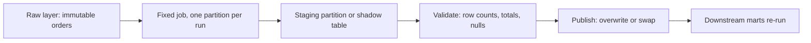

## 🎯 TL;DR

> A **backfill** is running a pipeline again for **past** data: to fill a gap, fix a historical bug, or apply a new business rule to old rows. Done well, it is **idempotent**, **isolated** from the live flow, and **verified** before anyone reads the result.

- Recompute by **partition** (usually a day or an hour), not by one giant job.
- Make every partition write **overwrite** instead of **append**, so a re-run never doubles the data.
- Pick a **cutover point** for streaming: the backfill owns everything before it, the live job owns everything after it.
- Control resources and downstream impact, then check row counts and totals before you publish.

## 🌱 Start simple (Junior)

> **💡 Analogy:** A teacher finds a wrong answer key for last month's quiz. She does not give everyone a new grade by hand. She re-grades every paper with the fixed key, one class at a time, and replaces the old grades. That re-grading is a backfill.

Imagine a `daily_revenue` table built every night from the `orders` table. On March 3 you find that refunds were counted as sales. You fix the query. Now the rows for the last 90 days are wrong, and tomorrow's run only fixes tomorrow.

A backfill re-runs the fixed query for each of the 90 days:

```text
for each day in [2026-01-01 .. 2026-03-31]:
    rebuild daily_revenue for that day, replacing the old rows
```

Two rules make this safe:

1. **Replace, do not add.** Running the job for March 3 twice should give the same table as running it once.
2. **Go one day at a time.** If something fails on day 42, you restart from day 42, not from day 1.

Those two rules have a name: the job must be **idempotent** (see [[idempotency]]).

## 🔧 How it really works (Mid)

A batch pipeline is usually parameterized by a **data interval**: the job for `dt = 2026-03-03` reads only the input for that interval and writes only that partition. A backfill is then just a loop over intervals, possibly in parallel.

Here is a minimal Spark version. The key is the dynamic partition overwrite, which replaces only the partitions the job actually writes:

```python
from datetime import date, timedelta
from pyspark.sql import SparkSession

spark = SparkSession.builder.getOrCreate()
# Replace only the partitions this run writes, not the whole table.
spark.conf.set("spark.sql.sources.partitionOverwriteMode", "dynamic")

def run_day(day: str) -> None:
    spark.sql(f"""
        INSERT OVERWRITE TABLE analytics.daily_revenue PARTITION (dt)
        SELECT product_id,
               SUM(CASE WHEN status = 'refund' THEN -amount ELSE amount END) AS revenue,
               dt
        FROM raw.orders
        WHERE dt = '{day}'
        GROUP BY product_id, dt
    """)

d, end = date(2026, 1, 1), date(2026, 3, 31)
while d <= end:
    run_day(d.isoformat())
    d += timedelta(days=1)
```

Running `run_day("2026-03-03")` twice leaves exactly one copy of each row. That is the property you are buying.

The source matters as much as the job. A backfill can only be as good as the history you still have:



Notice the **staging** step. Writing straight into production means readers see half-fixed data while the job runs. Writing to a shadow table and swapping it in at the end gives an all-or-nothing change. Table formats such as Iceberg or Delta support atomic commits, which makes this swap cheap; check your engine's docs for the exact mechanism.

**Where do the input rows come from?**

- **Batch:** the raw or bronze layer, which keeps the original immutable records. This is the normal source.
- **Streaming:** the event log (for example a Kafka topic) within its retention period, or a copy of the events written to the lake. Once retention expires, the events are gone.

## 🧠 Senior depth & trade-offs

- **Blast radius.** A backfill of 90 days can saturate the same cluster that serves the daily SLA. Run it in its own queue or resource pool, cap concurrency (for example 4 partitions at a time), and rate-limit any call that hits a live database or external API.
- **Order matters for stateful logic.** Cumulative sums, running balances and SCD2 histories depend on the previous partition. Backfill those in date order. Independent daily aggregates can run in parallel.
- **Code versions.** If the backfill runs a newer version of the code, the new history will not match the old history in the rest of the table. Tag each row with a pipeline version when the business meaning changed, or agree on a single cutover date and document it.
- **Streaming handoff.** For a streaming table, pick a **cutover timestamp** `T`. The backfill job reads data strictly before `T` (in bounded batch mode, or from a bounded replay), and the live job starts from `T`. Without a clean boundary you get a **gap** (nothing covers the seam) or **double counting** (both jobs cover it). Use event time for the boundary, not processing time, and use the same idempotent sink so a small overlap does not duplicate rows (see [[exactly-once]]).
- **Late data.** Events from before `T` can still arrive after the backfill finished. Decide the allowed lateness and whether a later re-run of the affected days is needed (see [[late-arriving-data]]).
- **Verification.** Before publishing, compare the new partitions against an expected value: row counts from the source, a sum of the measure, the number of distinct keys, and the difference from the old version. A backfill without a reconciliation step is a guess that looks like a fix.
- **Orchestration risk.** Schedulers such as Airflow can create one run per missed interval when you enable catchup (see [[airflow]]). A careless date range can start hundreds of runs at once. Set the range and concurrency on purpose, and check the scheduler docs for your version.
- **When not to backfill.** If the source has already purged the history and no raw copy exists, a backfill cannot be correct. Say so, document the gap, and only fix forward. Also, a metric that is computed on read (a view) does not need a backfill at all.

## 🧪 Try it

You have a `clicks` table partitioned by `dt`, and a bug caused duplicate rows on `2026-02-14` and `2026-02-15`. The raw layer still has the original events.

1. Write the Spark SQL that rebuilds one day's `clicks_clean` partition from `raw.clicks` with `DISTINCT` on `click_id`, using overwrite semantics. Why must you not use `INSERT INTO`?
2. Explain how you would verify the repaired days: name two checks that would catch a half-finished run.
3. You discover the bug only affects clicks from one mobile app version. What would you change in the backfill range, and why?

<details><summary>Show solutions</summary>

**1.**
```sql
INSERT OVERWRITE TABLE analytics.clicks_clean PARTITION (dt)
SELECT DISTINCT click_id, user_id, url, event_time, dt
FROM raw.clicks
WHERE dt = '2026-02-14';
```
`INSERT INTO` would append a second copy of every row on each re-run, which is exactly the duplication you are trying to fix.

**2.** Compare the row count of `clicks_clean` for each day with `COUNT(DISTINCT click_id)` from `raw.clicks` for the same day. Also compare the number of days written with the number expected (two). A half-finished run shows a lower count or a missing partition.

**3.** Keep the backfill range as it is if the reader can filter by app version. If the table has no app-version column, you may still need the whole day, because the fix must not change the rows of other versions. Restricting the range is only safe when the filter is exact and the untouched rows are rebuilt identically.

</details>

## 💬 Interview corner

> **🎤 Say this in the interview:** "How do you backfill six months of data safely?" is usually a senior question about **process**, not about syntax.

- **Mid answer:** "I would re-run the job per day with overwrite semantics, so re-runs are idempotent. I would process in date order, validate counts for each day, and only then let the downstream tables refresh."
- **Senior answer:** "I would make the job idempotent per partition and write to a staging table, then swap. I would run the backfill in an isolated resource pool with capped concurrency so the daily SLA is not touched. For streaming, I would choose a cutover timestamp so the backfill and the live job do not overlap or leave a gap, and I would reconcile totals against the source before publishing."
- **Staff hint:** Talk about who consumes the data during the backfill, how you communicate the affected range, and whether the old numbers need to be kept for audit.

**Model answer (3–5 sentences):** A backfill re-runs the fixed pipeline one partition at a time, with overwrite semantics so every re-run gives the same result. I write each partition to a staging area, validate counts and totals against the raw source, and swap it in atomically. I run the work in an isolated resource pool with bounded concurrency so the daily job keeps its SLA. For streaming tables I pick an event-time cutover so the backfill and the live job neither overlap nor leave a gap.

## ⚠️ Common mistakes

- **Appending instead of overwriting.** Each re-run doubles the rows. The fix is a partition overwrite or a merge on a natural key.
- **Running a backfill next to the live job on the same partitions.** The two writers race, and the last one wins. Serialize or partition the work by time.
- **Using the current time inside the logic.** `now()` gives a different answer each run, so the backfill is not reproducible. Use the data interval instead.
- **Forgetting the downstream tables.** Fixing `daily_revenue` does not fix the weekly report built from it. Re-run the dependency graph, not one node.
- **Assuming the history exists.** Kafka retention or a source purge can remove the input. Check before you promise a backfill.
- **One giant transaction.** A single 90-day job that fails on the last day wastes hours. Use small, restartable units.

## ✅ Check yourself (quiz)

1. A daily job uses `INSERT INTO` into a partitioned table. You re-run it for one day. What happens, and what should it use instead?
   - A) Nothing; Spark deduplicates automatically
   - B) The day's rows are doubled; use an overwrite of that partition
   - C) The whole table is replaced; use `TRUNCATE` first
   - D) The job fails with a constraint error

   <details><summary>Answer</summary>

   **B** — Append semantics add a second copy on every run. An overwrite of the partition makes re-runs idempotent.

   </details>

2. Why is a staging table plus an atomic swap safer than writing directly into production during a backfill?
   - A) It makes the job faster on every run
   - B) Readers never see a half-written mix of old and new partitions
   - C) It removes the need for validation
   - D) It avoids using partitions

   <details><summary>Answer</summary>

   **B** — The change becomes visible all at once, after validation. Speed and validation are separate concerns.

   </details>

3. A streaming table has a live job that started at 10:00 today. You backfill yesterday's events from the lake. What is the risk, and how do you avoid it?
   - A) No risk, because the sink is idempotent
   - B) Gap or double counting at the seam; choose an event-time cutover and read strictly before it
   - C) The live job will crash; restart it at midnight
   - D) Only the metadata is wrong; delete the checkpoint

   <details><summary>Answer</summary>

   **B** — Without a clean boundary, one window can be counted twice or missed. An explicit cutover on event time, with each job owning one side, avoids both.

   </details>

4. **Senior trade-off:** Your backfill of 90 days puts the daily SLA at risk. Which two controls reduce the risk without making the backfill incorrect?

   <details><summary>Answer</summary>

   Run the backfill in an isolated resource pool or queue, and cap the number of partitions processed at once (plus rate-limit any call to a live system). Neither changes the result, so correctness is kept, while the shared capacity is protected.

   </details>

5. Which input source is correct when Kafka retention is 7 days and the bug is 30 days old?

   <details><summary>Answer</summary>

   The raw or bronze layer in the lake, if it stored the events. Kafka no longer has the data after its retention expires, so a replay from the topic cannot cover 30 days.

   </details>

## 🗂️ Flashcards

| Front | Back |
|---|---|
| Backfill | Re-running a pipeline for past data to fill a gap or fix a historical bug |
| Why overwrite, not append? | Re-runs stay idempotent: the same input gives one copy of each row |
| Data interval | The time slice (day, hour) a job reads and writes; the unit of a backfill |
| Staging then swap | Write to a shadow table, validate, then publish atomically |
| Cutover timestamp | The event-time boundary that splits work between a backfill and the live job |
| Blast radius | How much shared capacity or downstream data a backfill can affect |
| Source of truth for replay | The immutable raw layer; Kafka only within its retention period |

## 🔗 Go further

- Topic: [[backfills]] (the broader view of batch backfills), [[pattern-dedup]], [[pattern-exactly-once]], [[pattern-late-data]].
- Glossary: [[backfill]], [[idempotency]], [[incremental-processing]], [[exactly-once]].
- Reference: your orchestrator's docs on backfills and catchup, and your table format's docs on atomic overwrites and snapshots.
