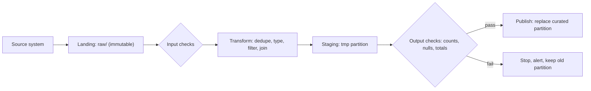

## 🎯 TL;DR

> A **batch ETL pipeline** loads one **partition** of data per run (usually one day), writes the result by **replacing that partition**, and keeps the **raw input untouched**. Running it twice for the same day gives the same answer, so reruns and backfills are safe.

- **Raw is immutable.** Land the source data as it arrived and never edit it. Every later step can be rebuilt from it.
- **Work per partition.** One run = one `dt` (date). Small, bounded units are easy to retry and to monitor.
- **Overwrite, do not append.** Replacing the partition makes the run idempotent. Appending duplicates data on every retry.
- **Publish after checks.** Validate the output, then make it visible in one step.

## 🌱 Start simple (Junior)

> **💡 Analogy:** A bakery that bakes a fresh batch of bread every morning from the same flour delivery. If the oven fails at 6:10, the baker throws away the half-baked tray and bakes the whole batch again. The flour delivery (the raw data) is never opened and mixed with yesterday's flour. The shop shows the bread only after it passes the quality check.

Suppose a shop sends you an export of orders every day. You want a table `curated.orders` with one clean row per order, and a daily total.

```text
raw (files as received)        curated (clean, queryable)
---------------------------    --------------------------
raw/orders/dt=2026-10-11/  ->  curated/orders/dt=2026-10-11/
raw/orders/dt=2026-10-12/  ->  curated/orders/dt=2026-10-12/
```

The rules that keep this simple:

1. **Copy the file into `raw/` first, exactly as received.** Never fix it in place.
2. **Each run reads one folder of `raw/`** (for example `dt=2026-10-12`).
3. **Each run writes one folder of `curated/`** and replaces whatever was there before.
4. **Re-running the job for `2026-10-12`** gives the same folder again. Nothing is doubled.

A minimal SQL version of step 3, inside one transaction:

```sql
BEGIN;
DELETE FROM curated.orders WHERE dt = DATE '2026-10-12';
INSERT INTO curated.orders (order_id, customer_id, amount, dt)
SELECT DISTINCT order_id, customer_id, amount, dt
FROM raw.orders
WHERE dt = DATE '2026-10-12' AND amount >= 0;
COMMIT;
```

If the job crashes after `DELETE` but before `COMMIT`, the transaction rolls back and yesterday's partition is still there. Readers never see half a day.

## 🔧 How it really works (Mid)

A batch ETL pipeline is a **DAG** of steps driven by a scheduler (for example [[dag]] in Airflow). Each run has a **logical date** (the business day it represents), which is not the wall-clock time the job runs.



The key steps:

1. **Land.** Copy the source extract to `raw/dt=<date>/`. Keep the file name, checksum and load time in a manifest. This layer is the audit trail and the replay source.
2. **Check the input.** Row count is not zero (unless zero is allowed), schema matches, required keys are present. A bad input should stop the run before it writes anything.
3. **Transform.** Deduplicate by business key, cast types, apply rules, join to dimensions. Write to a **staging** location, not to the final table.
4. **Check the output.** Compare with the input and with the previous days (row counts within an expected range, no null keys, totals not negative).
5. **Publish.** Replace the partition in the final table. Typical ways:
   - **Dynamic partition overwrite** in Spark: only the partitions present in the DataFrame are replaced.
   - **Delete-then-insert** in one transaction (warehouses, PostgreSQL).
   - **Atomic swap** of a table or a view that points to the new partition folder.

A PySpark job for one day:

```python
from pyspark.sql import SparkSession, functions as F

spark = (SparkSession.builder
         .appName("orders_daily")
         # Replace only the partitions that this DataFrame contains
         .config("spark.sql.sources.partitionOverwriteMode", "dynamic")
         .getOrCreate())

run_date = "2026-10-12"   # passed by the orchestrator, e.g. Airflow's {{ ds }}

raw = spark.read.parquet(f"s3://lake/raw/orders/dt={run_date}/")  # never written to
clean = (raw
         .dropDuplicates(["order_id"])                # dedupe by business key
         .filter(F.col("amount") >= 0)
         .withColumn("dt", F.lit(run_date)))          # partition column

(clean.write
      .mode("overwrite")                              # dynamic: only dt=2026-10-12 is replaced
      .partitionBy("dt")
      .parquet("s3://lake/curated/orders/"))
```

The scheduler sets the date and the retry policy. A minimal Airflow DAG shape:

```python
from datetime import datetime
from airflow import DAG
from airflow.operators.bash import BashOperator

with DAG(
    dag_id="orders_daily",
    start_date=datetime(2026, 1, 1),
    schedule="@daily",          # older Airflow versions call this schedule_interval
    catchup=False,
    max_active_runs=1,          # one day at a time, in order
    default_args={"retries": 3},
) as dag:
    land = BashOperator(task_id="land", bash_command="python land.py --dt {{ ds }}")
    load = BashOperator(task_id="load", bash_command="python load_orders.py --dt {{ ds }}")
    check = BashOperator(task_id="check", bash_command="python check_orders.py --dt {{ ds }}")
    land >> load >> check
```

**Late data in batch** is handled by the same mechanism. If a source delivers a correction for yesterday at 09:00 today, you rerun yesterday's partition. A common design reprocesses a **lookback window** (for example the last 3 days) every night, so late rows are picked up without manual work. The cost is more compute per run. Make the window a parameter.

**Why partitions and not rows?** Replacing a partition is cheap and exact. Finding the rows to update or delete one by one is slow and easy to get wrong. This is why batch pipelines in lakes and warehouses favour partition replacement, while [[upsert]] (`MERGE`) is reserved for tables where a partition is too large to rewrite.

## 🧠 Senior depth & trade-offs

- **Idempotency is the property you sell.** The pipeline is idempotent if `run(dt)` followed by `run(dt)` produces the same state as one run. Partition overwrite gives that for free. Append plus "delete duplicates later" does not. See [[idempotency]].
- **Atomicity of publish.** A reader must never see a half-written day. Options: transactions in a warehouse; in a lake, write to a new folder and switch a [[partition]] pointer or a table format snapshot (Iceberg, Delta). Check your engine's guarantee; a plain Parquet folder overwrite is not atomic for concurrent readers.
- **Small files.** One run per day, many tasks, can create thousands of small Parquet files. Add a compaction step or control the number of output files (`coalesce` or repartition by the partition key before the write). See [[small-files-problem]].
- **Skew.** A daily job that groups by one hot customer or one null key puts all the work on one task. Watch the Spark UI for a long straggler and handle the hot key before the aggregation ([[data-skew]]).
- **Scale numbers.** A day of 50 million order rows at about 200 bytes each is roughly 10 GB raw, before compression. A Spark job that reads and writes this once per day is comfortable on a small cluster. The same job at 10 times the volume needs a real capacity plan, not a bigger cluster by default.
- **Operations you should monitor:** run duration against its history, input row count against the previous days, output row count, number of failed checks, and **freshness**: when the last good partition landed compared with the [[sla-slo]].
- **When not to use it.** If the business needs answers within minutes, a daily batch is the wrong tool. Use [[pattern-realtime-aggregation]]. If the transform is simple SQL on data already in the warehouse, [[etl-vs-elt]] (transform inside the warehouse) can be simpler than a separate Spark job.
- **Lambda and Kappa.** A nightly batch often sits beside a real-time path to correct it. That combination is covered in [[pattern-lambda-kappa]] and [[pattern-reconciliation]].

## 🧪 Try it

Use the orders example from the lesson. Assume `raw.orders` holds three days, and each day has a few duplicate `order_id` rows.

1. **Idempotency test.** Write the SQL transaction above for `2026-10-12`. Run it twice. Count the rows before and after the second run. Explain why the count does not change.
2. **Lookback.** Change the job so that each run rebuilds the last 3 days (`dt` between `run_date - 2` and `run_date`). Write the `WHERE` clause and the `DELETE` range. Why must the `DELETE` range and the `INSERT` range be the same?
3. **Quality gate.** Write a SQL check that fails the run if the number of rows for the day is less than 50 percent of the average of the previous 7 days.

<details><summary>Show solutions</summary>

**1.** The first run deletes nothing new and inserts the day's distinct rows. The second run deletes exactly those rows and inserts them again. The count is the same both times, because the delete and insert cover the same key, `dt = 2026-10-12`. Without the `DELETE`, the second run doubles the rows.

**2.**
```sql
DELETE FROM curated.orders
WHERE dt BETWEEN DATE '2026-10-10' AND DATE '2026-10-12';

INSERT INTO curated.orders (order_id, customer_id, amount, dt)
SELECT DISTINCT order_id, customer_id, amount, dt
FROM raw.orders
WHERE dt BETWEEN DATE '2026-10-10' AND DATE '2026-10-12' AND amount >= 0;
```
If the `DELETE` range is smaller than the `INSERT` range, rows in the extra days are duplicated. If it is larger, you delete data that is not rebuilt. The two ranges must match.

**3.**
```sql
WITH today AS (
  SELECT COUNT(*) AS n FROM curated.orders WHERE dt = DATE '2026-10-12'
),
baseline AS (
  SELECT AVG(day_count) AS avg_n
  FROM (
    SELECT dt, COUNT(*) AS day_count
    FROM curated.orders
    WHERE dt BETWEEN DATE '2026-10-05' AND DATE '2026-10-11'
    GROUP BY dt
  ) d
)
SELECT CASE WHEN today.n < 0.5 * baseline.avg_n THEN 'FAIL' ELSE 'PASS' END AS gate
FROM today, baseline;
```
The orchestrator runs this after the load and stops the DAG when the result is `FAIL`, leaving the previous partition in place.

</details>

## 💬 Interview corner

**Question: "Design a daily ETL that loads orders into a warehouse. What happens when it fails halfway?"**

Mid answer: "I'd schedule it in Airflow with a retry. On a failure, the retry reruns the job. I'd make sure the load deletes the day's rows before inserting, so retries don't duplicate."

Senior answer: "I'd keep an immutable raw layer, process one partition per run, and publish by replacing that partition in one transaction or atomic pointer swap. A retry or a backfill reruns the same date and gives the same result, so the pipeline is idempotent. I'd add input and output checks that stop the run before publish, a lookback window for late corrections, and freshness and row-count monitors against the SLA."

**Question: "How do you backfill six months of history?"** Run the same job per partition in date order, with bounded parallelism. The idempotent design is what makes that safe. See [[pattern-backfill]].

> **🎤 Say this in the interview:** "I make each run a pure function of one partition. Raw data is never edited. The output partition is replaced, not appended, so reruns and backfills are safe. Checks run before publish, so a bad input never reaches consumers."

## ⚠️ Common mistakes

> **⚠️ Watch out:** Appending the day's output to the table on every run. A retry then doubles the data, and nothing in the schema stops it.

> **⚠️ Watch out:** Using the wall-clock date (`now()`) instead of the logical date from the scheduler. A rerun for last Tuesday then writes into today's partition.

- Editing files in `raw/`. You lose the ability to replay and to explain past numbers.
- Overwriting the whole table instead of the partition. Cost grows with history, and a failure in the middle can leave the table empty.
- Deleting with one range and inserting with another (the lookback bug in the exercise).
- No output checks, so a source that sends an empty file publishes a day with zero orders and nobody notices.
- Doing dedup by `DISTINCT` on all columns. Two versions of the same order with different `updated_at` values survive. Dedup by business key, with an explicit "latest wins" rule. See [[pattern-dedup]].
- Ignoring time zones. A `dt` derived from UTC timestamps may not match the business day in Tehran or the reporting zone.

## ✅ Check yourself (quiz)

1. A daily job appends its output to `curated.orders`. The job crashed after writing half the rows and was retried. What is the most likely result, and what is the fix?
   - A) Nothing; the database removes duplicates automatically
   - B) Some orders appear twice; replace the partition instead of appending
   - C) The retry fails with a primary key error and the table is empty
   - D) The orders are sorted differently; add an `ORDER BY`

<details><summary>Answer</summary>

**B** — appending is not idempotent. The partially written rows stay, and the retry adds the full set again. Deleting the partition and inserting it (or overwriting the partition) makes the run repeatable.

</details>

2. Which property must hold so that a backfill of six months is safe to run?
   - A) The job must run on a Sunday
   - B) Each run must produce the same result for its partition no matter how many times it runs
   - C) The job must read the whole history on every run
   - D) The raw files must be deleted after each run

<details><summary>Answer</summary>

**B** — idempotency per partition makes reruns and backfills safe. Reading all history (C) is the opposite of what you want, and deleting raw data (D) removes the replay source.

</details>

3. Why should the job use the **logical date** from the scheduler and not `current_date()` inside the code?

   - A) `current_date()` is slower
   - B) A rerun or backfill for an old date would write into today's partition; the logical date makes each run target the right partition
   - C) The scheduler does not allow date arguments
   - D) Logical dates are required for Parquet files

<details><summary>Answer</summary>

**B** — the run must be a function of its partition key. If the code uses the current time, a rerun for last week changes the wrong partition.

</details>

4. **(Senior)** Your nightly job takes 9 hours. The Spark UI shows one task running for 8 hours while the others finish in minutes. What is the likely cause, and what would you change?

   - A) Too few Parquet files; add more partitions
   - B) Data skew on one key (for example a null or a hot customer); salt the key or handle the hot key separately before the aggregation
   - C) The output format is wrong; use CSV
   - D) The Airflow retry count is too high

<details><summary>Answer</summary>

**B** — one straggler task with most of the data points to skew. Splitting the hot key (salting, or isolating it in its own step) spreads the work. Check the key distribution first; do not guess.

</details>

5. **(Senior)** Your team wants to rebuild the last 3 days each night to pick up late corrections. What is the trade-off, and what must be true about the code?

   - A) It is free, because the data is already in memory
   - B) It costs about three times the compute per run, and the delete and insert ranges must match exactly so no day is duplicated or lost
   - C) It only works with streaming engines
   - D) It removes the need for raw data

<details><summary>Answer</summary>

**B** — a lookback window trades compute for correctness on late data. The publish step must delete and insert the same set of partitions, or the window creates duplicates or gaps.

</details>

## 🗂️ Flashcards

| Front | Back |
|---|---|
| What is one batch run usually? | One partition (for example one day), identified by the logical date |
| Why keep a raw layer? | Replay, audit and rebuild; it is never edited |
| Why replace the partition instead of appending? | Reruns and retries stay idempotent; appending duplicates data |
| What is the logical date? | The business day the run represents, set by the scheduler, not the wall clock |
| What does a lookback window handle? | Late corrections for past partitions, at the cost of more compute |
| Where do checks run? | After transform and before publish; a failure keeps the old partition |
| Dynamic partition overwrite in Spark | Only partitions present in the written DataFrame are replaced |
| Main risk of a fixed `DELETE` range with a different `INSERT` range | Duplicates or missing days |

## 🔗 Go further

- [[pattern-backfill]] shows how the same per-partition design is used to rebuild history.
- [[pattern-dedup]] and [[dedup-idempotent-loads]] cover the dedup rules this pipeline depends on.
- [[pattern-late-data]] is the streaming counterpart: what to do when results are already published.
- [[pattern-reconciliation]] explains how to compare the batch result with a real-time one.
- [[medallion-architecture]] names the raw, cleaned and curated layers used here.
- The Airflow documentation for your version explains the scheduling parameters (`schedule`, `catchup`, `max_active_runs`) in detail.
