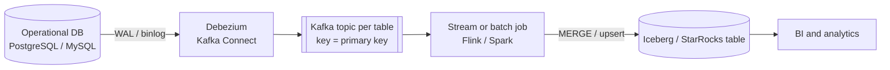
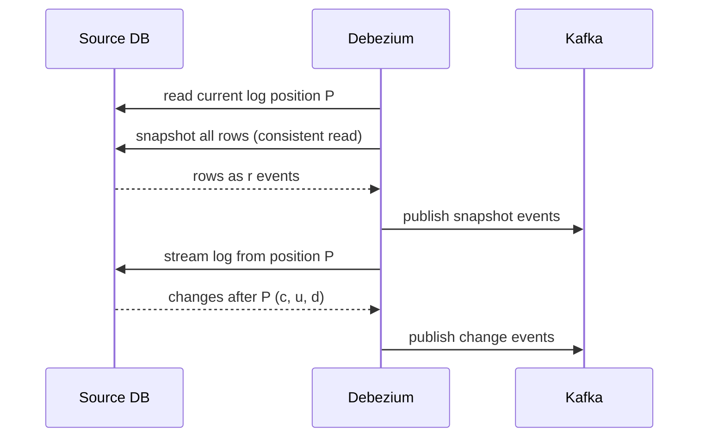

## 🎯 TL;DR

> **CDC to analytics** copies every insert, update and delete from an operational database into an analytics table, in near real time, without querying the production tables again and again.

- The change log of the source (MySQL binlog, PostgreSQL WAL) is the source of truth for changes. A connector such as **Debezium** reads it and writes one event per row change to Kafka.
- The first load is a **snapshot**. After it, the pipeline must continue from the exact log position where the snapshot was taken. Otherwise rows are lost or duplicated.
- The analytics table must behave like a **mirror**: apply events with **upserts and deletes by primary key**, in the right order, and tolerate replays.

## 🌱 Start simple (Junior)

> **💡 Analogy:** A shop keeps a notebook of every sale, return and price change, in the order they happen. An accountant who wants an up-to-date stock report does not walk through the shop every hour. They copy the notebook's new lines into their own spreadsheet: "add this sale", "change that price", "remove this order". The spreadsheet ends up equal to the shop's state.

In database terms:

- The **operational database** (for example, the orders service's PostgreSQL) is the shop.
- The **change log** (the WAL in PostgreSQL, the binlog in MySQL) is the notebook.
- The **warehouse table** is the accountant's spreadsheet.

Each change becomes an event with an operation code: `c` (create), `u` (update), `d` (delete), and `r` (read, used for the initial snapshot). A simplified event for one customer looks like this:

```json
{
  "op": "u",
  "before": {"id": 1, "name": "Ali"},
  "after":  {"id": 1, "name": "Ali R."},
  "source": {"table": "customers", "lsn": 103}
}
```

Your job in the pipeline is to read these events in order and make the analytics table match the source. Three things make this hard: the first copy of all the data, the rows that are deleted, and the events that arrive more than once or out of order.

## 🔧 How it really works (Mid)



### Step 1: the initial snapshot and the handoff

A table can have billions of rows, and the change log may not keep the history from the beginning. So the connector does two things in order:

1. It records the current log position (for example, an LSN in PostgreSQL or a binlog file and offset in MySQL).
2. It reads the full table as `r` events (a consistent read at that point).
3. It switches to reading the log **from the recorded position** onward.



The handoff is the risky part. If the snapshot read and the log stream do not share a boundary, rows changed during the snapshot can be missed or applied twice. Connectors avoid this by taking the position before the snapshot starts. Because some changes from that window are applied twice (the snapshot already has them, and the log replays them), the sink must be **idempotent**: applying an event that is already reflected must not change the result.

In practice, you run a snapshot once per table, then keep the stream running. Re-running a snapshot is a backfill, and it needs its own plan (see [[backfills]]).

### Step 2: ordering per key

Kafka guarantees order only inside a partition. If the connector partitions by primary key, all changes for one customer go to one partition in order. That is why the topic key matters. If you partition by a random value or by the table name, two updates of the same row can be processed out of order, and the final state is wrong.

Every event carries a position in the source log (LSN or binlog position). Use that position, not the arrival time, to decide which change is newer. Positions are comparable only inside one source database. Changes from two different databases have no shared order, so never mix them into one table key without a source identifier.

### Step 3: apply the events as upserts and deletes

The core of the pattern is one rule: **keep the latest change per primary key, then merge**. In a micro-batch, the same row may appear several times. Select the latest one first, using a window function, and then merge it into the target.

```sql
-- 1. keep only the latest change per key in this micro-batch
CREATE OR REPLACE TEMPORARY VIEW latest AS
SELECT * FROM (
  SELECT c.*,
         ROW_NUMBER() OVER (PARTITION BY c.id ORDER BY c.source_lsn DESC) AS rn
  FROM cdc_batch AS c
) AS ranked
WHERE rn = 1;

-- 2. apply to the lake table (Spark SQL with an Iceberg or Delta MERGE)
MERGE INTO lake.customers AS t
USING latest AS s
  ON t.id = s.id
WHEN MATCHED AND s.op = 'd' THEN DELETE
WHEN MATCHED AND s.op IN ('c', 'u', 'r') AND s.source_lsn > t.source_lsn THEN
  UPDATE SET name = s.name, email = s.email, source_lsn = s.source_lsn
WHEN NOT MATCHED AND s.op <> 'd' THEN
  INSERT (id, name, email, source_lsn) VALUES (s.id, s.name, s.email, s.source_lsn);
```

Two details matter here:

- The condition `s.source_lsn > t.source_lsn` is the **version guard**. A replayed or late event cannot overwrite a newer row.
- A delete with no matching target row is simply skipped. That makes replays of deletes safe.

### Deletes

A `d` event tells you that a row is gone at the source. You have three choices in the analytics layer:

| Approach | What happens | When to use |
|---|---|---|
| Hard delete | `DELETE` the row in the mirror | Mirror tables that must equal the source; no history needed |
| Soft delete | Keep the row with `is_deleted = true` and the source position | Auditing, late joins, "what did we know then" analysis |
| Historical (SCD2) | Close the old version and insert a new one | Full history of attribute changes (see [[scd]]) |

Deletes also interact with Kafka. Log-compacted topics use a **tombstone** (a record with the key and a null value) to remove a key from the compacted history. Debezium emits a delete event and can emit a tombstone after it. Your consumer must handle both: the `d` event applies the delete, the tombstone carries no row data.

### Schema changes

The source table will change: a new column, a renamed column, a type change. Three layers must agree:

- **The connector** captures DDL and tracks the schema history, so it knows how to decode each row version.
- **The topic and schema registry** must accept the new schema under your compatibility rule (usually backward compatible: new optional columns only).
- **The target table** needs the column before the first row that uses it arrives. Add columns to the lake table first, then let the new events flow.

Renames and type narrowing are not compatible changes. The usual safe path is: add the new column, backfill it, switch readers, then drop the old column in a later release. See [[schema-evolution]] and [[pattern-schema-evolution]].

## 🧠 Senior depth & trade-offs

**Choose the sink by the access pattern.** Both Iceberg and StarRocks can receive upserts, but they fit different loads:

- **Iceberg** on object storage is cheap, open and shared with Spark, Trino and Flink. Each `MERGE` commit creates new files. Frequent small commits create many small files and slow reads, so you need compaction and a commit interval that balances freshness and file count. Merge-on-read reduces write cost but adds read cost. The copy-on-write versus merge-on-read choice is the first design decision for a CDC-heavy table (see [[lakehouse-table-formats]]).
- **StarRocks primary-key tables** are built for upserts and deletes by key and serve low-latency queries directly. Use them when the analytics must be fresh (seconds) and queried heavily. The cost is an operational system to run and a smaller shared footprint than the lake.

**Latency is set by the slowest step.** The end-to-end delay is the sum of connector lag, Kafka lag, the stream or micro-batch interval, and the merge time. Measure each separately. A common surprise is that the connector is fine but a big `MERGE` every five minutes takes four minutes, so freshness is always "about ten minutes" no matter what you tune upstream.

**WAL and binlog risks.** A logical replication slot in PostgreSQL holds WAL on the primary until the connector confirms it has read it. If the connector stops (for example, the Kafka cluster is down for hours), the WAL grows and can fill the disk of the production database. This is one of the most serious operational risks in CDC. Monitor the slot lag, set alerts on it, and have a plan to drop the slot if the connector cannot be recovered. In MySQL, the binlog retention must be longer than the longest connector outage.

**Ordering across tables.** Each table is consistent only inside itself. If a `customers` change and an `orders` change are joined in the lake, a reader can see the order before its customer. Solve this with a consistent read point at query time, or accept eventual consistency and say so in the design.

**Monitoring:**

- Connector lag: time between the source commit timestamp and the event being published.
- Consumer lag in Kafka and the age of the last applied event per table.
- Row-count and checksum reconciliation between the source and the mirror, per table and per key range. A sample of primary keys compared with the source catches silent drift, which lag metrics do not.
- Schema registry failures and DDL events in the schema history topic.

**When not to use this pattern.** If the source is small, the data is needed daily, and the table has no deletes, a nightly full extract or an incremental query on an `updated_at` column is simpler. It misses hard deletes, which is why CDC exists, but for many tables that is acceptable. Query-based incremental extraction also puts load on the production database, while log-based CDC reads the log and avoids that.

**Failure modes you should name in an interview:**

- Replaying an old snapshot over new data, undoing newer changes. The version guard prevents it.
- Missing deletes because the pipeline only handled `c` and `u`.
- A table whose primary key changes. The update becomes a delete plus an insert with a new key; the mirror keeps an orphan row unless you handle the delete.
- Large transactions at the source that produce a burst of events and a long merge.

## 🧪 Try it

The program below applies a CDC stream to a mirror table with a version guard. It receives events out of order and with a duplicate, as a real pipeline sometimes does.

```python
import sqlite3

EVENTS = [  # (lsn, op, id, name) as a CDC stream delivers them, out of order
    (101, "c", 1, "Ali"),
    (103, "u", 1, "Ali R."),
    (102, "c", 2, "Sara"),
    (104, "d", 2, None),
    (100, "c", 1, "Ali"),  # late duplicate from a retry: older position
]

def init(db):
    db.execute("""CREATE TABLE IF NOT EXISTS customers (
        id INTEGER PRIMARY KEY, name TEXT, lsn INTEGER NOT NULL, deleted INTEGER NOT NULL DEFAULT 0)""")

def apply(db, lsn, op, cid, name):
    row = db.execute("SELECT lsn FROM customers WHERE id = ?", (cid,)).fetchone()
    if row and row[0] >= lsn:
        return  # the mirror already has this change or a newer one
    if op == "d":
        db.execute(
            "INSERT INTO customers VALUES (?, NULL, ?, 1) "
            "ON CONFLICT(id) DO UPDATE SET name = NULL, deleted = 1, lsn = excluded.lsn",
            (cid, lsn),
        )
    else:
        db.execute(
            "INSERT INTO customers VALUES (?, ?, ?, 0) "
            "ON CONFLICT(id) DO UPDATE SET name = excluded.name, deleted = 0, lsn = excluded.lsn",
            (cid, name, lsn),
        )

db = sqlite3.connect(":memory:")
init(db)
for ev in EVENTS:
    apply(db, *ev)
db.commit()
print(db.execute("SELECT id, name, deleted, lsn FROM customers ORDER BY id").fetchall())
# [(1, 'Ali R.', 0, 103), (2, None, 1, 104)]
```

Predict and check:

1. Why does the last event (`lsn 100`) not change customer 1?
2. What would happen to customer 2 if the delete (`104`) arrived before the insert (`102`)?
3. Replace the version guard with "always apply". Which rows are now wrong?

<details>
<summary>Your guess?</summary>

1. The mirror already has `lsn 103` for customer 1. The guard skips any event whose position is not newer, so the replayed `100` cannot undo the update.

2. The delete would find no row. With this code, it inserts a deleted row with `lsn 104`. When `102` arrives later, its position is older than `104`, so it is skipped. The customer correctly stays deleted. Without the guard, the old insert would bring the deleted customer back.

3. Customer 1 would become `Ali` again (the `100` replay overwrites `Ali R.`), which is a stale value. Customer 2 would also be wrong if the old `102` insert were replayed after the delete, because nothing would stop it from bringing the row back. The guard is what makes replays after a delete safe.

</details>

## 💬 Interview corner

> **🎤 Say this in the interview:** "I would read the database change log with a connector, publish one event per row change keyed by primary key, and start with a snapshot whose position is recorded before the read. In the lake or StarRocks I would dedupe each micro-batch to the latest change per key, then merge with a version guard on the source position, deleting on `d` events. I would monitor replication slot lag and reconcile counts per key range against the source."

**How it is asked:** "Design CDC from many microservice databases to the warehouse" or "How do you handle deletes and schema changes?"

- **Junior answer:** "Export the tables every hour and load them." This works for small tables, but misses deletes and loads the source.
- **Mid answer:** "Debezium reads the binlog into Kafka, then a Spark job runs a MERGE by primary key." Correct, but silent on snapshots, ordering and replays.
- **Senior answer:** Covers the snapshot handoff, partitioning by key, the version guard, delete strategy, schema registry compatibility, the replication slot risk, and a reconciliation check that proves the mirror matches the source.

**Model answer (3–5 sentences):** A log-based connector such as Debezium reads the WAL or binlog and publishes one event per row change, keyed by primary key so changes to a row stay ordered. The first load is a snapshot taken at a recorded log position, and streaming resumes from that position. Each micro-batch is reduced to the latest change per key with a window function, then merged into an Iceberg or StarRocks table, deleting on delete events and guarding updates by source position so replays cannot overwrite newer rows. I would watch replication slot lag on the source and reconcile row counts and sampled keys against the source every day.

## ⚠️ Common mistakes

- **Treating CDC as "the same as a query".** A query misses deletes and loads the source. The log captures deletes and reads the log, not the tables.
- **Partitioning Kafka by something other than the primary key.** Two updates to one row can be applied in the wrong order.
- **Ordering by arrival time.** Use the source log position (LSN or binlog offset), which is the order the database committed.
- **No version guard on MERGE.** A snapshot replay or a retry undoes newer changes.
- **Ignoring the replication slot.** A stopped connector can fill the production disk through WAL retention.
- **Adding a column to the source before the lake table.** The first event with the new column fails, and the pipeline stops.
- **Hard-deleting without a plan.** Analysts later ask for yesterday's numbers and the rows are gone; decide between hard, soft and SCD2 deliberately.
- **Assuming a primary key never changes.** A key change looks like a delete plus an insert; handle both or keep a stable surrogate key.

## ✅ Check yourself (quiz)

1. Why does a CDC pipeline record the log position before it starts the initial snapshot?
   - A) So the connector knows the table's size
   - B) So changes that happen during the snapshot are captured by the stream that follows, instead of being lost
   - C) So Kafka can compress the snapshot
   - D) So the warehouse can drop its indexes

<details>
<summary>Answer</summary>

**B** — the snapshot reads a moving table. Recording the position first means the stream starts at or before every change made during the read. Some changes are then applied twice, which is why the sink must be idempotent.

</details>

2. Your Spark micro-batch contains three events for the same customer, with positions 210, 212 and 211. Which row must be merged?
   - A) The one with position 210, because it arrived first
   - B) The one with position 212, because it is the highest source position
   - C) All three, one after another, in arrival order
   - D) None, because duplicates are dropped by Kafka

<details>
<summary>Answer</summary>

**B** — select the latest change per key by source position (`ROW_NUMBER() ... ORDER BY source_lsn DESC`, keep `rn = 1`). Arrival order is not the commit order when retries or partitions are involved.

</details>

3. Analysts ask why the mirror shows a customer who was deleted last week. The pipeline handles `c` and `u` events only. What is the fix?
   - A) Increase the Kafka retention
   - B) Handle `d` events in the merge, and decide between hard delete, soft delete or SCD2 for history
   - C) Switch from Debezium to a nightly CSV export
   - D) Add an index on the email column

<details>
<summary>Answer</summary>

**B** — a missing `d` branch means deletes never reach the mirror. The merge needs a delete branch, and the team must decide how much history to keep.

</details>

4. **(Senior)** A PostgreSQL logical replication slot is growing, and the production disk is at 85%. The connector has been down for six hours because of a Kafka outage. What do you do first, and what do you change?
   - A) Restart the production database to clear the WAL
   - B) Restore the connector as fast as possible so the slot advances; if that is not possible in time, weigh dropping the slot against the disk risk and the need for a new snapshot; then add alerts on slot lag
   - C) Delete the Kafka topics to free space on the database server
   - D) Turn off the snapshot step permanently

<details>
<summary>Answer</summary>

**B** — the slot pins WAL until the consumer confirms it, so the first priority is to get the consumer moving or to make an informed decision about the slot, which means a re-snapshot later. The lasting fix is alerting on slot lag and capacity planning for outages. Restarting the database or deleting Kafka topics does not solve the cause.

</details>

5. **(Senior)** Compare Iceberg and StarRocks as the target for a CDC table with 20 000 changes per second and dashboards that need results within 30 seconds. What drives your choice?
   - A) The file extension of the data
   - B) The freshness and query latency needed, the write pattern (commit frequency, small files, compaction) and the operational cost; Iceberg suits open, shared storage with batch-heavy reads, StarRocks suits low-latency serving on upserted keys
   - C) Whether the team likes SQL
   - D) The number of columns in the table

<details>
<summary>Answer</summary>

**B** — the decision follows the workload. Iceberg's commits and compaction set a freshness floor that depends on file counts; StarRocks primary-key tables serve low-latency queries on upserts but are an operational system you must run. Estimate commit rate and file growth before deciding, and test both on realistic volume.

</details>

## 🗂️ Flashcards

| Front | Back |
|---|---|
| What CDC reads | The source's change log (WAL in PostgreSQL, binlog in MySQL), not the tables |
| Why record the log position before the snapshot | The stream can resume from there, so no change during the snapshot is lost |
| Why partition the topic by primary key | Changes to one row stay in one partition and in order |
| Version guard on MERGE | Apply an update only if its source position is newer than the stored one |
| Dedupe step in a micro-batch | `ROW_NUMBER() OVER (PARTITION BY id ORDER BY source_lsn DESC)` and keep `rn = 1` |
| Risk of a stopped connector in PostgreSQL | The replication slot retains WAL and can fill the source disk |
| Hard vs soft delete | Hard removes the row; soft keeps it with a flag and position for audit |
| Safe schema change order | Add the column in the target first, then let new events flow |

## 🔗 Go further

- [[cdc]] explains log-based versus query-based capture, offsets and snapshot modes in more depth.
- [[pattern-exactly-once]] describes the three guarantees (replayable source, checkpoints, idempotent sink) that this pipeline depends on.
- [[pattern-dedup]] covers deduplication when the same change arrives many times over a long period.
- [[pattern-schema-evolution]] and [[schema-registry]] explain how to change the shape of events without breaking consumers.
- [[design-cdc-lake]] is the full system-design version of this pattern, with sizing and deep dives.
- [[lakehouse-table-formats]] compares copy-on-write and merge-on-read for upsert-heavy tables.
