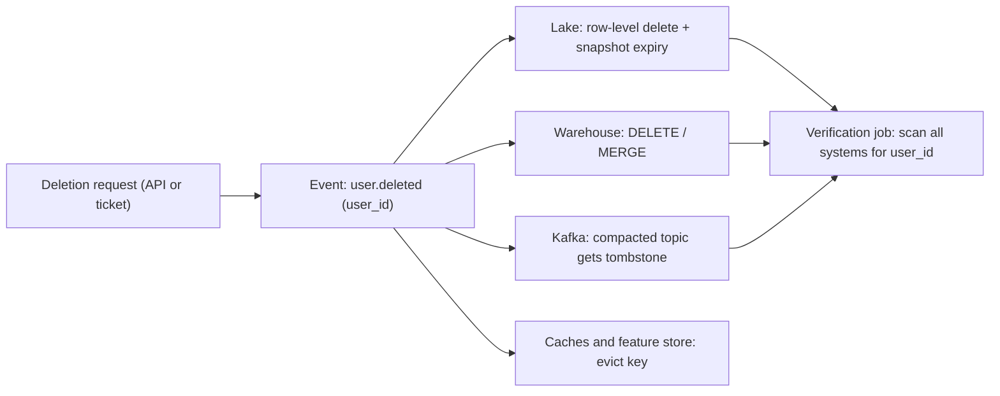

## 🎯 TL;DR

> **Data deletion in an immutable store** means removing one person's data from systems that were designed never to change in place: a Kafka log, Parquet files on object storage, snapshots, backups and derived tables. The delete has to reach every copy, and you have to prove it.

- Immutable does not mean undeletable. Each layer has its own mechanism: **tombstones and compaction** in Kafka, **row-level deletes plus snapshot expiry** in Iceberg or Delta, **DELETE/MERGE** in a warehouse, and **crypto-shredding** when you cannot rewrite the bytes at all.
- A deletion is not finished when the live table is clean. Old snapshots, time-travel windows, backups and replicas still hold the data until their own retention expires.
- Build it as a pipeline: a deletion request becomes an event, every system consumes it, every step is idempotent, and a verification job checks that nothing is left.

## 🌱 Start simple (Junior)

> **💡 Analogy:** A library that prints a new copy of every book each time someone edits a page, and keeps all old editions in the basement. If a reader asks you to remove their notes, you cannot just edit the shelf copy. You must also pull the notes from every edition in the basement, or lock the basement box with a key you then throw away.

The core facts:

- Data lives in many places: the event stream, the raw lake, the cleaned tables, the aggregates, the feature store, the caches, the backups.
- Most of these are **append-only** by design. Changing one row means rewriting a file, or writing a new version that hides the old one.
- Regulation (for example GDPR's right to erasure, or CCPA in California) asks you to delete a person's personal data within a deadline, and to be able to show that you did.

A tiny example. User `u-42` asks to be deleted. Where is their data?

```text
Kafka topic  clicks.raw         : 3 days of messages with user_id = u-42
Lake         s3://lake/events/  : Parquet files with user_id = u-42
Warehouse    dim_user, fact_*   : rows with user_id = u-42
Aggregates   daily_country_cnt  : no user_id, but built from u-42's rows
```

The rest of the lesson is how to remove each row in that list, and why the aggregate is a question for legal and design, not only for code.

## 🔧 How it really works (Mid)

Start with the request. Do not let each team delete by hand. Publish one event and let every system react:



**Kafka: tombstones and compaction.** A topic with `cleanup.policy=compact` keeps only the latest value for each key. To delete a key, produce a **tombstone**: the same key with a `null` value. After compaction, the key disappears.

```bash
kafka-topics.sh --bootstrap-server broker:9092 --create --topic users.profile \
  --partitions 12 --config cleanup.policy=compact \
  --config delete.retention.ms=86400000

```

Producing the tombstone needs a real `null` value, which most clients support directly (here, `confluent-kafka` in Python):

```python
from confluent_kafka import Producer

p = Producer({"bootstrap.servers": "broker:9092"})
# value=None produces a tombstone: the key stays, the value is null
p.produce("users.profile", key=b"u-42", value=None)
p.flush()
```

Three traps:

- Compaction runs only on closed segments. The latest segment is not compacted yet, so the old value is still readable for a while.
- The tombstone itself is kept for `delete.retention.ms` (24 hours by default in Apache Kafka; check your cluster), so consumers can see the delete. After that it is removed too.
- A raw topic that is **not** compacted keeps the original messages until its retention expires. A compacted "profile" topic does not clean the raw events. Retention is then your deletion deadline for that topic.

**Lake: row-level delete in open table formats.** Parquet files are immutable, so a delete has three steps in [[iceberg]] (Delta has the same shape):

1. **Delete:** the engine writes a delete file (merge-on-read) or rewrites the affected data files (copy-on-write). Readers now skip the rows.
2. **Rewrite:** compaction rewrites the files that still contain the rows, so the bytes are physically gone from the current snapshot.
3. **Expire:** old snapshots still point to the old files. Expire them, then remove orphan files.

```sql
-- Iceberg (Spark SQL). Procedure names as in Iceberg's Spark procedures;
-- check argument names for your Iceberg version.
DELETE FROM lake.events WHERE user_id = 'u-42';

CALL lake.system.rewrite_data_files(
  table => 'lake.events',
  where => 'user_id = ''u-42'''
);

CALL lake.system.expire_snapshots(
  table => 'lake.events',
  older_than => TIMESTAMP '2026-10-10 00:00:00'
);

CALL lake.system.remove_orphan_files(table => 'lake.events');
```

Until step 3 runs, time travel can still read the deleted rows from an old snapshot. That is correct behaviour for time travel, and it is exactly what a deletion audit will flag.

**Warehouse.** `DELETE` or `MERGE` on the table removes live rows. Partition drops are cheaper when the user's data sits in an identifiable partition. Remember the warehouse's own time-travel or fail-safe window, which keeps old versions for a fixed period.

**Crypto-shredding.** Encrypt each user's personal fields with a per-user key, stored in a key management service. Deleting that key makes all copies unreadable: the Kafka log, the old Parquet files, the backups. The ciphertext can stay forever. This is the only practical option when you must not rewrite a huge immutable archive.

```text
Stored in the event:  { user_id: "u-42", email_enc: "AE9f...", key_ref: "k/u-42" }
Delete request:       destroy key k/u-42 in KMS
Result:               email_enc is still stored but cannot be decrypted
```

## 🧠 Senior depth & trade-offs

**Choose the mechanism per layer, not one for everything.**

| Layer | Fast option | Strict option | Main cost |
|---|---|---|---|
| Kafka raw topic | Let retention expire | Crypto-shred the payload | Retention length is your deadline |
| Kafka compacted topic | Tombstone | Tombstone + wait for `delete.retention.ms` | Consumers must handle nulls |
| Lake (Iceberg/Delta) | Row-level delete | Delete + rewrite + expire + orphan removal | Rewrite cost, snapshot policy |
| Warehouse | `DELETE` / `MERGE` | Plus waiting out time-travel window | Retention settings you do not control |
| Backups | Accept retention | Crypto-shred or short backup life | Restore may bring data back |

**The personal-data separation pattern.** The best deletion is the one you never need to rewrite. Keep identifiers in one small, mutable **identity vault**, and let all analytical tables store a random surrogate token instead of `user_id` or email. Deleting the user means deleting the vault row. The analytical rows are no longer linkable to a person, although they still exist. Whether that counts as anonymised is a question for your legal team, not a code decision. See [[data-masking]].

**Derived and aggregated data.** A daily count by country is built from a user's rows, but it does not identify them. Decide policy explicitly: recompute the aggregate after deletion, accept it as anonymous, or apply a minimum group size (for example, suppress groups under a threshold). Write this decision down, because it will be questioned in an audit.

**Ordering and concurrency.** A deletion can race with a late event. A replay can re-insert a deleted user's clicks from a Kafka backlog. Fix it with a **deletion ledger** (a table of user IDs with a deletion timestamp) that ingestion checks before writing, so late events for a deleted user are dropped. The ledger itself must hold only the minimum needed, typically the hashed ID and the date.

**Idempotency and retries.** Every step must be safe to run twice: a tombstone for an absent key is harmless, a `DELETE` with no matching rows does nothing, and `expire_snapshots` can be re-run. Track progress per system, so a failed step is retried without a manual fix. See [[idempotency]].

**Verification.** Deletion is only real when you can show it. Use lineage ([[data-lineage]]) to list every table that holds `user_id`, and run a scan job after each deletion that counts remaining rows across all of them. Report the result per request, with a deadline metric: requests still open after 25 days, for example, before a 30-day deadline.

**What to monitor:** open deletion requests and their age, failed steps per system, the number of snapshots still pointing at deleted data, and the verification scan results.

> **🎤 Say this in the interview:** "I'd make deletion an event pipeline with a request ID. Each store has its own mechanism: tombstones for compacted Kafka, row-level delete plus rewrite and snapshot expiry for Iceberg, and crypto-shredding where I can't rewrite the bytes. I'd separate identifiers into a vault so most data is never rewritten. Then a verification job proves that nothing is left, including old snapshots and backups."

## 🧪 Try it

1. A raw Kafka topic keeps 7 days, and a compacted topic holds the latest profile per user. A user asks for deletion today. Which copies are gone immediately, which are gone within days, and which need another mechanism?
2. Why does `DELETE FROM lake.events` alone not remove the user's bytes from storage? List the three follow-up steps.
3. Design a minimum deletion ledger for late events. What do you store, and where do you check it?

<details><summary>Show solutions</summary>

**1.** The profile key disappears after the tombstone is compacted (soon, but not instantly) and the tombstone is removed after `delete.retention.ms`. The raw topic keeps messages until its 7-day retention ends, so it is gone within a week. If that is too slow, crypto-shred the payload, because retention cannot be shortened per user.

**2.** The delete writes a delete file or rewrites files, but old snapshots still reference the old data files, and orphan files may remain after failed writes. Rewrite the affected files (compaction), expire old snapshots, then remove orphan files.

**3.** Store the hashed `user_id`, the deletion date and the request ID. Ingestion (or the merge into the lake) checks the ledger and drops events for a listed user that arrive after the deletion timestamp. Keep the ledger small and purge entries once every upstream source is past its own retention window.

</details>

## 💬 Interview corner

**Question: "How would you delete one user's data across the platform?"**

- **Mid answer:** "I'd find all tables with `user_id` and run `DELETE` on each. I'd also send a tombstone to the Kafka topic."
- **Senior answer:** "I'd start with lineage to know every copy, then turn the request into an event with an ID and a deadline. Each store uses its own mechanism. Kafka gets a tombstone on the compacted topics and relies on retention elsewhere, the lake gets row-level deletes followed by rewrite and snapshot expiry, and I'd crypto-shred the archive I can't rewrite. A verification job checks every table, and a ledger drops late events for deleted users."

**Follow-up:** "Why is a deleted row still visible after you delete it?" Answer: time travel and old snapshots still reference the files until they are expired.

## ⚠️ Common mistakes

> **⚠️ Watch out:** A `DELETE` in the lake is not a deletion of the bytes. Until snapshots expire and orphan files are removed, the data is still in storage and still readable through time travel.

> **⚠️ Watch out:** Tombstones only work on compacted topics. Sending one to a normal (delete-policy) topic does nothing useful for the raw messages.

- Deleting from the warehouse and forgetting the backups and the time-travel window.
- Treating aggregates as personal data by default, or as anonymous by default, without a written decision.
- Deleting by hand, per team, with no request ID and no verification.
- Letting a Kafka replay re-insert deleted users because nobody checked a deletion ledger.
- Using random salts or non-deterministic hashes for the vault, so you cannot find the user's rows to delete them.
- Believing that crypto-shredding is free: the key service becomes a critical dependency, and any plaintext copy you forgot to encrypt is still there.

## ✅ Check yourself (quiz)

1. Which action removes a key from a compacted Kafka topic?
   - A) Producing a message with the key and an empty string value
   - B) Producing a tombstone: the key with a `null` value
   - C) Setting `retention.ms` to 0 on the topic
   - D) Deleting the topic

<details><summary>Answer</summary>

**B** — a `null` value is the tombstone. Compaction then removes the key after `delete.retention.ms`. An empty string is a valid value, so it does not delete the key.

</details>

2. After `DELETE FROM` on an Iceberg table, a time-travel query still returns the user's rows. Why?

   - A) Iceberg cannot delete rows
   - B) Old snapshots still reference the data files; expire the snapshots and remove orphan files
   - C) The delete ran on a different branch
   - D) Time travel always ignores deletes

<details><summary>Answer</summary>

**B** — the old snapshot is a valid version of the table. Only expiring it (and removing unreferenced files) makes the bytes disappear.

</details>

3. **(Senior)** A raw clickstream topic must not hold a deleted user's data after 48 hours, but its retention is 7 days and it is shared by many teams. What is the best option?

   - A) Shorten the retention for the whole topic to 48 hours
   - B) Crypto-shred the user's personal fields, so the messages are unreadable without the per-user key
   - C) Ask every consumer to delete its copy
   - D) Compact the topic by key

<details><summary>Answer</summary>

**B** — retention is per topic, not per user, so shortening it breaks other teams. Crypto-shredding makes the stored messages unreadable without changing the topic. Compaction (D) removes only older values of the same key, and a raw clickstream topic is not normally keyed for that.

</details>

4. **(Senior)** Why is a per-request verification scan important, even when every step reported success?

   - A) Steps can succeed on the live table while the snapshots, backups or late-arriving events still hold data
   - B) Scans speed up the delete
   - C) Verification replaces the deletion ledger
   - D) Regulators require the scan to run before the delete

<details><summary>Answer</summary>

**A** — each step reports success for its own system. Only an end-to-end scan across lineage shows what remains, including snapshots, replicas and replays.

</details>

5. **(Senior)** Why do many teams store analytical tables with a surrogate token instead of the user's ID?

   - A) Tokens are faster to join
   - B) Deleting the vault mapping cuts the link to the person without rewriting every analytical table
   - C) Tokens are required by Kafka
   - D) Surrogate keys are always smaller

<details><summary>Answer</summary>

**B** — the analytical rows stay in place but can no longer be linked to a person. Whether that counts as erasure must still be confirmed with legal.

</details>

## 🗂️ Flashcards

| Front | Back |
|---|---|
| Kafka tombstone | A message with a key and a `null` value; compaction removes the key |
| `delete.retention.ms` | How long a tombstone stays so consumers can see the delete |
| Why compaction is not instant | It runs on closed segments only, so the newest values stay readable for a while |
| Three lake steps after a row delete | Rewrite affected files, expire old snapshots, remove orphan files |
| Crypto-shredding | Encrypt per user and destroy the key to make all copies unreadable |
| Identity vault | A small mutable table that maps identifiers to surrogate tokens; deleting it breaks the link |
| Deletion ledger | Stores deleted IDs and dates so late or replayed events for them are dropped |
| Why verify after delete | Each system reports its own success; only an end-to-end scan shows what remains |

## 🔗 Go further

- [[design-user-deletion]] works through the full platform design for a deletion request.
- [[data-retention]] and [[data-security]] explain the retention and access rules that set the deadlines.
- [[data-lineage]] is how you find every copy before you delete it.
- [[lakehouse-table-formats]] and [[pattern-dedup]] cover the snapshot and dedup mechanics used here.
- [[kafka-retention-compaction]] goes deeper into compaction and retention settings.
