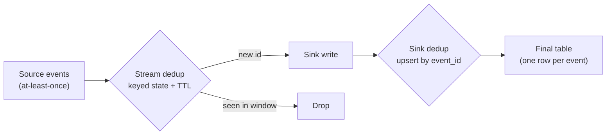

## 🎯 TL;DR

> **Deduplication at scale** removes events that arrived more than once, when the same event can be re-sent by retries, replays or at-least-once delivery, and the stream is too large to remember every event forever.

- Duplicates are normal. Producers retry, brokers redeliver, and jobs replay after failures. Dedup is a design requirement, not a bug fix.
- Three places can do it: **in the stream** (stateful, with a TTL window), **probabilistically** (a Bloom filter as a cheap pre-check), and **at the sink** (upsert or `ReplacingMergeTree`-style keys).
- Every option trades **accuracy** (no duplicates, no false drops) against **memory and cost**. A TTL window is exact only for duplicates that arrive within the window.

## 🌱 Start simple (Junior)

> **💡 Analogy:** A school registrar stamps each application with a form number. If the same form arrives twice in the mail, the registrar checks the list of form numbers already processed and throws the copy away. The list cannot grow forever, so the registrar keeps only the last month of forms. A form that arrives two months late gets processed again, because the list no longer remembers it.

That is the whole problem in one picture:

- Each event has a **unique ID** (the form number).
- Keep a set of IDs you have seen.
- When an ID is already in the set, drop the event.
- The set costs memory, so you **expire** old IDs. Expiry is the source of errors.

A small example: the same payment event arrives twice because the producer retried after a timeout.

```text
event_id  amount  arrival
p-1001    500     10:00:01
p-1001    500     10:00:03   <- retry, same event_id: must be dropped
p-1002    200     10:00:04
```

If you count the amounts without dedup, the total is 1200 instead of 700. The rest of this lesson is about how to remove the second `p-1001` while keeping memory bounded.

## 🔧 How it really works (Mid)

There are three layers, and a production system usually uses more than one.



### Layer 1: stateful dedup in the stream

The processor keeps a **keyed state** of event IDs seen during a time window. The first event with a new ID passes. Later events with the same ID are dropped. A **TTL** (time-to-live) or a **watermark** removes IDs older than the window, so the state stays bounded.

The engine handles the state, but the rules are yours:

- What is the **key**? Use an ID that the producer sets once and never regenerates on retry.
- What is the **window**? It must be longer than the longest delay between a duplicate and its original.
- What happens to an event **after** its window? It passes through, and it may be a duplicate you cannot detect.

Here is the logic in plain Python, so you can see the bounded-memory trade-off directly:

```python
import heapq

class TtlDeduper:
    """Exact dedup for duplicates that arrive within `ttl` of event time."""

    def __init__(self, ttl):
        self.ttl = ttl
        self.seen = {}   # event_id -> event_time
        self.heap = []   # (event_time, event_id), used to expire old ids
        self.max_time = float("-inf")

    def offer(self, event_id, event_time):
        """Return True if the event should be emitted."""
        self.max_time = max(self.max_time, event_time)
        horizon = self.max_time - self.ttl
        while self.heap and self.heap[0][0] < horizon:  # expire state
            t, old_id = heapq.heappop(self.heap)
            if self.seen.get(old_id) == t:
                del self.seen[old_id]
        if event_id in self.seen:
            return False        # duplicate inside the window: drop
        if event_time < horizon:
            return True         # too late: no state left, cannot prove duplicate
        self.seen[event_id] = event_time
        heapq.heappush(self.heap, (event_time, event_id))
        return True

d = TtlDeduper(ttl=10)
events = [("A", 1), ("B", 2), ("A", 3), ("C", 20), ("A", 4), ("C", 21), ("A", 5)]
emitted = [(e, t) for (e, t) in events if d.offer(e, t)]
print(emitted)
# [('A', 1), ('B', 2), ('C', 20), ('A', 4), ('A', 5)]
```

The second `A` at time 3 is dropped, because `A` is still in the window. The `A` at time 4 and 5 are emitted, because by then the state for `A` has expired and the code cannot prove they are duplicates. This is the core trade-off: the window bounds memory, and it also bounds correctness.

In Flink, this is a keyed `ValueState` or a built-in deduplication operator with state TTL. In Spark Structured Streaming, the equivalent is `dropDuplicatesWithinWatermark` (check the option names for your version), which keeps state until the watermark passes. The principle is the same: state is bounded by the watermark, not by the age of the stream.

### Layer 2: Bloom filters for a cheap first check

A **Bloom filter** is a bit array with several hash functions. Adding an ID sets some bits. Checking an ID asks whether all its bits are set.

- If the check says **no**, the ID was **definitely not** seen. Pass the event.
- If the check says **yes**, the ID was **probably** seen. It might be a false positive.

The memory is small. For a false-positive rate `p`, the number of bits per element is `-ln(p) / (ln 2)^2`, about 9.6 bits per element for `p = 1%`. Example: 180 million IDs (one hour at 50 000 events/s) need 180 000 000 × 9.6 ≈ 1.7 × 10⁹ bits ≈ 216 MB, while an exact set of 16-byte IDs with overhead can need several gigabytes.

The catch: a false positive **drops a real new event**. A Bloom filter alone is therefore only safe when losing a small fraction of new events is acceptable (for example, approximate analytics), or when a "yes" is confirmed by an exact lookup in the sink. Use it as a pre-filter in front of an exact store, not as the only check for money.

### Layer 3: sink-side dedup

The most robust option is to make the **sink idempotent**: the table has one row per event ID, and a second write updates the same row.

```sql
-- Iceberg / Delta / Spark: merge a micro-batch by event_id
MERGE INTO warehouse.payments AS t
USING (
  SELECT * FROM (
    SELECT p.*, ROW_NUMBER() OVER (PARTITION BY p.event_id ORDER BY p.received_at DESC) AS rn
    FROM payments_batch AS p
  ) AS ranked
  WHERE rn = 1
) AS s
ON t.event_id = s.event_id
WHEN NOT MATCHED THEN INSERT *;
```

Two things make this correct. The inner query removes duplicates **inside the batch** (the same ID can appear twice in one micro-batch). The `WHEN NOT MATCHED` clause makes the table keep the first row for each ID across batches. For data that can change, use `WHEN MATCHED` with a version guard instead.

ClickHouse `ReplacingMergeTree` and StarRocks primary-key tables work the same way at the storage level: rows with the same key are replaced, but the replacement happens during background merges or at read time, so queries may need `FINAL` or an aggregation to see the deduplicated view.

## 🧠 Senior depth & trade-offs

**Pick the layer by the cost of a wrong answer.** The layers differ in what they guarantee:

| Option | Memory | Accuracy | Failure mode | Good for |
|---|---|---|---|---|
| TTL state in the stream | Proportional to events per window | Exact inside the window | Duplicates after the window; memory growth if keys are unbounded | Real-time alerts and counts with a known maximum delay |
| Bloom filter | Small, fixed | Never misses a duplicate; drops new events at rate `p` | Lost new events | Pre-filter, approximate metrics |
| Sink upsert by key | Storage of the table itself | Exact, eventually consistent after merges | Extra write cost; query-time duplicates before merge | Financial and inventory tables |
| Batch `ROW_NUMBER` | Shuffle memory of the batch | Exact over the batch | Duplicates across batches unless merged | Daily loads and backfills |

**Size the window with numbers, not guesses.** Example: 50 000 events per second, and retries that can arrive up to 1 hour late. The window must cover 3 600 s × 50 000 = 180 million IDs. With a 16-byte ID and a hash map at roughly 50 bytes per entry (JVM objects, pointers, and buckets), that is 180 × 10⁶ × 50 ≈ 9 GB of state per job, spread across parallel tasks. A compact representation or a Bloom pre-check reduces it, but that changes the guarantee. Measure state size in a test with production-like key counts before you commit to the window.

**The key is the design.** Dedup works only if duplicates share a key. Typical traps:

- The producer generates a new UUID on each retry. Every copy is "unique", and nothing is removed. Fix: generate the ID once per business event, before the first send.
- Two different sources emit the same business event with different IDs (for example, a web click and a mobile retry). Technical dedup cannot see it. You need a business rule such as `(user_id, order_id, event_type)` with a documented window.
- A replayed backfill regenerates IDs. Keep the source's original ID in the record.

**Ordering and late data.** A duplicate that arrives after the window is the main source of leaks. Compare the window with your measured lateness distribution (p99 of the delay between event time and arrival), not with the average. If p99 is 40 minutes and your window is 10 minutes, about 1% of duplicates can leak. Pair the stream dedup with the sink dedup, so the leaks are removed at the end.

**Monitoring:**

- Duplicate rate per source and per hour (count of dropped events divided by total). A sudden increase signals a producer retry storm.
- State size and state growth per job, and the time to restore it after a failure.
- Count of events that passed through as "too late" (the window could not prove a duplicate).
- Reconciliation: distinct IDs in the sink against distinct IDs in the source for each hour. A gap means loss, and a count above the distinct ID count means duplicates reached the sink.

**When not to use stream dedup at all.** If the consumer can tolerate duplicates and a later batch removes them, skip the expensive state. A daily `ROW_NUMBER` dedup on the lake table is cheaper to run and easier to reason about, and it is correct even for long delays. Real-time dedup is worth its cost only when the duplicates would reach a user, a payment, or an alert before the batch runs.

**Combine the layers.** A common senior design: the producer sets a stable ID, the stream applies a TTL window that covers the 99th percentile of retries, a Bloom filter or key cache absorbs load, and the sink holds a primary key so that anything that leaked is removed. Each layer is cheap, and the combination makes the duplicate rate small and measurable.

## 🧪 Try it

1. Run the `TtlDeduper` code. Predict the emitted list before you run it.
2. Change `ttl` from `10` to `50`. Predict which of the late `A` events are now dropped.
3. Write a `ROW_NUMBER` batch dedup in plain Python: given a list of `(event_id, received_at)` tuples, return one tuple per `event_id`, keeping the latest `received_at`.

<details>
<summary>Your guess?</summary>

1. The output is `[('A', 1), ('B', 2), ('C', 20), ('A', 4), ('A', 5)]`. The second `A` at time 3 is dropped; the `A` events at times 4 and 5 leak because their state expired.

2. With `ttl=50`, nothing expires in this short sequence (the horizon never passes 1). The `A` at time 3 is dropped, and the later `A` events at 4 and 5 are also dropped because `A` is still in state. The window must cover the real delay of retries.

3. A straightforward answer:

```python
def latest_per_id(rows):
    best = {}
    for event_id, received_at in rows:
        if event_id not in best or received_at > best[event_id][1]:
            best[event_id] = (event_id, received_at)
    return list(best.values())
```

</details>

## 💬 Interview corner

> **🎤 Say this in the interview:** "Duplicates are inevitable with at-least-once delivery, so I design for them at three points. In the stream I keep keyed state for the expected retry window and expire it with the watermark. At the sink I make the write idempotent with a primary key or a `MERGE` by event ID. I size the window from the measured p99 delay and I monitor the duplicate rate and the state size, because the window is where accuracy and cost meet."

**How it is asked:** "Deduplicate billions of events per day" or "How do you remove duplicates from a stream with bounded memory?"

- **Junior answer:** "Use `DISTINCT`." This does not work on a stream, because the set of seen IDs grows without bound.
- **Mid answer:** "Keep a set of IDs in state with a TTL, and drop an event if its ID is in the set." Correct, and it names the trade-off, but it does not say how to size the TTL or what happens to late duplicates.
- **Senior answer:** Explains the three layers, sizes the window with the measured lateness and state estimates, names the key design (stable ID set by the producer), accepts a documented leak rate, and includes a reconciliation check at the sink.

**Model answer (3–5 sentences):** Duplicates are expected with at-least-once delivery, so I remove them at more than one layer. The producer assigns a stable event ID once, the stream keeps keyed state for the window that covers the p99 retry delay, and the state expires with the watermark so memory stays bounded. The sink holds one row per event ID, through a primary key or a `MERGE`, so anything that slipped past the window is removed. I monitor the duplicate rate, the state size, and a per-hour reconciliation between distinct IDs in the source and in the sink.

## ⚠️ Common mistakes

- **Using `DISTINCT` or an unbounded set on a stream.** Memory grows until the job fails. Always bound the state with a TTL or watermark.
- **Generating a new ID on each retry.** The dedup key must be created once per business event.
- **Sizing the window from the average delay.** The tail (p99) decides how many duplicates leak.
- **Trusting a Bloom filter alone for money.** A false positive drops a real event with no error message.
- **Deduplicating only in the stream.** Late duplicates and replays need a sink-side key.
- **Forgetting duplicates inside one batch.** A `MERGE` with two source rows for the same key fails or picks one at random unless you pick one explicitly (for example, with `ROW_NUMBER`).
- **Assuming `ReplacingMergeTree` is instant.** Dedup happens at merge time; queries need `FINAL` or an aggregation to see the final rows.
- **Ignoring business duplicates.** Two different IDs for the same order are not a technical duplicate. A business key rule is needed.

## ✅ Check yourself (quiz)

1. Why does a stream deduplicator need a TTL or watermark?
   - A) To make events arrive in order
   - B) To bound the memory used by the set of seen IDs
   - C) To encrypt the event IDs
   - D) To speed up the network

<details>
<summary>Answer</summary>

**B** — a set of seen IDs grows forever without expiry. The TTL or watermark removes old IDs so state stays bounded, at the cost of missing duplicates that arrive after the expiry.

</details>

2. A payment event is retried by the producer after a timeout, and the retry has a new UUID. Which change fixes the duplicates at the source?
   - A) Increase the window to 24 hours
   - B) Generate the event ID once per business event and reuse it on retry
   - C) Use a Bloom filter
   - D) Switch to a different message broker

<details>
<summary>Answer</summary>

**B** — a new UUID per attempt makes every copy look unique, so no dedup layer can match them. The ID must be stable across retries.

</details>

3. You need exact dedup for a financial table, and the window cannot cover all retries. What do you use?
   - A) A Bloom filter with 0.1% false positives
   - B) A sink table keyed by the stable event ID, with an upsert or `MERGE`, plus stream dedup for the common case
   - C) A `LIMIT 1` on the query
   - D) Nothing; accept duplicates in finance

<details>
<summary>Answer</summary>

**B** — a primary key or `MERGE` on the stable ID removes duplicates regardless of when they arrive, so it covers the leaks from the window. A Bloom filter can drop real payments, which is not acceptable for money.

</details>

4. **(Senior)** The p99 delay between event time and arrival is 40 minutes. The team sets a 10-minute dedup window "to save memory". What happens, and how do you decide?
   - A) Nothing; 10 minutes covers almost all events
   - B) About 1% of retried duplicates leak past the window and reach the sink; decide by comparing the state cost of a 40-minute window (the memory estimate) with the cost of leaked duplicates, and add a sink-side key for the remainder
   - C) The window must be exactly 40 minutes or the job fails
   - D) The sink will automatically remove all duplicates

<details>
<summary>Answer</summary>

**B** — the window must cover the tail of the delay distribution, and p99 is a tail value. Leaked duplicates are the cost of a short window, so the decision is a measured trade-off: memory for the longer window versus leak rate, with a sink-side key as the safety net.

</details>

5. **(Senior)** Compare a daily batch `ROW_NUMBER` dedup with real-time stream dedup for a lake table. Which do you choose, and why?
   - A) Stream dedup, because it is always more accurate
   - B) Batch dedup for analytical tables where a delay is acceptable, because it is exact over the whole batch, cheap, and not limited by a window; stream dedup only where duplicates would reach users or money in real time
   - C) Batch dedup, because it never needs memory
   - D) Neither; duplicates do not matter for analytics

<details>
<summary>Answer</summary>

**B** — batch dedup is exact over its input without a time window and needs no always-on state. Stream dedup adds cost and a window-bound accuracy limit, so use it only when the latency of duplicates matters to a user or a payment before the batch runs.

</details>

## 🗂️ Flashcards

| Front | Back |
|---|---|
| Why duplicates happen | At-least-once delivery, producer retries, and job replays |
| Dedup key rule | Generate the ID once per business event; never regenerate on retry |
| Why state needs a TTL or watermark | Without expiry, the set of seen IDs grows without bound |
| What a TTL window cannot catch | Duplicates arriving after the window expires |
| Bloom filter "no" answer | Definitely not seen; pass the event |
| Bloom filter "yes" answer | Probably seen; a false positive drops a real event |
| Bits per element for 1% false positives | About 9.6 bits |
| Sink-side dedup for leaks | Primary key or `MERGE` on the stable event ID |
| Batch dedup pattern | `ROW_NUMBER() OVER (PARTITION BY event_id ORDER BY received_at DESC)`, keep `rn = 1` |

## 🔗 Go further

- [[dedup-idempotent-loads]] covers the sink side in detail: primary-key tables, `ReplacingMergeTree` and idempotent loads.
- [[pattern-exactly-once]] explains why a deduplicator is part of an end-to-end guarantee, not a substitute for one.
- [[pattern-late-data]] shows how watermarks and allowed lateness decide what a window can still see.
- [[pattern-cdc-analytics]] applies the same key and version-guard ideas to change streams.
- [[bloom-filter]] (glossary) and [[deduplication]] (glossary) define the terms used here.
- [[streaming-state]] explains how keyed state is stored, checkpointed and bounded.
