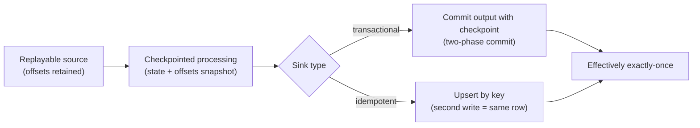
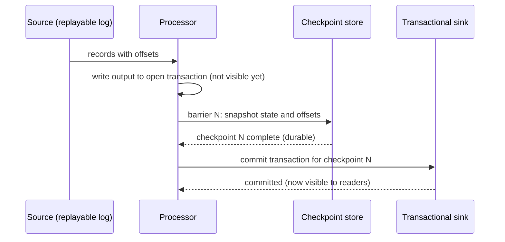

## 🎯 TL;DR

> **End-to-end exactly-once** means the final result in the sink is the same as if every input event had been processed one time, even when machines crash and work is retried.

- No system gives "exactly once" for free. You build it from three parts: a **replayable source**, **checkpointed processing**, and a **transactional or idempotent sink**.
- Each part alone is not enough. A transactional stream processor writing to a non-transactional database still produces duplicates after a crash.
- The practical rule: the source can re-send, the processor can re-run, and the sink can absorb a second write without changing the result.

## 🌱 Start simple (Junior)

> **💡 Analogy:** Imagine a bank clerk who reads a list of transfers and updates a ledger. The clerk may get interrupted halfway. To avoid double transfers, the clerk writes a bookmark ("I finished row 41") in the **same ledger transaction** as each transfer. After an interruption, the clerk reopens the list at the bookmark. The transfer and the bookmark either both happen or neither does.

That is the whole pattern in one picture. Now the terms:

- **At-least-once:** every event is processed one or more times. Nothing is lost, but duplicates happen after a retry.
- **Exactly-once (effective):** the *visible result* looks as if every event was processed one time. Internally the event may still be processed twice; the sink makes the second run harmless.

Here is a tiny example. Events arrive in a log, each with a position (an **offset**):

```text
offset  event
0       ali  +10
1       sara +5
2       ali  +7
3       reza +3
```

If we add these to a total and the process crashes after offset 2 is added but before we record "I am at offset 3", the restart will read offset 2 again and add 7 twice. That is the duplicate problem. The fix is to make "add the amount" and "remember the offset" one atomic step. The code in the **Try it** section does exactly this.

## 🔧 How it really works (Mid)

Think of three independent guarantees. The end-to-end result is only as strong as the weakest one.

| Part | What it must guarantee | Typical implementation |
|---|---|---|
| Source | You can **re-read** the same input after a failure | Kafka offsets, a CDC log with positions, files in object storage with a manifest |
| Processing | You can restore state **and** the input position from the same snapshot | Flink checkpoints, Spark Structured Streaming checkpoint directory, your own offset table |
| Sink | Writing the same result **twice** does not change the outcome | Transactions with commit on checkpoint (2PC), upserts by primary key, `MERGE`, overwrite of a partition |



### The checkpoint and the sink must agree

A checkpoint records two things at the same moment: the **state** of the operators (for example, running totals) and the **input position** (the offsets). If they are stored together, a restart restores both to the same point, and the processor replays exactly the input that was not yet reflected in the state.

With a transactional sink, the output produced since the last checkpoint is written in a transaction that is **committed only after the checkpoint succeeds**. A crash before that commit discards the uncommitted output, and the replay produces it again. The commit moment is the boundary between "happened" and "not happened".



If the job crashes before the commit, readers never saw the output. If it crashes after the commit but before the next checkpoint, the restart restores checkpoint N and replays input after it. That replay writes new output, and the sink's transaction log decides that the old attempt was already committed and must not repeat. This last step is why the sink has to be designed for it, not just "transactional" by name.

### The idempotent sink alternative

If your sink cannot participate in a transaction with the processor (many OLTP databases, HTTP APIs, or an analytics table you update with `MERGE`), you make the write **idempotent**: the same event produces the same row, keyed by a stable identifier.

```sql
-- staging holds one micro-batch; event_id is the business key
MERGE INTO warehouse.orders AS t
USING staging.orders_batch AS s
  ON t.event_id = s.event_id
WHEN MATCHED AND s.event_ts > t.event_ts THEN
  UPDATE SET status = s.status, amount = s.amount, event_ts = s.event_ts
WHEN NOT MATCHED THEN
  INSERT (event_id, status, amount, event_ts)
  VALUES (s.event_id, s.status, s.amount, s.event_ts);
```

Running this statement twice on the same batch gives the same table. The `WHEN MATCHED AND ... >` guard also makes it safe against out-of-order replays: an older version of a record cannot overwrite a newer one.

### Worked example: a per-user total with a crash

Here is the failure we are protecting against, in runnable form. The "log" is a list that stands in for a replayable source, and SQLite stands in for a sink that supports transactions.

```python
import sqlite3

LOG = [  # a replayable source: (offset, user_id, amount)
    (0, "ali", 10), (1, "sara", 5), (2, "ali", 7), (3, "reza", 3),
]

def init(db):
    db.execute("CREATE TABLE IF NOT EXISTS totals (user_id TEXT PRIMARY KEY, amount INTEGER NOT NULL)")
    db.execute("CREATE TABLE IF NOT EXISTS offsets (consumer TEXT PRIMARY KEY, next_offset INTEGER NOT NULL)")
    db.execute("INSERT OR IGNORE INTO offsets VALUES ('totals-job', 0)")
    db.commit()

def run(db, crash_at=None):
    (next_off,) = db.execute("SELECT next_offset FROM offsets WHERE consumer = 'totals-job'").fetchone()
    for offset, user, amount in LOG[next_off:]:
        with db:  # one transaction: the result and the offset move together, or not at all
            db.execute(
                "INSERT INTO totals VALUES (?, ?) "
                "ON CONFLICT(user_id) DO UPDATE SET amount = amount + excluded.amount",
                (user, amount),
            )
            if offset == crash_at:
                raise RuntimeError("simulated crash after the write, before the offset update")
            db.execute("UPDATE offsets SET next_offset = ? WHERE consumer = 'totals-job'", (offset + 1,))

db = sqlite3.connect(":memory:")
init(db)
try:
    run(db, crash_at=2)
except RuntimeError as e:
    print("crashed:", e)
run(db)  # restart: reads the committed offset and continues
print(db.execute("SELECT user_id, amount FROM totals ORDER BY user_id").fetchall())
# [('ali', 17), ('reza', 3), ('sara', 5)]
```

On the crash, the `with db:` block rolls back the `ali +7` update, so the offset is still 2. The restart replays offset 2 once and adds it once. The result is `ali = 17`, which is correct. Remove the transaction and the offset update as two separate statements, and the same crash can leave the total and the offset out of step.

### Kafka-to-Kafka is the easy case

When both the input and the output are Kafka topics, the broker can commit the output records and the consumer offset in one transaction (the producer sends offsets as part of its transaction, and downstream consumers read with `read_committed`). This is what the Kafka exactly-once topic covers in detail. The moment the sink is a database, a search index, an object store or an HTTP API, that broker transaction no longer covers the write, and you are back to transactional or idempotent sinks.

## 🧠 Senior depth & trade-offs

**The weakest link decides.** Walk the path from source to sink and ask for each hop: what happens if this stage crashes and restarts at the last checkpoint? Common weak links:

- **Non-replayable source.** A source that only exposes "the latest value" (a plain API, a log with short retention) cannot be re-read. If your replay window is shorter than your worst recovery time, you have silent data loss. Keep source retention longer than the time to detect and fix a broken job.
- **Non-transactional sink.** A processor with checkpoints writing to a plain JDBC table without upserts produces duplicates on every failure. Either use a sink that supports commit-on-checkpoint, or make the write keyed and idempotent.
- **External side effects.** Sending an email, charging a card, or calling a payment API inside the processor is not undone by a rollback. Put the side effect behind an idempotency key that the external system checks, or move it to an outbox pattern.
- **Non-deterministic logic.** If the processing depends on wall-clock time or random values, a replay can produce a different output for the same input. The sink then sees "different" rows, not duplicates. Use event time and deterministic functions.

**Latency is the price.** A transactional sink usually makes results visible only at checkpoint boundaries. A checkpoint interval of 1 minute means readers see data about 1 minute later at best, and more when a checkpoint is slow. Shorter intervals reduce the replay after a failure but increase checkpoint overhead and the number of commits. The trade-off is:

| Choice | Benefit | Cost |
|---|---|---|
| Short checkpoint interval | Less to replay, fresher output | More overhead, more commits, more small files in the sink |
| Long checkpoint interval | Efficient commits and fewer files | Longer replay after failure, delayed visibility |
| Idempotent upsert sink | Works with almost any database | Needs a stable key and a write cost per row |
| Transactional sink | No duplicates from the processor | Depends on the sink supporting the protocol; slower commits |

**State size and recovery time.** The checkpoint contains the state. Large state (billions of keys, long windows) means large snapshots, slow recovery, and long restore times on a cluster that just lost a node. Incremental checkpoints, state TTL, and smaller windows are the usual levers. A recovery time objective (how long you can be down) should be measured in a test, not estimated.

**What you monitor:**

- Checkpoint duration and the number of failed checkpoints. A rising duration is the first sign of trouble.
- Time from the source event to the sink commit (end-to-end latency).
- Replay volume after each restart (how many events were processed again).
- Reconciliation counts: the number of rows in the sink for a key range against the source, for a sample of hours. This catches the failures that metrics do not show.

**When not to use this pattern.** If your data can tolerate occasional duplicates that a later step removes (for example, a daily dedup on a unique event ID), a simple at-least-once pipeline plus deduplication is cheaper to build and operate. Use end-to-end exactly-once when duplicates are expensive to fix later: money, inventory, billing, or regulatory counts.

**Engine notes.** Flink implements this with checkpoint barriers and a two-phase-commit sink interface. Spark Structured Streaming gets exactly-once with its checkpoint directory and sinks that support idempotent writes (for example, the file sink with its commit log). Kafka Streams uses Kafka transactions for its own topics. Each has version-specific settings and sink support lists, so check the documentation for your version before you promise a guarantee in a design.

## 🧪 Try it

1. Run the Python code from the worked example. Note the output.
2. Change `crash_at=2` to `crash_at=3`. Predict the final totals before you run it.
3. Remove the `with db:` line and the rollback behavior. Make the offset update a separate `db.commit()` placed before the totals update. Run it with a crash in the middle. What breaks?

<details>
<summary>Your guess?</summary>

2. With `crash_at=3`, the crash happens on `reza +3`, which is rolled back. The restart replays offset 3 once. The final result is still `ali 17, reza 3, sara 5`. The output does not change because the transaction covered both the write and the offset.

3. If the offset is committed before the total, a crash after the offset commit skips that event after restart: the total misses the amount (data loss). If the total is committed first and the offset after, a crash between them replays the event and counts it twice. Either order breaks unless the two changes are in one transaction.

</details>

## 💬 Interview corner

> **🎤 Say this in the interview:** "Exactly-once is an end-to-end property, not a feature of one tool. I need a replayable source, a processor whose state and input offsets are checkpointed together, and a sink that either commits with the checkpoint or makes each write idempotent by key. I then check the weakest link, usually the sink or a side effect outside the pipeline."

**How it is asked:** "How do you guarantee no duplicates from Kafka into a warehouse?" or "Does Flink give exactly-once?"

- **Junior answer:** "Use exactly-once mode in the tool." This is not wrong, but it stops at the processor and ignores the sink.
- **Mid answer:** Names offsets, checkpoints and "upsert by key". Explains that the sink must be idempotent or transactional.
- **Senior answer:** Draws the three layers, names the sink protocol, explains the visibility delay at checkpoint boundaries, and gives one reconciliation check that proves the claim in production.

**Model answer (3–5 sentences):** Exactly-once is achieved end to end by combining a replayable source (Kafka offsets with enough retention), checkpointed processing that stores operator state and input positions together, and a sink that is either transactional with commit-on-checkpoint or idempotent through a stable business key and a `MERGE`. Output becomes visible only after the checkpoint completes, so I accept a latency equal to the checkpoint interval. Side effects outside the pipeline, such as payments or emails, are handled with idempotency keys, not rollbacks. I verify the guarantee with a daily reconciliation of row counts and sums per key range against the source.

## ⚠️ Common mistakes

- **"The tool has exactly-once, so we are done."** The guarantee covers only the part the tool controls. Check the sink and every side effect.
- **Committing the source offset before the output is durable.** This turns a crash into data loss, not duplicates.
- **Upsert without a stable key.** Using a generated UUID per attempt makes every retry a new row. The key must come from the event (or be derived from it).
- **Idempotent write with no ordering rule.** A late replay can overwrite a newer version. Compare event time or a version number in the `MERGE` condition.
- **Ignoring source retention.** A replay you cannot perform is not a recovery plan.
- **Reading a transactional sink too early.** Dashboards that read uncommitted data see values that later disappear.
- **Confusing "no duplicates" with "correct".** Deterministic processing is also required. A replay that calls the current time or a random function produces different output.

## ✅ Check yourself (quiz)

1. In a checkpointed stream processor, what must be stored together in one snapshot?
   - A) The sink's schema and the dashboard definitions
   - B) Operator state and the input offsets (positions in the source)
   - C) The list of all event IDs ever seen
   - D) The Kafka broker configuration

<details>
<summary>Answer</summary>

**B** — the state and the input position must come from the same point. Restoring state from one moment and offsets from another either replays too little (loss) or too much (duplicates).

</details>

2. A job writes to a PostgreSQL table with plain `INSERT` after each checkpoint, and no unique key. After a crash the table has duplicate rows. Which change fixes it most directly?
   - A) Increase the checkpoint interval
   - B) Add a unique key on the event ID and write with an upsert
   - C) Switch the processor from Flink to Spark
   - D) Add a `LIMIT` to the query

<details>
<summary>Answer</summary>

**B** — a stable unique key plus an upsert makes a second write of the same event a no-op. A longer interval only changes how much is replayed.

</details>

3. A payment service is called from inside the stream processor. The job crashes after the call succeeds but before the checkpoint. What is the safe design?
   - A) Rely on the checkpoint rollback to undo the payment
   - B) Pass an idempotency key to the payment API so a repeated call is recognized
   - C) Disable checkpoints for this job
   - D) Call the payment API twice on purpose

<details>
<summary>Answer</summary>

**B** — a rollback cannot undo an external side effect. An idempotency key (stable per event) lets the external system return the earlier result instead of charging again.

</details>

4. **(Senior)** Your team wants to lower end-to-end latency from 5 minutes to 10 seconds for a transactional sink. Which trade-off must you explain first?
   - A) Upsert versus append does not matter for latency
   - B) Commit frequency rises with the checkpoint interval, so overhead, small files and commit load increase; the visible delay is tied to how often commits happen
   - C) Latency is unaffected by checkpoints
   - D) The sink must switch to a text format

<details>
<summary>Answer</summary>

**B** — with a transactional sink, output becomes visible at commit time, which follows the checkpoint. Shorter intervals reduce delay but add checkpoint overhead, more commits and more small files. You must measure the cost before promising 10 seconds.

</details>

5. **(Senior)** A nightly reconciliation shows that the warehouse has 0.01% more orders than the source for a day with a known job restart. The pipeline is "exactly-once". What do you check first?
   - A) Whether the dashboard refresh rate is correct
   - B) Whether the sink write is idempotent for the restart window, and whether the source replay range was larger than the committed state covers
   - C) Whether the file format is Parquet
   - D) Whether the team uses SQL or Python

<details>
<summary>Answer</summary>

**B** — a small excess after a restart points to a sink that is not idempotent for the replayed range, or a commit that happened outside the checkpoint boundary. Check the keys written in that window first; it is a concrete hypothesis you can test.

</details>

## 🗂️ Flashcards

| Front | Back |
|---|---|
| End-to-end exactly-once means | The sink result equals single processing of each input, despite crashes and retries |
| The three parts of the guarantee | Replayable source, checkpointed processing, transactional or idempotent sink |
| Why checkpoint state and offsets together | So a restart resumes both from the same point: no loss, no duplicate |
| What commit-on-checkpoint means | Output is written in an open transaction and made visible only after the checkpoint completes |
| Idempotent write | Writing the same event twice leaves the same final row, usually keyed by a stable ID |
| Why a rollback does not undo a payment | External side effects are outside the transaction; use an idempotency key |
| Main cost of exactly-once sinks | Visibility delay tied to checkpoint or commit frequency |
| Why source retention matters | Replay needs the input to still exist; shorter retention than recovery time means loss |

## 🔗 Go further

- Read [[delivery-semantics]] first if the terms at-least-once and at-most-once are not yet clear.
- [[kafka-exactly-once]] covers idempotent producers, Kafka transactions and `read_committed` in detail.
- [[dedup-idempotent-loads]] shows the sink-side patterns (keys, upserts, `ReplacingMergeTree`, primary-key tables) that make the idempotent option work.
- [[flink]] explains checkpoint barriers and two-phase-commit sinks in the engine that popularized this design.
- [[pattern-cdc-analytics]] applies the same three layers to a database-to-warehouse pipeline, where the source is a change log.
- [[pattern-reconciliation]] shows how to prove the guarantee holds with counts and sums in production.
