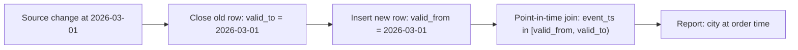

## 🎯 TL;DR

> **History pattern:** keep every version of a record together with the time range where it was true, so that you can answer "what was the state **at time X**?" correctly, even after the data changed.

- Overwriting a row destroys history. Keep versions instead.
- Three common ways: **SCD2** (one row per version with `valid_from` / `valid_to`), **daily snapshots** (a full copy per day), and **table time travel** (the storage engine keeps old snapshots for a while).
- The hard part is not storing history. It is **joining** facts to the version that was valid **at the event time**, not to the current version.

## 🌱 Start simple (Junior)

> **💡 Analogy:** Your school record. Your family moved city in 2024. If a teacher asks "which school district were you in when you enrolled in 2023?", the answer is the old address, not today's. A record that only holds today's address cannot answer that question.

Imagine an online shop. Customer 42 lives in Tabriz. On 2026-03-01 she moves to Shiraz. The `customers` table is overwritten:

```sql
-- the classic UPDATE: history is gone
UPDATE customers SET city = 'Shiraz' WHERE customer_id = 42;
```

Now an order placed on 2026-02-10 shows "Shiraz", although she lived in Tabriz then. If your report says "sales by city", February's Tabriz sales are wrong. This is a **point-in-time correctness** bug, and it is silent: the numbers look reasonable.

The fix is to never lose the old value. The simplest form is a second table with one row per version:

| customer_id | city | valid_from | valid_to |
|---|---|---|---|
| 42 | Tabriz | 2024-05-01 | 2026-03-01 |
| 42 | Shiraz | 2026-03-01 | 9999-12-31 |

Now the question "where did she live on 2026-02-10?" has one answer: the row whose range contains that date.

## 🔧 How it really works (Mid)

### Option 1: SCD Type 2 (slowly changing dimension)

SCD2 stores one row per version of an entity. Each row has a validity range and usually a flag `is_current`. The typical columns are a surrogate key (`customer_sk`), the natural key (`customer_id`), the tracked attributes, `valid_from`, `valid_to` (open-ended value for the current row), and `is_current`.

A change batch does two things for each changed key: it **closes** the current row and **inserts** a new one.

```sql
-- staging_customer: the deduplicated latest state from the source for this batch
-- :change_ts is the time the change happened in the source (not when we loaded it)

-- 1. close the current version of every changed customer
UPDATE dim_customer
SET valid_to = :change_ts, is_current = FALSE
WHERE is_current
  AND customer_id IN (SELECT s.customer_id
                      FROM staging_customer s
                      JOIN dim_customer d
                        ON d.customer_id = s.customer_id AND d.is_current
                      WHERE s.city <> d.city);      -- only real changes

-- 2. insert the new versions
INSERT INTO dim_customer (customer_id, city, valid_from, valid_to, is_current)
SELECT s.customer_id, s.city, :change_ts, DATE '9999-12-31', TRUE
FROM staging_customer s
JOIN dim_customer d ON d.customer_id = s.customer_id AND d.is_current
WHERE s.city <> d.city;
```

The example skips brand-new customers (they need a plain insert) and assumes the change is real, so it compares attributes before it creates a version. Production code compares a **hash of the tracked columns** to avoid creating versions for no-op updates. Use a `MERGE` statement where your engine supports it; the logic stays the same.

### Point-in-time join

To attach the right version to each fact, join on the **event time** falling inside the validity range:

```sql
SELECT o.order_id, o.order_ts, o.amount, c.city
FROM orders AS o
JOIN dim_customer AS c
  ON c.customer_id = o.customer_id
 AND o.order_ts >= c.valid_from
 AND o.order_ts <  c.valid_to;
```

Two details matter. The lower bound is inclusive and the upper bound exclusive, so a change exactly at `valid_to` does not produce two matches. And `valid_to` must never be `NULL`, because `NULL` comparisons silently drop the row.

### Option 2: daily snapshots

Copy the whole dimension (or a summary) every day into a table keyed by `snapshot_date`. Queries become trivial: `WHERE snapshot_date = '2026-02-10'`. The cost is storage: 10 million customers × 365 days = 3.65 billion rows per year, even if almost nothing changed. Snapshots are the right choice for small tables, for metrics that must match a fixed "end of day" report, and when the source cannot tell you when changes happened.

### Option 3: table time travel

Table formats such as Delta Lake and Apache Iceberg keep a log of snapshots. You can read an old version by version id or timestamp, for example `SELECT * FROM sales TIMESTAMP AS OF '2026-02-10'` in Spark SQL, and the exact syntax depends on the engine and version. This is excellent for **debugging**, reproducing a model run, and rolling back a bad load. It is not a business history model: old snapshots expire when you run retention or expire-snapshot maintenance, and time travel cannot tell you what was true in the business if the source sent a wrong value that was later corrected.



## 🧠 Senior depth & trade-offs

- **Change time vs load time.** `valid_from` must be the time the change happened in the business, which the source usually provides. If you use the load time, a late batch rewrites history: a correction arriving on Monday for a change on Friday makes Friday's orders look like they had the old city. Decide which one you use and document it.
- **Late corrections.** When an old change arrives late, you must split an existing range and re-point every fact that fell inside it. That usually means re-running the affected window, the same reprocessing discipline as [[pattern-backfill]].
- **Cost of range joins.** An equality key plus range predicates is harder for an engine than a plain equi-join. Engines often sort both sides by the key and scan ranges (sort-merge style). Partition or cluster the dimension by key, and keep the number of versions per key realistic. A customer with 10,000 address edits is a skew problem.
- **Two keys.** Facts should reference the surrogate key of the version (`customer_sk`) or the natural key plus the time range. Referencing the natural key only gives the current version back, which is the mistake that creates most point-in-time bugs.
- **Which attributes deserve history.** Track what reports need historically (segment, region, tax category), not every column. Every tracked column multiplies churn in the version table.
- **Retention and compliance.** Keeping full history can conflict with deletion rules. History tables are a common place where personal data stays after a deletion request. See [[pattern-data-deletion]] for the design.
- **When not to use it.** If only the current value matters for every report, SCD2 is extra work with extra bugs. If the table is tiny, a daily snapshot is simpler and safer. Do not use time travel as the only history for a business metric: the retention window will eventually delete it.

## 🧪 Try it

Given these versions of product 7's price (`valid_from` inclusive, `valid_to` exclusive):

| price | valid_from | valid_to |
|---|---|---|
| 100 | 2026-01-01 | 2026-02-01 |
| 120 | 2026-02-01 | 9999-12-31 |

and these sales:

| sale_id | product_id | sale_ts |
|---|---|---|
| 1 | 7 | 2026-01-31 23:59 |
| 2 | 7 | 2026-02-01 00:00 |

1. Which price does sale 1 get? Which does sale 2 get?
2. Write the point-in-time join that returns both sales with the correct price.
3. What changes if you accidentally write `<=` for the upper bound?

<details>
<summary>Your guess?</summary>

1. Sale 1 gets 100. Sale 2 gets 120, because `2026-02-01 00:00` is exactly `valid_from` of the new version and the lower bound is inclusive.
2. `JOIN prices p ON p.product_id = s.product_id AND s.sale_ts >= p.valid_from AND s.sale_ts < p.valid_to`.
3. A sale at exactly `2026-02-01 00:00` would match both rows, so the sale is counted twice in revenue. Use a half-open interval `[valid_from, valid_to)` everywhere.

</details>

## 💬 Interview corner

**Typical question:** "We report revenue by the customer's segment. Marketing says the numbers change every time we re-run last month. Why, and how do you fix it?"

- **Junior answer:** "The table is overwritten. I would add history."
- **Mid answer:** "We join to the current dimension, so segments are restated. I would build an SCD2 dimension with valid ranges and join on the order timestamp."
- **Senior answer:** "Restatement comes from joining to the current version and from using load time as the change time. I would store change time from the source, make the dimension SCD2 with hash-based change detection, and join facts on the event time with half-open ranges. For late corrections I would re-run the affected window with the same backfill procedure, and I would state the policy (business time vs load time) in the metric definition."

> **🎤 Say this in the interview:** "A history table answers 'what was true then'. I store versions with validity ranges, join facts on event time, and use half-open intervals so boundary rows are not double-counted. For debugging I use table snapshots, but I do not rely on them as business history because they expire."

## ⚠️ Common mistakes

- **Joining facts to `is_current`** for historical reports. This shows today's state for yesterday's events.
- **Using load time as `valid_from`**. Late loads silently move history.
- **Closed intervals on both ends** (`BETWEEN`). Boundary events match two versions and are double-counted.
- **`valid_to` as `NULL`** for the open version. Comparisons with `NULL` drop rows without an error.
- **Creating a version for every load**, even when nothing changed. Use a hash of the tracked columns.
- **Treating time travel as an audit log.** Snapshots expire, and corrected source data replaces the old state.

## ✅ Check yourself (quiz)

1. A customer changes city on 2026-03-01. An order is placed on 2026-03-01 at 09:00. Which SCD2 version should it join to, if `valid_from` is the change time?
   - A) the old version, because the change was "that day" and not earlier
   - B) the new version, because `valid_from` is inclusive and 09:00 is after `2026-03-01 00:00`
   - C) both versions, so the order is split
   - D) it depends on the load time

   <details>
   <summary>Answer</summary>

   **B** — the validity range is `[valid_from, valid_to)`. A timestamp after the start of the new range belongs to the new version. Joining to both would double-count the order.

   </details>

2. Which storage option is the cheapest for keeping one daily snapshot of a 5-million-row table for 90 days?
   - A) SCD2 with change tracking
   - B) daily full snapshots
   - C) time travel only
   - D) a materialized view of the current state

   <details>
   <summary>Answer</summary>

   **A** — SCD2 stores only the rows that changed. Daily full snapshots store 5 million × 90 = 450 million rows even if almost nothing changes. Time travel depends on retention, and a materialized view of the current state has no history.

   </details>

3. *(Trade-off)* A correction for a change made six months ago arrives today. What must you do, and why is a simple `UPDATE` not enough?
   - A) Nothing; the current version is always correct
   - B) Split the existing version ranges, then re-point the facts that fell inside the corrected range and re-run downstream models for that window
   - C) Insert the correction with `valid_from = today`
   - D) Delete the table and reload

   <details>
   <summary>Answer</summary>

   **B** — a simple update changes the version, but every fact and every aggregate built on the old range is now stale. Inserting with today's date would make the history look as if the correction happened today, which is the load-time mistake.

   </details>

4. Why should the surrogate key be referenced by facts rather than the natural key alone?
   - A) It is smaller
   - B) The natural key returns all versions, which is never useful
   - C) It identifies a specific version, so the fact keeps the version that was true at event time
   - D) Natural keys cannot be indexed

   <details>
   <summary>Answer</summary>

   **C** — a surrogate key points at one version. The natural key alone joins to whichever version you filter for, and it is easy to get the current one by mistake.

   </details>

## 🗂️ Flashcards

| Front | Back |
|---|---|
| Point-in-time correctness | Each fact is joined to the version that was valid at the fact's event time |
| SCD Type 2 | One row per version with `valid_from`, `valid_to` and usually `is_current` |
| Half-open interval | `[valid_from, valid_to)`: inclusive start, exclusive end, so boundaries never match twice |
| Daily snapshot | Full copy of a table per day; simple queries, high storage cost |
| Time travel | Read a table as of an older snapshot; good for debugging, limited by retention |
| Change time vs load time | `valid_from` should be the business change time, not when the batch loaded |
| Hash diff | Hash of tracked columns; create a new version only when the hash changes |
| Restatement | Old reports change because history was overwritten or joined to current values |

## 🔗 Go further

- [[dimensional-modeling]] for where SCD2 dimensions sit in a star schema.
- [[advanced-dimensions]] for SCD types 1 to 6 and their trade-offs.
- [[lakehouse-table-formats]] for snapshots and time travel in Iceberg and Delta.
- [[pattern-backfill]] for reprocessing windows after a late correction.
- [[pattern-reconciliation]] for checking that the history table matches the source.
