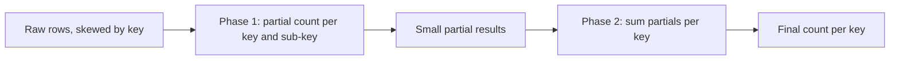

## 🎯 TL;DR

> A **hot key** is a key (a user, a product, a country, a date) that gets far more traffic or data than the others. Partitioning by key sends all of that load to **one** partition, one task or one row, so it becomes the bottleneck of the whole job. This is **skew**.

- Hashing spreads **distinct** keys evenly. It cannot split **one** key.
- The usual fixes split the heavy key into sub-keys (**salting**), aggregate in two phases, or isolate the heavy keys and handle them separately.
- Every fix trades something: ordering, extra shuffle, a merge step, or more complex code.
- Detect it before you fix it: look at partition sizes, task durations and the top keys by count.

## 🌱 Start simple (Junior)

> **💡 Analogy:** A supermarket has ten checkout lanes, and customers choose a lane by the first letter of their surname. If most customers' surnames start with "M", lane M is a queue of 200 people while the other nine lanes are empty. Adding lanes does not help, because the problem is one letter. Giving the "M" customers three temporary lanes does.

In data terms: imagine a click table with 10 million rows for the day. 9.9 million of them come from a single bot, `user_id = 42`. Hash partitioning sends all of `user_id = 42` to one partition:

```text
partition 0:  ~ 100 000 rows   (normal users)
partition 1:  ~ 100 000 rows
...
partition 7:  9 900 000 rows   (user_id = 42)   <- hot key
```

Seven tasks finish in seconds. The eighth runs for an hour. The job waits for it. Your cluster is mostly idle while one core works.

The idea to remember: **distributing keys is not the same as distributing work**. A single key always lands on a single place unless you change the key.

## 🔧 How it really works (Mid)

Systems place data by a key, usually with a hash: `partition = hash(key) % N`. This works when the keys are many and their traffic is similar. It breaks with skewed traffic (a few keys carry most of the load), which is common in real data: popular products, one large customer, a default value such as `NULL` or `"unknown"`, or the current date in a time-based key.

Where it appears:

| System | What becomes hot | Symptom |
|---|---|---|
| Kafka | one key → one partition → one consumer | consumer lag on one partition, others idle |
| Spark | a join or `groupBy` key | one straggler task, long shuffle read on one partition |
| Flink | a keyed operator (`keyBy`) | backpressure on one subtask, growing state on one task |
| Databases | one row or one partition key | lock waits on a counter row, throttling on one shard |

**Spark example.** A `groupBy` on `user_id` where `42` has 9.9 million rows:

```python
from pyspark.sql import functions as F

clicks = spark.table("raw.clicks")  # columns: user_id, click_id, ...
counts = clicks.groupBy("user_id").count()
```

In the Spark UI, the stage that reads this shuffle shows one task with a huge shuffle-read size and a long duration, while the median task is tiny. That gap is the signal. The same happens in joins: one key with millions of matching rows on one side makes one join task do all the work.

**Two-phase aggregation** (also called local-then-global aggregation) is the first fix for aggregates. Each partition first aggregates what it has, which shrinks the hot key's data a lot, and only the small partial results are shuffled and combined:



**Salting** adds a random sub-key so that one logical key becomes `N` physical keys, each handled by a different task:

```python
from pyspark.sql import functions as F

N = 16  # number of salt buckets

salted = clicks.withColumn("salt", (F.rand() * N).cast("int"))

# Phase 1: 16 partial counts for user 42 instead of one huge group
partial = salted.groupBy("user_id", "salt").agg(F.count("*").alias("c"))

# Phase 2: merge the partial counts back to one row per user
final = partial.groupBy("user_id").agg(F.sum("c").alias("clicks"))
```

The result is the same as the plain `groupBy`, but no single task holds all 9.9 million rows of user 42.

**Salting a join** works differently. The big side gets a random salt, and the small side is copied once for every salt value so that every salted key still finds its match:

```python
small_exploded = small.withColumn(
    "salt", F.explode(F.array(*[F.lit(i) for i in range(N)]))
)
big_salted = big.withColumn("salt", (F.rand() * N).cast("int"))
joined = big_salted.join(small_exploded, ["user_id", "salt"])
```

Be careful: the small side is multiplied by `N`. This only pays off when the small side is small. Otherwise you move the problem.

## 🧠 Senior depth & trade-offs

- **Detect first.** Measure the top keys (`GROUP BY key ORDER BY COUNT(*) DESC LIMIT 20`), and check the distribution of partition or task sizes. Do not salt everything "just in case": it adds shuffle and code for no gain.
- **Spark AQE.** Adaptive Query Execution can split skewed partitions of a shuffle join at runtime (its skew-join handling is controlled by `spark.sql.adaptive.skewJoin.*` settings). It helps with big-table-vs-big-table joins on skewed keys, but it has thresholds, and it does not fix a skewed `groupBy` by itself. Check your Spark version's docs for the exact behavior and defaults. See [[spark-aqe]] and [[spark-joins-skew]].
- **Isolate the heavy keys.** When a handful of keys carry most of the data, handle them on their own path: broadcast the small dimension for the hot keys, process them in a separate job, or write them to a dedicated table. The main pipeline then sees a balanced key space. This is often simpler than salting the whole data set.
- **Kafka: ordering is the cost.** Salting `user_id` into `user_id#7` spreads one user's events over several partitions. Per-key ordering is gone, and any consumer that needs the full history of a key must merge across partitions. Use salting on Kafka only when the consumer's logic does not need per-key order, or when you can re-merge by event time downstream. Also remember that adding partitions does not help a single hot key, because the key still maps to one partition.
- **Flink: state is the hot spot.** In a `keyBy`, a hot key sends all its state and all its timers to one subtask. Two-phase or local-global aggregation (Flink SQL does this for some aggregates; check its configuration for your version) reduces the traffic that reaches the keyed operator. Watch checkpoint size per subtask: one fat subtask makes the whole checkpoint slow.
- **Databases: hot rows.** A counter updated by thousands of transactions per second serializes on one row lock. The classic fix is a **sharded counter**: `N` rows per counter, each transaction updates one random row, and reads sum them. Partition-key hotspots in NoSQL stores (DynamoDB, Cassandra, Bigtable) are the same problem at a different layer: choose keys with high cardinality, or add a write-sharding suffix and fan out the reads. Check each store's partition limits in its docs.
- **Cost of each fix.** Salting multiplies the work of the join's small side. Two-phase aggregation adds one shuffle. Isolation adds a second code path that must stay in sync. Choose the cheapest fix that moves the bottleneck, and say which one you chose and why.
- **Monitoring.** Track per-partition lag (Kafka), max-vs-median task duration (Spark), per-subtask backpressure and state size (Flink), and lock wait time (databases). A widening max/median ratio is the early warning.

## 🧪 Try it

Your `events` table has 500 million rows per day. The key `country = 'IR'` holds 40% of them. A job computes `COUNT(*)` per country and joins each row to a `country_dim` table with 200 rows.

1. Explain why adding more executors does not fix this job. Which operation is the bottleneck?
2. Write the SQL (or PySpark) for the per-country count using two-phase aggregation. Use `N = 8` sub-buckets. Keep the output identical to a plain `GROUP BY country`.
3. For the join with the 200-row `country_dim`, which approach would you pick, and why? Would you salt it?

<details><summary>Show solutions</summary>

**1.** The bottleneck is the single task (or partition) that holds all rows for `'IR'`. Hash partitioning places all of them together, so more executors cannot split that group. More executors only help the other tasks finish sooner.

**2.**
```python
from pyspark.sql import functions as F

N = 8
partial = (events
    .withColumn("bucket", (F.rand() * N).cast("int"))
    .groupBy("country", "bucket")
    .agg(F.count("*").alias("c")))

result = partial.groupBy("country").agg(F.sum("c").alias("events"))
```
The output is the same as `events.groupBy("country").count()`, because each row is counted exactly once in exactly one bucket.

**3.** The join is with a 200-row table, so it should be a **broadcast join**: send `country_dim` to every executor and join locally, with no shuffle of the 500 million rows by `country`. Salting is not needed, and it would multiply the 200 rows by `N` for no benefit. Check the join plan in the Spark UI to confirm the broadcast.

</details>

## 💬 Interview corner

> **🎤 Say this in the interview:** "Our Spark job is slow on one task" is a hot-key question. Start with evidence (the top keys and the task duration distribution), then pick the fix.

- **Mid answer:** "I would find the hot key by counting rows per key. For an aggregate, I would use two-phase aggregation, and for a join I would broadcast the small side or salt the big side."
- **Senior answer:** "First I measure: top keys, max versus median task time, and shuffle read per task. If a few keys dominate, I isolate them on a separate path. If they are in a large join, I use AQE skew handling or salt with the smaller side replicated. For Kafka, I would not salt if the consumer needs per-key order. I would check that the fix keeps results identical and watch the max-to-median ratio afterwards."
- **Staff hint:** Discuss the upstream fix, for example a producer that stops sending a default key like `NULL` or `"unknown"` to one partition, and who owns that change.

**Model answer (3–5 sentences):** A hot key sends most of the data to one partition or task, so adding resources does not help. I first confirm it with the top keys and the task duration distribution. For aggregates I use two-phase aggregation, and for joins I use a broadcast if one side is small, or AQE skew handling or salting if both are large. For Kafka I avoid salting when the consumer needs per-key ordering, and I make sure each fix keeps the results identical.

## ⚠️ Common mistakes

- **Adding partitions or executors.** A single key still lands on one partition or task. The fix changes the key distribution, not the size of the cluster.
- **Salting everything.** Salting adds shuffle and complexity. Measure first, and fix only the keys that matter.
- **Forgetting the merge step.** Salted aggregates must be combined in a second phase. Otherwise each salt bucket is output as a separate "user".
- **Replicating the big side by mistake.** Exploding the large table by `N` multiplies its size. Replicate only the small side.
- **Breaking Kafka ordering silently.** Salting a key changes which partition holds each event. Downstream logic that assumed per-key order will break without an error.
- **Ignoring the NULL key.** In joins and group-bys, `NULL` or a default such as `'unknown'` is often the hottest key. It needs an explicit plan.

## ✅ Check yourself (quiz)

1. A Spark stage has 199 tasks that finish in seconds and one task that runs for 40 minutes with 50 times more shuffle read. What is the most likely cause?
   - A) A slow disk on one executor
   - B) A hot key that concentrates data in one partition
   - C) Too few shuffle partitions in total, uniformly
   - D) A broken Spark UI

   <details><summary>Answer</summary>

   **B** — One task with a huge input and everything else small is the signature of skew on a key. A slow disk would be one reason among many; the input-size gap points to the key.

   </details>

2. Why does salting a key improve a `GROUP BY` but not by itself a plain `GROUP BY` without a second phase?
   - A) Salting makes the key smaller
   - B) Salted keys are split into partial results that must be merged; the merge is cheap because the partials are small
   - C) Spark deletes the salt column automatically
   - D) Salting removes the shuffle

   <details><summary>Answer</summary>

   **B** — Phase 1 spreads the hot key over many tasks, and phase 2 merges small partial results. Without the merge you would return one row per salt bucket instead of one per key.

   </details>

3. You join a 500-million-row fact table with a 200-row dimension and see skew on one key. Which change is most appropriate?
   - A) Salt the fact table and explode the dimension by 16
   - B) Broadcast the 200-row dimension to all executors
   - C) Add 500 more executors
   - D) Convert the join to a `UNION`

   <details><summary>Answer</summary>

   **B** — A broadcast join removes the shuffle of the big table, so the hot key no longer forms a single heavy shuffle partition. Salting would be unnecessary here.

   </details>

4. **Senior trade-off:** Kafka consumers of `user_id` need per-user ordering. One user produces 30% of events. What do you do?

   <details><summary>Answer</summary>

   Do not salt the key blindly, because that breaks per-user ordering. Options: use a key that keeps the order that matters (for example a session or sequence key), handle that user on an isolated topic or partition with a consumer that can process it at its own speed, or rate-limit at the producer. Each option has a cost, and the choice depends on which ordering the business actually requires.

   </details>

5. Which metric is the best early warning that a hot key is growing?

   <details><summary>Answer</summary>

   The ratio of the slowest task (or partition, or subtask) to the median. A ratio that keeps growing shows a skewed key before the job misses its SLA. Total job time only shows the problem after it hurts.

   </details>

## 🗂️ Flashcards

| Front | Back |
|---|---|
| Hot key | A key with far more data or traffic than the others, which overloads the one place that owns it |
| Skew | Uneven distribution of data or work across partitions or tasks |
| Salting | Splitting one logical key into N sub-keys so the work spreads across tasks |
| Two-phase aggregation | Partial aggregation per sub-key, then a merge per key; cuts the hot key's shuffle |
| Broadcast join | Copy the small table to every executor; no shuffle of the big table |
| Sharded counter | N rows per counter to avoid one contended row lock |
| Max-to-median task time | The early-warning ratio for skew in a Spark stage |

## 🔗 Go further

- Topic: [[spark-joins-skew]], [[spark-shuffle]], [[spark-ui-debugging]], [[pattern-realtime-aggregation]], [[partitioning-sharding]].
- Glossary: [[hot-key]], [[data-skew]], [[salting]], [[shuffle]], [[broadcast-join]].
- Reference: the Spark SQL performance tuning guide (AQE section) and your store's partitioning and throughput docs for the exact limits of your version.
